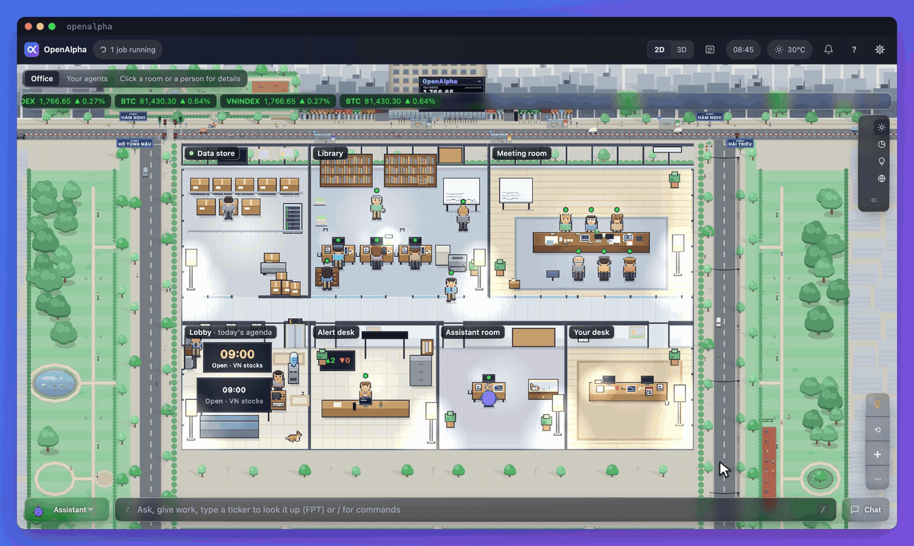

<h1 align="center">OpenAlpha</h1>

<p align="center">
  <strong>An open-source AI investment analyst that runs on your own machine.</strong><br/>
  A council of AI analysts argues before every suggestion; placing the order is still your call.
</p>

<p align="center">
  <strong><a href="README.md">🇻🇳 Tiếng Việt</a></strong> &bull; <strong>🇬🇧 English</strong>
</p>

<p align="center">
  
  
</p>

<p align="center">
  
</p>

You ask about a name, and OpenAlpha gives you a plan back: where to buy, where to stop out, where to take profit, and how much fits the book you hold, with the case for buying next to the case against. It is for individual investors who run their own book and want the reasoning behind a call, not just a ticker.

- **Runs on your machine.** Your book, config and API keys stay local. The AI sees weights only, never a balance, a price paid or your total assets.
- **You approve every order.** It suggests by default. With exchange keys set, every order waits for your confirmation.
- **An AI council debates.** Bull, bear, a synthesizer, a trader, a risk analyst and a fact-checker. Code computes prices and size; the AI handles the *why*.
- **Four markets.** Vietnamese equities (the deepest), crypto, Vietnamese gold, and world gold for reference.

It is an analysis aid, not investment advice. Suggestions can be wrong, and every decision is yours.

<p align="center">
  <a href="https://zalo.me/g/yl7iqyfovvtyosujulea"></a><br/>
  <sub>Stuck on setup, or want release news? Ask in the <a href="https://zalo.me/g/yl7iqyfovvtyosujulea">OpenAlpha Zalo group</a> (in Vietnamese).</sub>
</p>

<p align="center">
  <a href="#quick-start">Quick start</a> · <a href="#the-office-page">The office page</a> · <a href="#see-it-in-action">See it in action</a> · <a href="#safety">Safety</a> · <a href="#documentation">Docs</a> · <a href="#stability-license-and-disclaimer">License</a>
</p>

## Quick start

You need a Mac, a Linux machine or Windows 10/11, and one AI key. The easiest: sign up at [OpenRouter](https://openrouter.ai) and create a key at [openrouter.ai/keys](https://openrouter.ai/keys). Keep it like a password.

Open a terminal (macOS: press ⌘ + Space and type `Terminal`; Windows: open PowerShell from the Start menu), use the one block for your machine, paste each line and press Enter. Anything after `#` is a note:

```bash
curl -fsSL https://raw.githubusercontent.com/alex2loop/openalpha/main/install.sh | sh   # macOS, Linux: install, then open a new terminal
openalpha key set OPENROUTER_API_KEY   # paste the key and press Enter (nothing shows, that's normal); skip if setup saved it
openalpha chat                    # then type /refresh (about 5 minutes), then /suggest FPT
```

```powershell
powershell -c "irm https://raw.githubusercontent.com/alex2loop/openalpha/main/install.ps1 | iex"   # Windows: install, then open a new PowerShell window
openalpha key set OPENROUTER_API_KEY   # paste the key and press Enter (nothing shows, that's normal); skip if setup saved it
openalpha chat                    # then type /refresh (about 5 minutes), then /suggest FPT
```

During install, OpenAlpha asks a few questions: language, the currency of your book, AI model, a daily spending cap, Telegram if you want it. The currency is chosen once; change the rest any time with `openalpha onboard`. To test your AI key, run `openalpha doctor --online`.

### Record the money you have

Every suggestion is sized from your book, so don't skip this. It is only a record on your machine; no money moves. Type these in `openalpha chat` (or Telegram, Zalo):

```text
/setup                                       # pick your risk level and the markets you trade
/record deposit vps 100000000 VND 2026-08-14 # 100 million VND into the VPS account
/suggest FPT                                 # take a deep look at one name
/record buy FPT 100 62000                    # place the order in your VPS app, record it here once it fills
```

Prices are in whole VND: a board price of `62.00` is recorded as `62000`. Crypto, gold, other brokers (SSI, TCBS...) and fixing a row recorded by mistake: [trading guide, the ledger](docs/en/trading.md#the-ledger).

### Run it in the background, get the morning brief

Type `/exit` to leave the chat, then:

```bash
openalpha start --background   # run the daemon; data refreshes itself from here
openalpha autostart enable     # start it at every login
openalpha status               # is it running? openalpha stop stops it
```

Connect Telegram or Zalo ([channels guide](docs/en/channels.md)), then type `/brief enable 08:00` in that chat for a brief before the open.

<details>
<summary><b>Windows, install without questions, updates, uninstall</b></summary>

- **Windows:** no admin rights needed; `openalpha.exe` goes in `%USERPROFILE%\.local\bin`, data in `%USERPROFILE%\.openalpha` (the `~/.openalpha` this guide refers to). If `openalpha` is not recognized, open a new PowerShell window. An ARM machine gets the native ARM build automatically. Vietnamese text shows garbage? Use Windows Terminal.
- **Windows Defender blocks `openalpha.exe`?** The binary is not code-signed, so it is sometimes flagged by mistake. The installer already checked it against the release's `SHA256SUMS`; to check yourself, compare `Get-FileHash "$HOME\.local\bin\openalpha.exe"` with the line for your build on the [Releases](https://github.com/alex2loop/openalpha/releases) page. Only exclude the folder once it matches; don't turn antivirus off.
- **Install without questions:** set `OPENALPHA_NO_ONBOARD=1` and take [config.minimal.en.toml](config.minimal.en.toml) (it needs only an OpenRouter key). The top of [install.sh](install.sh) and [install.ps1](install.ps1) lists every option.
- **Change the model or add a fallback provider:** `openalpha onboard`, or edit `[[models]]` in `config.toml` ([configuration](docs/en/configuration.md#models-required-at-least-one)). `openalpha provider list` lists over 70 providers.
- **Updates:** `openalpha upgrade` takes you to the new release and keeps your data and settings.
- **Uninstall:** `openalpha stop`, then delete the `openalpha` file (in `~/.local/bin` by default). `~/.openalpha` holds your whole book and config; run `openalpha db export --out <folder>` first if you want to keep them.

</details>

## The office page

<p align="center">
  
</p>

The office page is a glass wall into the daemon: your assistant, the research crew and your own agents work in their rooms, and everything that moves is a real run, a real step or a real question waiting for you; nothing is scripted to look busy. Beside it sit your portfolio, suggestions, chat and command box. The page never places an order and never starts an AI run by itself.

To open it, add these two lines to `~/.openalpha/config.toml`:

```toml
[api]
enabled = true
```

then run:

```bash
openalpha restart --background   # the daemon reads the config again (not running yet? openalpha start --background)
openalpha web                    # prints a one-time sign-in link (5 minutes) and opens your browser
```

The desktop app takes the address and token `openalpha connect` prints. What the page shows, how to use it and how to reach it from another machine: [the office page](docs/en/operations.md#the-office-page) · [run the API on a server](docs/en/operations.md#run-the-api-on-a-server).

## See it in action

Type `/suggest FPT` and get a plan back: where to buy, where to stop out, where to take profit and how much to buy.

<p align="center">
  
</p>

Every suggestion also gives the case for buying, the case for waiting, and what would prove it wrong. Here is a real run, trimmed, with the ticker, prices and percentages masked:

```
You:  /suggest XXX

💡 XXX (16/10/2026): BUY, Medium confidence. Buy about 400 XXX (~9,280,000 VND, 4.65% of your portfolio).
  Entry xx.xx · Stop xx.xx (▼ -x.xx%) · Take 33% off at xx.xx (▲ x.xx%) · Far target xx.xx (▲ x.xx%)

🎯 How to manage it
  Don't chase it above xx.xx. Buy 200 XXX first, and add the rest later if the price comes back and holds.
  After fees: if the stop is hit you lose about 737,120 VND (0.37% of your portfolio).

🚩 I am wrong if
  The 2026 report shows operating cash flow below profit.

💬 Debate (3 review steps)
  🐂 Case for buying: cheap on earnings, profit rising, net cash.
  🐻 Case for waiting: profit runs well above its historical average; the last four quarters are unaudited.

This is analysis, not an order - the decision is always yours.
  Once you have traded, paste this: /record buy vps equity-vn:XXX 400 xxxxx VND 2026-10-16
```

### A day with OpenAlpha

https://github.com/user-attachments/assets/46ea9c20-cc72-4bfa-8bb6-272981615802

## Daily use

Most everyday commands work on data already on your machine and never call the AI. The ones that do count against the spending cap you set during install.

| You want | Type | Calls the AI? |
|---|---|---|
| The morning read, before the open | `/brief` · `/brief enable 08:00` | yes |
| A deep read on one name | `/suggest FPT` | yes |
| A question researched, with sources | `/research <question>` | yes |
| Themes forming in Vietnam | `/themes` | yes, at most $1 a run by default |
| Rank a whole market | `/screen equity-vn 20` | no |
| Follow a few names' prices | `/watchlist add FPT HPG` · `/watchlist` | no |
| Load missing data | `/refresh` | no |
| Boards, macro, one price | `/market` · `/overview` · `/price FPT` | no |
| See the book, steer it back to target | `/portfolio` · `/rebalance` | no |
| Find out how past suggestions did | `/reflect` | no |

The figures in this README only illustrate the syntax; they are not trade ideas. Every command: `/help` in chat, or [commands.md](docs/en/commands.md).

## How it works

For every name you ask about, six AI analysts argue it over three rounds. For a Vietnamese stock, a series of checks can each stop the idea. **Not one of them is allowed to write a number.** Entry, stop, target and size are computed in code before the debate even opens.

<p align="center">
  
</p>

The plan is fixed while you are calm, then keeps you on it: a stop only moves up, never down; a weaker market means smaller suggested sizes; you get a message when price reaches a level you set. Each suggestion is tracked until it closes, and `/reflect` shows their real record.

<p align="center"></p>

| Market | Market id | What it brings |
|---|---|---|
| **VN equities** | `equity-vn` | The deepest: foreign and proprietary flow, the disclosure calendar, financial health, and always planned around T+2. |
| **Crypto** | `crypto` | Spot only. Reads the futures market to show how much leverage traders are using. |
| **VN gold** | `gold-vn` | Compared with the world price, so you can tell a real move from a shop widening its spread. Off by default; switch it on with `/profile enable gold-vn`. |
| **World gold** | `gold` | Reference only: its price, and the yardstick for VN gold. |

<p align="center">
  
</p>

You talk to it from the terminal, Telegram, Zalo or the office page. Rather not use an AI key of your own? Connect OpenAlpha to Claude Code, Codex or Cursor over MCP (`openalpha mcp install`) and that app's model does the reasoning ([details](docs/en/dev/extending.md)).

## Safety

- **The AI never sees your money.** The analyst gets weights only.
- **It places no orders on its own.** Without exchange keys the order path does not exist; with them, every order waits for your confirmation, and `/trade halt` blocks every new buy until you type `/trade resume`.
- **Everything stays on your machine.** Keys come from your environment or from `~/.openalpha/env` (readable only by you), and are never printed back.
- **Your book is backed up every day.** While it runs in the background, OpenAlpha copies the book into `~/.openalpha/backups/daily/` and keeps the newest three ([backup and restore](docs/en/storage.md#sqlite-backup-and-restore)).
- **AI spend has a ceiling.** A daily cap is set during install; add a monthly or per-run cap in `[budget]` ([budgets](docs/en/budgets.md)).

Every other safeguard: [safety.md](docs/en/safety.md) · [SECURITY.en.md](SECURITY.en.md).

## Documentation

New here? Start with the [docs index](docs/en/README.md): it points you to the pages for setup, everyday commands and what each number means. No code needed for any of the guides.

| Topic | Page |
|---|---|
| Markets, suggestions, the ledger, the portfolio, placing orders | [trading.md](docs/en/trading.md) |
| Every CLI and chat command | [commands.md](docs/en/commands.md) |
| Every key in `config.toml` | [configuration.md](docs/en/configuration.md) |
| Which data source answers what | [data-sources.md](docs/en/data-sources.md) |
| Your own analysts, skills, choosing models | [agents.md](docs/en/agents.md) |
| Web research with citations | [research.md](docs/en/research.md) |
| Telegram and Zalo | [channels.md](docs/en/channels.md) |
| The daemon, the office page, running on a server | [operations.md](docs/en/operations.md) |
| SDK, MCP and extending | [dev/extending.md](docs/en/dev/extending.md) |

## Contribute to OpenAlpha

OpenAlpha is run by one person today, so every contribution makes a real difference, even if you do not write code.

- **Use it for real, then tell us.** A bug report with the command you ran, what you expected and what you got (and the market): open it on [GitHub Issues](https://github.com/alex2loop/openalpha/issues/new/choose).
- **Docs and wording.** A confusing sentence, a place where Vietnamese and English disagree: fix it in `docs/` or in the two catalogs under `src/i18n/locales/`.
- **Data sources, exchanges, new markets.** Open an issue first for anything structural. Good first steps: issues labelled [good first issue](https://github.com/alex2loop/openalpha/issues?q=is%3Aissue%20state%3Aopen%20label%3A%22good%20first%20issue%22). The directions already ruled out (auto-trading, a backtest harness...): [CONTRIBUTING.en.md](CONTRIBUTING.en.md#things-that-will-be-turned-down).

Run from source:

```bash
git clone https://github.com/alex2loop/openalpha.git && cd openalpha
bun install
bun run dev -- onboard

bun run check       # lint + typecheck + the contract gates
bun run lint:arch   # the architecture gates
```

Both commands must pass before anything lands. Architecture: 16 modules with no cycles, every dependency pointing toward the kernel; 32 gates break the build the moment a boundary does. House rules: [AGENTS.md](AGENTS.md) · [CONTRIBUTING.en.md](CONTRIBUTING.en.md) · [Code of conduct](CODE_OF_CONDUCT.en.md).

### Support and community

- **Setup and usage questions, release news:** the [OpenAlpha Zalo group](https://zalo.me/g/yl7iqyfovvtyosujulea), in Vietnamese. It covers using the software, never which name to buy. Mask your API keys before pasting a config. Admins never message you privately for keys or money.
- **Bugs and feature requests:** [GitHub Issues](https://github.com/alex2loop/openalpha/issues/new/choose).
- **Security vulnerabilities:** report privately per [SECURITY.en.md](SECURITY.en.md), never in the group or an issue.

## Stability, license and disclaimer

**Stability.** This is an early-stage tool that has run live daily for months - so it is sure-footed at the things it does every day, and rough everywhere else. There is no test suite; breaking changes land between versions; and assets cannot yet move between venues.

**License.** MIT, for the code. The name, logo and Bé Alpha are not part of the license: see [NOTICE.en.md](NOTICE.en.md#name-and-logo-are-not-licensed).

**The data is a separate question.** OpenAlpha ships no market data - it reads from each provider at run time, on your machine, and their terms are between you and them. [NOTICE.en.md](NOTICE.en.md) names every host it can reach.

OpenAlpha is a research and bookkeeping assistant. Its suggestions are educational, **can be wrong, and are not financial advice**. It does not know your full circumstances, it places an order only when you approve one, and markets do what they like. You own every decision. Never risk money you cannot afford to lose.
