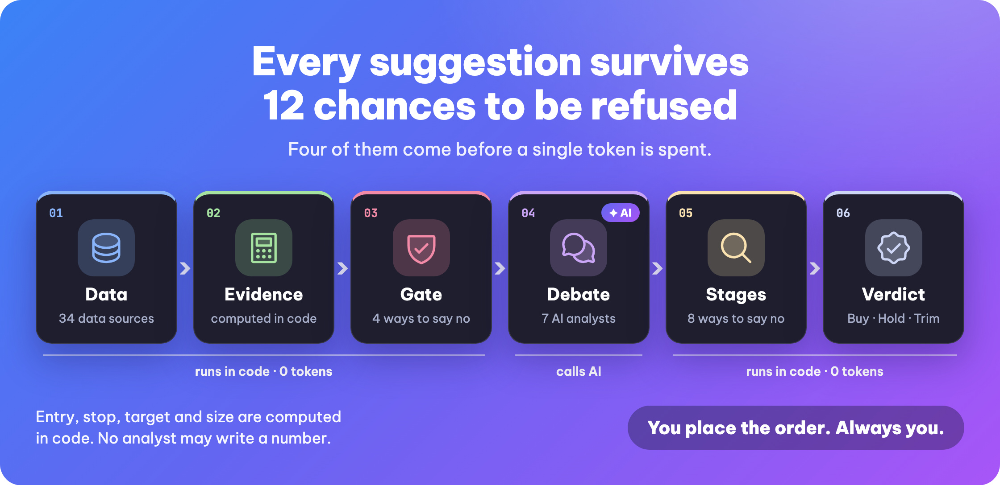
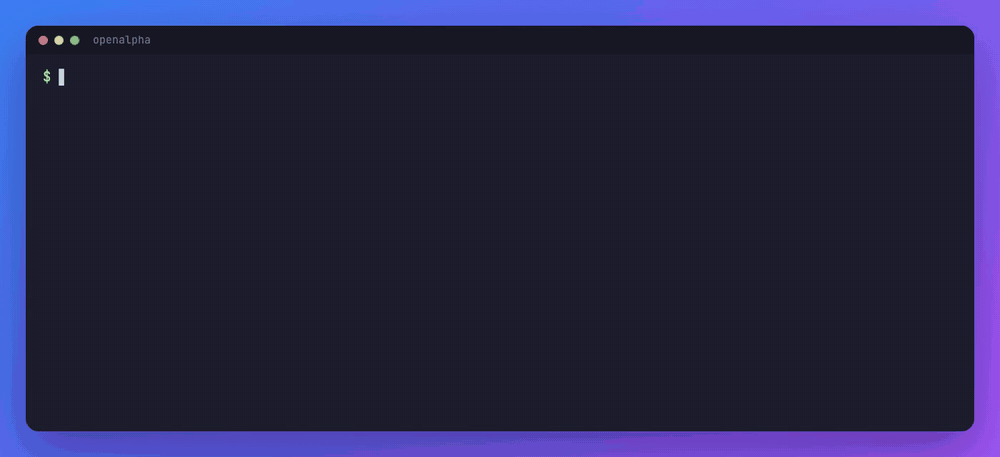
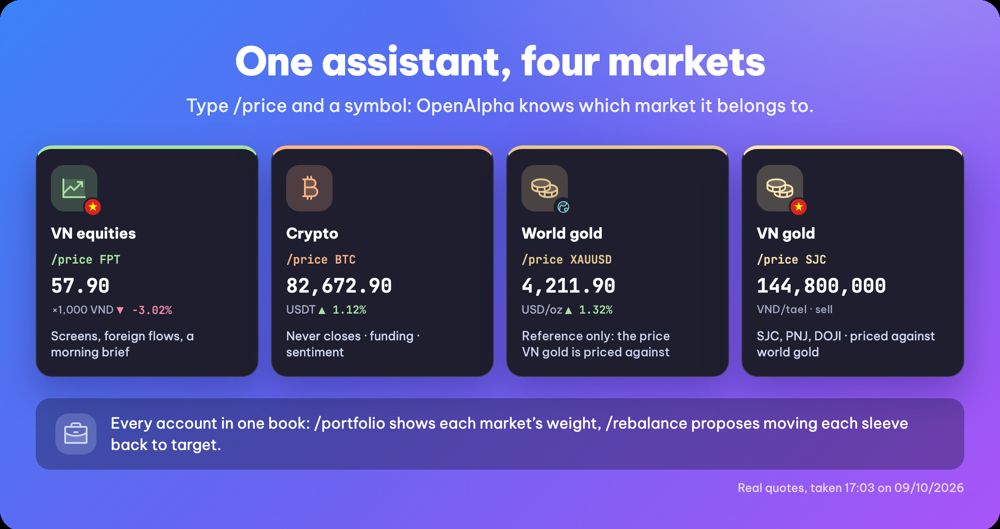
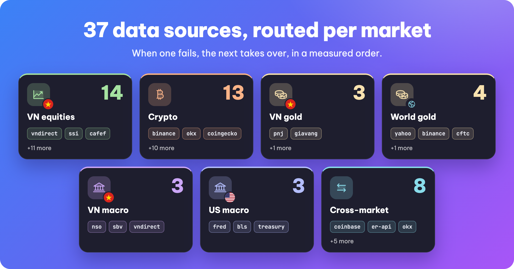
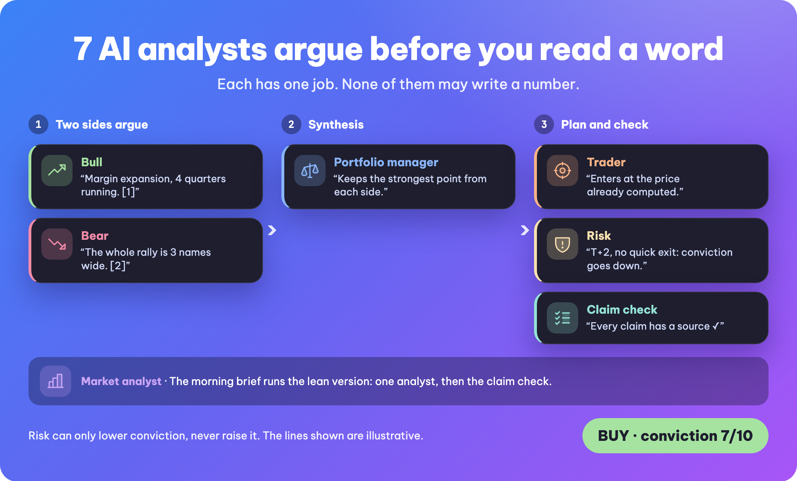
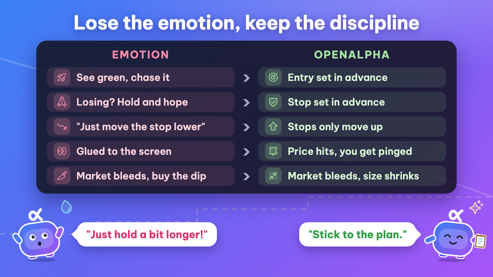

<h1 align="center">OpenAlpha</h1>
<h3 align="center">What if TradingAgents and OpenClaw had a baby? 👀</h3>

<p align="center">
  <strong>A council of AI analysts that argues before every call, like TradingAgents, running on your machine and chatting over Telegram and Zalo, like OpenClaw.<br/>Meet OpenAlpha, an open-source AI investment analyst.</strong>
</p>

<p align="center">
  <strong><a href="README.md">🇻🇳 Tiếng Việt</a></strong> &bull; <strong>🇬🇧 English</strong>
</p>

<p align="center">
  
  
</p>

<p align="center">
  
</p>

<p align="center">
  Every morning before the open, it screens the whole market, picks the few names worth a look, works out how much of each fits the book you hold, and gives you the case for buying next to the case against.<br/>
  Deepest in <strong>Vietnamese equities</strong>, with local data sources, and it follows <strong>crypto</strong> and gold too.<br/>
  <strong>That is where it stops: placing the order is still your call.</strong>
</p>

<p align="center">
  <em>The model can read everything about the name you asked for, except one thing: your money.</em>
</p>

<p align="center">
  <a href="https://zalo.me/g/yl7iqyfovvtyosujulea"></a><br/>
  <sub>Stuck on setup, or want release news? Ask in the <a href="https://zalo.me/g/yl7iqyfovvtyosujulea">OpenAlpha Zalo group</a> (in Vietnamese).</sub>
</p>

---

<p align="center">
  <a href="#see-it-in-action">See it in action</a> · <a href="#quick-start">Quick start</a> · <a href="#why-openalpha">Why and safety</a> · <a href="#documentation">Docs</a> · <a href="#contribute-to-openalpha">Contribute</a> · <a href="#stability-license-and-disclaimer">License</a>
</p>

## See it in action

Type `/suggest FPT` and get a plan back: where to buy, where to stop out, where to take profit and how much to buy.

<p align="center">
  
</p>

### A real run

Beyond the plan, every suggestion gives the case for buying, the case for waiting, and what would prove it wrong. Here is a real run, trimmed, with the ticker and prices masked:

```
You:  /suggest XXX

💡 XXX (16/10/2026): BUY, Medium confidence. Buy about 400 XXX (~9,280,000 VND, 4.65% of your portfolio).
  Entry xx.xx · Stop xx.xx (▼ -7.54%) · Take 33% off at xx.xx (▲ 7.97%) · Far target xx.xx (▲ 23.92%)

🎯 How to manage it
  Don't chase it above xx.xx. Buy 200 XXX first, and add the rest later if the price comes back and holds.
  After fees: if the stop is hit you lose about 737,120 VND (0.37% of your portfolio).

🚩 I am wrong if
  The 2026 report shows operating cash flow below profit.

💬 Debate (3 review steps)
  🐂 Case for buying: cheap on earnings, profit rising, net cash.
  🐻 Case for waiting: profit runs well above its historical average; the last four quarters are unaudited.

This is analysis, not an order - the decision is always yours.
  Once you have traded, paste this: /record buy vps equity-vn:XXX 400 xxxxx VND 2026-10-16
```

### A day with OpenAlpha

https://github.com/user-attachments/assets/46ea9c20-cc72-4bfa-8bb6-272981615802

<p align="center">
  <sub>70 seconds</sub>
</p>

---

## Quick start

All you need is a Mac, a Linux machine or Windows 10/11 (ARM machines need Windows 11), and one AI provider key. [OpenRouter](https://openrouter.ai) has free models too; a paid model usually costs a few dollars a month.

### Try it in 3 commands

```bash
curl -fsSL https://raw.githubusercontent.com/alex2loop/openalpha/main/install.sh | sh   # install, then open a new terminal
export OPENROUTER_API_KEY="..."   # AI key, from openrouter.ai
openalpha chat                    # then type /refresh, and once it finishes, /suggest FPT
```

That is enough to see a suggestion. For one sized to your own money, also do step 4 below.

### Full setup in 5 steps

**1. Install.** One line. It downloads one self-contained binary, then asks a few questions (language, AI model, a daily spending cap, Telegram if you want it). Run `openalpha onboard` any time to change them.

```bash
curl -fsSL https://raw.githubusercontent.com/alex2loop/openalpha/main/install.sh | sh
```

```powershell
powershell -c "irm https://raw.githubusercontent.com/alex2loop/openalpha/main/install.ps1 | iex"   # Windows
```

**2. Save your AI key and check.** `onboard` offers to save it for you; otherwise open a new terminal:

```bash
openalpha key set OPENROUTER_API_KEY   # you type the key hidden; it is kept in ~/.openalpha/env
openalpha doctor --online              # sends the model one short test message
```

`openalpha key` lists which keys are set and where they come from. The same two commands work on Windows.

**3. Load the data and say how much risk you want.** Run `openalpha chat`, then type:

```text
/refresh     # first time: loads symbol lists, prices, statements (free, about 5 minutes)
/setup       # pick your risk level and the markets you trade
```

**4. Record the money you have, for the markets you trade.** Every suggestion is sized from this book, so don't skip it.

<details open>
<summary><b>Vietnamese stocks</b></summary>

```text
/record deposit vps 100000000 VND 2026-08-14              # 100 million VND into the VPS account
/suggest FPT                                              # take a deep look at one name
/record buy FPT 100 62000                                 # place the order yourself, record it once it fills (venue, VND and today filled in)
```

Prices are in whole VND: a board price of `62.00` is recorded as `62000`. Leave the fee out and the book prices it. With another broker (SSI, TCBS, VNDIRECT...), add it to `~/.openalpha/config.toml` with your own fee schedule, then record `ssi` instead of `vps`:

```toml
[trading.venues.ssi]
default_for = ["equity-vn"]                                # VN stocks book at SSI instead of VPS
fees = { buy = 0.0015, sell = 0.0015, sell_tax = 0.001 }
```

With accounts at both VPS and SSI, swap the `default_for` line for `markets = ["equity-vn"]`.

</details>

<details>
<summary><b>Crypto</b></summary>

USDT bought over P2P: add `fx` to the deposit, the rate you actually paid for each USDT. Buys then spend that USDT at that cost, so they take no `fx`:

```text
/record deposit binance 1000 USDT 2026-08-14 fx 26600
/record buy binance crypto:BTC 0.01 60000 USDT 2026-08-14
```

VND paid into the exchange: a USDT buy converts at that day's market rate. The assistant shows you first; if it looks right, type `/record confirm` to record it:

```text
/record deposit binance 26000000 VND 2026-08-14
/record buy binance crypto:BTC 0.01 60000 USDT 2026-08-14
/record confirm
```

- New to crypto? A round trip from USDT deposit to withdrawal, currency moves and checking USDT against the exchange: [trading guide](docs/en/trading.md#foreign-cash-at-a-venue).
- `binance` and `okx` are built in. For another exchange (Bybit, Bitget...), declare it like SSI above, with `markets = ["crypto"]` and `fees = { buy = 0.001, sell = 0.001, fee_asset = "base" }`.
- With Binance or OKX API keys set, `/record sync binance` pulls in your fills, and `/trade` stages an order for you to approve:

```text
/trade spot binance:BTC buy 0.001 limit 60000 tp 70000 sl 56000   # limit buy with take-profit and stop-loss
/trade confirm                                                     # only now does the order reach the exchange
```

</details>

<details>
<summary><b>Vietnamese gold</b></summary>

This segment starts switched off. Switch it on, declare where you buy gold, then record it like a stock:

```text
/profile enable gold-vn
/price SJC                     # today's buy-back, sell price and spread
```

```toml
[trading.venues.sjc]
markets = ["gold-vn"]
fees = { buy = 0, sell = 0 }   # the shop charges no separate fee; the spread is in the price
```

```text
/record deposit sjc 150000000 VND 2026-08-14
/record buy sjc gold-vn:SJC 1 120000000 VND 2026-08-14   # 1 tael
```

Smaller amounts are recorded in taels: 1 chỉ is `0.1`, and the price stays per tael. For ring gold use `gold-vn:PNJ-RING` or `gold-vn:DOJI-RING`. Stop and target are set from the shop's buy-back price, which is what you actually get when you sell.

</details>

To sell: `/record sell vps equity-vn:FPT all 65000 VND 2026-08-20` (`all` sells the whole position, or give a quantity). To withdraw: `/record withdrawal vps 1000000 VND 2026-08-21`. Dates are always year-month-day. Recorded something wrong? `/transactions` shows each row's id, then `/update <id> ...` fixes it or `/delete <id>` shows the row and then `/delete <id> confirm` removes it. Type `/record` on its own to see every kind of row (dividends, splits, transfers...). Config is read at start, so restart afterwards: `openalpha restart --background`.

**5. Turn on the morning brief.** `openalpha start --background` keeps it running (and data refreshes itself); `openalpha autostart enable` starts it at every login. Connect Telegram or Zalo ([channels guide](docs/en/channels.md)), then type `/brief enable 08:00` in that chat. `openalpha status` tells you whether it is running, `openalpha stop` stops it. A few weeks in, `/reflect` shows how the old suggestions did.

<details>
<summary><b>Windows, minimal config, updates, uninstall</b></summary>

- **No admin rights needed.** `openalpha.exe` goes in `%USERPROFILE%\.local\bin`, and that folder is added to your user PATH. If `openalpha` is not recognized, open a new PowerShell window, or run `& "$HOME\.local\bin\openalpha.exe"` directly. Data and config live in `%USERPROFILE%\.openalpha`, the `~/.openalpha` this guide refers to.
- **Windows Defender blocks `openalpha.exe`?** The binary is not code-signed, so it is sometimes flagged by mistake. The installer already checked it against the release's `SHA256SUMS`; to check yourself, run `Get-FileHash "$HOME\.local\bin\openalpha.exe"` and compare it with the line for your build (`openalpha-windows-x64.exe`, or `openalpha-windows-arm64.exe` on ARM) on the [Releases](https://github.com/alex2loop/openalpha/releases) page. If it matches, exclude the folder, in PowerShell run as Administrator: `Add-MpPreference -ExclusionPath "$HOME\.local\bin"`. Don't turn antivirus off.
- **A Windows machine with an ARM chip?** The installer picks the native ARM build, and an older x64 install moves to it when you re-run the install command.
- **Vietnamese text shows garbage?** Use Windows Terminal instead of the old console window. **Prefer WSL2?** The `curl ... | sh` line works there, with its own `~/.openalpha`.
- **Rather not answer questions during install?** Take [config.minimal.en.toml](config.minimal.en.toml): it runs as is with just an OpenRouter key, every line commented. This overwrites an existing `config.toml`:

  ```bash
  curl -fsSL https://raw.githubusercontent.com/alex2loop/openalpha/main/config.minimal.en.toml -o ~/.openalpha/config.toml --create-dirs
  ```

  ```powershell
  New-Item -ItemType Directory -Force "$HOME\.openalpha" | Out-Null; irm https://raw.githubusercontent.com/alex2loop/openalpha/main/config.minimal.en.toml -OutFile "$HOME\.openalpha\config.toml"
  ```

- **Every config option:** [config.sample.toml](config.sample.toml) · [docs/en/configuration.md](docs/en/configuration.md). No AI key? Run a local model through Ollama or vLLM.
- **Installing on a server or in CI?** Set `OPENALPHA_NO_ONBOARD=1` to skip the questions; the top of [install.sh](install.sh) and [install.ps1](install.ps1) lists every option, such as `OPENALPHA_VERSION` to install one exact release.
- **Updates:** the CLI mentions a new release once a day, with what is worth knowing about it; in a private chat the bot mentions it weekly (daily for an important one). `openalpha upgrade` takes you there and keeps your data and settings.
- **Uninstall:** `openalpha stop`, then delete the `openalpha` file (in `~/.local/bin` by default; on Windows `openalpha.exe`, and `openalpha.exe.old` if present). `~/.openalpha` holds your whole book and config: run `openalpha db export --out <folder>` first if you want to keep them.

</details>

### Daily use

Most of what you do every day is **free**: those commands work on data already on your machine and never call the AI. The figures below were measured on 2026-10-15 with cheap models (`gpt-6-luna` for the debate, `claude-haiku-5.5` for research); dearer models cost more, and `[budget]` caps it either way.

| You want | Type | Costs? |
|---|---|---|
| The morning read, before the open | `/brief` · `/brief enable 08:00` | yes: one short read per held or watched name; names already read today are free |
| A deep read on one name | `/suggest FPT` | about $0.01 |
| A question researched, with sources | `/research <question>` | about $0.03 (`quick`) |
| Themes forming in Vietnam | `/themes` | yes, at most $1 a run by default |
| Rank a whole market | `/screen equity-vn 20` | **free** |
| Follow a few names' prices | `/watchlist add FPT HPG` · `/watchlist` | **free** |
| Load missing data for the markets you use (`force`: reload it all) | `/refresh` · `/refresh equity-vn force` | **free** |
| Boards, macro, one price | `/market` · `/overview` · `/price FPT` | **free** |
| See the book, steer it back to target | `/portfolio` · `/rebalance` | **free** |
| How the book has really done, deposits taken out | `/portfolio nav` | **free** |
| Catch the book up to the exchange (needs an exchange API key) | `/record sync okx` · `/reconcile` | **free** |
| Find out how your calls did | `/reflect` | **free** |

The figures in this README only illustrate the syntax; they are not trade ideas. Everything else: `/help` in chat, or [docs/en/commands.md](docs/en/commands.md).

---

## Why OpenAlpha

- **Code does the numbers, the AI explains them.** Entry, stop, target and size are computed in advance; the AI argues why to buy and why to stay away.
- **Discipline, written down in advance.** The plan is fixed while you are calm, then keeps you on it, falling markets included.
- **Deepest in Vietnamese equities.** Local data, official macro figures with the source sentence quoted, and T+2 always accounted for.
- **Every call gets scored.** Each suggestion is tracked until it closes; `/reflect` shows how often it was right, and later calls get less confident when earlier ones missed.

**A good fit if** you run your own book, you want the reasoning behind a call rather than just the ticker, and you want your API keys to stay on your own machine. **A bad fit if** you want a bot that trades by itself, or someone to decide for you. Neither exists here, and that is deliberate.

### Markets and data

<p align="center">
  
</p>

| Market | Market id | What it brings |
|---|---|---|
| **VN equities** | `equity-vn` | The deepest: follows foreign and proprietary flow, the disclosure calendar and financial health, and always plans around T+2. |
| **Crypto** | `crypto` | Spot only. Buys when price clears its recent high, with a stop that moves up behind the price, and reads the futures market to show how much leverage traders are using. |
| **VN gold** | `gold-vn` | Compared with the world price, so you can tell a real move from a shop widening its spread. |
| **World gold** | `gold` | Reference only: its price, and the yardstick for VN gold. |

A bare ticker is usually enough (`/price FPT`). Qualify it only where two markets could claim the same name: `/suggest crypto:UNI`.

<p align="center">
  
</p>

Data lives in SQLite, already on your machine. Over 70 AI providers work, and when one stalls the run moves to the next. Talk to it from the terminal, Telegram, Zalo or Zalo Personal.

From OpenAI, Anthropic, Gemini and DeepSeek to gateways such as OpenRouter or a model on your own machine through Ollama: `openalpha provider list` shows the full list and the name to put in the config ([guide](docs/en/configuration.md)). Paying for ChatGPT already? Sign in with `openalpha auth login`, no key needed. No key at all works too: connect OpenAlpha to Claude Code, Codex or Cursor over MCP and that app's model does the reasoning ([Advanced](#advanced)).

### How it works

For every name you ask about, six AI analysts argue it: bull, bear, a synthesizer, then a trader, a risk analyst and a fact-checker. For a Vietnamese stock, a whole series of checks can each kill the idea. **Not one of them is allowed to write a number.** Entry, stop, target, size - the code has finished all of it before the debate even opens. The model's job is the *why*, and the *what would make this wrong*.

<p align="center">
  
</p>

### Discipline instead of emotion

<p align="center"></p>

**No FOMO, no hoping a loser comes back.** The hard part is rarely knowledge; it is the moment you press the button.

<details>
<summary><b>How it keeps you disciplined, including when the market turns down</b></summary>

- **A stop can only move up, never down.** There is no "just a little lower" button.
- **No need to stare at the price board.** In Telegram or Zalo, set a level with `/alert create FPT above 130` (board price) and you get a message when price reaches it.

**When the market turns down,** the goal is not to call the bottom but to keep enough capital to play the next round:

- **A weaker market means smaller positions.** Each segment's cap tightens and suggested sizes shrink.
- **A cap on the whole portfolio.** Many small positions cannot add up to one big bet.
- **One command stops buying.** With an exchange key set, `/trade halt` blocks every new buy through OpenAlpha until you type `/trade resume`; sells and stops keep working.

</details>

OpenAlpha does not promise you will never lose. It keeps each loss small, planned and known in advance.

### Safety

- **The AI never sees your money.** The analyst gets weights only, never a balance, a price paid or your total assets.
- **It places no orders on its own.** It suggests by default. Without exchange keys the order path does not exist; with them, every order waits for your confirmation.
- **Everything stays on your machine.** The book and the config live locally; Keys come from your environment or from `~/.openalpha/env` (readable only by you). OpenAlpha writes that file only when you type a key into `onboard` or `openalpha key set`, and never prints a key back.
- **AI spend has a ceiling.** `onboard` sets a daily cap; add a monthly or per-run cap in `[budget]`, so a bad loop cannot run up a bill.

Every other safeguard: [SECURITY.en.md](SECURITY.en.md).

---

## Documentation

This section sums up each area. Every topic has a full page in the table at the end.

### Research with receipts

Ask a question that needs fresh outside data, and get back a report where every claim can show where it came from. The model never goes online itself: code searches and fetches the pages first, so the model cannot invent a source, and where evidence is missing the report says so.

**The search provider sets the depth.** The default is DuckDuckGo: free and keyless, but thin, so a question about fresh figures often comes back empty. Set `[web_search]` to Exa, Tavily, Brave, Serper or DeepSeek, the cheapest and strong on Vietnamese sources ([configuration](docs/en/configuration.md)), and the report draws on far more sources.

Details: [docs/en/research.md](docs/en/research.md)

### Advanced

<details>
<summary><b>Your own analysts</b></summary>

Beside the main analyst, you can add analysts of your own, each one a TOML file: a brief, the tools it may use, and a spending cap. Give it a `[focus]` and it becomes a **second opinion** with its own taste. Its calls are scored apart and never touch the stops, alerts or morning brief of your main book:

```bash
openalpha agent add banks      # writes a starter file; `agent edit banks` to change it
```

```toml
system_prompt = "Look only at bank stocks, held long, with a steady dividend."
max_daily_usd = 0.5                 # its own daily cap

[focus]
markets = ["equity-vn"]
sectors = ["banks"]
horizon = "long"

[capabilities]
tools = ["suggestion_run", "suggestion_track_record", "market_screen", "market_price", "market_news"]
```

Ask it with `openalpha chat --agent banks`, or point a Telegram/Zalo chat at it with `/agent banks`. `openalpha agent list` shows how often it has been right and how often it agrees with your other agents; `agent pause banks` switches it off at once, with no restart. Details: [docs/en/agents.md](docs/en/agents.md)

</details>

<details>
<summary><b>Plug into Claude Code, Cursor, VS Code... (MCP)</b></summary>

Run OpenAlpha as an MCP server inside Claude Code, Codex, Cursor, VS Code or Gemini CLI: that app's own model does the thinking, so you need no AI provider key of your own.

```bash
openalpha mcp install      # or --host codex, cursor, vscode, gemini, opencode, zed
```

Suggestions written that way are scored separately in `/reflect` under `client:<model>`, and orders are never placed from there. Details: [docs/en/dev/extending.md](docs/en/dev/extending.md)

</details>

### FAQ

- **What does it cost?** The software is free; you pay only your AI provider, and the [Daily use](#daily-use) table lists the cost of each command. You set a daily spending cap during setup.
- **Do I need a powerful machine?** No. The AI runs at the provider; your machine runs one small binary. Only running a model locally (Ollama) needs real hardware.
- **Can I use it without coding?** Yes. You paste a few commands into a terminal once; after that you ask in plain language, or chat over Telegram or Zalo.
- **Can I trust the suggestions?** They can be wrong, and it does not hide that: `/reflect` shows the real record of every past call.

### Full reference

| Topic | Page |
|---|---|
| Markets, suggestions, the ledger, the portfolio, placing orders | [trading.md](docs/en/trading.md) |
| Every CLI and chat command | [commands.md](docs/en/commands.md) |
| Every key in `config.toml` | [configuration.md](docs/en/configuration.md) |
| Which data source answers what | [data-sources.md](docs/en/data-sources.md) |
| AI integration: your own analysts, skills, choosing models | [agents.md](docs/en/agents.md) |
| Web research with citations | [research.md](docs/en/research.md) |
| Telegram and Zalo | [channels.md](docs/en/channels.md) |
| Approvals and safeguards | [safety.md](docs/en/safety.md) |
| Budgets, background operation, storage | [budgets.md](docs/en/budgets.md) · [operations.md](docs/en/operations.md) · [storage.md](docs/en/storage.md) |
| SDK, MCP and extending | [dev/extending.md](docs/en/dev/extending.md) |

---

## Contribute to OpenAlpha

OpenAlpha is open source and run by one person today, so every contribution makes a real difference. You do not need to write code to help.

- **Use it for real, then tell us.** A bug report with the command you ran, what you expected and what you got (and the market) beats any compliment. Open it on [GitHub Issues](https://github.com/alex2loop/openalpha/issues/new/choose).
- **Docs and wording.** A confusing sentence, a term that is off, a place where Vietnamese and English disagree: fix it in `docs/` or in the two catalogs under `src/i18n/locales/`.
- **Data sources, exchanges, brokers, new markets.** Each is a local change: one adapter, one registration line and the locale keys. Open an issue first for anything structural.
- **Agents and skills.** An analyst of your own is one TOML file; a plugin data source is one `sources.ts`.

**Good first steps:** issues labelled [good first issue](https://github.com/alex2loop/openalpha/issues?q=is%3Aissue%20state%3Aopen%20label%3A%22good%20first%20issue%22). **Roadmap:** there is no separate page yet; planned work and new ideas are discussed in [Issues](https://github.com/alex2loop/openalpha/issues). The directions already ruled out (auto-trading, a backtest harness...) are in [CONTRIBUTING.en.md](CONTRIBUTING.en.md#things-that-will-be-turned-down), with the reasons.

### Run from source

```bash
git clone https://github.com/alex2loop/openalpha.git && cd openalpha
bun install
bun run dev -- onboard

bun run check       # lint + typecheck + the contract gates
bun run lint:arch   # the architecture gates
```

Both commands must pass before anything lands. House rules and the business invariants: [AGENTS.md](AGENTS.md). A clone updates with `git pull`.

Architecture: 15 modules with no cycles, every dependency pointing toward the kernel; 30 gates break the build the moment a boundary does. Contributing: [CONTRIBUTING.en.md](CONTRIBUTING.en.md) · [Code of conduct](CODE_OF_CONDUCT.en.md).

### Support and community

- **Setup and usage questions, release news:** the [OpenAlpha Zalo group](https://zalo.me/g/yl7iqyfovvtyosujulea), in Vietnamese. It covers using the software, never which name to buy. Mask your API keys before pasting a config. Admins never message you privately for keys or money.
- **Bugs and feature requests:** [GitHub Issues](https://github.com/alex2loop/openalpha/issues/new/choose). A bug is tracked only once it has an issue.
- **Security vulnerabilities:** report privately per [SECURITY.en.md](SECURITY.en.md), never in the group or an issue.

Find it useful? Give the repo a ⭐ so more people find it.

---

## Stability, license and disclaimer

**Stability.** This is an early-stage tool that has run live daily for months - so it is sure-footed at the things it does every day, and rough everywhere else. There is no test suite; breaking changes land between versions; and assets cannot yet move between venues.

**License.** MIT, for the code. Use it however you want. The name, logo and Bé Alpha are not part of the license: see [NOTICE.en.md](NOTICE.en.md#name-and-logo-are-not-licensed).

**The data is a separate question.** OpenAlpha ships no market data - it reads from each provider at run time, on your machine, and their terms are between you and them. [NOTICE.en.md](NOTICE.en.md) names every host it can reach and what to check before you point it at one.

OpenAlpha is a research and bookkeeping assistant. Its suggestions are educational, **can be wrong, and are not financial advice**. It does not know your full circumstances, it places an order only when you approve one, and markets do what they like. You own every decision. Never risk money you cannot afford to lose.
