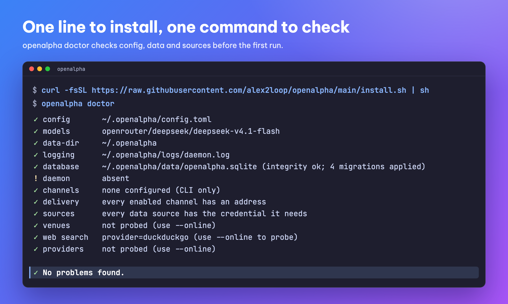

<h1 align="center">OpenAlpha</h1>
<h3 align="center">Seven analysts. Twelve stages. Zero orders placed without you.</h3>

<p align="center">
  <strong><a href="README.md">🇻🇳 Tiếng Việt</a></strong> &bull; <strong>🇬🇧 English</strong>
</p>

<p align="center">
  A self-hosted AI analyst for people who run their own book. Deepest in <strong>Vietnamese equities</strong>, with nine local data sources, then <strong>crypto</strong> and gold.<br/>
  Every morning before the open, it screens the whole market, picks the few names worth a look, works out how much of each fits the book you hold, and gives the case for buying next to the case against.<br/>
  <strong>That is where it stops. Placing the order is your job, and only yours.</strong>
</p>

<p align="center">
  
  
  
  
  
  
</p>

<p align="center">
  
</p>

https://github.com/user-attachments/assets/4a550977-b39b-4c5f-8afe-466152f545b8

<p align="center">
  <sub>An office worker's day (70 s)</sub>
</p>

<p align="center">
  <em>The model can read everything about the name you asked for, except one thing: your money.</em>
</p>

---

## Ask once, get this back

Every buy decision comes down to two questions: is this name worth buying, and what is that advice based on?

An illustrative example, ticker and prices masked:

```
You:  /suggest XXX

XXX - BUY - conviction 7/10
Trend intact; foreign flow turned net buyer 3 sessions running.
Entry xx.xxx · stop xx.xxx · take 33% at xx.xxx · target xx.xxx · R:R 1,6
Sized to 6,0% NAV - 4,2% of your risk budget, under the 25% sleeve cap.

Bull: margin expansion, 4 quarters running.
Bear: the whole rally is 3 names wide; breadth has not confirmed.
Risk: T+2 means you cannot exit before Thursday.

Suggestion only. Place it yourself, then /record so the book stays honest.
```

Seven analysts argued this name. Twelve stages all had the power to kill it. **Not one of them was allowed to write a number.** Entry, stop, target, size - the code had finished all of it before the debate even opened. The model's job is the *why*, and the *what would make this wrong*.

<p align="center">
  
</p>

**A good fit if** you run your own book, you want the reasoning behind a call rather than just the ticker, and you want your API keys to stay on your own machine. **A bad fit if** you want a bot that trades by itself, or someone to decide for you. Neither exists here, and that is deliberate.

---

## Discipline instead of emotion

<p align="center"></p>

**No FOMO, no hoping a loser comes back.** The hard part is rarely knowledge; it is the moment you press the button. OpenAlpha fixes the plan while you are calm, then keeps you on it.

- **Numbers set in advance, no haggling mid-trade.** Entry, stop, take-profit and size are computed by code, and the AI cannot change them.
- **A stop can only move up, never down.** There is no "just a little lower" button.
- **No need to stare at the price board.** Set a level with `/alert` and you get a message when price reaches it.
- **Every wrong call is recorded, and the next one is less sure of itself.** The record in `/reflect` caps how confident later suggestions may be.

**When the market turns down,** the goal is not to call the bottom but to keep enough capital to play the next round:

- **A weaker market means smaller positions.** Each asset group's cap tightens and suggested sizes shrink.
- **A cap on the whole portfolio.** Many small positions cannot add up to one big bet.
- **One command stops buying.** `/trade halt` blocks every new buy through OpenAlpha until you type `/trade resume`; sells and stops keep working. Without an exchange key OpenAlpha places no orders at all: `/trade` then only names the keys to set.

OpenAlpha does not promise you will never lose. It keeps each loss small, planned and known in advance.

---

## Markets and data

<p align="center">
  
</p>

| Market | `market:` | What it brings |
|---|---|---|
| **VN equities** | `equity-vn` | The deepest market: 7 factors (plus 2 for ETFs), nine local sources. Follows foreign and proprietary flow, marks distribution sessions, reads the disclosure calendar, checks financial health, and always plans around T+2 - what you buy this morning, you cannot sell this afternoon. |
| **Crypto** | `crypto` | Spot only, 5 factors. Funding rates and long/short crowding are read from the perpetual futures market, so you can see where the leverage is sitting before you join it. Enters when price clears its recent high (a Donchian breakout), leaves on a Turtle-style trailing stop. |
| **VN gold** | `gold-vn` | Local dealer prices are compared with the world price, so you can tell when gold is really moving and when the shop is just widening its spread. The calendar includes Saturdays, since those counters still quote that day. |
| **World gold** | `gold` | 7 macro factors: real rates, the dollar, the gold-silver ratio, official demand, inflation, the safe-haven bid, and trend. Reference only: no venue trades it, so it is there for its price and as the yardstick VN gold is measured against. |

A bare ticker is usually enough (`/price FPT`). Qualify it only where two markets could claim the same name: `/suggest crypto:UNI`.

<p align="center">
  
</p>

| | |
|---|---|
| **20 factors** | Every score is arithmetic, and each factor publishes its share of the call - so you can see which one carried it. |
| **56 tools** | 23 core agent tools plus 33 trading tools (2 of them only with an exchange key). MCP servers plug in alongside. |
| **73 LLM providers** | 38 model aliases over five transports. When a provider stalls, the run moves on to the next one. |
| **4 surfaces** | CLI, Telegram, Zalo, Zalo Personal. |
| **Two languages** | 3,276 hand-written strings in English and Vietnamese. A VN stock price shows in thousands of đồng, as on the trading board. |
| **Storage** | SQLite by default, already on your machine. PostgreSQL when you want it. |
| **Architecture** | 15 modules with no cycles, every dependency pointing toward the kernel. 30 gates break the build the moment a boundary does. |

**Fixed every run:** factor scores, entry, stop, target, size, every cap - all from code, reproducing exactly. **Varies:** the debate itself.

---

## 16 safety systems

Two things can hurt you here: **the money** and **the machine**. Every layer below is enforced in code rather than asked for in a prompt - because a prompt is only a request and code is a guarantee.

**The money (7).** Two layers decide how large a position is allowed to get: a cap on open risk across the whole book, and a cap per asset group that tightens as the market turns worse. One layer protects the exit: stops trail up and never down. Three layers govern what reaches an exchange and what gets recorded afterwards: it suggests by default, orders go to the exchange one at a time, and the ledger is the single source of truth. The seventh is a daily and monthly cost cap, so a bad loop cannot run up a bill.

**The machine (9).** Two layers sit around the loop itself: approval gates, and loop detection for a run that stops making progress. Four guard what comes in: prompt-injection scanning, SSRF protection, limits on file paths, and chat channels that refuse strangers by default. Two guard what goes back out and what gets to run: secrets are scrubbed from anything leaving the process, and a plugin runs code only when you allow it.

**And the 16th:** the model never sees your money. A persona gets a weight, a count of open lots and the date of the first buy; for a sold name, only whether it made or lost money, never how much - never a quantity, a price paid, a cash balance or your total assets. The code the agent uses to read your portfolio has no function that returns an amount, so it *cannot* ask for one - the figures are not just filtered out.

Credentials come from the environment only, and without exchange keys the order path is never built. Details: [SECURITY.en.md](SECURITY.en.md).

---

## Getting started, step by step

You need a Mac, a Linux machine or Windows 10/11, and one AI provider key. [OpenRouter](https://openrouter.ai) has free models too; a paid model usually costs a few dollars a month.

**1. Install.** One line. It downloads one self-contained binary (nothing else to install), then walks you through a short setup (language, AI provider and model, a daily spending cap, and Telegram if you want it) and saves it to `~/.openalpha/config.toml`. When your key is already set, it sends the model a test message so you know it works. Run `openalpha onboard` again any time to change one part.

```bash
curl -fsSL https://raw.githubusercontent.com/alex2loop/openalpha/main/install.sh | sh
```

On Windows, open PowerShell and run:

```powershell
powershell -c "irm https://raw.githubusercontent.com/alex2loop/openalpha/main/install.ps1 | iex"
```

<details>
<summary><b>Notes for Windows</b></summary>

- **No admin rights needed.** `openalpha.exe` goes to `%USERPROFILE%\.local\bin`, and that folder is added to your user PATH. If `openalpha` is not recognized, open a new PowerShell window, or run it directly with `& "$HOME\.local\bin\openalpha.exe"`.
- **Your data and config** live in `%USERPROFILE%\.openalpha`, which is the `~/.openalpha` this guide refers to.
- **Install options** are environment variables set just before the command, for example to install one exact release: `$env:OPENALPHA_VERSION="v1.0.3"; irm https://raw.githubusercontent.com/alex2loop/openalpha/main/install.ps1 | iex`. The top of [install.ps1](install.ps1) lists them all. The `powershell -c "..."` line above works from both PowerShell and CMD.
- **Windows Defender or your antivirus blocks `openalpha.exe`?** The binary is not code-signed, so it is sometimes flagged by mistake. The installer already checked it against the release's `SHA256SUMS`; to check it yourself, run `Get-FileHash "$HOME\.local\bin\openalpha.exe"` and compare it with the `openalpha-windows-x64.exe` line of `SHA256SUMS` on the [Releases](https://github.com/alex2loop/openalpha/releases) page. If it matches, exclude the folder rather than the file (the hash changes with every release), from PowerShell run as Administrator: `Add-MpPreference -ExclusionPath "$HOME\.local\bin"`. Don't turn your antivirus off.
- **Vietnamese text shows as garbage?** Use Windows Terminal (built into Windows 11) instead of the old console window.
- **Running in the background:** `openalpha start --background` runs until you `openalpha stop` or shut down; after a restart, run it again.
- **Prefer WSL2?** The Linux `curl ... | sh` line above works there. A WSL install keeps its own `~/.openalpha`, separate from the Windows one.
- **Uninstall:** run `openalpha stop`, then delete `openalpha.exe` from `%USERPROFILE%\.local\bin` (and `openalpha.exe.old` if present, the previous version `openalpha upgrade` leaves behind). Keep that folder on your PATH, since other tools may live there too. Delete `%USERPROFILE%\.openalpha` only when you no longer want your book and config; run `openalpha db export --out <folder>` first to keep them.

</details>

Rather skip the setup questions? Take [config.minimal.toml](config.minimal.toml) instead: a working config that needs only an OpenRouter key, with every line commented (in Vietnamese). This overwrites any `config.toml` you already have.

```bash
curl -fsSL https://raw.githubusercontent.com/alex2loop/openalpha/main/config.minimal.toml -o ~/.openalpha/config.toml --create-dirs
```

```powershell
New-Item -ItemType Directory -Force "$HOME\.openalpha" | Out-Null; irm https://raw.githubusercontent.com/alex2loop/openalpha/main/config.minimal.toml -OutFile "$HOME\.openalpha\config.toml"
```

**2. Set your AI key and check.** Open a new terminal and put the key in the environment variable you chose during setup:

```bash
export OPENROUTER_API_KEY="..."   # the key lives in your environment, never in a file
openalpha doctor --online   # also sends the model one short test message
```

`export` keeps the key in that terminal window only. For every terminal and the background brief to see it, add the same `export` line to the end of `~/.zshrc` (macOS) or `~/.bashrc` (Linux). On Windows, in PowerShell:

```powershell
$env:OPENROUTER_API_KEY="..."; setx OPENROUTER_API_KEY "..."   # works now, and in every later terminal
openalpha doctor
```

<p align="center">
  
</p>

**3. Open the chat and say how much risk you want.** Run `openalpha chat` and type `/setup`. The assistant asks how much risk you can take and whether you trade VN stocks, crypto or both, switches off what you don't trade, and proposes a starting allocation. To set it yourself: `/profile set risk-level balanced`, `/profile disable crypto`. A new profile starts with VN stocks and crypto switched on; refreshes and the morning brief skip a sleeve that is off. To follow Vietnamese gold, `/profile enable gold-vn`.

**4. Record the money you have.** Every suggestion is sized from this book, so don't skip it:

```text
/record deposit vps 100000000 VND 2026-08-14   # 100 million VND into the VPS account
```

**5. Load the data, then look around for free.** A fresh install has no data yet, so type `/refresh` first: it loads the symbol lists, prices, fundamentals and annual statements for the last closed session. Then `/screen equity-vn 20` ranks the whole market, `/price FPT` shows a price, `/watchlist add FPT HPG BTC` keeps names in view.

**6. Take a deep look at one name.** `/suggest FPT` gives you a suggestion like the example above.

**7. Place the order yourself, then record it.** You trade at your broker as usual. Once it fills, record it (leave the fee out and the book prices it):

```text
/record buy vps equity-vn:FPT 100 62000 VND 2026-08-14
```

**8. Turn on the morning brief.** `openalpha start --background` keeps it running (and the data then refreshes itself). The brief is sent over Telegram or Zalo, so connect one first ([channels guide](docs/en/channels.md)), then type `/brief enable 08:00` in that chat. In the terminal, `/brief` reads it any time. `openalpha status` tells you whether it is running, and `openalpha stop` stops it.

**9. A few weeks in, see how the calls did.** `/reflect` puts each old suggestion next to what actually happened.

Installing on a server or in CI? Set `OPENALPHA_NO_ONBOARD=1` to skip the model setup; the top of [install.sh](install.sh) lists every option. When a new release lands the CLI mentions it once a day; `openalpha upgrade` takes you there and keeps your data and settings. To uninstall: `openalpha stop`, then delete the `openalpha` file (in `~/.local/bin` by default) and the `~/.openalpha` folder. That folder holds your whole book and config, so run `openalpha db export --out <folder>` first if you want to keep them.

---

## Configuration

Setup already wrote `~/.openalpha/config.toml`. To edit it by hand, a model and a key are enough:

```toml
[[models]]
provider    = "openrouter"
model       = "deepseek/deepseek-v4.1-flash"
api_key_env = "OPENROUTER_API_KEY"

[budget]
max_daily_usd = 5                   # a brake on spend
```

No AI key? Run a local model through Ollama or vLLM. Exchange keys (`OKX_*`, `BINANCE_*`) matter only if you want OpenAlpha to place orders. A minimal working file (commented in Vietnamese): [config.minimal.toml](config.minimal.toml). Everything else: [config.sample.toml](config.sample.toml) · [docs/en/configuration.md](docs/en/configuration.md)

---

## Daily use

Most of what you do every day is **free**: those commands work on data already on your machine and never call the AI. The figures below were measured on 2026-10-15 with cheap models (`gpt-6-luna` for the debate, `claude-haiku-5.5` for research); dearer models cost more, and `[budget]` caps it either way.

| You want | Type | Costs? |
|---|---|---|
| The morning read, before the open | `/brief` · `/brief enable 08:00` | yes: one short read per held or watched name; names already read today are free |
| A deep read on one name | `/suggest FPT` | about $0.01 |
| A question researched, with sources | `/research <question>` | about $0.03 (`quick`) |
| Themes forming in Vietnam | `/themes` | yes, at most $1 a run by default |
| Rank a whole market | `/screen equity-vn 20` | **free** |
| Load missing data for the markets you use (`force`: reload it all) | `/refresh` · `/refresh equity-vn force` | **free** |
| Boards, macro, one price | `/market` · `/overview` · `/price FPT` | **free** |
| See the book, steer it back to target | `/portfolio` · `/rebalance` | **free** |
| How the book has really done, deposits taken out | `/portfolio nav` | **free** |
| Record deposits, withdrawals, buys, sells | `/record` | **free** |
| Catch the book up to the exchange (needs an exchange API key) | `/record sync okx` · `/reconcile` | **free** |
| Find out how your calls did | `/reflect` | **free** |
| Place a trade, deliberately (needs an exchange API key) | `/trade` then `/trade confirm` | - |

**Place a crypto order at the exchange** (needs an OKX or Binance API key). The order is only staged; nothing goes out until you confirm:

```text
/trade spot binance:BTC buy 0.001 limit 60000 tp 70000 sl 56000   # limit buy with take-profit and stop-loss
/trade confirm                                                     # send the staged order
```

VN stocks default to the venue `vps`; with another broker, declare it in `[trading.venues.<name>]` ([configuration](docs/en/configuration.md#trading)). The figures above only illustrate the syntax; they are not trade ideas. Everything else: `/help` in chat, or [docs/en/commands.md](docs/en/commands.md).

---

## Research with receipts

Ask a question that needs fresh outside data, and get back a report where every claim can show where it came from. A real run, trimmed and translated from Vietnamese:

```
You:  /research quick What did FPT earn in the first nine months of 2026 against its
      full-year plan, and what do brokers forecast for the year?

1 search · 8 pages read
5 sources used · 5 claims with evidence
⚠️ 1 evidence issue
  • A claim did not find enough supporting sources. ×1
✓ Completed with gaps · Evidence level: partial

Answer: The sources found have no nine-month 2026 profit figure for FPT, so its
share of the full-year plan cannot be worked out yet. The latest figure covers
eight months.

Eight months of 2026 (per HSC, August 2026):
- Net profit VND 6,761 bn, up 13.8% year on year.
- 63.8% of HSC's own full-year forecast, not FPT's official plan.

Brokers' full-year 2026 forecasts:
- BSC (Buy, target price VND 90,600): net profit to parent VND 10,670 bn, up 14%.
- BVSC: net profit VND 10,716 bn, up 14.3%.
- AAS (24HMoney, 1 Oct 2026): net profit VND 10,553 bn, up 12.6%; pre-tax
  profit VND 11,909 bn, 102% of plan.

Takeaway: most forecasts point to FPT meeting or slightly beating its 2026 profit
plan. These figures are forecasts, not results.

$0.0309 · 47 s
```

- **The model never touches the network.** Code searches and fetches first, and the model reads only what code collected, so it cannot invent a source.
- **Quotes are checked word for word.** A claim must rest on an excerpt that is really on the fetched page; a quote that does not match, or a claim short of sources, is flagged like the ⚠️ line above.
- **A forecast stays a forecast.** Price targets, estimates and company guidance are marked and presented as someone's forecast, never as an outcome.
- **Missing means missing.** With no nine-month figure, the report says so and gives the latest eight-month one instead of guessing. Two sources that disagree on a number are reported as a conflict.
- **Three depths:** `quick`, `standard` (the default) and `thorough`, where you see and can edit the research plan once before it runs.
- **The search provider sets the depth.** The default is DuckDuckGo: free and keyless, but thin, so a question about fresh figures often comes back empty. Set `[web_search]` to Exa, Tavily, Brave or Serper ([configuration](docs/en/configuration.md)) and the report draws on far more sources.

Details: [docs/en/research.md](docs/en/research.md)

---

## Your own analysts

Beside the main analyst, you can add analysts of your own, each one a TOML file: a brief, the tools it may use, and a spending cap. Give it a `[focus]` and it becomes a **second opinion** with its own taste. Its calls are scored apart and never touch the stops, alerts or morning brief of your main book:

```bash
openalpha agent add banks      # writes a starter file; `agent edit banks` to change it
```

```toml
system_prompt = "Look only at bank stocks, held long, with a steady dividend."
max_daily_usd = 0.5                 # its own daily cap

[focus]
markets = ["equity-vn"]
sectors = ["banks"]
horizon = "long"

[capabilities]
tools = ["suggestion_run", "suggestion_track_record", "market_screen", "market_price", "market_news"]
```

Ask it with `openalpha chat --agent banks`, or point a Telegram/Zalo chat at it with `/agent banks`. `openalpha agent list` shows how often it has been right and how often it agrees with your other agents; `agent pause` switches it off at once, with no restart. Details: [docs/en/agents.md](docs/en/agents.md)

---

## Embed it, or plug it into another AI app

The runtime is an SDK as well as a binary. Embed it from a clone of this repo; the package is not published to npm:

```ts
import { boot } from '@openalpha/runtime/app'
const { app, dispose } = await boot({
  mode: 'cli',
  env: process.env,
  configPath: './config.toml',
  shutdownSignal: AbortSignal.timeout(60_000),
  tools: [],
  agents: [],
})
```

Or plug it into Claude Code, Codex, Cursor, VS Code or Gemini CLI as an MCP server, and that app's own model does the thinking - no AI provider key of your own required:

```bash
openalpha mcp install      # or --host codex, cursor, vscode, gemini, opencode, zed
```

Suggestions written that way are scored separately in `/reflect` under `client:<model>`, and orders are never placed from there. Details: [docs/en/dev/extending.md](docs/en/dev/extending.md)

---

## Questions and support

- **Setup and usage questions, release news:** the [OpenAlpha Zalo group](https://zalo.me/g/yl7iqyfovvtyosujulea), in Vietnamese. It covers using the software, never which name to buy. Mask your API keys before pasting a config. Admins never message you privately for keys or money.
- **Bugs and feature requests:** [GitHub Issues](https://github.com/alex2loop/openalpha/issues/new/choose). A bug is tracked only once it has an issue.
- **Security vulnerabilities:** report privately per [SECURITY.en.md](SECURITY.en.md), never in the group or an issue.

---

## Development

```bash
git clone https://github.com/alex2loop/openalpha.git && cd openalpha
bun install
bun run dev -- onboard

bun run check       # lint + typecheck + the contract gates
bun run lint:arch   # the architecture gates
```

Both commands must pass before anything lands. House rules and the business invariants: [AGENTS.md](AGENTS.md). A clone updates with `git pull`.

Bug reports and ideas: [GitHub Issues](https://github.com/alex2loop/openalpha/issues) · [CONTRIBUTING.en.md](CONTRIBUTING.en.md) · [Code of conduct](CODE_OF_CONDUCT.en.md). Security vulnerabilities go privately via [SECURITY.en.md](SECURITY.en.md).

**Straight talk about stability.** This is the first public release of a tool that has run live daily for months - so it is sure-footed at the things it does every day, and rough everywhere else. There is no test suite; the database is reset on schema changes; breaking changes land between versions; and assets cannot yet move between venues.

---

## License and disclaimer

MIT, for the code. Use it however you want. The name, logo and Bé Alpha are not part of the license:
see [NOTICE.en.md](NOTICE.en.md#name-and-logo-are-not-licensed). Found a vulnerability? Report it
privately via [SECURITY.en.md](SECURITY.en.md).

**The data is a separate question.** OpenAlpha ships no market data - it reads from each provider at
run time, on your machine, and their terms are between you and them. [NOTICE.en.md](NOTICE.en.md) names
every host it can reach and what to check before you point it at one.

OpenAlpha is a research and bookkeeping assistant. Its suggestions are educational, **can be wrong, and are not financial advice**. It does not know your full circumstances, it places an order only when you approve one, and markets do what they like. You own every decision. Never risk money you cannot afford to lose.
