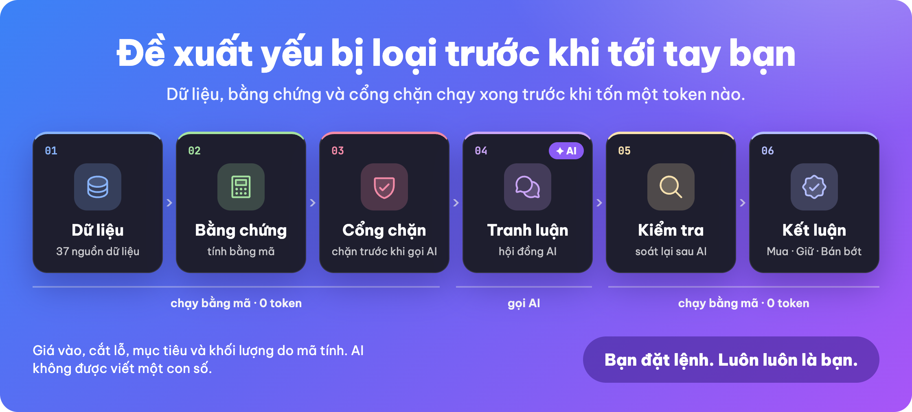
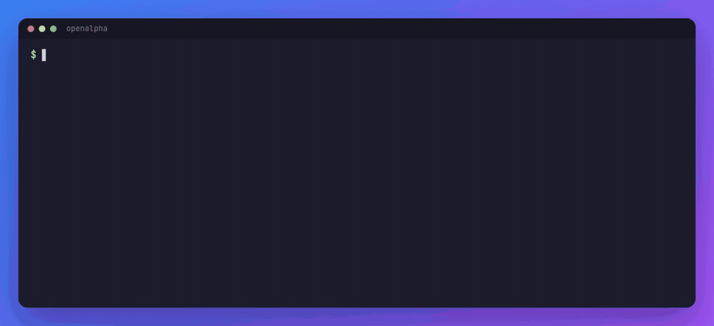
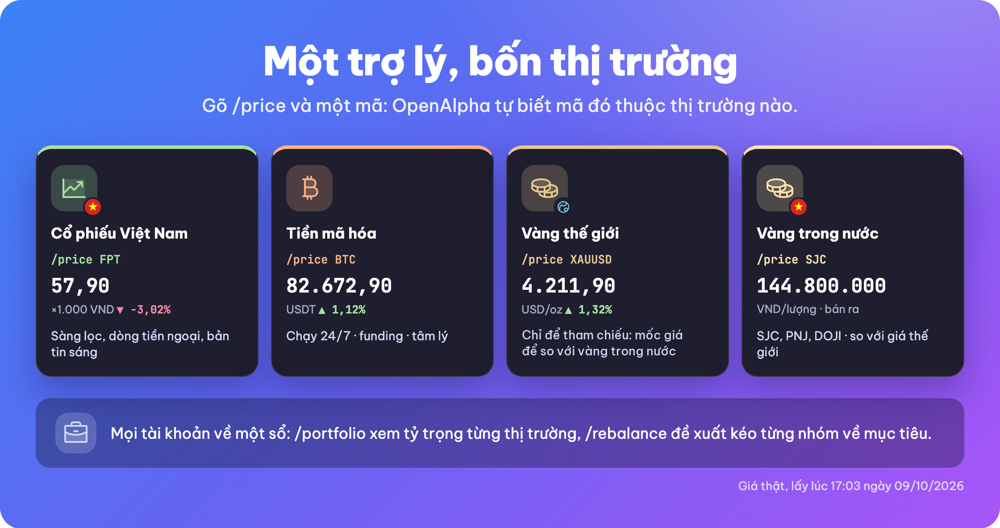
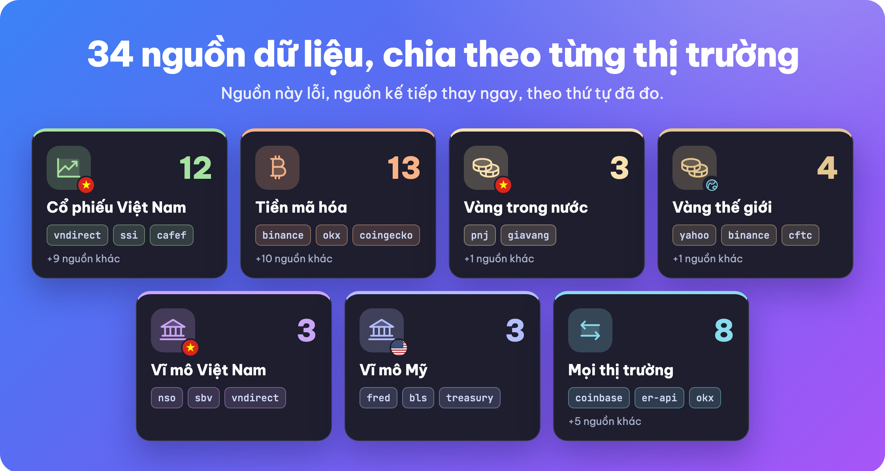
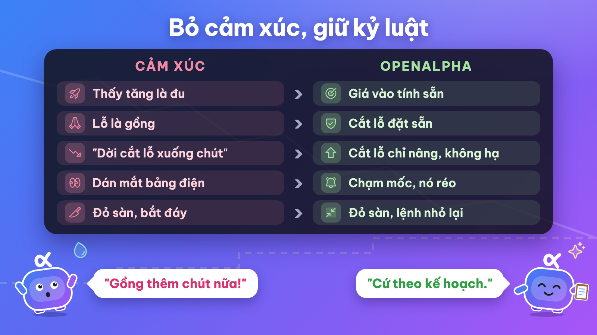

<h1 align="center">OpenAlpha</h1>
<h3 align="center">Khi TradingAgents gặp OpenClaw 👀</h3>

<p align="center">
  <strong>Một hội đồng AI tranh luận trước mỗi đề xuất như TradingAgents, chạy trên máy bạn và trò chuyện qua Telegram, Zalo như OpenClaw.<br/>Đó là OpenAlpha, nhà phân tích đầu tư AI mã nguồn mở.</strong>
</p>

<p align="center">
  <strong>🇻🇳 Tiếng Việt</strong> &bull; <strong><a href="README.en.md">🇬🇧 English</a></strong>
</p>

<p align="center">
  
  
</p>

<p align="center">
  
</p>

<p align="center">
  Mỗi sáng trước giờ mở cửa, nó lọc cả thị trường, chọn ra vài mã đáng xem, tính sẵn nên mua bao nhiêu cho vừa danh mục của bạn, và nói rõ lý do nên mua lẫn lý do nên tránh.<br/>
  Mạnh nhất ở <strong>cổ phiếu Việt Nam</strong> nhờ dữ liệu trong nước, theo dõi thêm <strong>crypto</strong> và vàng.<br/>
  <strong>Nó dừng ở đó: đặt lệnh hay không vẫn do bạn quyết.</strong>
</p>

<p align="center">
  <em>AI đọc được mọi thứ về mã bạn hỏi, trừ một thứ: số tiền của bạn.</em>
</p>

<p align="center">
  <a href="https://zalo.me/g/yl7iqyfovvtyosujulea"></a><br/>
  <sub>Cài chưa được, hay muốn nhận tin bản mới? Hỏi trong <a href="https://zalo.me/g/yl7iqyfovvtyosujulea">nhóm Zalo OpenAlpha</a>, bằng tiếng Việt.</sub>
</p>

---

<p align="center">
  <a href="#xem-nó-làm-việc">Xem demo</a> · <a href="#bắt-đầu-nhanh">Bắt đầu nhanh</a> · <a href="#vì-sao-dùng-openalpha">Vì sao và an toàn</a> · <a href="#tài-liệu">Tài liệu</a> · <a href="#góp-sức-cho-openalpha">Góp sức</a> · <a href="#độ-ổn-định-giấy-phép-và-miễn-trừ">Giấy phép</a>
</p>

## Xem nó làm việc

Gõ `/suggest FPT`, nhận về một kế hoạch: mua ở đâu, cắt lỗ ở đâu, chốt lời ở đâu và mua bao nhiêu.

<p align="center">
  
</p>

### Một lần chạy thật

Ngoài kế hoạch, mỗi đề xuất còn cho biết lý do nên mua, lý do nên chờ, và điều gì sẽ chứng minh nó sai. Đây là một lần chạy thật, đã rút gọn, che mã và giá:

```
Bạn:  /suggest XXX

💡 XXX (16/10/2026): nên MUA, Mức tin cậy trung bình. Mua khoảng 400 XXX (~9.280.000 VND, chiếm 4,65% danh mục).
  Vào lệnh xx,xx · Cắt lỗ xx,xx (▼ -7,54%) · Chốt 33% tại xx,xx (▲ 7,97%) · Mục tiêu xa xx,xx (▲ 23,92%)

🎯 Cách quản lý vị thế
  Đừng mua đuổi trên xx,xx. Mua trước 200 XXX, phần còn lại mua sau nếu giá quay lại và đứng vững.
  Đã trừ phí: nếu chạm cắt lỗ, bạn mất khoảng 737.120 VND (0,37% danh mục).

🚩 Mình sai khi
  Báo cáo năm 2026 ghi nhận dòng tiền hoạt động thấp hơn lợi nhuận.

💬 Tranh luận (3 bước sàng lọc)
  🐂 Lý do nên mua: định giá hấp dẫn, lợi nhuận tăng, tiền ròng dương.
  🐻 Lý do nên chờ: lợi nhuận đang cao hơn hẳn bình quân lịch sử; bốn quý gần nhất chưa kiểm toán.

Đây là phân tích, không phải lệnh đặt - quyết định luôn thuộc về bạn.
  Sau khi khớp lệnh, dán dòng này: /record buy vps equity-vn:XXX 400 xxxxx VND 2026-10-16
```

### Một ngày dùng OpenAlpha

https://github.com/user-attachments/assets/bea5ab46-72bd-48f5-8a51-9260f09824d9

<p align="center">
  <sub>70 giây</sub>
</p>

---

## Bắt đầu nhanh

Bạn chỉ cần một máy macOS, Linux hoặc Windows 10/11 (máy chip ARM cần Windows 11), và một khóa AI: đăng ký [OpenRouter](https://openrouter.ai) rồi tạo khóa ở [openrouter.ai/keys](https://openrouter.ai/keys) (giữ như mật khẩu, đừng gửi ai). OpenRouter có cả mô hình miễn phí; dùng mô hình trả phí thì thường chỉ tốn vài đô la mỗi tháng.

### Thử ngay trong 3 lệnh

Mở Terminal (macOS: nhấn ⌘ + Space, gõ `Terminal`; Windows: mở PowerShell từ menu Start), chọn đúng một khối theo máy của bạn, chép từng dòng vào rồi nhấn Enter. Phần sau dấu `#` chỉ là ghi chú, không cần gõ:

```bash
curl -fsSL https://raw.githubusercontent.com/alex2loop/openalpha/main/install.sh | sh   # macOS, Linux: cài đặt, xong thì mở terminal mới
openalpha key set OPENROUTER_API_KEY   # dán khóa rồi Enter (màn hình không hiện gì là bình thường); lúc cài đã lưu thì bỏ qua
openalpha chat                    # rồi gõ /refresh (chờ khoảng 5 phút), xong thì gõ /suggest FPT
```

```powershell
powershell -c "irm https://raw.githubusercontent.com/alex2loop/openalpha/main/install.ps1 | iex"   # Windows: cài đặt, xong thì mở cửa sổ PowerShell mới
openalpha key set OPENROUTER_API_KEY   # dán khóa rồi Enter (màn hình không hiện gì là bình thường); lúc cài đã lưu thì bỏ qua
openalpha chat                    # rồi gõ /refresh (chờ khoảng 5 phút), xong thì gõ /suggest FPT
```

Như vậy là đủ để xem một đề xuất. Muốn đề xuất có khối lượng vừa với túi tiền của bạn thì làm thêm bước 4 bên dưới.

### Cài đầy đủ trong 5 bước

Đã chạy 3 lệnh ở trên thì bắt đầu từ bước 3.

**1. Cài đặt.** Một dòng, tải về một tệp chạy duy nhất rồi hỏi bạn vài câu (ngôn ngữ, tiền tệ của sổ, mô hình AI, mức chi mỗi ngày, Telegram nếu muốn). Tiền tệ chỉ chọn một lần: thiết lập hồ sơ rồi thì không đổi được. Muốn đổi phần còn lại thì chạy `openalpha onboard`.

```bash
curl -fsSL https://raw.githubusercontent.com/alex2loop/openalpha/main/install.sh | sh   # macOS, Linux
```

```powershell
powershell -c "irm https://raw.githubusercontent.com/alex2loop/openalpha/main/install.ps1 | iex"   # Windows
```

**2. Lưu khóa AI và kiểm tra.** `onboard` sẽ hỏi lưu giúp; nếu chưa thì mở một terminal mới:

```bash
openalpha key set OPENROUTER_API_KEY   # gõ khóa ở chế độ ẩn; khóa được giữ trong ~/.openalpha/env
openalpha doctor --online              # gửi một tin ngắn để thử mô hình
```

`openalpha key` cho biết khóa nào đã có và lấy từ đâu. Hai lệnh này dùng được cả trên Windows.

**3. Nạp dữ liệu và khai khẩu vị.** Chạy `openalpha chat`, rồi gõ:

```text
/refresh     # lần đầu: nạp danh sách mã, giá, báo cáo tài chính (miễn phí, khoảng 5 phút)
/setup       # chọn mức rủi ro và thị trường bạn chơi
```

**4. Ghi số tiền bạn có, theo thị trường bạn chơi.** Khối lượng của mọi gợi ý đều tính từ sổ này, nên đừng bỏ qua. Đây chỉ là sổ ghi chép trong máy, không chuyển tiền thật. Các dòng bắt đầu bằng `/` gõ trong `openalpha chat` (hoặc Telegram, Zalo), không gõ thẳng ở terminal.

<details open>
<summary><b>Cổ phiếu Việt Nam</b></summary>

```text
/record deposit vps 100000000 VND 2026-08-14              # nạp 100 triệu vào tài khoản VPS
/suggest FPT                                              # soi một mã
/record buy FPT 100 62000                                 # đặt lệnh trên app VPS, khớp rồi ghi lại ở đây (tự điền sàn, VND, hôm nay)
/record sell FPT all 65000                                # bán hết khi cổ phiếu đã về (T+2: sau 2 ngày làm việc); bán một phần thì ghi số lượng
```

Giá ghi bằng VND nguyên: bảng điện hiện `62,00` thì ghi `62000`; giá gõ lệch từ 10 lần trở lên so với giá đang giao dịch thì sổ hỏi lại trước khi lưu. Phí bỏ trống thì sổ tự tính. Chỉ dùng VPS thì bỏ qua phần còn lại của mục này. Tài khoản ở công ty khác (SSI, TCBS, VNDIRECT...) thì thêm vào `~/.openalpha/config.toml` với biểu phí của bạn, rồi ghi `ssi` thay cho `vps`:

```toml
[trading.venues.ssi]
default_for = ["equity-vn"]                                # cổ phiếu VN ghi ở SSI thay vì VPS
fees = { buy = 0.0015, sell = 0.0015, sell_tax = 0.001 }
```

Có tài khoản ở cả VPS lẫn SSI thì thay dòng `default_for` bằng `markets = ["equity-vn"]`.

</details>

<details>
<summary><b>Crypto</b></summary>

Nạp USDT mua qua P2P thì ghi kèm `fx` ở dòng nạp, là giá bạn thật sự trả cho mỗi USDT. Lệnh mua sau đó trả bằng số USDT này theo giá vốn ấy, nên không cần `fx`:

```text
/record deposit binance 1000 USDT 2026-08-14 fx 26600
/record buy binance crypto:BTC 0.01 60000 USDT 2026-08-14
/record sell binance crypto:BTC all 65000                 # bán hết; tự điền USDT và hôm nay
```

Nạp VND vào sàn thì lệnh mua bằng USDT được quy theo tỷ giá thị trường ngày đó. Trợ lý cho bạn xem trước, đúng thì gõ `/record confirm` để ghi:

```text
/record deposit binance 26000000 VND 2026-08-14
/record buy binance crypto:BTC 0.01 60000 USDT 2026-08-14
/record confirm
```

- Mới chơi crypto? Từng bước từ nạp USDT tới rút về, chênh lệch tỷ giá và đối chiếu USDT với sàn: [cẩm nang](docs/cam-nang.md#crypto-qua-p2p-từng-bước-cho-người-mới).
- `binance` và `okx` có sẵn. Sàn khác (Bybit, Bitget...) thì khai như SSI ở trên, với `markets = ["crypto"]` và `fees = { buy = 0.001, sell = 0.001, fee_asset = "base" }`.
- Đã đặt khóa API của Binance hoặc OKX thì `/record sync binance` tự lấy lệnh đã khớp, và `/trade` dựng sẵn lệnh thật để bạn duyệt:

```text
/trade spot binance:BTC buy 0.001 limit 60000 tp 70000 sl 56000   # mua giới hạn, kèm chốt lời và cắt lỗ
/trade confirm                                                     # chỉ lúc này lệnh mới lên sàn
```

</details>

<details>
<summary><b>Vàng trong nước</b></summary>

Nhóm này tắt sẵn. Bật nó lên rồi ghi như cổ phiếu; vàng và tiền mua vàng được ghi ở nơi giữ có sẵn `gold-shop` (tiệm vàng):

```text
/profile enable gold-vn
/price SJC                     # giá mua vào, bán ra và chênh lệch hôm nay
```

```text
/record deposit gold-shop 150000000 VND 2026-08-14
/record buy SJC 1 140000000              # 1 lượng; tự điền tiệm vàng, VND và hôm nay
/record sell SJC 1 145000000             # bán lại cho tiệm, theo giá tiệm mua vào
```

Mua lẻ thì ghi theo lượng: 1 chỉ là `0.1`, giá vẫn ghi theo lượng. Vàng nhẫn ghi `PNJ-RING` hoặc `DOJI-RING`. Cắt lỗ và mục tiêu tính theo giá tiệm mua lại, tức số tiền bạn thực nhận khi bán. Muốn tách sổ theo từng tiệm (SJC, PNJ...) thì khai như SSI ở trên, với `markets = ["gold-vn"]` và `fees = { buy = 0, sell = 0 }`, rồi ghi tên tiệm thay cho `gold-shop`.

</details>

Vài điều dùng được cho mọi thị trường:

- **Rút tiền về:** gõ `/record withdrawal` kèm nơi giữ, số tiền, tiền tệ và ngày, ví dụ `/record withdrawal vps 1000000 VND 2026-08-21`. Ngày luôn viết theo kiểu năm-tháng-ngày.
- **Lỡ ghi nhầm?** Gõ `/transactions` để thấy mã của từng dòng. Sửa bằng `/update <mã bút toán> ...`. Muốn xóa thì gõ `/delete <mã bút toán>` để xem lại cho chắc, rồi `/delete <mã bút toán> confirm`.
- **Cổ tức, chia tách, chuyển tiền giữa hai nơi:** gõ riêng `/record`, trợ lý sẽ liệt kê đủ các kiểu ghi và cách viết từng kiểu.
- **Vừa sửa `config.toml`** (ví dụ thêm công ty chứng khoán hay tiệm vàng)? Gõ `/exit` để thoát rồi mở lại `openalpha chat` là xong. Nếu OpenAlpha đang chạy nền thì gõ thêm `openalpha restart --background`.

**5. Bật bản tin sáng (không bắt buộc).** Gõ `/exit` để thoát chat, rồi chạy `openalpha start --background` để chương trình chạy nền (dữ liệu cũng tự nạp từ đó); `openalpha autostart enable` để nó tự chạy mỗi lần đăng nhập. Nối Telegram hoặc Zalo ([hướng dẫn kênh](docs/kenh.md)), rồi gõ `/brief enable 08:00` trong kênh đó. `openalpha status` cho biết nó còn chạy không, `openalpha stop` để dừng. Vài tuần sau, `/reflect` cho biết các đề xuất cũ đúng được bao nhiêu.

<details>
<summary><b>Windows, cấu hình tối giản, cập nhật, gỡ cài đặt</b></summary>

- **Không cần quyền admin.** `openalpha.exe` nằm ở `%USERPROFILE%\.local\bin` và thư mục này được thêm vào PATH của tài khoản bạn. Gõ `openalpha` mà báo không nhận ra lệnh thì mở một cửa sổ PowerShell mới, hoặc chạy thẳng `& "$HOME\.local\bin\openalpha.exe"`. Dữ liệu và cấu hình nằm ở `%USERPROFILE%\.openalpha`, cũng chính là `~/.openalpha` trong hướng dẫn này.
- **Windows Defender chặn `openalpha.exe`?** Tệp chạy chưa được ký số nên đôi khi bị báo nhầm. Trình cài đã đối chiếu tệp với `SHA256SUMS` của bản phát hành; muốn tự kiểm thì chạy `Get-FileHash "$HOME\.local\bin\openalpha.exe"` rồi so với dòng của bản bạn cài (`openalpha-windows-x64.exe`, hoặc `openalpha-windows-arm64.exe` trên máy ARM) trên trang [Releases](https://github.com/alex2loop/openalpha/releases). Khớp rồi thì thêm ngoại lệ cho cả thư mục, trong PowerShell chạy bằng quyền Admin: `Add-MpPreference -ExclusionPath "$HOME\.local\bin"`. Đừng tắt hẳn diệt virus.
- **Máy Windows chip ARM?** Trình cài tự chọn bản ARM chạy thẳng trên máy; bản x64 cài trước đó sẽ chuyển sang bản ARM khi bạn chạy lại lệnh cài.
- **Tiếng Việt hiện thành ký tự lạ?** Dùng Windows Terminal thay cho cửa sổ console cũ. **Thích WSL2?** Lệnh `curl ... | sh` chạy được trong WSL2, với thư mục `~/.openalpha` riêng.
- **Không muốn trả lời từng câu lúc cài?** Lấy [config.minimal.toml](config.minimal.toml): chạy được ngay, chỉ cần khóa OpenRouter, mỗi dòng đều có chú thích. Lệnh này ghi đè `config.toml` nếu bạn đã có:

  ```bash
  curl -fsSL https://raw.githubusercontent.com/alex2loop/openalpha/main/config.minimal.toml -o ~/.openalpha/config.toml --create-dirs
  ```

  ```powershell
  New-Item -ItemType Directory -Force "$HOME\.openalpha" | Out-Null; irm https://raw.githubusercontent.com/alex2loop/openalpha/main/config.minimal.toml -OutFile "$HOME\.openalpha\config.toml"
  ```

- **Đổi mô hình, thêm nhà cung cấp AI dự phòng:** chạy `openalpha onboard` rồi chọn "Mô hình AI", hoặc sửa `[[models]]` trong `config.toml`. Mục đầu là mô hình chính, các mục sau chỉ được dùng khi nhà cung cấp trước lỗi hay treo. `openalpha provider list` cho biết tên nhà cung cấp, `openalpha provider models` cho biết mô hình và giá. Chi tiết: [mô hình và nhà cung cấp](docs/tro-ly.md#mô-hình-và-nhà-cung-cấp) · [danh mục nhà cung cấp](docs/cau-hinh.md#danh-mục-nhà-cung-cấp).

  ```toml
  [[models]]                                   # mô hình chính
  provider = "openrouter"
  model = "deepseek/deepseek-v4.1-flash"
  api_key_env = "OPENROUTER_API_KEY"

  [[models]]                                   # dự phòng khi OpenRouter lỗi
  provider = "anthropic"
  model = "claude-sonnet-4-6"
  api_key_env = "ANTHROPIC_API_KEY"
  ```

- **Mọi tùy chọn cấu hình:** [config.sample.toml](config.sample.toml) · [docs/cau-hinh.md](docs/cau-hinh.md). Không muốn dùng khóa AI thì chạy mô hình ngay trên máy qua Ollama hoặc vLLM.
- **Cài trên máy chủ hay trong CI?** Đặt `OPENALPHA_NO_ONBOARD=1` để bỏ bước hỏi; đầu [install.sh](install.sh) và [install.ps1](install.ps1) liệt kê đủ các tùy chọn, ví dụ `OPENALPHA_VERSION` để cài đúng một bản.
- **Cập nhật:** CLI nhắc mỗi ngày một lần, kèm điều đáng chú ý của bản mới; trong chat riêng, bot nhắc mỗi tuần (bản quan trọng thì mỗi ngày). `openalpha upgrade` lên bản mới mà giữ nguyên dữ liệu và cấu hình.
- **Gỡ cài đặt:** `openalpha stop`, rồi xóa tệp `openalpha` (mặc định ở `~/.local/bin`; trên Windows là `openalpha.exe` và `openalpha.exe.old` nếu có). Thư mục `~/.openalpha` chứa toàn bộ sổ và cấu hình: chạy `openalpha db export --out <thư-mục>` trước nếu muốn giữ.

</details>

### Dùng mỗi ngày

Phần lớn việc hằng ngày đều **miễn phí**: các lệnh đó chỉ tính trên dữ liệu đã có trong máy, không gọi AI. Các con số dưới đây đo thật ngày 2026-10-15 với mô hình rẻ (`gpt-6-luna` cho tranh luận, `claude-haiku-5.5` cho nghiên cứu); mô hình đắt hơn thì tốn hơn, và `[budget]` luôn chặn trần.

| Bạn muốn | Gõ | Tốn tiền? |
|---|---|---|
| Bản tin trước giờ mở cửa | `/brief` · `/brief enable 08:00` | có: một lượt ngắn cho mỗi mã đang giữ hay theo dõi; mã đã soi trong ngày thì miễn phí |
| Soi kỹ một mã | `/suggest FPT` | khoảng $0,01 |
| Nghiên cứu một câu hỏi, có trích nguồn | `/research <câu hỏi>` | khoảng $0,03 (`quick`) |
| Chủ đề đầu tư đang hình thành | `/themes` | có, tối đa $1 mỗi lần theo mặc định |
| Xếp hạng cả thị trường | `/screen equity-vn 20` | **miễn phí** |
| Theo dõi giá vài mã | `/watchlist add FPT HPG` · `/watchlist` | **miễn phí** |
| Nạp dữ liệu còn thiếu cho các thị trường bạn đang dùng (`force`: nạp lại hết) | `/refresh` · `/refresh equity-vn force` | **miễn phí** |
| Bảng giá, vĩ mô, một mã | `/market` · `/overview` · `/price FPT` | **miễn phí** |
| Xem danh mục, kéo về tỷ trọng mục tiêu | `/portfolio` · `/rebalance` | **miễn phí** |
| Danh mục thật sự lời lỗ bao nhiêu, đã trừ tiền nạp rút | `/portfolio nav` | **miễn phí** |
| Đồng bộ sổ với sàn (cần khóa API của sàn) | `/record sync okx` · `/reconcile` | **miễn phí** |
| Xem mình đúng được bao nhiêu | `/reflect` | **miễn phí** |

Các con số trong README chỉ minh họa cú pháp, không phải gợi ý mua bán. Đầy đủ: `/help` trong chat, hoặc [cẩm nang tiếng Việt](docs/cam-nang.md).

---

## Vì sao dùng OpenAlpha

- **Con số do code tính, AI chỉ giải thích.** Giá vào, cắt lỗ, mục tiêu và khối lượng được tính sẵn; AI tranh luận vì sao nên mua và vì sao nên tránh.
- **Kỷ luật được viết sẵn.** Kế hoạch chốt khi bạn còn tỉnh táo, rồi giữ bạn đi đúng kế hoạch đó, kể cả khi thị trường đi xuống.
- **Mạnh ở cổ phiếu Việt Nam.** Dữ liệu trong nước, số liệu vĩ mô chính thức kèm câu trích gốc, và luôn tính đến T+2.
- **Đúng sai đều được chấm.** Mỗi đề xuất được theo dõi tới khi khép lại; `/reflect` cho biết nó đúng được bao nhiêu, và đề xuất sau bớt tự tin khi đề xuất trước sai nhiều.

**Hợp với bạn nếu** bạn tự quản danh mục của mình, muốn thấy lập luận đằng sau mỗi đề xuất thay vì chỉ thấy một mã được phím, và muốn khóa API nằm trên máy mình. **Không hợp nếu** bạn tìm một con bot tự chạy lệnh, hoặc muốn có ai đó quyết định thay bạn. Cả hai đều không có ở đây, và đó là chủ ý.

### Thị trường và dữ liệu

<p align="center">
  
</p>

| Thị trường | Mã thị trường | Có gì |
|---|---|---|
| **Cổ phiếu Việt Nam** | `equity-vn` | Sâu nhất: theo dõi khối ngoại và tự doanh, lịch công bố thông tin, sức khỏe tài chính, và luôn tính đến T+2. |
| **Tiền mã hóa** | `crypto` | Chỉ giao ngay. Mua khi giá vượt đỉnh gần đây, cắt lỗ dời lên theo giá, đọc thêm dữ liệu phái sinh để biết thị trường đang dùng đòn bẩy nhiều hay ít. |
| **Vàng trong nước** | `gold-vn` | So với giá thế giới để biết vàng thật sự tăng hay chỉ là tiệm nới chênh lệch. |
| **Vàng thế giới** | `gold` | Chỉ để tham chiếu: xem giá và làm mốc cho vàng trong nước. |

Chỉ cần gõ mã (`/price FPT`). Khi hai thị trường có cùng một mã thì ghi thêm tên thị trường: `/suggest crypto:UNI`.

<p align="center">
  
</p>

Dữ liệu lưu trong SQLite có sẵn trên máy, không cần cài thêm. Dùng được hơn 70 nhà cung cấp AI, nhà nào treo thì tự chuyển sang nhà kế tiếp. Nói chuyện với nó qua terminal, Telegram, Zalo hoặc Zalo cá nhân.

Từ OpenAI, Anthropic, Gemini, DeepSeek tới cổng trung gian như OpenRouter hay mô hình chạy ngay trên máy qua Ollama: gõ `openalpha provider list` để xem đủ danh sách và tên ghi vào cấu hình ([hướng dẫn](docs/cau-hinh.md#danh-mục-nhà-cung-cấp)). Đang trả tiền ChatGPT thì đăng nhập bằng `openalpha auth login chatgpt`, khỏi cần khóa. Không có khóa nào cũng được: nối OpenAlpha vào Claude Code, Codex hay Cursor qua MCP để mô hình của ứng dụng đó suy luận ([Nâng cao](#nâng-cao)).

### Cách nó hoạt động

Với mỗi mã bạn hỏi, sáu nhà phân tích AI tranh luận: phe mua, phe bán, người tổng hợp, rồi bên giao dịch, quản trị rủi ro và người soát lại số liệu. Với cổ phiếu Việt Nam, còn cả loạt bước kiểm tra có quyền chặn đề xuất lại. **Nhưng không ai trong số đó được viết ra một con số nào.** Giá vào, cắt lỗ, mục tiêu, khối lượng đều do mã nguồn tính xong trước khi cuộc tranh luận bắt đầu. AI chỉ lo phần *vì sao* và phần *điều gì có thể khiến nhận định đó sai*.

<p align="center">
  
</p>

### Kỷ luật thay cho cảm xúc

<p align="center"></p>

**Không FOMO, không gồng lỗ, không "chắc nó hồi".** Cái khó hiếm khi là kiến thức, mà là lúc bấm nút.

<details>
<summary><b>Cách nó giữ kỷ luật, kể cả khi thị trường đi xuống</b></summary>

- **Cắt lỗ chỉ được nâng, không được hạ.** Không có nút "dời xuống thêm chút nữa".
- **Không cần dán mắt vào bảng điện.** Trong Telegram hoặc Zalo, đặt mốc bằng `/alert create FPT above 130000` (giá đầy đủ, như khi `/record`), giá chạm là hệ thống nhắn bạn.

**Khi thị trường đi xuống,** mục tiêu không phải đoán đáy, mà là còn đủ vốn để chơi tiếp:

- **Thị trường xấu thì tự thu nhỏ.** Trần từng nhóm siết lại và khối lượng đề xuất nhỏ đi.
- **Có trần cho cả danh mục.** Nhiều lệnh nhỏ không cộng dồn thành một khoản cược lớn.
- **Một lệnh tắt mua.** Khi đã khai khóa sàn, `/trade halt` chặn mọi lệnh mua mới qua OpenAlpha cho tới khi bạn gõ `/trade resume`; bán và cắt lỗ vẫn chạy.

</details>

OpenAlpha không hứa bạn không lỗ. Nó giúp mỗi khoản lỗ nhỏ, có kế hoạch và biết trước.

### An toàn

- **AI không thấy tiền của bạn.** Nhà phân tích chỉ biết tỷ trọng, không bao giờ thấy số dư, giá đã mua hay tổng tài sản.
- **Không tự đặt lệnh.** Mặc định chỉ gợi ý. Chưa khai khóa sàn thì đường đặt lệnh không tồn tại; có khóa thì lệnh nào cũng chờ bạn xác nhận.
- **Mọi thứ nằm trên máy bạn.** Sổ và cấu hình lưu ngay trên máy; khóa lấy từ biến môi trường hoặc từ `~/.openalpha/env` (chỉ bạn đọc được). OpenAlpha chỉ ghi vào tệp đó khi bạn nhập khóa qua `onboard` hoặc `openalpha key set`, và không bao giờ in khóa ra.
- **Sổ được sao lưu mỗi ngày.** Khi chạy nền, OpenAlpha chép sổ SQLite vào `~/.openalpha/backups/daily/` và giữ ba bản mới nhất ([sao lưu và khôi phục](docs/luu-tru.md#sao-lưu-và-khôi-phục-sqlite)).
- **Chi tiêu AI có trần.** `onboard` đặt trần theo ngày; thêm trần theo tháng hoặc theo lượt trong `[budget]`, để một vòng lặp lỗi không đốt tiền.

Mọi lớp bảo vệ còn lại: [SECURITY.md](SECURITY.md).

---

## Tài liệu

Mới bắt đầu thì đọc [Cẩm nang sử dụng](docs/cam-nang.md) trước: cài đặt, hồ sơ đầu tư, ghi sổ, bản đồ lệnh và ý nghĩa từng con số, viết cho nhà đầu tư và không cần biết lập trình. Phần dưới đây tóm tắt từng mảng, bảng cuối trỏ tới trang đầy đủ.

### Nghiên cứu có trích nguồn

Hỏi một câu cần dữ liệu mới từ bên ngoài, nhận về một báo cáo mà mỗi nhận định đều chỉ ra được nó đến từ đâu. Mô hình không tự lên mạng: code tìm và tải trang trước, nên mô hình không bịa ra được nguồn, và chỗ nào thiếu bằng chứng thì báo cáo nói thẳng là thiếu.

**Nguồn tìm kiếm quyết định độ sâu.** Mặc định là DuckDuckGo: miễn phí, không cần khóa, nhưng ít kết quả, nên câu hỏi về số liệu mới thường về tay không. Khai `[web_search]` bằng Exa, Tavily, Brave, Serper hay DeepSeek, rẻ nhất và mạnh về nguồn tiếng Việt ([cấu hình](docs/cau-hinh.md)), thì báo cáo có nhiều nguồn hơn hẳn.

Chi tiết: [docs/nghien-cuu.md](docs/nghien-cuu.md)

### Nâng cao

<details>
<summary><b>Nhà phân tích của riêng bạn</b></summary>

Ngoài nhà phân tích chính, bạn tạo thêm được nhà phân tích riêng chỉ bằng một tệp TOML: một đoạn dặn dò, danh sách công cụ được dùng và trần chi phí. Thêm `[focus]` là có một **ý kiến thứ hai** với khẩu vị riêng. Đề xuất của nó được chấm điểm tách riêng, không bao giờ đụng vào cắt lỗ, cảnh báo hay bản tin sáng của danh mục chính:

```bash
openalpha agent add ngan-hang      # tạo tệp mẫu, rồi `agent edit ngan-hang` để sửa
```

```toml
system_prompt = "Chỉ xem cổ phiếu ngân hàng, nắm giữ dài hạn, ưu tiên cổ tức đều."
max_daily_usd = 0.5                 # trần chi phí riêng mỗi ngày

[focus]
markets = ["equity-vn"]
sectors = ["banks"]
horizon = "long"

[capabilities]
tools = ["suggestion_run", "suggestion_track_record", "market_screen", "market_price", "market_news"]
```

Hỏi nó bằng `openalpha chat --agent ngan-hang`, hoặc gắn nó vào một nhóm Telegram/Zalo bằng `/agent ngan-hang`. `openalpha agent list` cho thấy nó đúng được bao nhiêu và hay đồng ý với các agent khác tới đâu; `agent pause ngan-hang` tắt nó ngay mà không cần khởi động lại. Chi tiết: [docs/tro-ly.md](docs/tro-ly.md)

</details>

<details>
<summary><b>Cắm vào Claude Code, Cursor, VS Code... (MCP)</b></summary>

Chạy OpenAlpha như một máy chủ MCP trong Claude Code, Codex, Cursor, VS Code hay Gemini CLI: AI của chính ứng dụng ấy làm phần suy nghĩ, bạn không cần khóa AI riêng.

```bash
openalpha mcp install      # hoặc --host codex, cursor, vscode, gemini, opencode, zed
```

Đề xuất tạo theo cách này được chấm điểm riêng trong `/reflect` (dưới tên `client:<model>`), và cách này không bao giờ đặt được lệnh. Chi tiết: [docs/dev/mo-rong.md](docs/dev/mo-rong.md)

</details>

<details>
<summary><b>Trang văn phòng và ứng dụng của riêng bạn (API)</b></summary>

Đặt `[api] enabled = true` thì daemon mở một API HTTP và WebSocket cục bộ trên `127.0.0.1`, có mã truy cập. Ứng dụng khách nhận được sổ giao dịch, giá, đề xuất và chat của bạn, cùng một luồng trực tiếp về những gì daemon đang chạy: từng phiên chạy và các bước của nó, phê duyệt và câu hỏi đang chờ trên mọi kênh, các lần khớp lệnh và lúc chạm hạn mức chi tiêu. Cùng địa chỉ đó phục vụ trang văn phòng: một văn phòng nhỏ nơi trợ lý, nhóm nghiên cứu và các agent của bạn làm việc cùng lúc với daemon, kèm danh mục, đề xuất, khung chat và ô câu lệnh bên cạnh. Mở liên kết mà `openalpha api link` in ra. Trang chỉ cho bạn xem, không quyết định thay bạn: không đặt lệnh và không tự khởi động phiên chạy AI nào. Cách bật và cách nối từ máy khác: [docs/van-hanh.md](docs/van-hanh.md#chạy-api-trên-máy-chủ). Trang cho thấy gì và dùng thế nào: [docs/van-hanh.md](docs/van-hanh.md#trang-văn-phòng)

</details>

### Câu hỏi thường gặp

- **Tốn bao nhiêu tiền?** Phần mềm miễn phí, bạn chỉ trả cho nhà cung cấp AI; bảng [Dùng mỗi ngày](#dùng-mỗi-ngày) ghi chi phí từng lệnh. Bạn đặt trần chi tiêu mỗi ngày lúc cài.
- **Có cần máy mạnh không?** Không. AI chạy ở nhà cung cấp, máy bạn chỉ chạy một tệp nhỏ. Chỉ khi muốn chạy mô hình ngay trên máy (Ollama) mới cần máy mạnh.
- **Không biết lập trình có dùng được không?** Được. Bạn chỉ cần chép vài lệnh vào terminal một lần; sau đó hỏi bằng tiếng Việt, hoặc chat qua Telegram, Zalo.
- **Đề xuất có đáng tin không?** Có thể sai, và nó không giấu điều đó: `/reflect` cho thấy thành tích thật của từng đề xuất cũ.

### Tra cứu đầy đủ

| Chủ đề | Trang |
|---|---|
| Thị trường, đề xuất, sổ lệnh, danh mục, đặt lệnh | [giao-dich.md](docs/giao-dich.md) |
| Mọi lệnh CLI và lệnh chat | [lenh.md](docs/lenh.md) |
| Mọi khóa trong `config.toml` | [cau-hinh.md](docs/cau-hinh.md) |
| Nguồn dữ liệu nào trả lời việc gì | [nguon-du-lieu.md](docs/nguon-du-lieu.md) |
| Tích hợp AI: nhà phân tích riêng, kỹ năng, chọn mô hình | [tro-ly.md](docs/tro-ly.md) |
| Nghiên cứu web có trích nguồn | [nghien-cuu.md](docs/nghien-cuu.md) |
| Telegram và Zalo | [kenh.md](docs/kenh.md) |
| Phê duyệt và các lớp bảo vệ | [an-toan.md](docs/an-toan.md) |
| Ngân sách, vận hành nền, lưu trữ | [ngan-sach.md](docs/ngan-sach.md) · [van-hanh.md](docs/van-hanh.md) · [luu-tru.md](docs/luu-tru.md) |
| SDK, MCP và mở rộng | [dev/mo-rong.md](docs/dev/mo-rong.md) |

---

## Góp sức cho OpenAlpha

OpenAlpha là mã nguồn mở và hiện do một người vận hành, nên mỗi lần góp sức đều tạo khác biệt thật. Bạn không cần biết lập trình mới giúp được.

- **Dùng thật rồi kể lại.** Một lỗi kèm lệnh bạn đã chạy, điều bạn mong đợi và điều nhận được (nhớ nêu thị trường) giúp nhiều hơn mọi lời khen. Mở ở [GitHub Issues](https://github.com/alex2loop/openalpha/issues/new/choose).
- **Tài liệu và câu chữ.** Câu nào khó hiểu, thuật ngữ nào chưa chuẩn, chỗ nào tiếng Việt và tiếng Anh lệch nhau: sửa thẳng trong `docs/` hoặc trong hai catalog `src/i18n/locales/`.
- **Nguồn dữ liệu, sàn, công ty chứng khoán, thị trường mới.** Mỗi thứ là một thay đổi cục bộ: một adapter, một dòng đăng ký và các khóa ngôn ngữ. Mở issue trước cho mọi thay đổi về cấu trúc.
- **Agent và skill.** Một nhà phân tích riêng chỉ là một tệp TOML; một nguồn dữ liệu dạng plugin là một tệp `sources.ts`.

**Việc vừa sức cho người mới:** các issue gắn nhãn [good first issue](https://github.com/alex2loop/openalpha/issues?q=is%3Aissue%20state%3Aopen%20label%3A%22good%20first%20issue%22). **Lộ trình:** chưa có trang riêng; việc định làm và ý tưởng mới được bàn trong [Issues](https://github.com/alex2loop/openalpha/issues). Những hướng đã chốt là sẽ không làm (tự đặt lệnh, bộ backtest...) nằm trong [CONTRIBUTING.md](CONTRIBUTING.md#những-thứ-sẽ-bị-từ-chối), kèm lý do.

### Chạy từ mã nguồn

```bash
git clone https://github.com/alex2loop/openalpha.git && cd openalpha
bun install
bun run dev -- onboard

bun run check       # lint + typecheck + các cổng hợp đồng
bun run lint:arch   # các cổng kiến trúc
```

Một thay đổi chỉ được nhận khi cả hai lệnh trên đều qua. Quy tắc nội bộ và bất biến nghiệp vụ: [AGENTS.md](AGENTS.md). Bản clone cập nhật bằng `git pull`.

Kiến trúc: 16 mô-đun, phụ thuộc một chiều về phía lõi, không vòng lặp; 32 cổng chặn tự động làm build thất bại ngay khi một mô-đun vượt ranh giới. Góp mã: [CONTRIBUTING.md](CONTRIBUTING.md) · [Quy tắc ứng xử](CODE_OF_CONDUCT.md).

### Hỗ trợ và cộng đồng

- **Hỏi cách cài, cách dùng, nhận tin bản mới:** [nhóm Zalo OpenAlpha](https://zalo.me/g/yl7iqyfovvtyosujulea). Nhóm chỉ hỗ trợ dùng phần mềm, không bàn mã nào nên mua. Che khóa API trước khi dán cấu hình. Admin không bao giờ nhắn riêng để xin khóa hay tiền.
- **Báo lỗi, đề xuất tính năng:** [GitHub Issues](https://github.com/alex2loop/openalpha/issues/new/choose). Lỗi chỉ được theo dõi khi có issue.
- **Lỗ hổng bảo mật:** báo riêng theo [SECURITY.md](SECURITY.md), không đăng lên nhóm hay issue.

Thấy hữu ích? Cho repo một ⭐ để nhiều người biết tới.

---

## Độ ổn định, giấy phép và miễn trừ

**Độ ổn định.** Đây là giai đoạn đầu của một công cụ đã được dùng thật hằng ngày trong nhiều tháng: ổn định ở những việc dùng mỗi ngày, còn thô ở những phần khác. Chưa có bộ test; giữa hai phiên bản có thể có thay đổi không tương thích; và chưa chuyển được tài sản giữa các sàn.

**Giấy phép.** Mã nguồn theo giấy phép MIT, dùng thế nào tùy bạn. Tên, logo và Bé Alpha thì không nằm trong giấy phép: xem [NOTICE.md](NOTICE.md#tên-và-logo-không-đi-kèm-giấy-phép).

**Dữ liệu là chuyện khác.** OpenAlpha không đóng gói sẵn dữ liệu thị trường nào: nó lấy dữ liệu từ từng nhà cung cấp khi chạy, ngay trên máy bạn, và điều khoản sử dụng là chuyện giữa bạn với họ. [NOTICE.md](NOTICE.md) liệt kê mọi trang mà nó có thể đọc, và những gì nên kiểm tra trước khi bật một nguồn.

OpenAlpha là trợ lý nghiên cứu và ghi sổ. Đề xuất ở đây mang tính tham khảo, **có thể sai, và không phải lời khuyên đầu tư**. OpenAlpha không biết hết hoàn cảnh của bạn, chỉ đặt lệnh khi bạn duyệt, và không ai đoán chắc được thị trường. Mọi quyết định là của bạn. Đừng đầu tư số tiền bạn không chịu mất được.
