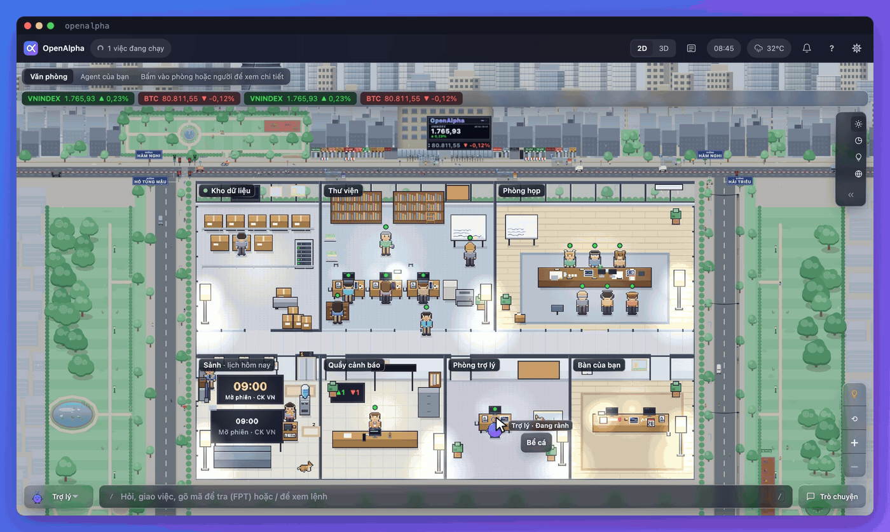

<h1 align="center">OpenAlpha</h1>

<p align="center">
  <strong>Nhà phân tích đầu tư AI mã nguồn mở, chạy ngay trên máy bạn.</strong><br/>
  Một hội đồng AI tranh luận trước mỗi đề xuất; đặt lệnh hay không vẫn do bạn quyết.
</p>

<p align="center">
  <strong>🇻🇳 Tiếng Việt</strong> &bull; <strong><a href="README.en.md">🇬🇧 English</a></strong>
</p>

<p align="center">
  
  
</p>

<p align="center">
  
</p>

Bạn hỏi một mã, OpenAlpha trả về một kế hoạch: mua ở đâu, cắt lỗ ở đâu, chốt lời ở đâu, mua bao nhiêu cho vừa danh mục của bạn, kèm lý do nên mua lẫn lý do nên tránh. Nó dành cho nhà đầu tư cá nhân tự quản danh mục, muốn thấy lập luận đằng sau mỗi đề xuất thay vì chỉ thấy một mã được phím.

- **Chạy trên máy bạn.** Sổ, cấu hình và khóa API nằm ở máy bạn. AI chỉ thấy tỷ trọng, không bao giờ thấy số dư, giá đã mua hay tổng tài sản.
- **Bạn duyệt mọi lệnh.** Mặc định chỉ gợi ý. Có khai khóa sàn thì lệnh nào cũng chờ bạn xác nhận.
- **Một hội đồng AI tranh luận.** Phe mua, phe bán, người tổng hợp, bên giao dịch, quản trị rủi ro và người soát số liệu. Giá và khối lượng do code tính, AI chỉ lo phần *vì sao*.
- **Bốn thị trường.** Cổ phiếu Việt Nam (sâu nhất), crypto, vàng trong nước, và vàng thế giới để tham chiếu.

Đây là công cụ hỗ trợ phân tích, không phải lời khuyên đầu tư. Đề xuất có thể sai, và mọi quyết định là của bạn.

<p align="center">
  <a href="https://zalo.me/g/yl7iqyfovvtyosujulea"></a><br/>
  <sub>Cài chưa được, hay muốn nhận tin bản mới? Hỏi trong <a href="https://zalo.me/g/yl7iqyfovvtyosujulea">nhóm Zalo OpenAlpha</a>.</sub>
</p>

<p align="center">
  <a href="#bắt-đầu-nhanh">Bắt đầu nhanh</a> · <a href="#trang-văn-phòng">Trang văn phòng</a> · <a href="#xem-nó-làm-việc">Xem demo</a> · <a href="#an-toàn">An toàn</a> · <a href="#tài-liệu">Tài liệu</a> · <a href="#độ-ổn-định-giấy-phép-và-miễn-trừ">Giấy phép</a>
</p>

## Bắt đầu nhanh

Bạn cần một máy macOS, Linux hoặc Windows 10/11, và một khóa AI. Cách dễ nhất: đăng ký [OpenRouter](https://openrouter.ai) rồi tạo khóa ở [openrouter.ai/keys](https://openrouter.ai/keys). Giữ khóa như mật khẩu, đừng gửi ai.

Mở Terminal (macOS: nhấn ⌘ + Space, gõ `Terminal`; Windows: mở PowerShell từ menu Start), chọn đúng một khối theo máy của bạn, chép từng dòng vào rồi nhấn Enter. Phần sau dấu `#` chỉ là ghi chú:

```bash
curl -fsSL https://raw.githubusercontent.com/alex2loop/openalpha/main/install.sh | sh   # macOS, Linux: cài đặt, xong thì mở terminal mới
openalpha key set OPENROUTER_API_KEY   # dán khóa rồi Enter (màn hình không hiện gì là bình thường); lúc cài đã lưu thì bỏ qua
openalpha chat                    # rồi gõ /refresh (chờ khoảng 5 phút), xong thì gõ /suggest FPT
```

```powershell
powershell -c "irm https://raw.githubusercontent.com/alex2loop/openalpha/main/install.ps1 | iex"   # Windows: cài đặt, xong thì mở cửa sổ PowerShell mới
openalpha key set OPENROUTER_API_KEY   # dán khóa rồi Enter (màn hình không hiện gì là bình thường); lúc cài đã lưu thì bỏ qua
openalpha chat                    # rồi gõ /refresh (chờ khoảng 5 phút), xong thì gõ /suggest FPT
```

Lúc cài, OpenAlpha hỏi vài câu: ngôn ngữ, tiền tệ của sổ, mô hình AI, mức chi mỗi ngày, Telegram nếu muốn. Tiền tệ chỉ chọn một lần; phần còn lại đổi bất cứ lúc nào bằng `openalpha onboard`. Muốn thử khóa AI thì chạy `openalpha doctor --online`.

### Ghi số tiền bạn có

Khối lượng của mọi đề xuất được tính từ sổ của bạn, nên đừng bỏ qua bước này. Đây chỉ là sổ ghi chép trên máy, không chuyển tiền thật. Gõ trong `openalpha chat` (hoặc Telegram, Zalo):

```text
/setup                                       # chọn mức rủi ro và thị trường bạn chơi
/record deposit vps 100000000 VND 2026-08-14 # nạp 100 triệu vào tài khoản VPS
/suggest FPT                                 # soi một mã
/record buy FPT 100 62000                    # khớp lệnh trên app VPS rồi ghi lại ở đây
```

Giá ghi bằng VND nguyên: bảng điện hiện `62,00` thì ghi `62000`. Crypto, vàng, công ty chứng khoán khác (SSI, TCBS...) và cách sửa một dòng ghi nhầm: [cẩm nang, phần ghi sổ](docs/cam-nang.md#24-ghi-sổ-danh-mục).

### Chạy nền và bản tin sáng

Gõ `/exit` để thoát cuộc trò chuyện, rồi:

```bash
openalpha start --background   # chạy dịch vụ nền (daemon); dữ liệu cũng tự nạp từ đây
openalpha autostart enable     # tự chạy mỗi lần đăng nhập
openalpha status               # còn chạy không; openalpha stop để dừng
```

Nối Telegram hoặc Zalo ([hướng dẫn kênh](docs/kenh.md)), rồi gõ `/brief enable 08:00` trong kênh đó để nhận bản tin trước giờ mở cửa.

<details>
<summary><b>Windows, cài không cần trả lời, cập nhật, gỡ cài đặt</b></summary>

- **Windows:** không cần quyền admin; `openalpha.exe` nằm ở `%USERPROFILE%\.local\bin`, dữ liệu ở `%USERPROFILE%\.openalpha` (chính là `~/.openalpha` trong hướng dẫn này). Gõ `openalpha` mà không nhận thì mở cửa sổ PowerShell mới. Máy chip ARM được cài bản ARM tự động. Tiếng Việt hiện thành ký tự lạ thì dùng Windows Terminal.
- **Windows Defender chặn `openalpha.exe`?** Tệp chạy chưa được ký số nên đôi khi bị báo nhầm. Trình cài đã đối chiếu tệp với `SHA256SUMS` của bản phát hành; muốn tự kiểm thì so `Get-FileHash "$HOME\.local\bin\openalpha.exe"` với dòng của bản bạn cài trên trang [Releases](https://github.com/alex2loop/openalpha/releases). Khớp rồi mới thêm ngoại lệ cho thư mục đó; đừng tắt hẳn diệt virus.
- **Cài không cần trả lời:** đặt `OPENALPHA_NO_ONBOARD=1` rồi lấy [config.minimal.toml](config.minimal.toml) (chỉ cần khóa OpenRouter). Đầu [install.sh](install.sh) và [install.ps1](install.ps1) liệt kê đủ tùy chọn.
- **Đổi mô hình hay thêm nhà cung cấp dự phòng:** `openalpha onboard`, hoặc sửa `[[models]]` trong `config.toml` ([cấu hình](docs/cau-hinh.md#models-bắt-buộc-ít-nhất-một)). `openalpha provider list` liệt kê hơn 70 nhà cung cấp.
- **Cập nhật:** `openalpha upgrade` lên bản mới mà giữ nguyên dữ liệu và cấu hình.
- **Gỡ cài đặt:** `openalpha stop`, rồi xóa tệp `openalpha` (mặc định ở `~/.local/bin`). Thư mục `~/.openalpha` chứa toàn bộ sổ và cấu hình; muốn giữ thì chạy `openalpha db export --out <thư-mục>` trước.

</details>

## Trang văn phòng

<p align="center">
  
</p>

Trang văn phòng là một ô cửa kính nhìn vào dịch vụ nền: trợ lý, nhóm nghiên cứu và các agent của bạn làm việc trong từng phòng, và mỗi chuyển động là một phiên chạy, một bước hay một câu hỏi đang chờ bạn, không có gì diễn cho vui. Bên cạnh là danh mục, đề xuất, cuộc trò chuyện và ô câu lệnh. Trang không bao giờ đặt lệnh và không tự khởi động phiên chạy AI nào.

Để mở trang, thêm hai dòng này vào `~/.openalpha/config.toml`:

```toml
[api]
enabled = true
```

rồi chạy:

```bash
openalpha restart --background   # dịch vụ nền đọc lại cấu hình (chưa chạy thì dùng openalpha start --background)
openalpha web                    # in liên kết đăng nhập dùng một lần (5 phút) và mở trình duyệt
```

Ứng dụng desktop thì dùng địa chỉ và token mà `openalpha connect` in ra. Trang hiện gì, cách dùng và cách mở từ máy khác: [trang văn phòng](docs/van-hanh.md#trang-văn-phòng) · [chạy API trên máy chủ](docs/van-hanh.md#chạy-api-trên-máy-chủ).

## Xem nó làm việc

Gõ `/suggest FPT`, nhận về một kế hoạch: mua ở đâu, cắt lỗ ở đâu, chốt lời ở đâu và mua bao nhiêu.

<p align="center">
  
</p>

Mỗi đề xuất còn nói rõ lý do nên mua, lý do nên chờ, và điều gì sẽ chứng minh nó sai. Đây là một phiên chạy thật, đã rút gọn, che mã, giá và tỷ lệ:

```
Bạn:  /suggest XXX

💡 XXX (16/10/2026): nên MUA, Mức tin cậy trung bình. Mua khoảng 400 XXX (~9.280.000 VND, chiếm 4,65% danh mục).
  Vào lệnh xx,xx · Cắt lỗ xx,xx (▼ -x,xx%) · Chốt 33% tại xx,xx (▲ x,xx%) · Mục tiêu xa xx,xx (▲ x,xx%)

🎯 Cách quản lý vị thế
  Đừng mua đuổi trên xx,xx. Mua trước 200 XXX, phần còn lại mua sau nếu giá quay lại và đứng vững.
  Đã trừ phí: nếu chạm cắt lỗ, bạn mất khoảng 737.120 VND (0,37% danh mục).

🚩 Mình sai khi
  Báo cáo năm 2026 ghi nhận dòng tiền hoạt động thấp hơn lợi nhuận.

💬 Tranh luận (3 bước sàng lọc)
  🐂 Lý do nên mua: định giá hấp dẫn, lợi nhuận tăng, tiền ròng dương.
  🐻 Lý do nên chờ: lợi nhuận đang cao hơn hẳn bình quân lịch sử; bốn quý gần nhất chưa kiểm toán.

Đây là phân tích, không phải lệnh đặt - quyết định luôn thuộc về bạn.
  Sau khi khớp lệnh, dán dòng này: /record buy vps equity-vn:XXX 400 xxxxx VND 2026-10-16
```

### Một ngày dùng OpenAlpha

https://github.com/user-attachments/assets/bea5ab46-72bd-48f5-8a51-9260f09824d9

## Dùng mỗi ngày

Phần lớn câu lệnh hằng ngày chỉ tính trên dữ liệu đã có trong máy, không gọi AI. Câu lệnh nào gọi AI thì tính vào trần chi tiêu bạn đặt lúc cài.

| Bạn muốn | Gõ | Gọi AI? |
|---|---|---|
| Bản tin trước giờ mở cửa | `/brief` · `/brief enable 08:00` | có |
| Soi kỹ một mã | `/suggest FPT` | có |
| Nghiên cứu một câu hỏi, có trích nguồn | `/research <câu hỏi>` | có |
| Chủ đề đầu tư đang hình thành | `/themes` | có, mặc định tối đa $1 mỗi lần |
| Xếp hạng cả thị trường | `/screen equity-vn 20` | không |
| Theo dõi giá vài mã | `/watchlist add FPT HPG` · `/watchlist` | không |
| Nạp dữ liệu còn thiếu | `/refresh` | không |
| Bảng giá, vĩ mô, một mã | `/market` · `/overview` · `/price FPT` | không |
| Xem danh mục, kéo về tỷ trọng mục tiêu | `/portfolio` · `/rebalance` | không |
| Xem các đề xuất cũ đúng được bao nhiêu | `/reflect` | không |

Các con số trong README chỉ minh họa cú pháp, không phải gợi ý mua bán. Đủ mọi câu lệnh: `/help` trong cuộc trò chuyện, hoặc [bản đồ lệnh](docs/cam-nang.md#4-bản-đồ-lệnh).

## Cách nó hoạt động

Với mỗi mã bạn hỏi, sáu nhà phân tích AI tranh luận theo ba vòng. Với cổ phiếu Việt Nam, còn một loạt bước kiểm tra có quyền chặn đề xuất lại. **Nhưng không ai trong số đó được viết ra một con số.** Giá vào, cắt lỗ, mục tiêu và khối lượng do code tính xong trước khi cuộc tranh luận bắt đầu.

<p align="center">
  
</p>

Kế hoạch được chốt khi bạn còn tỉnh táo, rồi giữ bạn đi đúng kế hoạch: cắt lỗ chỉ được nâng, không được hạ; thị trường xấu thì khối lượng đề xuất nhỏ lại; giá chạm mốc thì bạn được nhắn. Mỗi đề xuất được theo dõi tới khi khép lại, và `/reflect` cho thấy thành tích thật của chúng.

<p align="center"></p>

| Thị trường | Mã thị trường | Có gì |
|---|---|---|
| **Cổ phiếu Việt Nam** | `equity-vn` | Sâu nhất: khối ngoại và tự doanh, lịch công bố thông tin, sức khỏe tài chính, luôn tính đến T+2. |
| **Tiền mã hóa** | `crypto` | Chỉ giao ngay. Đọc thêm dữ liệu phái sinh để biết thị trường đang dùng đòn bẩy nhiều hay ít. |
| **Vàng trong nước** | `gold-vn` | So với giá thế giới để biết vàng thật sự tăng hay chỉ là tiệm nới chênh lệch. Tắt sẵn; bật bằng `/profile enable gold-vn`. |
| **Vàng thế giới** | `gold` | Chỉ để tham chiếu: xem giá và làm mốc cho vàng trong nước. |

<p align="center">
  
</p>

Bạn nói chuyện với nó qua terminal, Telegram, Zalo hoặc trang văn phòng. Không muốn dùng khóa AI riêng? Nối OpenAlpha vào Claude Code, Codex hay Cursor qua MCP (`openalpha mcp install`) để mô hình của ứng dụng đó suy luận ([chi tiết](docs/dev/mo-rong.md)).

## An toàn

- **AI không thấy tiền của bạn.** Nhà phân tích chỉ biết tỷ trọng.
- **Không tự đặt lệnh.** Chưa khai khóa sàn thì đường đặt lệnh không tồn tại; có khóa thì lệnh nào cũng chờ bạn xác nhận, và `/trade halt` tắt mọi lệnh mua mới cho tới khi bạn gõ `/trade resume`.
- **Mọi thứ nằm trên máy bạn.** Khóa lấy từ biến môi trường hoặc từ `~/.openalpha/env` (chỉ bạn đọc được), và không bao giờ bị in ra.
- **Sổ được sao lưu mỗi ngày.** Khi chạy nền, OpenAlpha chép sổ vào `~/.openalpha/backups/daily/` và giữ ba bản mới nhất ([sao lưu và khôi phục](docs/luu-tru.md#sao-lưu-và-khôi-phục-sqlite)).
- **Chi tiêu AI có trần.** Trần theo ngày đặt lúc cài; thêm trần theo tháng hoặc theo phiên chạy trong `[budget]` ([ngân sách](docs/ngan-sach.md)).

Mọi lớp bảo vệ còn lại: [an-toan.md](docs/an-toan.md) · [SECURITY.md](SECURITY.md).

## Tài liệu

Mới bắt đầu thì đọc [Cẩm nang sử dụng](docs/cam-nang.md): cài đặt, hồ sơ đầu tư, ghi sổ, bản đồ lệnh và ý nghĩa từng con số, viết cho nhà đầu tư, không cần biết lập trình. Mục lục đầy đủ: [docs/README.md](docs/README.md).

| Chủ đề | Trang |
|---|---|
| Thị trường, đề xuất, sổ lệnh, danh mục, đặt lệnh | [giao-dich.md](docs/giao-dich.md) |
| Mọi câu lệnh CLI và câu lệnh chat | [lenh.md](docs/lenh.md) |
| Mọi khóa trong `config.toml` | [cau-hinh.md](docs/cau-hinh.md) |
| Nguồn dữ liệu nào trả lời việc gì | [nguon-du-lieu.md](docs/nguon-du-lieu.md) |
| Nhà phân tích của riêng bạn, kỹ năng, chọn mô hình | [tro-ly.md](docs/tro-ly.md) |
| Nghiên cứu web có trích nguồn | [nghien-cuu.md](docs/nghien-cuu.md) |
| Telegram và Zalo | [kenh.md](docs/kenh.md) |
| Dịch vụ nền, trang văn phòng, chạy trên máy chủ | [van-hanh.md](docs/van-hanh.md) |
| SDK, MCP và mở rộng | [dev/mo-rong.md](docs/dev/mo-rong.md) |

## Góp sức cho OpenAlpha

OpenAlpha hiện do một người vận hành, nên mỗi lần góp sức đều tạo khác biệt thật, kể cả khi bạn không biết lập trình.

- **Dùng thật rồi kể lại.** Một lỗi kèm câu lệnh bạn đã chạy, điều bạn mong đợi và điều nhận được (nhớ nêu thị trường): mở ở [GitHub Issues](https://github.com/alex2loop/openalpha/issues/new/choose).
- **Tài liệu và câu chữ.** Câu nào khó hiểu, chỗ nào tiếng Việt và tiếng Anh lệch nhau: sửa thẳng trong `docs/` hoặc trong hai catalog `src/i18n/locales/`.
- **Nguồn dữ liệu, sàn, thị trường mới.** Mở issue trước cho mọi thay đổi về cấu trúc. Việc vừa sức cho người mới: nhãn [good first issue](https://github.com/alex2loop/openalpha/issues?q=is%3Aissue%20state%3Aopen%20label%3A%22good%20first%20issue%22). Những hướng đã chốt là sẽ không làm (tự đặt lệnh, bộ backtest...): [CONTRIBUTING.md](CONTRIBUTING.md#những-thứ-sẽ-bị-từ-chối).

Chạy từ mã nguồn:

```bash
git clone https://github.com/alex2loop/openalpha.git && cd openalpha
bun install
bun run dev -- onboard

bun run check       # lint + typecheck + các cổng hợp đồng
bun run lint:arch   # các cổng kiến trúc
```

Một thay đổi chỉ được nhận khi cả hai câu lệnh trên đều qua. Kiến trúc: 16 mô-đun, phụ thuộc một chiều về phía lõi, không vòng lặp; 32 cổng chặn tự động làm build thất bại ngay khi một mô-đun vượt ranh giới. Quy tắc nội bộ: [AGENTS.md](AGENTS.md) · [CONTRIBUTING.md](CONTRIBUTING.md) · [Quy tắc ứng xử](CODE_OF_CONDUCT.md).

### Hỗ trợ và cộng đồng

- **Hỏi cách cài, cách dùng, nhận tin bản mới:** [nhóm Zalo OpenAlpha](https://zalo.me/g/yl7iqyfovvtyosujulea). Nhóm chỉ hỗ trợ dùng phần mềm, không bàn mã nào nên mua. Che khóa API trước khi dán cấu hình. Admin không bao giờ nhắn riêng để xin khóa hay tiền.
- **Báo lỗi, đề xuất tính năng:** [GitHub Issues](https://github.com/alex2loop/openalpha/issues/new/choose).
- **Lỗ hổng bảo mật:** báo riêng theo [SECURITY.md](SECURITY.md), không đăng lên nhóm hay issue.

## Độ ổn định, giấy phép và miễn trừ

**Độ ổn định.** Đây là giai đoạn đầu của một công cụ đã được dùng thật hằng ngày trong nhiều tháng: ổn định ở những việc dùng mỗi ngày, còn thô ở những phần khác. Chưa có bộ test; giữa hai phiên bản có thể có thay đổi không tương thích; và chưa chuyển được tài sản giữa các sàn.

**Giấy phép.** Mã nguồn theo giấy phép MIT. Tên, logo và Bé Alpha không nằm trong giấy phép: xem [NOTICE.md](NOTICE.md#tên-và-logo-không-đi-kèm-giấy-phép).

**Dữ liệu là chuyện khác.** OpenAlpha không đóng gói sẵn dữ liệu thị trường nào: nó lấy dữ liệu từ từng nhà cung cấp khi chạy, ngay trên máy bạn, và điều khoản sử dụng là chuyện giữa bạn với họ. [NOTICE.md](NOTICE.md) liệt kê mọi trang mà nó có thể đọc.

OpenAlpha là trợ lý nghiên cứu và ghi sổ. Đề xuất ở đây mang tính tham khảo, **có thể sai, và không phải lời khuyên đầu tư**. OpenAlpha không biết hết hoàn cảnh của bạn, chỉ đặt lệnh khi bạn duyệt, và không ai đoán chắc được thị trường. Mọi quyết định là của bạn. Đừng đầu tư số tiền bạn không chịu mất được.
