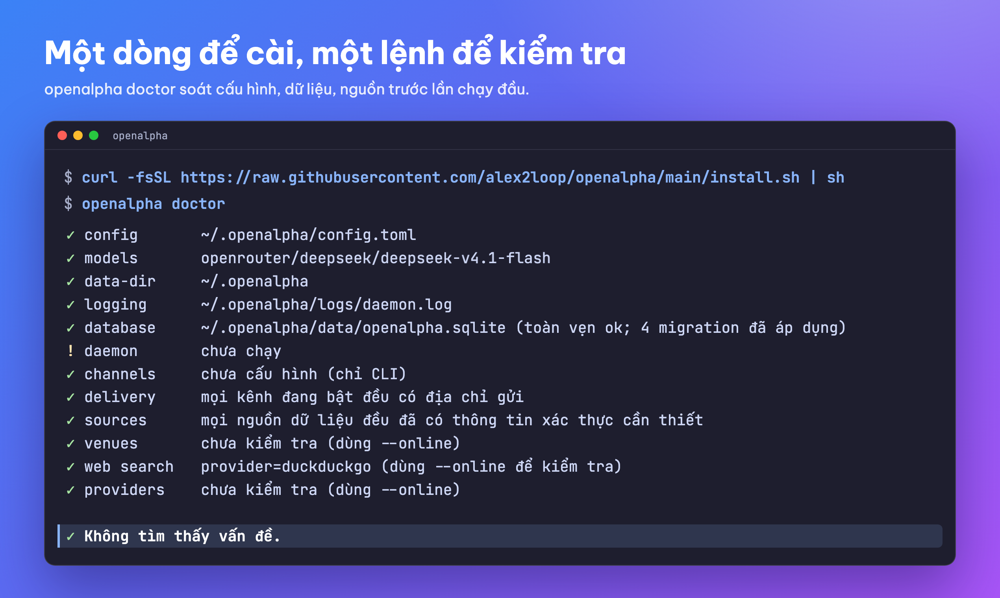

<h1 align="center">OpenAlpha</h1>
<h3 align="center">Bảy nhà phân tích. Mười hai bước kiểm tra. Không tự đặt một lệnh nào.</h3>

<p align="center">
  <strong>🇻🇳 Tiếng Việt</strong> &bull; <strong><a href="README.en.md">🇬🇧 English</a></strong>
</p>

<p align="center">
  Trợ lý phân tích đầu tư chạy ngay trên máy bạn, mạnh nhất ở <strong>cổ phiếu Việt Nam</strong> nhờ chín nguồn dữ liệu trong nước, và theo dõi cả <strong>crypto</strong> lẫn vàng.<br/>
  Mỗi sáng trước giờ mở cửa, nó lọc cả thị trường, chọn ra vài mã đáng xem, tính sẵn nên mua bao nhiêu cho vừa danh mục của bạn, và nêu cả lý do nên mua lẫn lý do nên tránh.<br/>
  <strong>Nó dừng ở đó. Đặt lệnh hay không là quyết định của riêng bạn.</strong>
</p>

<p align="center">
  
  
  
  
  
  
</p>

<p align="center">
  
</p>

https://github.com/user-attachments/assets/86e0aa95-3bd1-4250-9c6d-a442afa3114a

<p align="center">
  <sub>Một ngày của dân văn phòng (70 giây)</sub>
</p>

<p align="center">
  <em>AI đọc được mọi thứ về mã bạn hỏi, trừ một thứ: số tiền của bạn.</em>
</p>

---

## Hỏi một câu, nhận về cái này

Trước khi mua, bạn cần biết hai điều: mã này có đáng mua không, và lời khuyên đó dựa vào đâu.

Ví dụ minh họa, mã và giá đã che:

```
Bạn:  /suggest XXX

XXX - MUA - mức tin cậy 7/10
Xu hướng còn nguyên; khối ngoại mua ròng 3 phiên liên tiếp.
Vào lệnh xx.xxx · cắt lỗ xx.xxx · chốt lời 33% ở xx.xxx · mục tiêu xx.xxx · R:R 1,6
Khối lượng 6,0% tổng tài sản - chiếm 4,2% ngân sách rủi ro, dưới trần 25% của nhóm.

Phe mua: biên lợi nhuận tăng 4 quý liên tiếp.
Phe bán: đà tăng chỉ dồn vào 3 mã; độ rộng thị trường chưa xác nhận.
Rủi ro: T+2 - bạn không thoát được trước thứ Năm.

Chỉ là gợi ý. Bạn tự đặt lệnh, rồi ghi lại bằng /record.
```

Bảy nhà phân tích AI đã tranh luận về mã này, và mười hai bước kiểm tra đều có quyền chặn nó lại. **Nhưng không ai trong số đó được viết ra một con số nào.** Giá vào, cắt lỗ, mục tiêu, khối lượng đều do mã nguồn tính xong trước khi cuộc tranh luận bắt đầu. AI chỉ lo phần *vì sao* và phần *điều gì có thể khiến nhận định đó sai*.

<p align="center">
  
</p>

**Hợp với bạn nếu** bạn tự quản danh mục của mình, muốn thấy lập luận đằng sau mỗi đề xuất thay vì chỉ thấy một mã được phím, và muốn khóa API nằm trên máy mình. **Không hợp nếu** bạn tìm một con bot tự chạy lệnh, hoặc muốn có ai đó quyết định thay bạn. Cả hai đều không có ở đây, và đó là chủ ý.

---

## Kỷ luật thay cho cảm xúc

<p align="center"></p>

**Không FOMO, không gồng lỗ, không "chắc nó hồi".** Cái khó hiếm khi là kiến thức, mà là lúc bấm nút. OpenAlpha chốt kế hoạch khi bạn còn tỉnh táo, rồi giữ bạn đi đúng kế hoạch đó.

- **Con số chốt trước, không mặc cả giữa chừng.** Giá vào, cắt lỗ, chốt lời và khối lượng do mã nguồn tính, AI không sửa được.
- **Cắt lỗ chỉ được nâng, không được hạ.** Không có nút "dời xuống thêm chút nữa".
- **Không cần dán mắt vào bảng điện.** Đặt mốc bằng `/alert`, giá chạm là hệ thống nhắn bạn.
- **Đoán sai thì bị ghi lại, và lần sau bớt tự tin.** Thành tích trong `/reflect` giới hạn mức tin cậy của các đề xuất tiếp theo.

**Khi thị trường đi xuống,** mục tiêu không phải đoán đáy, mà là còn đủ vốn để chơi tiếp:

- **Thị trường xấu thì tự thu nhỏ.** Trần từng nhóm tài sản siết lại và khối lượng đề xuất nhỏ đi.
- **Có trần cho cả danh mục.** Nhiều lệnh nhỏ không cộng dồn thành một khoản cược lớn.
- **Một lệnh tắt mua.** `/trade halt` chặn mọi lệnh mua mới qua OpenAlpha cho tới khi bạn gõ `/trade resume`; bán và cắt lỗ vẫn chạy. Chưa khai khóa sàn thì OpenAlpha vốn không đặt được lệnh nào: gõ `/trade` khi đó chỉ nhận lại tên các khóa cần đặt.

OpenAlpha không hứa bạn không lỗ. Nó giúp mỗi khoản lỗ nhỏ, có kế hoạch và biết trước.

---

## Thị trường và dữ liệu

<p align="center">
  
</p>

| Thị trường | `market:` | Có gì |
|---|---|---|
| **Cổ phiếu Việt Nam** | `equity-vn` | Thị trường sâu nhất: 7 yếu tố (thêm 2 cho ETF), chín nguồn trong nước. Theo dõi khối ngoại và tự doanh, đánh dấu phiên phân phối, đọc lịch công bố thông tin, kiểm tra sức khỏe tài chính, và luôn tính đến T+2: mua sáng nay thì chiều nay chưa bán được. |
| **Tiền mã hóa** | `crypto` | Chỉ giao ngay, 5 yếu tố. Đọc funding và tỷ lệ long/short từ thị trường phái sinh, để bạn thấy đòn bẩy đang dồn về phía nào trước khi vào lệnh. Mua khi giá vượt đỉnh các phiên gần đây (phá kênh Donchian), thoát bằng cắt lỗ dời dần kiểu Turtle. |
| **Vàng trong nước** | `gold-vn` | So giá vàng miếng, vàng nhẫn trong nước với giá thế giới, để bạn biết lúc nào vàng thật sự tăng, lúc nào chỉ là tiệm nới chênh lệch. Lịch tính cả thứ Bảy, vì tiệm vàng vẫn báo giá ngày đó. |
| **Vàng thế giới** | `gold` | 7 yếu tố vĩ mô: lãi suất thực, đồng đô la, tỷ lệ vàng/bạc, nhu cầu chính thức, lạm phát, dòng tiền trú ẩn, và xu hướng. Chỉ để tham chiếu: không sàn nào giao dịch, nên nó dùng để xem giá và làm mốc cho vàng trong nước. |

Chỉ cần gõ mã (`/price FPT`). Khi hai thị trường có cùng một mã thì ghi thêm tên thị trường: `/suggest crypto:UNI`.

<p align="center">
  
</p>

| | |
|---|---|
| **20 yếu tố** | Mọi điểm số đều là phép tính, và mỗi yếu tố cho biết nó góp bao nhiêu phần vào kết luận. |
| **56 công cụ** | 23 công cụ lõi và 33 công cụ giao dịch (2 trong số đó chỉ có khi bạn khai khóa sàn). Cắm thêm được máy chủ MCP. |
| **73 nhà cung cấp LLM** | 38 tên tắt mô hình, qua năm chuẩn kết nối. Nhà cung cấp nào treo thì hệ thống chuyển sang nhà kế tiếp. |
| **4 giao diện** | Terminal, Telegram, Zalo, Zalo cá nhân. |
| **Tiếng Việt** | 3.276 câu chữ viết tay. Giá cổ phiếu hiện theo nghìn đồng như trên bảng điện. |
| **Lưu trữ** | SQLite mặc định, không cần cài thêm. PostgreSQL khi bạn cần. |
| **Kiến trúc** | 15 mô-đun, phụ thuộc một chiều về phía lõi, không vòng lặp. 30 cổng chặn tự động làm build thất bại ngay khi một mô-đun vượt ranh giới. |

**Luôn cố định:** điểm yếu tố, giá vào, cắt lỗ, mục tiêu, khối lượng, mọi mức trần đều do mã nguồn tính, chạy lại cho kết quả y hệt. **Thay đổi giữa các lần chạy:** chỉ có nội dung tranh luận.

---

## 16 lớp an toàn

Có hai chỗ có thể gây hại cho bạn: **tiền** và **phần mềm**. Mọi lớp dưới đây đều áp bằng mã nguồn chứ không phải dặn dò trong prompt, vì prompt chỉ là lời nhờ, còn mã nguồn là ràng buộc.

**Phần tiền (7 lớp).** Hai lớp quyết định một vị thế được phép lớn tới đâu: trần rủi ro đang mở trên toàn danh mục, và trần từng nhóm tài sản siết lại khi thị trường xấu đi. Một lớp giữ đường thoát: cắt lỗ chỉ được nâng, không được hạ. Ba lớp quyết định cái gì được gửi tới sàn và cái gì được ghi nhận: mặc định chỉ gợi ý, lệnh gửi sàn lần lượt từng cái, và sổ ghi chép là nguồn sự thật duy nhất. Lớp thứ bảy là trần chi phí AI theo ngày và theo tháng, để một vòng lặp lỗi không thể đốt tiền của bạn.

**Phần mềm (9 lớp).** Hai lớp bao quanh vòng chạy của AI: duyệt trước mọi thao tác nguy hiểm, và dừng một lượt chạy bị lặp mà không tiến triển. Bốn lớp canh những gì đi vào: chặn tấn công chèn prompt, chống SSRF, giới hạn đường dẫn tệp, và kênh chat mặc định từ chối người lạ. Hai lớp canh những gì đi ra và những gì được chạy: thông tin nhạy cảm bị che trước khi ra khỏi chương trình, và plugin chỉ chạy khi bạn bật.

**Và lớp thứ 16:** mô hình không bao giờ thấy tiền của bạn. Nhà phân tích chỉ nhận tỷ trọng, số lô đang mở và ngày mua đầu tiên; với mã đã bán, nó chỉ biết lãi hay lỗ, không biết bao nhiêu - không bao giờ là khối lượng, giá đã mua, số dư hay tổng tài sản. Phần mã AI dùng để đọc danh mục không hề có hàm trả về số tiền, nên AI *không thể* hỏi tới, chứ không phải chỉ bị lọc bớt.

Khóa API chỉ đọc từ biến môi trường, và nếu bạn không khai khóa sàn thì đường đặt lệnh không hề tồn tại. Chi tiết: [SECURITY.md](SECURITY.md).

---

## Bắt đầu từng bước

Bạn cần một máy macOS, Linux hoặc Windows 10/11 và một khóa API của nhà cung cấp AI. [OpenRouter](https://openrouter.ai) có cả mô hình miễn phí; dùng mô hình trả phí thì thường chỉ tốn vài đô la mỗi tháng.

**1. Cài đặt.** Chỉ một dòng. Nó tải về một tệp chạy duy nhất (không cần cài thêm gì), rồi dẫn bạn qua vài bước thiết lập ngắn (ngôn ngữ, nhà cung cấp và mô hình AI, mức chi mỗi ngày, và Telegram nếu bạn muốn) và ghi lại vào `~/.openalpha/config.toml`. Nếu khóa đã được đặt sẵn, nó gửi thử một tin tới mô hình để bạn biết là chạy được. Muốn đổi một phần thì chạy lại `openalpha onboard` bất cứ lúc nào.

```bash
curl -fsSL https://raw.githubusercontent.com/alex2loop/openalpha/main/install.sh | sh
```

Trên Windows thì mở PowerShell và chạy:

```powershell
powershell -c "irm https://raw.githubusercontent.com/alex2loop/openalpha/main/install.ps1 | iex"
```

<details>
<summary><b>Ghi chú cho Windows</b></summary>

- **Không cần quyền admin.** `openalpha.exe` nằm ở `%USERPROFILE%\.local\bin` và thư mục này được thêm vào PATH của tài khoản bạn. Gõ `openalpha` mà báo không nhận ra lệnh thì mở một cửa sổ PowerShell mới, hoặc chạy thẳng `& "$HOME\.local\bin\openalpha.exe"`.
- **Dữ liệu và cấu hình** nằm ở `%USERPROFILE%\.openalpha`, cũng chính là `~/.openalpha` trong hướng dẫn này.
- **Tùy chọn khi cài:** đặt biến môi trường ngay trước lệnh, ví dụ cài đúng một bản: `$env:OPENALPHA_VERSION="v1.0.3"; irm https://raw.githubusercontent.com/alex2loop/openalpha/main/install.ps1 | iex`. Đầu [install.ps1](install.ps1) liệt kê đủ các tùy chọn. Dòng `powershell -c "..."` ở trên chạy được cả trong PowerShell lẫn CMD.
- **Windows Defender hay phần mềm diệt virus chặn `openalpha.exe`?** Tệp chạy chưa được ký số nên đôi khi bị báo nhầm. Trình cài đã đối chiếu tệp với `SHA256SUMS` của bản phát hành; muốn tự kiểm thì chạy `Get-FileHash "$HOME\.local\bin\openalpha.exe"` rồi so với dòng `openalpha-windows-x64.exe` trong `SHA256SUMS` trên trang [Releases](https://github.com/alex2loop/openalpha/releases). Khớp rồi thì thêm ngoại lệ cho cả thư mục (mã băm đổi theo mỗi bản mới), trong PowerShell chạy bằng quyền Admin: `Add-MpPreference -ExclusionPath "$HOME\.local\bin"`. Đừng tắt hẳn diệt virus.
- **Tiếng Việt hiện thành ký tự lạ?** Dùng Windows Terminal (có sẵn trên Windows 11) thay cho cửa sổ console cũ.
- **Chạy nền:** `openalpha start --background` chạy tới khi bạn `openalpha stop` hoặc tắt máy; khởi động lại máy thì chạy lại lệnh đó.
- **Thích WSL2?** Lệnh `curl ... | sh` cho Linux ở trên chạy được trong WSL2. Bản trong WSL có thư mục `~/.openalpha` riêng, tách khỏi bản Windows.
- **Gỡ cài đặt:** chạy `openalpha stop`, rồi xóa `openalpha.exe` (và `openalpha.exe.old` nếu có, bản cũ mà `openalpha upgrade` để lại) trong `%USERPROFILE%\.local\bin`. Giữ thư mục đó trong PATH vì công cụ khác cũng có thể nằm ở đây. Chỉ xóa `%USERPROFILE%\.openalpha` khi không cần sổ và cấu hình nữa; chạy `openalpha db export --out <thư-mục>` trước nếu muốn giữ.

</details>

Không muốn trả lời từng câu hỏi lúc cài? Bỏ qua bước chọn mô hình rồi lấy luôn [config.minimal.toml](config.minimal.toml): một cấu hình chạy được ngay, chỉ cần khóa OpenRouter, mỗi dòng đều có chú thích tiếng Việt. Lệnh này ghi đè `config.toml` nếu bạn đã có.

```bash
curl -fsSL https://raw.githubusercontent.com/alex2loop/openalpha/main/config.minimal.toml -o ~/.openalpha/config.toml --create-dirs
```

```powershell
New-Item -ItemType Directory -Force "$HOME\.openalpha" | Out-Null; irm https://raw.githubusercontent.com/alex2loop/openalpha/main/config.minimal.toml -OutFile "$HOME\.openalpha\config.toml"
```

**2. Đặt khóa AI và kiểm tra.** Mở một terminal mới, đặt khóa vào đúng biến môi trường bạn đã chọn lúc cài:

```bash
export OPENROUTER_API_KEY="..."   # khóa chỉ nằm trong biến môi trường, không bao giờ trong tệp
openalpha doctor --online   # gửi thêm một tin ngắn để thử mô hình
```

`export` chỉ giữ khóa trong cửa sổ terminal đó. Muốn mọi terminal và bản tin chạy nền đều thấy khóa, thêm đúng dòng `export` ấy vào cuối `~/.zshrc` (macOS) hoặc `~/.bashrc` (Linux). Trên Windows, chạy trong PowerShell:

```powershell
$env:OPENROUTER_API_KEY="..."; setx OPENROUTER_API_KEY "..."   # dùng ngay, và giữ cho mọi terminal sau
openalpha doctor
```

<p align="center">
  
</p>

**3. Mở chat và khai khẩu vị.** Chạy `openalpha chat` rồi gõ `/setup`. Trợ lý hỏi bạn chịu rủi ro tới đâu, chơi cổ phiếu VN, crypto hay cả hai, rồi tắt nhóm bạn không chơi và đề nghị một cách chia tiền ban đầu. Muốn tự khai: `/profile set risk-level balanced`, `/profile disable crypto`. Hồ sơ mới bật sẵn cổ phiếu VN và crypto; nhóm đã tắt thì lần nạp dữ liệu cũng như bản tin sáng đều bỏ qua. Muốn theo dõi vàng trong nước thì `/profile enable gold-vn`.

**4. Ghi số tiền bạn có.** Khối lượng của mọi gợi ý đều tính từ sổ này, nên đây là bước không được bỏ:

```text
/record deposit vps 100000000 VND 2026-08-14   # nạp 100 triệu vào tài khoản VPS
```

**5. Nạp dữ liệu rồi xem thị trường, miễn phí.** Máy mới cài chưa có dữ liệu, nên gõ `/refresh` trước: nó nạp danh sách mã, giá, chỉ số cơ bản và báo cáo tài chính năm của phiên đã chốt gần nhất. Sau đó `/screen equity-vn 20` xếp hạng cả sàn, `/price FPT` xem giá, `/watchlist add FPT HPG BTC` để theo dõi.

**6. Soi kỹ một mã.** `/suggest FPT` cho ra một đề xuất như ví dụ ở trên.

**7. Tự đặt lệnh, rồi ghi lại.** Bạn đặt lệnh ở công ty chứng khoán như mọi khi. Khớp rồi thì ghi vào sổ (bỏ trống phí thì sổ tự tính):

```text
/record buy vps equity-vn:FPT 100 62000 VND 2026-08-14
```

**8. Bật bản tin sáng.** `openalpha start --background` để chương trình chạy nền (từ đó dữ liệu cũng tự nạp). Bản tin tự gửi qua Telegram hoặc Zalo, nên nối một kênh trước ([hướng dẫn kênh](docs/kenh.md)), rồi gõ `/brief enable 08:00` trong kênh đó. Ở terminal thì gõ `/brief` lúc nào cũng đọc được. `openalpha status` cho biết nó còn chạy không, `openalpha stop` để dừng.

**9. Vài tuần sau, xem mình đúng được bao nhiêu.** `/reflect` so từng đề xuất cũ với kết quả thật.

Cài trên máy chủ hay trong CI? Đặt `OPENALPHA_NO_ONBOARD=1` để bỏ bước chọn mô hình; đầu [install.sh](install.sh) liệt kê đủ các tùy chọn. Có bản mới thì CLI nhắc mỗi ngày một lần; `openalpha upgrade` lên bản mới mà giữ nguyên dữ liệu và cấu hình. Muốn gỡ: `openalpha stop`, rồi xóa tệp `openalpha` (mặc định ở `~/.local/bin`) và thư mục `~/.openalpha`. Thư mục này chứa toàn bộ sổ và cấu hình, nên chạy `openalpha db export --out <thư-mục>` trước nếu muốn giữ.

---

## Cấu hình

Bước cài đặt đã ghi sẵn `~/.openalpha/config.toml`. Muốn sửa tay thì một mô hình và một khóa là đủ:

```toml
[[models]]
provider    = "openrouter"
model       = "deepseek/deepseek-v4.1-flash"
api_key_env = "OPENROUTER_API_KEY"

[budget]
max_daily_usd = 5                   # phanh chi tiêu
```

Không muốn dùng khóa AI thì chạy mô hình ngay trên máy qua Ollama hoặc vLLM. Khóa sàn (`OKX_*`, `BINANCE_*`) chỉ cần khi bạn muốn đặt lệnh qua OpenAlpha. Bản tối giản có chú thích: [config.minimal.toml](config.minimal.toml). Mọi tùy chọn khác: [config.sample.toml](config.sample.toml) · [docs/cau-hinh.md](docs/cau-hinh.md)

---

## Dùng mỗi ngày

Phần lớn việc hằng ngày đều **miễn phí**: các lệnh đó chỉ tính trên dữ liệu đã có trong máy, không gọi AI. Các con số dưới đây đo thật ngày 2026-10-15 với mô hình rẻ (`gpt-6-luna` cho tranh luận, `claude-haiku-5.5` cho nghiên cứu); mô hình đắt hơn thì tốn hơn, và `[budget]` luôn chặn trần.

| Bạn muốn | Gõ | Tốn tiền? |
|---|---|---|
| Bản tin trước giờ mở cửa | `/brief` · `/brief enable 08:00` | có: một lượt ngắn cho mỗi mã đang giữ hay theo dõi; mã đã soi trong ngày thì miễn phí |
| Soi kỹ một mã | `/suggest FPT` | khoảng $0,01 |
| Nghiên cứu một câu hỏi, có trích nguồn | `/research <câu hỏi>` | khoảng $0,03 (`quick`) |
| Chủ đề đầu tư đang hình thành | `/themes` | có, tối đa $1 mỗi lần theo mặc định |
| Xếp hạng cả thị trường | `/screen equity-vn 20` | **miễn phí** |
| Nạp dữ liệu còn thiếu cho các thị trường bạn đang dùng (`force`: nạp lại hết) | `/refresh` · `/refresh equity-vn force` | **miễn phí** |
| Bảng giá, vĩ mô, một mã | `/market` · `/overview` · `/price FPT` | **miễn phí** |
| Xem danh mục, kéo về tỷ trọng mục tiêu | `/portfolio` · `/rebalance` | **miễn phí** |
| Danh mục thật sự lời lỗ bao nhiêu, đã trừ tiền nạp rút | `/portfolio nav` | **miễn phí** |
| Ghi nạp, rút, mua, bán | `/record` | **miễn phí** |
| Đồng bộ sổ với sàn (cần khóa API của sàn) | `/record sync okx` · `/reconcile` | **miễn phí** |
| Xem mình đúng được bao nhiêu | `/reflect` | **miễn phí** |
| Đặt lệnh (cần khóa API của sàn và xác nhận) | `/trade` rồi `/trade confirm` | - |

**Đặt lệnh thẳng lên sàn crypto** (cần khóa API của OKX hoặc Binance). Lệnh chỉ được dựng sẵn; không gì ra sàn cho tới khi bạn xác nhận:

```text
/trade spot binance:BTC buy 0.001 limit 60000 tp 70000 sl 56000   # mua giới hạn, kèm chốt lời và cắt lỗ
/trade confirm                                                     # gửi lệnh đang chờ lên sàn
```

Cổ phiếu VN mặc định ghi sổ ở sàn `vps`; dùng công ty chứng khoán khác thì khai trong `[trading.venues.<tên>]` ([cấu hình](docs/cau-hinh.md#trading)). Các con số ở trên chỉ minh họa cú pháp, không phải gợi ý mua bán. Đầy đủ: `/help` trong chat, hoặc [cẩm nang tiếng Việt](docs/cam-nang.md).

---

## Nghiên cứu có trích nguồn

Hỏi một câu cần dữ liệu mới từ bên ngoài, nhận về một báo cáo mà mỗi nhận định đều chỉ ra được nó đến từ đâu. Một lần chạy thật, rút gọn:

```
Bạn:  /research quick Lợi nhuận 9 tháng 2026 của FPT đạt bao nhiêu so với kế hoạch năm,
      và các công ty chứng khoán dự báo cả năm thế nào?

1 lượt tìm kiếm · 8 trang đã đọc
5 nguồn được dùng · 5 nhận định có bằng chứng
⚠️ 1 vấn đề về bằng chứng
  • Chưa tìm thấy đủ nguồn ủng hộ cho một nhận định. ×1
✓ Hoàn tất nhưng còn thiếu sót · Mức độ bằng chứng: một phần

Kết luận: Nguồn tìm được chưa có số lợi nhuận 9 tháng 2026 của FPT, nên chưa thể
tính tỷ lệ so với kế hoạch năm. Số mới nhất là lũy kế 8 tháng.

Kết quả 8 tháng 2026 (theo HSC, tháng 8/2026):
- Lợi nhuận thuần 6.761 tỷ đồng, tăng 13,8% so với cùng kỳ.
- Bằng 63,8% dự báo cả năm của HSC, chưa phải kế hoạch chính thức của FPT.

Dự báo cả năm 2026 của các công ty chứng khoán:
- BSC (khuyến nghị MUA, giá mục tiêu 90.600 đồng): lợi nhuận sau thuế cổ đông
  công ty mẹ 10.670 tỷ đồng, tăng 14%.
- BVSC: lợi nhuận sau thuế 10.716 tỷ đồng, tăng 14,3%.
- AAS (24HMoney, 01/10/2026): lợi nhuận sau thuế 10.553 tỷ đồng, tăng 12,6%;
  lợi nhuận trước thuế 11.909 tỷ, bằng 102% kế hoạch.

Nhận định: Đa số dự báo cho thấy FPT có khả năng đạt hoặc vượt nhẹ kế hoạch
lợi nhuận năm 2026. Các con số này là dự báo, không phải kết quả.

$0.0309 · 47 giây
```

- **Mô hình không tự lên mạng.** Code tìm và tải trang trước, mô hình chỉ đọc những gì code đã lấy về, nên không thể bịa ra một nguồn.
- **Trích dẫn được kiểm từng chữ.** Một nhận định phải dựa trên đoạn trích có thật trên trang đã tải; trích dẫn không khớp, hay nhận định chưa đủ nguồn, đều bị gắn cờ như dòng ⚠️ ở trên.
- **Dự báo là dự báo.** Giá mục tiêu, ước tính hay kế hoạch công ty được đánh dấu và trình bày đúng là dự báo của ai, không bao giờ thành "đã đạt".
- **Thiếu thì nói thiếu.** Không có số 9 tháng thì báo cáo nói chưa có và đưa số 8 tháng gần nhất, chứ không đoán. Hai nguồn lệch nhau về một con số thì báo là mâu thuẫn.
- **Ba mức sâu:** `quick`, `standard` (mặc định) và `thorough`, ở mức `thorough` bạn được xem và sửa kế hoạch nghiên cứu một lần trước khi chạy.
- **Nguồn tìm kiếm quyết định độ sâu.** Mặc định là DuckDuckGo: miễn phí, không cần khóa, nhưng ít kết quả, nên câu hỏi về số liệu mới thường về tay không. Khai `[web_search]` bằng Exa, Tavily, Brave hay Serper ([cấu hình](docs/cau-hinh.md)) thì báo cáo có nhiều nguồn hơn hẳn.

Chi tiết: [docs/nghien-cuu.md](docs/nghien-cuu.md)

---

## Nhà phân tích của riêng bạn

Ngoài nhà phân tích chính, bạn tạo thêm được nhà phân tích riêng chỉ bằng một tệp TOML: một đoạn dặn dò, danh sách công cụ được dùng và trần chi phí. Thêm `[focus]` là có một **ý kiến thứ hai** với khẩu vị riêng. Đề xuất của nó được chấm điểm tách riêng, không bao giờ đụng vào cắt lỗ, cảnh báo hay bản tin sáng của danh mục chính:

```bash
openalpha agent add ngan-hang      # tạo tệp mẫu, rồi `agent edit ngan-hang` để sửa
```

```toml
system_prompt = "Chỉ xem cổ phiếu ngân hàng, nắm giữ dài hạn, ưu tiên cổ tức đều."
max_daily_usd = 0.5                 # trần chi phí riêng mỗi ngày

[focus]
markets = ["equity-vn"]
sectors = ["banks"]
horizon = "long"

[capabilities]
tools = ["suggestion_run", "suggestion_track_record", "market_screen", "market_price", "market_news"]
```

Hỏi nó bằng `openalpha chat --agent ngan-hang`, hoặc gắn nó vào một nhóm Telegram/Zalo bằng `/agent ngan-hang`. `openalpha agent list` cho thấy nó đúng được bao nhiêu và hay đồng ý với các agent khác tới đâu; `agent pause` tắt nó ngay mà không cần khởi động lại. Chi tiết: [docs/tro-ly.md](docs/tro-ly.md)

---

## Nhúng và cắm vào ứng dụng AI khác

Runtime vừa là chương trình chạy độc lập, vừa là thư viện (SDK) để nhúng. Hiện nhúng từ bản clone của repo; gói chưa phát hành lên npm:

```ts
import { boot } from '@openalpha/runtime/app'
const { app, dispose } = await boot({
  mode: 'cli',
  env: process.env,
  configPath: './config.toml',
  shutdownSignal: AbortSignal.timeout(60_000),
  tools: [],
  agents: [],
})
```

Hoặc cắm vào Claude Code, Codex, Cursor, VS Code, Gemini CLI... như một máy chủ MCP - khi đó AI của chính ứng dụng ấy làm phần suy nghĩ, bạn không cần khóa AI riêng:

```bash
openalpha mcp install      # hoặc --host codex, cursor, vscode, gemini, opencode, zed
```

Đề xuất tạo theo cách này được chấm điểm riêng trong `/reflect` (dưới tên `client:<model>`), và cách này không bao giờ đặt được lệnh. Chi tiết: [docs/dev/mo-rong.md](docs/dev/mo-rong.md)

---

## Hỏi đáp và hỗ trợ

- **Hỏi cách cài, cách dùng, nhận tin bản mới:** [nhóm Zalo OpenAlpha](https://zalo.me/g/yl7iqyfovvtyosujulea). Nhóm chỉ hỗ trợ dùng phần mềm, không bàn mã nào nên mua. Che khóa API trước khi dán cấu hình. Admin không bao giờ nhắn riêng để xin khóa hay tiền.
- **Báo lỗi, đề xuất tính năng:** [GitHub Issues](https://github.com/alex2loop/openalpha/issues/new/choose). Lỗi chỉ được theo dõi khi có issue.
- **Lỗ hổng bảo mật:** báo riêng theo [SECURITY.md](SECURITY.md), không đăng lên nhóm hay issue.

---

## Phát triển

```bash
git clone https://github.com/alex2loop/openalpha.git && cd openalpha
bun install
bun run dev -- onboard

bun run check       # lint + typecheck + các cổng hợp đồng
bun run lint:arch   # các cổng kiến trúc
```

Một thay đổi chỉ được nhận khi cả hai lệnh trên đều qua. Quy tắc nội bộ và bất biến nghiệp vụ: [AGENTS.md](AGENTS.md). Bản clone cập nhật bằng `git pull`.

Báo lỗi hoặc góp ý: [GitHub Issues](https://github.com/alex2loop/openalpha/issues) · [CONTRIBUTING.md](CONTRIBUTING.md) · [Quy tắc ứng xử](CODE_OF_CONDUCT.md). Lỗ hổng bảo mật thì báo riêng theo [SECURITY.md](SECURITY.md).

**Nói trước về độ ổn định.** Đây là bản công khai đầu tiên của một công cụ đã được dùng thật hằng ngày trong nhiều tháng: ổn định ở những việc dùng mỗi ngày, còn thô ở những phần khác. Chưa có bộ test; cơ sở dữ liệu phải dựng lại khi đổi cấu trúc; giữa hai phiên bản có thể có thay đổi không tương thích; và chưa chuyển được tài sản giữa các sàn.

---

## Giấy phép và miễn trừ

Mã nguồn theo giấy phép MIT, dùng thế nào tùy bạn. Tên, logo và Bé Alpha thì không nằm trong giấy phép:
xem [NOTICE.md](NOTICE.md#tên-và-logo-không-đi-kèm-giấy-phép). Phát hiện lỗ hổng thì báo riêng theo
[SECURITY.md](SECURITY.md).

**Dữ liệu là chuyện khác.** OpenAlpha không đóng gói sẵn dữ liệu thị trường nào: nó lấy dữ liệu từ
từng nhà cung cấp khi chạy, ngay trên máy bạn, và điều khoản sử dụng là chuyện giữa bạn với họ.
[NOTICE.md](NOTICE.md) liệt kê mọi trang mà nó có thể đọc, và những gì nên kiểm tra trước khi bật một nguồn.

OpenAlpha là trợ lý nghiên cứu và ghi sổ. Đề xuất ở đây mang tính tham khảo, **có thể sai, và không phải lời khuyên đầu tư**. OpenAlpha không biết hết hoàn cảnh của bạn, chỉ đặt lệnh khi bạn duyệt, và không ai đoán chắc được thị trường. Mọi quyết định là của bạn. Đừng đầu tư số tiền bạn không chịu mất được.
