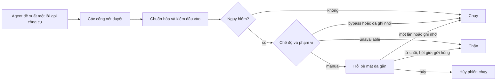
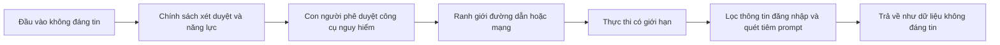

# An toàn: phê duyệt và bảo mật

Có hai việc khác nhau, và OpenAlpha phòng thủ cả hai song song. **Phê duyệt** quyết định một hành
động nguy hiểm có được chạy hay không. **Bảo mật** quyết định hành động đó với tới được những gì khi
đã chạy. Cái này không thay được cái kia, và cả hai đều do mã thực thi, không phải nhờ một câu dặn
trong prompt.

Nói thật ngay từ đầu: một lệnh shell đã được duyệt chạy với đúng quyền của tiến trình dịch vụ nền (daemon). Thư mục
làm việc chỉ là điểm xuất phát, **không** phải sandbox của hệ điều hành. Muốn nhốt mã thật sự thù
địch, hãy dùng container hoặc một tài khoản dịch vụ bị hạn chế quyền.

## Danh mục kiểm cho operator

1. Giữ khóa API trong biến môi trường mà cấu hình nêu tên. Không bao giờ đặt giá trị bí mật vào
   `config.toml`, prompt, kỹ năng hay bộ nhớ.
2. Để chế độ phê duyệt ở `manual`, trừ khi cả người gọi lẫn phần việc đều đáng tin.
3. Giữ khâu xét duyệt kênh ở dạng danh sách cho phép hoặc ghép nối, và khai mã người dùng operator
   cho các chat dùng chung.
4. Chỉ nạp công cụ plugin có chạy mã từ các plugin đi kèm đáng tin. Để `[plugins].allow_code` tắt,
   trừ khi bạn đã đọc `sources.ts` của plugin đó.
5. Chỉ cho mỗi agent những công cụ, năng lực và host đi ra mà nó cần.

Chạy `openalpha doctor` sau mọi thay đổi, hoặc `openalpha doctor safety` để xem công tắc rủi ro nào đang bật. Cấu hình được trộn và đóng băng lúc khởi động, nên phải khởi
động lại tiến trình thì thay đổi về bảo mật mới có hiệu lực.

---

## Phần một: phê duyệt

Phê duyệt chặn các tác dụng phụ mà agent xin làm. Nó cũng giữ nguyên quy tắc sản phẩm: OpenAlpha mặc
định chỉ **gợi ý**, và nơi duy nhất đặt được lệnh thì hỏi bạn ở từng lần.

### Ba câu trả lời của bạn

| Quyết định | Tác dụng |
| --- | --- |
| **Từ chối** | Chặn lời gọi này. Trong CLI, văn bản tự do sẽ về lại agent như phản hồi về việc cần đổi gì. |
| **Cho một lần** | Chạy đúng lời gọi này, một lần. |
| **Ghi nhớ** | Cho phép trong suốt cuộc trò chuyện hoặc kết nối MCP. Không có nếu công cụ không cho nhớ, hoặc nếu tham số dài đến mức ô hỏi không hiện đủ. |

Mọi thứ không nhận diện được, sai định dạng, hết hạn hay không gửi tới được đều chặn lời gọi. Hủy thì
dừng luôn cả khoảng chờ lẫn phiên chạy.

"Ghi nhớ" không bao giờ có với việc theo lịch hay agent con được ủy quyền. Nó cũng không có với
`order_place`: **hai lệnh giống nhau là hai lần khớp thật**, nên câu trả lời của bạn cho lệnh này
không bao giờ áp sang lệnh kế tiếp.

### Cái gì cần phê duyệt

Một lời gọi cần phê duyệt khi bất kỳ điều nào sau đây đúng:

1. Công cụ ghi tệp hoặc chạy lệnh shell.
2. Công cụ đến từ một server MCP bên ngoài.
3. Công cụ tự đánh giá **đầu vào này** là nguy hiểm.

Quy tắc thứ ba để việc chỉ đọc đi thẳng. Liệt kê các việc theo lịch thì không cần hỏi, xóa một việc
thì phải hỏi. Gọi lại bộ nhớ thì không cần hỏi, ghi hay xóa thì phải hỏi.

Đọc trang web cũng vậy. Agent mở luôn link bạn gửi hoặc link mà một lần tìm kiếm hay đọc tin mang về.
Nó hỏi bạn trước khi tự ghép hay sửa link, tự thêm header, hoặc đã đọc quá `[loop] max_unasked_fetches`
trang trong một phiên chạy (mặc định 10). Một trang web có thể giấu lệnh bên trong, và link do agent tự
ghép chính là đường nó có thể mang danh mục, hồ sơ hay ghi chú của bạn ra ngoài, nên link đó phải để
bạn duyệt. Đoạn bạn chuyển tiếp vào chat, hay việc một agent giao cho agent khác, đều được coi là lời của
người khác, không tính là link bạn gửi.
Những lần hỏi này không có nút "nhớ".

Phê duyệt **không** thay cho phân quyền. Agent phải vốn đã được phép dùng công cụ đó, và lời gọi phải
qua khâu kiểm tra đầu vào, rồi bạn mới bị hỏi.

### Các chế độ

| Chế độ | Hành vi |
| --- | --- |
| `manual` | Hỏi một con người. Chế độ tương tác bình thường. |
| `bypass` | Cho phép mà không hỏi. Phải chọn tường minh. |
| `unavailable` | Chặn, vì phiên chạy không có cách đáng tin nào để hỏi một con người. |

`bypass` cho phép **trước khi** cổng được hỏi tới, nên không công cụ nào tự biến mình thành
không-thể-bypass. Thay vào đó, công cụ có tác dụng không hoàn tác được ngoài tiến trình này sẽ tự
kiểm tra chế độ và từ chối. Đặt lệnh dưới `bypass` còn cần thêm `[trading.orders] allow_unattended`.
Đó là hai quyết định có chủ ý, không phải một.

Những trường hợp sau luôn dùng `unavailable`: heartbeat, việc theo lịch không có đích, agent con
không có tuyến chat, và phiên chạy một phát không tương tác (trừ khi bạn chọn bypass). Việc theo lịch
có đích thì hỏi qua đích đó, và `schedule run-now` cũng theo đúng đích của việc.

### Phạm vi và thời gian sống

| Phạm vi | Được đưa ra | "Ghi nhớ" sống bao lâu |
| --- | --- | --- |
| Cuộc trò chuyện tương tác | từ chối, một lần, ghi nhớ | Trong bộ nhớ tiến trình, theo từng cuộc trò chuyện và lời gọi. Không bao giờ lưu xuống đĩa. |
| Client MCP | từ chối, một lần, ghi nhớ | Theo kết nối MCP đang hoạt động. |
| Việc theo lịch có đích | từ chối, một lần | Không có. |
| Agent con có tuyến | từ chối, một lần | Không có. |

Phê duyệt đã ghi nhớ chỉ phủ đúng điều khóa của nó nêu, và mất khi khởi động lại:

- lệnh shell: đúng lệnh cùng các đối số;
- công cụ từ server MCP bên ngoài: toàn bộ bộ đối số (không kể thứ tự khóa);
- mọi công cụ khác: tên công cụ.

Lời gọi có khóa khác sẽ hỏi lại. Lần từ chối trong cuộc trò chuyện không được nhớ. Lần từ chối trên MCP
thì có, để agent không thể hỏi mãi về cùng một công cụ đã bị từ chối trên một kết nối.

**Agent con không bao giờ thừa hưởng chế độ bypass hay các phê duyệt đã ghi nhớ của agent cha.** Với
chat có tuyến, nó xin được phê duyệt một lần qua tuyến đó; không có tuyến thì các lời gọi nguy hiểm
của nó bị chặn.

### Trong lúc bạn quyết

Hạn chót của phiên chạy được **tạm dừng** trong lúc chờ, để thời gian bạn suy nghĩ không ăn vào phần
hạn mức dành cho việc thật. Khoảng chờ có mốc hết giờ riêng: `[loop].approval_timeout_ms` (120 giây)
thường ngày, `[schedule].approval_timeout_ms` (900 giây) với việc theo lịch có đích. Các lời gọi giống
hệt nhau đang chờ trong một phiên chạy chỉ hiện một ô hỏi, không phải ba.

### Theo từng bề mặt

**CLI.** In tên công cụ cùng chi tiết của lời gọi (với `shell_exec` là cả lệnh và các đối số). Thêm
`--verbose` thì in cả bản xem trước tham số đã lọc thông tin đăng nhập. `o`/`once` hoặc `y`/`yes` là
cho một lần, `r`/`remember` là ghi nhớ nếu phạm vi cho phép, mọi thứ khác là từ chối. Ô hỏi từ các
phiên chạy con song song lần lượt hiện từng cái. Đối số lồng nhau của công cụ MCP được in dạng JSON
gọn. Lời gọi quá dài để hiện đủ sẽ mở đầu bằng `[Tham số bị cắt bớt - chỉ có thể duyệt một lần]` và
không có nút ghi nhớ.

**Kênh.** Ô hỏi dạng nút bấm chỉ đi tới đúng kênh sở hữu phiên chạy. Một lần bấm chỉ được nhận khi
mọi điều sau đều đúng: yêu cầu vẫn đang chờ, lần bấm đến từ đúng chat đã được hỏi, quyết định đó thật
sự đã được đưa ra, **và** người bấm là một operator có thẩm quyền.

Kênh không có nút bấm (Zalo) thì hỏi bằng các mã ngắn như `/4821` để bạn gõ lại. Mỗi mã chỉ dùng được
trong chat đó và chỉ khi câu hỏi còn mở. Chỉ khi không tạo được mã nào thì nó mới từ chối ngay, và nói
rõ điều đó. Khi tắt máy, mọi yêu cầu còn chờ đều bị từ chối.

**MCP.** Phê duyệt qua form elicitation khi client hỗ trợ. Client không có elicitation thì không duyệt
được, nên các lời gọi nguy hiểm hỏng theo hướng đóng.

**Bộ lập lịch và ủy quyền.** Chỉ khi có kênh và chat đích, và chỉ từ chối hoặc cho một lần. Ô hỏi của
agent con nêu rõ cả con lẫn phiên chạy cha.

### Vì sao nó giữ được

- Biết mã yêu cầu thôi chưa đủ thẩm quyền: câu trả lời còn phải khớp đúng kênh của phiên chạy.
- Lần bấm trên kênh gắn thẩm quyền vào đúng chat đã hỏi và vào danh sách operator.
- Bản xem trước tham số được lọc thông tin đăng nhập và chặn ở 2.000 ký tự.
- `shell_exec` từ chối lời gọi mà lệnh và đối số không vừa phần chi tiết 400 ký tự của ô hỏi. Nó cũng
  đặt trong dấu nháy các đối số có khoảng trắng hoặc dấu nháy, nên ô hỏi luôn hiện đủ câu lệnh, kể cả
  ranh giới giữa các đối số.
- Phê duyệt diễn ra sau khâu chuẩn bị đầu vào và ngay trước khi chạy, nên lời gọi bị chặn không bao
  giờ chạy được.
- Thiếu giao diện, gửi hỏng, hết giờ, bị hủy, phản hồi sai định dạng và tắt máy - tất cả đều **hỏng
  theo hướng đóng**.

---

## Phần hai: các tầng bảo mật

Không tầng nào thay được tầng nào. Phê duyệt quyết định một hành động có được chạy; chính sách đường
dẫn và mạng vẫn kiểm đích của nó; đường ống đầu ra vẫn coi kết quả là dữ liệu chứ không phải chỉ dẫn.

### Thông tin đăng nhập và log

Thông tin đăng nhập của mô hình đọc từ biến môi trường mà `api_key_env` nêu tên; của lưu trữ và tìm
kiếm cũng theo cách đó. Thiếu giá trị lưu trữ thì khởi động hỏng ngay, thay vì chạy lên một
dịch vụ cấu hình dở dang; thiếu khóa mô hình chỉ làm các lượt gọi mô hình phải chờ và `start` sẽ cảnh báo;
khóa tìm kiếm rỗng chỉ tắt tìm kiếm web và báo rõ điều đó.

Một vài thông tin đăng nhập là tệp riêng dưới thư mục dữ liệu, quyền `0600`: lần đăng nhập thuê bao
của nhà cung cấp mô hình, token API tự sinh, khóa mạng xã hội và phiên Zalo cá nhân. Chúng không đi
theo `db export` hay `db backup`; xem [Lưu trữ](luu-tru.md#tệp-nằm-ngoài-cơ-sở-dữ-liệu).

Khóa nhập trên trang văn phòng (Cài đặt > Nhà cung cấp, Sàn giao dịch và Công cụ) được ghi vào đúng tệp
khóa mà `openalpha key set` ghi, `<thư mục dữ liệu>/env`, quyền `0600`, thay thế nguyên khối.

- Dịch vụ nền không bao giờ gửi lại giá trị đã lưu. Trang chỉ biết một tên đã được lưu hay chưa, và giá
  trị bị từ chối không xuất hiện lại trong lỗi, trong log hay trong câu báo của ô nhập.
- Trang chỉ đặt được những biến mà mô hình, sàn, tìm kiếm web và nguồn dữ liệu của bạn đọc. Mã API,
  token bot của từng kênh, biến của máy chủ MCP, các biến điều khiển của chính sản phẩm (như
  `OPENALPHA_DATA_DIR`) và những tên quyết định cách chương trình khởi chạy đều bị từ chối. Giá trị có
  xuống dòng, có khoảng trắng ở đầu hay cuối, hoặc dài quá 4.096 ký tự cũng vậy.
- Khóa nằm trong biến nào (`api_key_env`, `[trading.sources]`, `credentials` của một sàn) chỉ đặt được
  bằng câu lệnh hoặc sửa tệp, nên trang không thể trỏ một khóa sang chỗ mới.
- Khi đã đặt `[api] public_url`, dù mới lưu trên đĩa hay đang chạy, trang không đổi khóa nào và không bắt
  đầu đăng nhập ChatGPT.

Việc nhận diện thông tin đăng nhập bao gồm header authorization, token của nhà cung cấp, JWT, khóa
riêng, chứng chỉ và URL có mang thông tin đăng nhập. Nó được dùng theo ba hướng:

- các yêu cầu đi ra từ chối những phần URL, header và thân có dạng bí mật;
- bộ nhớ từ chối các giá trị trông như bí mật;
- đầu ra công cụ, lỗi và stack trace được lọc trước khi hiển thị hay ghi log.

Chi tiết của việc lọc:

- Phép gán kiểu `token: ...` hay `password=...` chỉ bị che khi giá trị dài từ 8 ký tự trở lên, nên
  `pass: 12` và `token: ETH` đi qua nguyên vẹn.
- Khóa đặt trong dấu nháy (`"password": "..."`, kể cả trong chuỗi JSON đã thoát) được đọc theo cùng
  cách.
- Dòng tiêu đề `Cookie:` hoặc `Set-Cookie:` bị che tới hết dòng.
- Văn bản truyền theo luồng tới ứng dụng được lọc xuyên qua ranh giới giữa các đoạn, nên một bí mật bị
  cắt đôi giữa hai đoạn vẫn bị bắt. Luồng giữ lại từ đang dở, hoặc dòng tiêu đề hay khối khóa riêng
  đang dở, cho tới khi đủ để xét; quá 512 ký tự thì nhả những gì đang có.

Việc lọc là lớp phòng thủ cuối, không phải giấy phép để đặt thông tin đăng nhập ở nơi mô hình thấy
được.

### Tệp và shell

Các công cụ tệp phân giải qua thư mục làm việc của agent và kiểm lại định danh thư mục đó, nên symlink
hay việc tráo thư mục không thoát ra được. Cả đọc lẫn ghi đều từ chối đường dẫn thiết bị và các tệp
nhạy cảm của máy: khóa SSH, thông tin đăng nhập cloud và kube, khóa GnuPG, tệp `.env`, tệp mật khẩu,
socket container. Riêng ghi còn từ chối các tệp chỉ dẫn dự án được bảo vệ (`AGENTS.md`, `CLAUDE.md`,
`CONTEXT.md`).

Chính sách shell từ chối các bộ khởi chạy và lớp bọc có thể lách khâu kiểm tra, các trình thông dịch
(python, node, awk...), lệnh định dạng hệ tệp, lệnh xóa cưỡng bức thư mục gốc, và lệnh ghi thẳng vào
thiết bị. Việc chạy hủy được và bị chặn theo thời lượng cùng dung lượng đầu ra. Tiến trình con nhận
môi trường đã lọc, cùng `HOME` và thư mục tạm riêng cho mỗi phiên chạy.

Mọi thứ ghi dưới thư mục dữ liệu đều chỉ của riêng bạn: thư mục `0700`, tệp `0600`. Phạm vi này gồm
token của nhà cung cấp, tệp agent và kỹ năng, các bản cài plugin, log, thư mục nháp, đầu ra `db export`
và các bản sao lưu cơ sở dữ liệu.

- Bản sao lưu chứa mọi cuộc trò chuyện, mọi bộ nhớ và mọi dòng sổ, nên nó không bao giờ thừa hưởng một
  umask để lại quyền đọc cho người khác.
- Tệp xuất hiện bằng một lần rename nguyên tử, với quyền đã đặt **trước** lần rename đó, nên không ai
  thấy một tệp dở dang hay mở quyền.
- Bản sao lưu là tệp duy nhất do chính cơ sở dữ liệu ghi ra. Nên nó được ghi trong một thư mục tạm riêng
  tư `0700` và chỉ chuyển ra khi đã hoàn tất.
- Windows không có các bit quyền này. Ở đó thư mục dữ liệu nằm trong hồ sơ người dùng của bạn
  (`%USERPROFILE%\.openalpha`), vốn đã chặn các tài khoản khác.

### Yêu cầu đi ra

- **Chỉ HTTPS.** Ngoại lệ duy nhất là địa chỉ loopback (`localhost`, `127.0.0.1`, `[::1]`), dành cho
  máy chủ mô hình chạy ngay trên máy này như Ollama.
- **Danh sách cho phép.** Nếu có, tên host phải khớp.
- **Tên bị chặn.** Host kiểu metadata của cloud, `.local` và `.internal` bị chặn từ trước khi hỏi DNS.
- **Chỉ địa chỉ công khai.** Mọi endpoint đã phân giải đều được kiểm xem có định tuyến công khai được
  không, và yêu cầu được ghim vào đúng địa chỉ đã kiểm. Nhờ đó chặn được DNS rebinding.
- **Chuyển hướng.** Tối đa năm chặng, mỗi đích đều kiểm lại. Khi chuyển hướng sang host khác thì mất
  các header nhạy cảm (đường này chỉ GET hoặc HEAD nên không có thân để rò).
- **Hủy.** Tín hiệu hủy lan qua cả khâu phân giải DNS lẫn khâu gửi yêu cầu.

Endpoint của một server MCP qua HTTP được kiểm lại ở mỗi yêu cầu và không đi theo chuyển hướng nào,
nhưng không được ghim địa chỉ, nên khoảng hở rebind giữa lúc kiểm và lúc gọi vẫn còn.

Trang văn phòng tự gọi ra ngoài đúng một chỗ, từ trình duyệt của bạn chứ không phải từ dịch vụ nền: thời tiết
hiện tại của thành phố thuộc vùng nhà từ `api.open-meteo.com`, mỗi 30 phút, chỉ gửi vĩ độ và kinh độ của
thành phố, không kèm cookie hay referrer. Nó không bao giờ chạy khi xem thử giờ khác hay khi giảm chuyển
động, và gọi lỗi thì văn phòng dùng thời tiết tự tạo. Chính sách bảo mật của trang đã biên dịch chỉ cho nó nối tới dịch vụ nền
và đúng máy chủ đó; Cài đặt > Dữ liệu và kết nối ghi tên nó cạnh các máy chủ mà dịch vụ nền gọi.

Danh sách `hosts` của agent là một ranh giới năng lực cho `web_fetch` và cho các trang `research` đọc
trực tiếp: thêm một host là cố ý nới phạm vi agent đó với tới được. Trang research nằm ngoài danh sách bị bỏ
qua như một lần đọc hỏng bình thường, phiên chạy vẫn đi tiếp.

### Nội dung công cụ và kỹ năng

Đầu ra công cụ được chuẩn hóa trước khi quay lại ngữ cảnh của mô hình:

1. Bỏ các chuỗi ANSI, lọc thông tin đăng nhập. Toàn bộ kết quả được lọc trước khi cắt ở bất kỳ chỗ nào,
   nên một khối khóa không thể bị cắt đôi rồi để lộ nửa còn lại. Kết quả lớn hơn 4 MiB (chỉ một máy chủ
   MCP từ xa mới gửi được) bị bỏ mà không đọc, thay bằng một dòng ghi chú.
2. Phát hiện các mẫu tiêm prompt **trước** khi rút gọn mảng và áp trần dung lượng.
3. Chuẩn hóa các mảng và giới hạn đầu ra: 32 KB trong một cuộc trò chuyện, 64 KB cho một lời gọi MCP được
   phục vụ mà client tự lo ngân sách ngữ cảnh. Phần nào dài hơn thì giữ phần đầu và phần cuối. Trần này
   tính theo văn bản như mô hình nhận được, đã thoát ký tự và nằm trong lớp bọc, không tính theo văn bản
   thô.
4. Nội dung đáng ngờ nhận một thông báo bảo mật đi kèm ngay trong luồng.
5. Kết quả được bọc lại thành tool result, nên mô hình coi nó là dữ liệu.

`web_fetch` đọc tối đa 2 MiB của một trang. Trang văn bản dài hơn trả về phần đầu kèm
`"truncated": true` thay vì thất bại; phản hồi không phải văn bản vẫn bị từ chối.

Khâu cài kỹ năng quét nghiêm hơn: tiêm prompt, payload shell và Unicode vô hình đều có thể chặn thẳng
một kỹ năng.

### Plugin và kênh

Chỉ các plugin đi kèm đáng tin mới được đóng góp công cụ có chạy mã, handler lệnh slash và CLI, hay
định nghĩa kênh. Plugin đã cài mà không đáng tin thì chỉ đóng góp nội dung khai báo, và chỉ khi có
`[plugins].allow_untrusted`.

Ngoại lệ duy nhất có chạy mã đã cài là `sources.ts` của một nguồn dữ liệu thị trường. Nó cần thêm công
tắc riêng `[plugins].allow_code` ngoài `allow_untrusted`, và chạy với toàn bộ quyền của dịch vụ nền: endpoint
đã khai chỉ ràng buộc được một plugin trung thực, không hơn.

Khâu xét duyệt kênh là danh sách cho phép hoặc ghép nối. Không có chế độ mở. Trong chat dùng chung,
hãy khai mã người dùng operator tường minh, để một người đọc đã được nhận không tự động thành
operator: khi chưa khai, mọi người dùng đã được nhận trong chat đều tính là operator.

### Sổ sách và lệnh

Mô hình thấy tỷ trọng và phần trăm các vị thế của bạn, không bao giờ thấy tiền, khối lượng hay giá
vốn. Mọi trường số tuyệt đối bị cắt khỏi các gói dữ liệu đưa cho mô hình. Con đường đặt lệnh duy nhất
hỏi một con người ở từng lần và không bao giờ nhớ câu trả lời đó. Trần chi tiêu giới hạn mỗi phiên
chạy được tiêu bao nhiêu; xem [ngân sách](ngan-sach.md).

### Mạng xã hội

Agent trên một [mạng xã hội](mang-xa-hoi.md) đọc văn bản của người lạ trong khi đang giữ công cụ, nên
ranh giới là mã, không phải lời nhắc. Cách ghim bản skill đã duyệt, quy tắc công cụ, máy chủ được ghim,
khóa và bản nháp nằm ở trang đó. Ở ranh giới yêu cầu, runtime còn chặn thêm:

- **Đường dẫn và nhãn.** Yêu cầu phải khớp một mẫu đã ghim. `..`, dấu gạch chéo mã hóa, dấu gạch chéo
  ngược, `?` và `#` bị từ chối trước khi gọi. Nhãn quyết định chính sách, và yêu cầu tài khoản, đăng
  ký, quản trị không bao giờ được gửi.
- **Kiểm tra bí mật.** Nội dung giống bí mật hoặc chứa chính khóa của agent bị từ chối.
- **MCP.** `social_request` và `social_skill` bị giữ lại khỏi bề mặt máy chủ MCP.

### Lệnh được chuyển cho dịch vụ nền

Khi có dịch vụ nền đang chạy, CLI chuyển các lệnh thuộc trạng thái dịch vụ nền cho nó qua `/v1/exec` (xem
[vận hành](van-hanh.md#lệnh-chạy-trong-dịch-vụ-nền)). Socket này chạy một lệnh ngay trong dịch vụ nền, nên nó chỉ
nhận đúng terminal của bạn trên cùng máy. Mọi điều kiện sau đều phải đúng, và được kiểm trước khi kết nối
được nâng cấp:

- Token API trong tiêu đề `Authorization: Bearer`. Cookie đăng nhập của trang không bao giờ được đọc, và
  token sai được tính vào cùng cơ chế khóa tạm như mọi lệnh gọi API khác.
- Không có tiêu đề `Origin`. Trình duyệt luôn gửi tiêu đề này, nên không trang web nào mở được nó.
- Đầu bên kia là loopback, và `Host` đúng bằng `127.0.0.1:<cổng>`.
- Không có `X-Forwarded-For`, `Forwarded`, `X-Forwarded-Host`, `X-Forwarded-Proto`, `X-Real-IP`, `Via`,
  `CF-Connecting-IP` hay `True-Client-IP`, dù có đặt `public_url` hay không.

Reverse proxy hoặc `tailscale serve` chạy trên cùng máy đều hiện ra như một đầu loopback, nên chính các
phép kiểm `Host` và tiêu đề mới là thứ giữ người gọi từ xa ở ngoài. Socket có mức trần riêng là 8, tách
khỏi các luồng của trang, và socket nào không gửi lệnh nào trong 10 giây sẽ bị đóng.

Lệnh được chuyển chỉ làm được đúng những gì lệnh đó làm ở terminal của bạn, không hơn. Phê duyệt vẫn
được hỏi ngay ở terminal đó, trang không trả lời thay được, và hai terminal không bao giờ thấy phê duyệt
của nhau. Các lệnh nhận bí mật (`key set`, `onboard`, `auth login`) vẫn chạy ở máy bạn. Dịch vụ nền ghi log tên
lệnh, mã thoát và thời gian của mỗi lệnh, không bao giờ ghi đối số, câu trả lời, văn bản đã sửa hay đầu
ra.

## Hành vi khi hỏng

| Điều kiện | Kết quả |
| --- | --- |
| Thiếu biến môi trường bí mật bắt buộc | Khởi động hỏng với một lỗi cấu hình |
| Đường dẫn tệp thoát khỏi thư mục làm việc hoặc trỏ vào đường dẫn được bảo vệ | Thao tác bị từ chối |
| URL không phải HTTPS, không được phép, thuộc mạng riêng, hoặc không an toàn sau chuyển hướng | Bị từ chối trước khi kết nối |
| Công cụ nguy hiểm bị từ chối, hoặc phê duyệt hết hạn | Công cụ không chạy |
| Đầu ra công cụ trông như một lần tiêm prompt | Đánh dấu là không đáng tin, trả về kèm thông báo |
| Plugin không đáng tin đóng góp mã chạy được | Bị bỏ qua hoặc bị từ chối |
| Định danh kênh không được nhận | Hỏng theo hướng đóng |

---

## Các lỗi bạn có thể gặp

Lỗi đến với bạn dưới dạng một câu rõ ràng, kèm gợi ý nếu có. Trong CLI, một vài lỗi còn đặt mã thoát.
Thêm `--verbose` để xem chi tiết kỹ thuật.

### Mã dừng phiên chạy

Khi một phiên chạy dừng sớm, CLI thoát với mã dưới đây và in câu cùng gợi ý.

| Mã | Mã thoát | Nghĩa là | Việc cần làm |
|---|---:|---|---|
| `shutdown` | 0 | Runtime dừng bình thường. | Không cần làm gì. |
| `budget` | 3 | Chạm một trần chi tiêu, hoặc không đọc được sổ chi phí. | Chạy `openalpha cost`. Xem danh sách trần bên dưới. |
| `rate` | 4 | Hết hạn mức tần suất: của nhà cung cấp, hoặc của chính ứng dụng. | Đợi vài giây rồi thử lại, hoặc thêm mô hình dự phòng trong `[[models]]`. |
| `llm_error` | 5 | Nhà cung cấp mô hình lỗi hẳn. | Xem `openalpha logs`, hoặc thử mô hình dự phòng. Xem danh sách lỗi mô hình bên dưới. |
| `turn_limit` | 6 | Agent dùng hết số lượt cho phép trước khi xong. | Gửi tin nhắn tiếp để làm tiếp, hoặc tăng `[loop] max_turns`. |
| `length_limit` | 7 | Ngữ cảnh vẫn đầy sau khi nén. | Mở cuộc trò chuyện mới bằng `/new`, hoặc rút gọn yêu cầu và kết quả công cụ. |
| `content_filter` | 8 | Chính sách an toàn của nhà cung cấp chặn nội dung. | Diễn đạt lại, hoặc thử mô hình khác. |
| `queue_full` | 9 | Hàng đợi của cuộc trò chuyện đầy (10 việc đang chờ). | Đợi một chút rồi thử lại. |
| `no_agents` | 10 | Không có agent nào đủ điều kiện. | Kiểm tra agent bằng `openalpha agent list`. |
| `hook_failed` | 11 | Một bước bắt buộc hỏng, phiên chạy dừng để tránh mất dữ liệu. | Xem log. |
| `session_busy` | 12 | Cuộc trò chuyện này đang có một phiên chạy khác. | Đợi, dừng nó bằng `/stop`, hoặc mở cuộc trò chuyện mới bằng `/new`. Phiên chạy chết mà chưa dọn sẽ nhả cuộc trò chuyện sau `[loop] max_duration_ms` cộng năm phút. |
| `loop` | 15 | Agent cứ lặp lại cùng các lời gọi công cụ. | Diễn đạt lại, hoặc gửi tin nhắn tiếp để đổi hướng. Nếu nó gọi quá nhiều công cụ khác nhau, tăng `[loop] max_tool_calls`. |
| `agent_paused` | 16 | Agent đang tạm dừng. | `openalpha agent resume <id>`. |
| `abort` | 130 | Bạn đã hủy. | Gửi tin nhắn mới để bắt đầu lại. |

Phiên chạy hết giờ (không có mã thoát riêng) báo "Hết thời gian trước khi agent làm xong". Gửi tin
nhắn tiếp để làm tiếp, hoặc tăng `[loop] max_duration_ms`.

Một lần dừng `budget` nêu trần nào bị chạm:

| Trần | Cách xử lý |
|---|---|
| Theo phiên chạy | Tăng `--max-cost-usd`, hoặc giảm `max_tokens` nếu chi phí ước tính của một lượt gọi đã vượt trần. |
| Theo ngày | Về 0 lúc nửa đêm theo múi giờ `[locale]`. Tăng `[budget] max_daily_usd`. |
| Theo tháng | Tăng `[budget] max_monthly_usd`. |
| Phần ngày của agent này | Sang ngày mai agent chạy lại. Nâng `max_daily_usd` trong `agent.toml` của nó. |
| Không đọc được sổ | "Không thể ghi nhận chi tiêu. Không thể chạy thêm tác vụ có phí." Xem log tìm lỗi lưu trữ, rồi khởi động lại. |

### Lỗi mô hình

Sau một lần dừng `llm_error`, các mã cần bạn ra tay (`auth`, `billing`, `not_found`, `rate`) có câu báo và cách sửa
riêng; các mã còn lại báo chung là lỗi nhà cung cấp, chi tiết nằm trong log:

| Mã | Nghĩa là | Việc cần làm |
|---|---|---|
| `transient` | Lỗi tạm thời của nhà cung cấp. | Thử lại. Chuỗi mô hình đã tự thử lại và thử dự phòng rồi. |
| `rate` | Nhà cung cấp trả 429. | Đợi, hoặc thêm mô hình dự phòng. Mục đó nghỉ theo `Retry-After` của nhà cung cấp, hoặc 1 phút. |
| `auth` | Xác thực thất bại. | Sửa khóa. Nhà cung cấp bị bỏ qua 15 phút. |
| `billing` | Lỗi thanh toán. | Nạp tiền cho tài khoản. Nhà cung cấp bị bỏ qua 15 phút. |
| `timeout` | Yêu cầu quá thời gian chờ. | Thử lại. |
| `not_found` | Không tìm thấy mô hình hoặc địa chỉ dịch vụ. | Sửa mã mô hình. Mục đó tắt đến khi khởi động lại. |
| `context_overflow` | Vượt giới hạn ngữ cảnh. | `/new`, hoặc rút gọn yêu cầu. |
| `empty_response` | Mô hình không trả lời gì. | Thử lại. |
| `output_budget_exhausted` | Hết hạn mức phản hồi trước khi kịp trả lời. | Tăng `max_tokens` trên mục mô hình. |
| `response_too_large` | Phản hồi quá lớn. | Thu hẹp yêu cầu. |
| `fatal` | Lỗi khác từ nhà cung cấp. | Xem log. |

### Lỗi công cụ

Khi một công cụ hỏng, chat hiện một nhãn ngắn:

| Mã | Nghĩa là |
|---|---|
| `unknown_tool` | Agent gọi một công cụ không tồn tại. |
| `unauthorized` | Agent không được phép dùng công cụ hay agent con đó. |
| `invalid_input` | Đầu vào không qua khâu kiểm tra. |
| `depth_limit` | Đã đạt giới hạn số tầng ủy quyền (`[loop] delegation_depth`). |
| `delegate_full` | Hết chỗ ủy quyền (`[loop] max_delegations`, `max_parallel_delegations`). |
| `budget_exhausted` | Không đủ ngân sách cho công việc ủy quyền. |
| `approval_timeout` | Bạn không trả lời kịp, nên công cụ không chạy. |
| `approval_denied` | Bạn đã từ chối thao tác này. |
| `approval_unavailable` | Không có cách nào hỏi bạn, nên lời gọi nguy hiểm bị chặn. |
| `path_escape` | Đường dẫn vượt khỏi không gian làm việc của agent. |
| `binary_content` | Không hỗ trợ nội dung nhị phân. |
| `host_blocked` | Host không được phép (xem [Yêu cầu đi ra](#yêu-cầu-đi-ra)). |
| `dns_failure` | Không phân giải được tên miền. |
| `payload_too_large` | Phản hồi quá lớn. |
| `schedule_blocked` | Thao tác đặt lịch bị chặn, ví dụ agent đã đủ số việc cho phép. |
| `file_not_found` | Không tìm thấy tệp hay skill, hoặc bạn không được xem nó. |
| `credential_leak` | Một yêu cầu đi ra chứa mẫu giống bí mật, nên bị chặn. |
| `timeout` | Thao tác quá thời gian chờ. |
| `repeated_call` | Agent lặp lại một lời gọi y hệt, nên bị chặn. |
| `server_unavailable` | Máy chủ MCP của công cụ hiện chưa phản hồi. |
| `superseded` | Bỏ qua vì có tin nhắn mới hơn. |
| `unexpected` | Lỗi không mong đợi. Xem log. |

### Lỗi đặt lệnh

Lỗi đặt lệnh đến từ `/trade` và `order_place`. Chúng chia theo việc sổ của bạn có bị đụng tới không.

**Cần bạn ra tay.** Lệnh hoặc lớp bảo vệ của nó đang lệch so với sổ:

| Mã | Chuyện gì xảy ra | Việc cần làm |
|---|---|---|
| `order.unmirrorable` | Đã khớp, nhưng sổ từ chối bút toán. | Ghi giao dịch bằng tay với `/record`. |
| `order.unmirrorable_fee` | Đã khớp, nhưng loại phí không ghi tự động được. | Ghi giao dịch bằng tay. |
| `order.fee_unreported` | Đã khớp, nhưng sàn vẫn chưa liệt kê phí của giao dịch sau vài lần đọc lại nhanh. | Chờ một lát rồi chạy `/record sync <sàn>`; lệnh vào sổ khi sàn đã liệt kê. |
| `order.unpriced_fill` | Sàn báo đã khớp nhưng không kèm giá. | Ghi giao dịch bằng tay. |
| `order.fill_timeout` | Lệnh vẫn còn sống trên sàn và không hủy được. | Xử lý lệnh đó trên sàn; `/trade reconcile` liệt kê lệnh còn treo để bạn chốt. |
| `order.exit_failed` | Đã khớp, nhưng không đặt được chốt lời/cắt lỗ. | Vị thế đang không có lệnh cắt lỗ. Đặt bằng `/trade exit`. |

**Sổ nguyên vẹn.** Chưa có gì dịch chuyển; sửa nguyên nhân rồi thử lại:

| Mã | Chuyện gì xảy ra | Việc cần làm |
|---|---|---|
| `order.auth` | Sàn từ chối thông tin API. | Kiểm tra khóa. |
| `order.network` | Không kết nối được tới sàn. | Thử lại. |
| `order.rate_limited` | Sàn đang giới hạn tần suất của bạn. | Đợi. |
| `order.insufficient` | Không đủ số dư. | Nạp tiền hoặc giảm khối lượng. |
| `order.rejected` | Sàn từ chối lệnh. | Đọc phần chi tiết. |
| `order.clock_skew` | Đồng hồ máy lệch quá xa so với sàn. | Chỉnh lại đồng hồ hệ thống. |
| `order.below_minimum` | Khối lượng thấp hơn mức tối thiểu của sàn. | Tăng khối lượng. |
| `order.exit_below_minimum` | Tính theo giá cắt lỗ, vị thế nhỏ hơn mức lệnh tối thiểu của sàn nên không đặt được lệnh cắt lỗ. | Tăng khối lượng một chút. |
| `order.unfilled` | Không khớp kịp và đã bị hủy. | Đặt lại nếu vẫn muốn. |
| `order.book_moved` | Một lệnh khác đã đi ra trong lúc lệnh này chờ, nên hạn mức không còn cho phép. | Kiểm tra sổ rồi đặt lại. |
| `order.book_unpriced` | Có khoản nắm chưa có giá nên không kiểm tra được hạn mức cho lệnh mua. | `/portfolio` cho biết mã nào; `/refresh` thị trường của mã đó rồi đặt lại. |
| `order.approval_bypassed` | Lệnh cần bước duyệt, mà cuộc trò chuyện này đang bỏ qua duyệt. | Chạy trong phiên `manual`, hoặc đặt thêm `[trading.orders] allow_unattended`. |
| `order.buying_halted` | Chức năng mua đang tắt (`/trade halt`). Bán và lệnh thoát vẫn gửi được. | Chỉ bạn mới bật lại được. |
| `order.sell_unsettled` | Hôm nay chỉ bán được phần đã về tài khoản. | Thông báo nêu khối lượng bán được ngay; chờ phần còn lại. |
| `order.sell_guarded` | Một lệnh thoát đang chờ đã khóa một phần vị thế tại sàn. | `/trade cancel`, hoặc bán tối đa khối lượng được nêu. |
| `order.no_position` | Sổ của bạn chưa có gì ở đây để bảo vệ. | Ghi giao dịch trước, rồi đặt lệnh thoát. |
| `order.exit_inverted` | Chốt lời và cắt lỗ nằm sai phía so với giá. | Đổi chỗ hoặc sửa lại các mức. |
| `order.exit_oversized` | Lệnh thoát lớn hơn phần sàn đang giữ. | Ghi số bằng hoặc nhỏ hơn vị thế, hoặc bỏ trống. |
| `order.exit_conflict` | Ở đây đã có lệnh thoát đang chờ mà lệnh mới không sửa thành được. | `/trade cancel` trước, rồi đặt cặp mới. |
| `order.exit_not_amendable` | Sàn này không cho dời lệnh thoát đang chờ. | `/trade cancel` rồi `/trade exit`, làm liền tay: giữa hai bước vị thế không có lệnh bảo vệ. |
| `order.venue_ambiguous` | Nhiều sàn có thể khớp lệnh. | Ghi `sàn:mã` với một trong các sàn được liệt kê. |
| `order.venue_unavailable` | Không sàn nào đặt lệnh được cho mã này. | Thông báo liệt kê các sàn đang giữ mã. |
| `order.venue_unreachable` | Sàn đó chỉ ghi sổ tay ở đây, hoặc chưa nạp thông tin API. | Thêm thông tin API, hoặc tự giao dịch ở đó. |

`order.exit_unsupported` nằm ở cả hai nhóm. Từ `/trade exit` thì chưa có gì dịch chuyển. Còn khi nó
xảy ra lúc đang gắn lệnh thoát vào một lệnh vào đã khớp, thì nghĩa là một vị thế đang mở mà không có
lệnh cắt lỗ. Dù trường hợp nào, nó cho biết sàn không giữ lệnh chốt lời/cắt lỗ, nên vị thế chỉ được
canh bằng cảnh báo.

Bên trong: [dev/an-toan.md](dev/an-toan.md).

Xem thêm [plugin](dev/mo-rong.md#plugin), [kênh](kenh.md) và [tham chiếu `config.toml`](cau-hinh.md).
