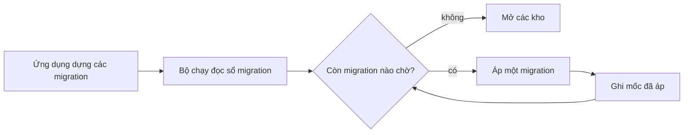

# Bên trong lưu trữ: dialect, migration, sổ đăng ký bảng, phiên chat

Dành cho người đóng góp mã. Phần operator dùng cơ sở dữ liệu và phiên chat nằm ở
[Lưu trữ và phiên chat](../luu-tru.md).

## Các tầng lưu trữ

Mọi truy cập đi qua một giao diện SQL bất đồng bộ duy nhất. Kho (store) lo phần SQL, giao dịch giữ mọi
quy tắc trải trên nhiều hơn một dòng, và agent không bao giờ chạm thẳng vào tầng lưu trữ.
`openPersistence` (`persistence/connection.ts`) trả về `{ storage, dialect }` cho engine đã cấu hình;
`resetPersistence` là bản phá hủy của nó.

```ts
interface Storage {
  query<T>(sql: string, params?: readonly unknown[]): Promise<readonly T[]>
  execute(sql: string, params?: readonly unknown[]): Promise<{ readonly changes: number }>
  transaction<T>(fn: (tx: Transaction) => Promise<T>): Promise<T>
  close(): Promise<void>
}
```

`Transaction` là nửa `query` và `execute`. Cả hai nằm trong `core/types/storage.ts`.

### Hợp đồng dialect

Mã trong kho hỏi `Dialect` về các khác biệt giữa engine thay vì rẽ nhánh trong logic nghiệp vụ. Không
bao giờ viết SQL riêng cho một dialect trong kho, hay rẽ nhánh theo dialect trong logic nghiệp vụ.

```ts
interface Dialect {
  readonly name: 'sqlite' | 'postgres'
  readonly autoIncrementPk: string
  param(index: number): string                       // sqlite ?N, postgres $N
  paramList(count: number, startAt?: number): string
  upsert(table: string, target: UpsertTarget): string // keys, cols, rowCount, keepWhenNull?
  insert(table: string, target: InsertTarget): string // insert đi sau chính lệnh delete của nó
}
```

`UpsertTarget.keepWhenNull` nêu các cột mà NULL không được ghi đè, dành cho dòng mà nhiều nhà cung cấp
mỗi bên điền một phần.

### Engine

- **SQLite** (`persistence/engines/sqlite.ts`, `bun:sqlite`). Thứ tự pragma: `busy_timeout` 5000 ms
  đứng đầu (chuyển sang WAL cần một khóa, nên thời gian chờ phải được đặt trước), `journal_mode = WAL`,
  `synchronous = NORMAL`, `temp_store = MEMORY`, `cache_size` 4000 KiB, `mmap_size` 8 MiB,
  `foreign_keys = ON`. Lượt quét lưu giữ còn chạy `PRAGMA optimize` mỗi 6 giờ trên SQLite
  (`optimizeSqlite` trong `persistence/upkeep.ts`, lỗi log `retention.optimize_failed`); không có timer của
  engine. Sao lưu dùng `VACUUM INTO` (`persistence/backup.ts`): ghi vào một thư mục
  tạm `mkdtemp` (`.staging-*`, `0700`) cạnh đích, `chmod 0600`, fsync, rename vào chỗ rồi fsync thư mục cha (fsync lỗi thì bản sao lưu lỗi), vì `VACUUM INTO` theo umask
  chứ không theo đối số quyền và bản sao không được để người khác đọc được lúc đang ghi. `backupAndPrune`
  ghi một bản, xóa các thư mục tạm mồ côi và bỏ các bản cũ nhất quá `keep` (`KEEP_BACKUPS` là 7 nếu nơi gọi
  không truyền số). Lượt quét lưu giữ gọi nó cho `backups/daily/` khi `newestBackupAt` không có, nằm
  ở tương lai hoặc đã cũ ít nhất một ngày trừ một chu kỳ quét, với số bản là `[retention] daily_backups`;
  chỉ SQLite, lỗi log `retention.backup_failed`.
- **PostgreSQL** (`persistence/engines/postgres.ts`). `ensureSchema` chạy `CREATE SCHEMA IF NOT EXISTS`
  trước tiên: `search_path` nêu tên schema nhưng không bao giờ tạo nó, và mục thiếu bị bỏ qua lặng lẽ,
  khiến mọi migration rơi vào `public`.

## Migration



Một migration là `{ id, reversibility, up, down? }` (`persistence/types.ts`). Tên tệp chính là id:
`YYYY_MM_DD_HHMMSS_description.ts`, nên thứ tự từ điển là thứ tự áp dụng. Tệp export `up` và có thể
export `down`; bước sinh mã ghép chúng với id lấy từ tên tệp.

- **Registry.** `persistence/migrations/registry.generated.ts` do `bun run gen`
  (`scripts/gen-migrations.ts`) sinh ra. Không sửa tay. Thêm tệp bằng `bun run migration:new` rồi sinh
  lại. Các import tĩnh của nó là thứ bản binary đã biên dịch cần.
- **Bộ chạy** (`persistence/migrations/runner.ts`). `migrate(db, dialect, options)` là idempotent: chỉ áp
  các id chưa có trong sổ `_migrations`. `resolveMigrations` gộp phần cốt lõi với phần mở rộng mà
  trading và plugin thêm vào, sắp theo id và từ chối trùng lặp (`StorageError`).
- **Một giao dịch có khóa.** Đọc, quyết định, áp, ghi sổ diễn ra trong một giao dịch, nên hai tiến trình
  cùng khởi động không thể cùng tính ra một danh sách chờ. SQLite tuần tự hóa qua `BEGIN IMMEDIATE`;
  PostgreSQL lấy `pg_advisory_xact_lock(hashtext('persistence_migrations'))` và đặt
  `statement_timeout` cùng `idle_in_transaction_session_timeout` về 0 cho giao dịch đó. Cả lô được ăn cả
  ngã về không: một lỗi giữa chừng rollback các migration đã áp trước đó trong cùng lần gọi.
- **Sổ.** `_migrations (id TEXT PRIMARY KEY, applied_at BIGINT NOT NULL)`. Tên bảng và các câu lệnh đọc
  nó được export từ bộ chạy vì `doctor` đọc nó qua một handle `bun:sqlite` chỉ đọc thô, nên phần SQL
  phải dùng chung.
- **Trạng thái.** `migrationStatus` trả về `applied | pending | orphan` cho mỗi id. Mồ côi là id có
  trong sổ mà không được khai báo (hạ cấp hoặc migration bị xóa). `migrate` từ chối
  cơ sở dữ liệu có id mồ côi, trước khi sao lưu hay áp gì, bằng `errors.dbSchemaAhead`: bản cũ đọc
  schema mới sẽ đọc sai dữ liệu.
- **Sao lưu trước migration.** Chỉ SQLite, khi có `backupDir` và có thể còn migration chờ:
  `backupSqlite` vào `pre-migration/`. Một lần kiểm sơ bộ lỗi thời chỉ có thể làm thừa hoặc bỏ lỡ một
  bản sao, không bao giờ làm bỏ lỡ migration, vì khóa đọc lại trước khi áp. Bản sao lỗi thì ghi log
  `migration.backup_failed` và không chặn.
- **Rollback.** `resolveMigrationRollback` nói `db migrate down` sẽ làm gì:
  `ready | none | irreversible | orphan | gap`. Chỉ migration đã áp mới nhất đảo ngược được, và chỉ khi
  lịch sử liền mạch. `rollbackMigration` phân giải lại dưới cùng khóa và trả `history_changed` nếu một
  tiến trình khác đã dịch sổ kể từ lúc operator được báo mục tiêu. Log: `migration.applied`,
  `migration.failed`, `migration.rolled_back`, `migration.rollback_failed`.

### Quy tắc migration

- Migration bất biến từ 1.0.0: tệp và id đã áp không bao giờ đổi. Mọi thay đổi schema là một tệp mới,
  có `down` viết ngay lúc tạo.
- `check-migration-rollback` ép có `down` (phủ bảng tĩnh cộng một vòng đi về trên SQLite).
- Thêm một bảng là ba chỗ sửa: `CREATE TABLE` trong migration, tên bảng trong `TABLES_TO_DROP` của
  migration đó, và một dòng trong sổ đăng ký (phần kế tiếp).

## Sổ đăng ký bảng

`persistence/tables.ts` liệt kê mọi bảng vì không engine nào có sẵn truy vấn danh mục dùng chung được.
Nó điều khiển `db stats`, phân trang của `db export`, thứ tự của `db import` và khóa xóa của phần lưu
giữ, và là nơi duy nhất viết khóa chính ngoài DDL.

```ts
interface DbTable {
  readonly name: string
  readonly pk: readonly string[]   // theo thứ tự khai báo; export phân trang theo nó
  readonly durable?: true          // chỉ còn nếu đã xuất; không danh mục nào tự suy ra
}
```

Các mục nằm trong `CORE_TABLES` rồi `TRADING_TABLES`. Export: `ALL_TABLES`, `DURABLE_TABLES`,
`ALL_TABLE_NAMES`, `TABLE_NAME_WIDTH`, `findTable(name)` (tên do operator đưa vào, trả `null`) và
`dbTable(name)` (tên có kiểu, ném `StorageError` nếu thiếu). `durable` dành cho dòng do operator ghi
hoặc không tải lại được; mỗi ngoại lệ trong dữ liệu thị trường đều có chú thích nêu lý do.

### Cổng kiểm tra

`scripts/check-table-registry.ts` đối chiếu sổ đăng ký với schema, để một bảng được thêm vào migration
mà quên ở đây sẽ hỏng ngay lúc lint thay vì vô hình với `db stats` và `db export`.

1. Nó migrate một cơ sở dữ liệu SQLite dùng một lần, so tên bảng với sổ đăng ký, và đối chiếu từng khóa
   chính với `PRAGMA table_info`, nêu tên mục bị thiếu và khóa nào đã đổi. Nó cũng khẳng định mỗi bảng
   phân trang được.
2. PostgreSQL không migrate được từ một cổng kiểm tra. Schema của nó được đọc bằng cách chạy hàm `up` của
   từng migration trên một `Transaction` ghi lại, chỉ thu DDL chứ không thực thi, rồi phân tích
   `CREATE TABLE`.
3. Bộ đọc đó cũng chạy trên dialect SQLite và được đối chiếu với `PRAGMA table_info`. Không vậy, bộ phân
   tích có thể lệch đi và lặng lẽ bỏ qua lỗi ở PostgreSQL, engine mà nó là cách kiểm tra duy nhất.

Vậy nếu một bảng nghiệp vụ biến mất sau khi reset, nghĩa là migration của nó chưa được đăng ký lúc khởi
động, không phải `db stats` che một lỗi.

### Ghi chú về dữ liệu

- `daily_bars` khóa theo `(market, ticker, day)`; `source_id` ghi lại bên ghi và không thuộc khóa. Vì
  vậy một phiên chỉ có một dòng, và `listBars` trả đúng dòng đã lưu, vì một chuỗi có cùng một phiên
  hai lần làm đổi mọi trung vị, ATR và khoảng nhìn lại.
- `resting_exits.first_missed_at` là mốc thời gian chứ không phải bộ đếm, có chủ ý: đếm số lần bị phủ
  nhận chỉ đo số lượt đối chiếu chứ không đo thời gian, và ý nghĩa của nó đổi theo nhịp vòng lặp.
- `llm_attempts` là nguồn sự thật của chi phí. Tổng theo phiên chat được cộng từ đó (`loadTotals`),
  không bao giờ lưu sẵn.

## Lưu giữ

`persistence/retention.ts`. Hằng số: `SCHEDULER_RUNS_KEEP_PER_JOB` 200,
`BRIEF_SNAPSHOTS_KEEP_PER_LOCALE` 1, `LLM_ATTEMPTS_RETENTION_MS` 400 ngày. `RetentionConfig` mang
`retentionDays` và `inboxRetentionDays`, cùng `historyFloors`: số ngày nơi đọc của từng phạm vi lịch sử
nhìn lại (`HISTORY_FLOOR_DAYS` của trading: `MAXIMUM_OUTCOME_LOOKBACK_DAYS`, `MACRO_WINDOW_DAYS`,
`MACRO_BACKFILL_DAYS`), `effectiveHistoryDays` lấy số lớn hơn giữa nó và `historyRetentionDays`.
`persistence/retention-evidence.ts` làm rỗng `factorScores[].provenance` của gợi ý đã chấm quá cửa sổ
chung, ngoài mười dòng mới nhất của mỗi mã, theo trang 200 dòng đọc và ghi lại dưới dạng JSON thô.
Daemon dọn một lần lúc khởi động rồi theo chu kỳ; `db cleanup` chạy tay đúng chính sách đó. `runRetention` chạy câu xóa của từng phạm vi (`toScopes`) trong giao dịch riêng,
nên một phạm vi chậm hoặc hỏng không giữ kết nối SQLite suốt cả lượt dọn và không làm PostgreSQL hoàn tác
các phạm vi khác khi hết `statement_timeout`; phạm vi hỏng log `retention.scope_failed` và trả 0 trong
`RetentionCounts` giữ nguyên hình dạng. Lệnh `SELECT changes()` vẫn nằm trong giao dịch của phạm vi, cùng
kết nối với câu xóa.

## Kho phiên chat

`SessionStore` (`persistence/types.ts`), do `createSessionStore(db, dialect)` hiện thực trong
`persistence/stores/session/store.ts`; câu SQL đến từ `buildSessionSql(dialect)`.

- **Nhận phiên.** `claimRun({ session, runId, now, leaseExpiresBefore })` chèn dòng nếu chưa có, rồi
  nhận nó bằng một `UPDATE` duy nhất: hai bên tranh nhau đều chạy nó và bên thua khớp không dòng nào
  (trả `false`, lộ ra thành `session_busy`). Bên đang giữ mà hoạt động cuối cũ hơn
  `leaseExpiresBefore` thì mất lease. Mốc đó là `now - (loop.maxDurationMs + RUN_LEASE_SLACK_MS)`, với
  `RUN_LEASE_SLACK_MS` = 300.000.
- **Đường ghi.** `appendMessages` là sink phiên chat của engine: chỉ ghi thêm, ghi mỗi lượt xong bởi
  `engine/hooks/persistence.ts`. `appendCommandExchange` ghi hai dòng mà một lệnh slash đóng góp (không
  phiên chạy nào sở hữu chúng). `finalizeRun(id, runId, outcome)` khép phiên chat lại và ném
  `ConflictError` trừ khi đúng phiên chạy đó đang giữ nó.
- **Stale.** `markStaleRuns(leaseExpiresBefore)` chạy một lần lúc daemon khởi động
  (`app/startup-state.ts`), trước khi bất kỳ hệ con nào mở được phiên chạy, và đánh dấu `stale` mọi
  phiên chat `active` mà không ai giữ lease còn sống.
- **Xóa.** `remove(id)` đọc trạng thái ngay trong giao dịch và từ chối phiên chat `active` (`'active'`;
  lần ghi kế tiếp của nó sẽ hỏng vì xóa dây chuyền). Còn lại thì xóa dòng tuyến trước, rồi tin nhắn, đặt
  `llm_attempts.session_id` thành null, rồi xóa phiên chat. `clear(agentId?)` làm tương tự cho nhiều
  phiên và từ chối nếu có phiên nào đang `active`. Khóa tuyến dùng `SESSION_ROUTE_KEY_PREFIX`.
- **Tra theo tiền tố.** `resolveIdPrefix` trả `found | not_found | ambiguous`; mã khớp đúng nguyên văn
  thắng một khớp dài hơn.
- **Đọc.** `loadHistory(id, limit?)` trả `limit` dòng mới nhất theo thứ tự; `loadDetails` trả một
  `SessionSnapshot` (chi tiết, tin nhắn đã lưu, các lần gọi, tổng đã gộp). `SessionStatus` là
  `'active' | 'done' | 'stale'`.

### Hàng đợi và rào chắn tuyến

`core/session-queue.ts` tuần tự hóa việc theo từng phiên chat trên một đuôi promise với
`MAX_QUEUE_DEPTH` = 10; vượt mức đó thì người gọi nhận `RunHalted('queue_full')`. Một lần đổi tuyến
(`/new`) đi qua rào chắn tuyến với một thế hệ (generation) riêng cho mỗi tuyến: nó chờ các lease đang
giữ, vô hiệu hóa việc đã xếp hàng, cập nhật tuyến đã lưu, rồi mới nhận việc cho thế hệ mới, nên một tin
nhắn nhận cho phiên chat cũ không chạy nhầm dưới tuyến mới.

### Khâu nén và khôi phục danh sách việc

- `engine/compact/compactor.ts` quyết định và điều phối; `summarizer.ts` gọi mô hình;
  `message-repair.ts` giữ mỗi lời gọi công cụ cùng kết quả của nó, bỏ mồ côi, loại trùng theo mã lời
  gọi, và kiểm tính toàn vẹn trước lần gọi nhà cung cấp kế tiếp. `engine/loop/run-compaction.ts` nối
  nó vào phiên chạy.
- Các lời gọi tóm tắt có ngân sách, được tính giá và ghi như lần thử `compaction`. Lỗi nhà cung cấp thì
  chèn một dấu cắt ngắn. Một lần nén không làm bản ghi nhỏ đi thì dừng với `length_limit`.
- `engine/loop/todo.ts` giữ bản sao danh sách `todo_write` của phiên chạy ngoài bản ghi hội thoại và
  ghi lại nó trước lần gọi nhà cung cấp kế tiếp khi không còn kết quả `todo_write` hay thông báo khôi
  phục nào trước đó còn thấy được. Chỉ kết quả `todo_write` mới làm mới bản sao. Thông báo chỉ nằm
  trong prompt, không bao giờ vào bản ghi hội thoại đã lưu.

## Bản đồ mã nguồn

- Lưu trữ và giao dịch: [`persistence/connection.ts`](../../src/persistence/connection.ts)
- Engine: [`persistence/engines/sqlite.ts`](../../src/persistence/engines/sqlite.ts) - [`persistence/engines/postgres.ts`](../../src/persistence/engines/postgres.ts)
- Hợp đồng dialect: [`core/types/storage.ts`](../../src/core/types/storage.ts)
- Bộ chạy migration: [`persistence/migrations/runner.ts`](../../src/persistence/migrations/runner.ts) - registry được sinh: [`registry.generated.ts`](../../src/persistence/migrations/registry.generated.ts)
- Schema cốt lõi: [`persistence/migrations/2026_07_10_000001_initial_schema.ts`](../../src/persistence/migrations/2026_07_10_000001_initial_schema.ts)
- Schema giao dịch: [`persistence/migrations/2026_07_10_000002_trading_tables.ts`](../../src/persistence/migrations/2026_07_10_000002_trading_tables.ts)
- Lưu giữ: [`persistence/retention.ts`](../../src/persistence/retention.ts)
- Sổ đăng ký bảng: [`persistence/tables.ts`](../../src/persistence/tables.ts), được canh bởi [`scripts/check-table-registry.ts`](../../scripts/check-table-registry.ts); cổng rollback: [`scripts/check-migration-rollback.ts`](../../scripts/check-migration-rollback.ts)
- Sao lưu và khôi phục SQLite: [`persistence/backup.ts`](../../src/persistence/backup.ts)
- CLI cơ sở dữ liệu: [`cli/commands/db/db.ts`](../../src/cli/commands/db/db.ts), [`export.ts`](../../src/cli/commands/db/export.ts), [`import.ts`](../../src/cli/commands/db/import.ts), [`migrate.ts`](../../src/cli/commands/db/migrate.ts)
- Hợp đồng kho phiên chat: [`persistence/types.ts`](../../src/persistence/types.ts) - kho: [`persistence/stores/session/store.ts`](../../src/persistence/stores/session/store.ts)
- Ghi bản ghi hội thoại: [`engine/hooks/persistence.ts`](../../src/engine/hooks/persistence.ts)
- Hàng đợi phiên chat và rào chắn tuyến: [`core/session-queue.ts`](../../src/core/session-queue.ts)
- Nén ngữ cảnh: [`engine/compact/compactor.ts`](../../src/engine/compact/compactor.ts) - [`message-repair.ts`](../../src/engine/compact/message-repair.ts)
- Khôi phục danh sách việc: [`engine/loop/todo.ts`](../../src/engine/loop/todo.ts)
- CLI lịch sử: [`cli/commands/history.ts`](../../src/cli/commands/history.ts)
