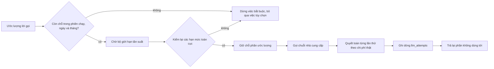

# Ngân sách - xét duyệt, quyết toán và chia lát trên cây phiên chạy

Dành cho người đóng góp mã đang sửa engine chi phí hay ủy quyền. Đặt hạn mức và xem đã tiêu bao nhiêu:
[ngan-sach.md](../ngan-sach.md).

---

## Xét duyệt

Việc bắt buộc (một lượt thường, khâu nén hội thoại) dừng khi không được duyệt; việc tùy chọn (trích xuất sở thích) bị bỏ qua
và ghi log. Hàng đợi của kênh ngừng nhận phiên chạy một khi ngày hoặc tháng đã chạm hạn mức.



Hai lần kiểm, vì hai lý do. Lần đầu tránh đốt một suất giới hạn tần suất cho việc vốn đã không đủ tiền. Lần sau bịt khoảng
trống mà một phiên chạy khác có thể đã tiêu trong lúc lượt này chờ. Phần giữ chỗ được tính khi xét duyệt, nên hai phiên chạy
song song không thể cùng được duyệt trên cùng một đồng còn lại. Phần giữ chỗ trong bộ nhớ cố tình không bền vững: nó thuộc
về tiến trình và biến mất cùng tiến trình.

Mã: [engine/budget/reservation.ts](../../src/engine/budget/reservation.ts) (xét duyệt và cảnh báo mềm ở `soft_warn_ratio`).

## Quyết toán

Mỗi lần thử gọi nhà cung cấp được quyết toán đúng một lần, kể cả lần hỏng, lần thử lại và lần dự phòng, vì cả ba đều có thể
phát sinh tiền.

1. Lượng token do nhà cung cấp báo được chuẩn hóa; số không hợp lệ hoặc âm thành 0.
2. Chi phí lấy con số của chính nhà cung cấp khi họ đưa ra, nếu không thì lấy bảng giá mô hình đã phân giải.
3. Token đầu vào, đầu ra, đọc cache và ghi cache được tính giá riêng. Token suy luận là tập con của token đầu ra và không
   bao giờ bị tính hai lần.
4. Chi phí thật được cộng vào tổng của tiến trình và vào ngân sách phiên chạy, rồi ghi vào `llm_attempts`. Ghi hỏng thì thử
   lại tối đa ba lần (`ATTEMPT_RECORD_MAX_TRIES`, chờ 100 ms). Chỉ **sau đó** mới được ra lệnh dừng vì ngân sách.

Mức dùng thật có thể vượt ước lượng. Runtime ghi đủ con số thật rồi mới dừng, và không bao giờ vứt bớt phần đã trả tiền cho
tổng vừa với hạn mức.

Mã: [engine/budget/attempt-settlement.ts](../../src/engine/budget/attempt-settlement.ts).

## Sổ chi phí

`llm_attempts` là cuốn sổ bền vững ([persistence/stores/llm-attempt.ts](../../src/persistence/stores/llm-attempt.ts)). Mỗi
dòng mang theo phiên chạy và phiên chạy cha (`parent_run_id`), cuộc trò chuyện tính tiền, agent, `billing_agent_id`, nhà cung cấp,
mô hình, kết cục, số token, nguồn giá, `cost_nano_usd`, độ trễ và thời điểm quyết toán. Tổng theo ngày, tháng và khoảng đều
cộng từ các dòng, nên không có tổng hợp nào để lệch.

Lúc khởi động, runtime dựng lại ngày và tháng hiện tại từ `llm_attempts` trước khi duyệt việc.

Nếu một lần ghi vẫn hỏng sau các lần thử lại, khoản chi được nối vào `unrecorded-spend.jsonl` trong thư mục dữ liệu
([engine/budget/unrecorded-spend.ts](../../src/engine/budget/unrecorded-spend.ts)). Lúc khởi động nó được cộng ngược vào tổng
ngày và tháng cho đến hết tháng của nó, nên khởi động lại không trả tiền về cho các hạn mức. Khi cả lần nối cũng hỏng, hoặc
tệp không đọc được hay bị hỏng lúc khởi động, không việc tốn tiền nào được duyệt thêm chừng nào còn đặt hạn mức ngày hoặc
tháng (`ledger_unavailable`); không có hạn mức thì chỉ là khoảng hở trong báo cáo.

Chính sách lưu giữ xóa cuộc trò chuyện và tin nhắn cũ nhưng tách rời các dòng lần thử chứ không xóa.

`billing_agent_id` là agent có mức trần được tính khoản chi, không phải lúc nào cũng là agent chạy. Một con ủy quyền, một con
nghiên cứu và một persona tranh luận do công cụ khởi động đều tính cho agent đã nhờ; một lần đọc tiêu đề trong cuộc tranh
luận đó được ghi nhận cho agent này nhưng không bao giờ bị từ chối. Giá trị rỗng thì tính cho agent đã chạy dòng đó.

Mức trần theo agent ([engine/budget/agent-cap.ts](../../src/engine/budget/agent-cap.ts)) đọc chi tiêu của agent chịu chi phí
trong ngày trên lịch đúng một lần, khi phiên chạy bắt đầu, và không giữ chỗ. Đọc hỏng thì ghi log `agents.cap_read_failed` và
phiên chạy cứ đi tiếp. Chạm trần thì phiên chạy gốc dừng với `agent_daily_cap`; tác vụ bị bỏ qua mà không tính lỗi.

---

## Ngân sách trên một cây phiên chạy

Ba tầng:

| Tầng | Chủ sở hữu | Phạm vi |
| --- | --- | --- |
| Hạn mức toàn cục | `CostTracker` ([engine/budget/cost-tracker.ts](../../src/engine/budget/cost-tracker.ts)), một cái mỗi tiến trình | Ngày và tháng, mọi phiên chạy ở mọi độ sâu |
| Ngân sách phiên chạy | `Budget` trên trạng thái phiên chạy ([engine/budget/run-budget.ts](../../src/engine/budget/run-budget.ts)) | Một phiên chạy gốc |
| Lát ngân sách | `BudgetSlice` giao cho con ([engine/budget/slices.ts](../../src/engine/budget/slices.ts)) | Một phiên chạy con, hoặc một nhóm trong một giai đoạn nghiên cứu |

Con không bao giờ tự tạo ngân sách. Nó nhận một lát, còn các hạn mức toàn cục được kiểm ở mọi lời gọi bất kể độ sâu.

### Con nhận được gì

```ts
const allocationUsd = ctx.budget.remainingUsd() * AGENT_BUDGET_FRACTION // 0.85
const slices = createBudgetSlicesWithin(ctx.budget, allocationUsd, count)
```

(`allocateChildBudgets` trong [tools/delegation/child-run.ts](../../src/tools/delegation/child-run.ts);
`AGENT_BUDGET_FRACTION` và `MIN_PER_RUN_BUDGET_USD` trong [engine/constants.ts](../../src/engine/constants.ts).)

Toàn bộ phần phân bổ được **giữ chỗ trên cha ngay từ đầu**, giữ lại 15% cho cha đọc kết quả rồi trả lời. Các con sau đó rút
từ **một bể chung**, ai tới trước dùng trước. Phần giữ chỗ được quyết toán một lần khi mọi lát đã quyết toán, nên một con tiêu
ít để phần dư cho đứa anh em. Một con mất kiểm soát có thể hút cạn bể trước lời gọi đầu tiên của đứa anh em; đứa đó báo
`budget`, như khi tiêu hết một lát riêng. Ngân sách bị kẹt là lãng phí chắc chắn còn con mất kiểm soát chỉ thỉnh thoảng, nên
bể là lựa chọn có chủ ý (trần theo từng lát là đường nâng cấp nếu chuyện đó xảy ra).

Cả nhóm bị từ chối khi `allocationUsd / count` dưới `MIN_PER_RUN_BUDGET_USD` ($0,001). Ở phiên chạy không bị chặn, phần còn
lại là `Infinity` nên không điều nào ở đây cắn vào.

Cha còn $1,00, ba con chạy cùng lúc: giữ chỗ và chia chung 0,850, cha giữ 0,150, từ chối khi dưới 0,003 tổng.

### Bể nghiên cứu

`research` chạy cây worker riêng nên lấy một bể chứ không phải một lát ([engine/research/budget.ts](../../src/engine/research/budget.ts)).
Nó giữ chỗ đúng 85% một lần và chia theo giai đoạn (`PHASE_WEIGHTS`):

| Độ sâu | plan | crawl | synthesize | review |
| --- | ---: | ---: | ---: | ---: |
| `light` | 0 | 0,70 | 0,30 | 0 |
| `medium` | 0,10 | 0,45 | 0,25 | 0,20 |
| `deep` | 0,10 | 0,50 | 0,20 | 0,20 |

`pool.take(phase, count, knownFutureCalls)` cắt một nhóm theo tỷ lệ `count / (count + knownFutureCalls)`, nên một nhóm chạy
sớm không bỏ đói phần việc mà kế hoạch đã biết là sắp tới. Giai đoạn crawl giữ `CRAWL_EXTERNAL_COST_RESERVE` (25%) không chia
được: phí tìm kiếm rơi vào chính ngân sách crawl, và một nhóm giữ chỗ cả giai đoạn sẽ khiến khoản phí đầu tiên làm dừng luôn
khâu crawl. Khoản Exa báo được dùng nguyên; Brave, DeepSeek, Serper và Tavily tính theo `cost_per_search_usd` đã khai (không khai thì
không tính), riêng DeepSeek chỉ tính khi lượt tìm có kết quả; DuckDuckGo và SearXNG tự dựng miễn phí; trúng cache và lời gọi hỏng không bao giờ bị tính tiền.

### Khi một lát cạn

Chi tiêu được ghi, rồi lệnh dừng mới được ném ra. Ở một con, nó hiện ra như sau:

| Bề mặt | Giá trị |
| --- | --- |
| `RunResult.reason` của con | `budget` |
| Kết quả công cụ | `{ agent_id, reason, text, budget_exhausted: true, ... }`, `isError: true` |
| Cha | Chạy tiếp với phần văn bản dở dang cùng thông báo; không được gọi lại y nguyên |

Một người cha bị chính ngân sách của mình chặn sẽ dừng ở lần tính tiền kế tiếp. Khâu quyết toán phần giữ chỗ của con nuốt
lệnh dừng đó, nên kết quả đã trả tiền không bao giờ bị vứt đi.

### Giới hạn không phải tiền

Các bộ đếm `[loop]` chặn cây độc lập với ngân sách:

| Giới hạn | Hình dạng | Có hoàn lại? |
| --- | --- | --- |
| `delegation_depth` | Số cạnh con tối đa từ phiên chạy gốc, cộng với việc từ chối tự ủy quyền và vòng lặp tổ tiên | không áp dụng |
| `max_delegations` | Một hạn ngạch dùng chung cho cả cây, giữ chỗ trước khi con khởi động ([engine/budget/delegation-quota.ts](../../src/engine/budget/delegation-quota.ts)) | Không |
| `max_parallel_delegations` | Số mục tối đa trong một lời gọi `delegate_parallel` | không áp dụng |
| `max_spawn` (tệp agent) | Số agent con tự tạo một agent được khởi động cùng lúc trong một lời gọi; chúng dùng phần ngân sách và hạn ngạch của agent cha | không áp dụng |

### Các bất biến

- Giới hạn của con luôn đến từ phần phân bổ cha đã giữ chỗ, không bao giờ từ một hạn mức vừa đọc lại từ cấu hình.
- Giữ chỗ trước khi sinh con, quyết toán trong `finally`, quyết toán đúng một lần.
- Chi tiêu được ghi trước khi ra lệnh dừng, ở mọi tầng.
- Cha luôn giữ lại 15% phần còn lại của chính mình.
- Hạn mức toàn cục áp lên con y hệt như áp lên phiên chạy gốc.

---

## Bản đồ mã nguồn

- Xét duyệt và cảnh báo: [engine/budget/reservation.ts](../../src/engine/budget/reservation.ts)
- Mức trần theo agent: [engine/budget/agent-cap.ts](../../src/engine/budget/agent-cap.ts)
- Bộ theo dõi toàn cục: [engine/budget/cost-tracker.ts](../../src/engine/budget/cost-tracker.ts)
- Quyết toán lần thử: [engine/budget/attempt-settlement.ts](../../src/engine/budget/attempt-settlement.ts), [engine/budget/unrecorded-spend.ts](../../src/engine/budget/unrecorded-spend.ts)
- Ngân sách theo phiên chạy: [engine/budget/run-budget.ts](../../src/engine/budget/run-budget.ts)
- Lát và phân bổ cho con: [engine/budget/slices.ts](../../src/engine/budget/slices.ts), [tools/delegation/child-run.ts](../../src/tools/delegation/child-run.ts)
- Bể ngân sách nghiên cứu: [engine/research/budget.ts](../../src/engine/research/budget.ts)
- Dữ liệu chi phí bền vững: [persistence/stores/llm-attempt.ts](../../src/persistence/stores/llm-attempt.ts)
