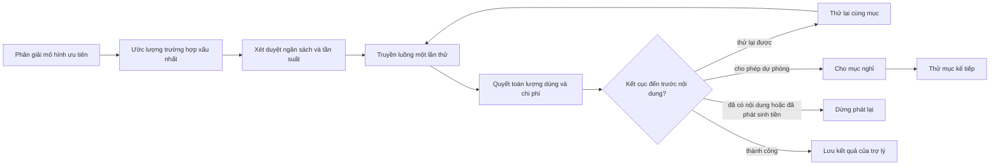

# Agent, ủy quyền và chuỗi mô hình - bên trong

Dành cho người đóng góp mã đang sửa bộ nạp agent, ủy quyền, kỹ năng hay chuỗi nhà cung cấp. Cách viết agent, đội và chọn
mô hình: [tro-ly.md](../tro-ly.md).

---

## Nạp agent và mức tin cậy

Schema là `AgentTomlSchema` trong [engine/agents/builder.ts](../../src/engine/agents/builder.ts). Agent vào sổ đăng ký từ
ba nơi:

| Nguồn | Nằm ở đâu | Mức tin cậy |
|---|---|---|
| Có sẵn | `src/engine/agents/<id>/`, các vai tranh luận giao dịch ở `src/trading/agents/<id>/` | Đáng tin |
| Plugin | `AgentProfileSource` trong phần đóng góp `agents` của plugin | Chỉ đáng tin với plugin đi kèm |
| Người dùng | `<data_dir>/agents/<id>/agent.toml` | Không đáng tin |

Mức tin cậy quyết định loader đọc những trường nào. `model_tier` và `reasoning` bị từ chối trên hồ sơ không đáng tin, và
`system_prompt` của nó bị quét tìm mẫu chỉ dẫn bị chặn. Schema nghiêm là có chủ ý: một khóa năng lực gõ sai mà bị bỏ qua
sẽ được đọc như một quyền đã cấp. Mọi trường `[capabilities]` là một cái trần, không bao giờ là một cái sàn; không trường
nào nới quyền.

Agent của người dùng nạp hỏng mềm theo từng tệp ([engine/agents/user.ts](../../src/engine/agents/user.ts)), ghi log
`agents.user_load_failed` hoặc `agents.user_id_reserved`. Một `[focus]` mà runtime từ chối làm agent đó bị bỏ qua với
`agents.focus_invalid` (kiểm trong [app/providers.ts](../../src/app/providers.ts)). Thứ tự lúc khởi động: agent có sẵn,
rồi plugin, rồi người dùng; mã đã tồn tại là mã dành riêng. Công cụ đăng ký cùng kiểu - có sẵn, plugin, rồi công cụ MCP đã
kết nối sau cùng, không bao giờ thay một cái tên đã có.

Một `model_tier` đáng tin phải trỏ tới nhóm không rỗng mà mọi mục đều hỗ trợ gọi công cụ khi agent có công cụ. Một nhóm
mâu thuẫn với nhóm phần ghép ưu tiên thì bị từ chối.

### Suy luận của persona

Các persona giao dịch phân mức suy luận theo vai: hai nhà nghiên cứu, vai phân tích ở chế độ lean và vai quản lý danh mục
chạy ở `medium`; vai trader, vai rủi ro và vai đối chiếu luận điểm ở `low`. Mức suy nghĩ đáng tiền ở việc dựng một lập
luận từ bằng chứng, không phải ở việc thực thi hay kiểm chứng. Một trader quyết định giá có trên ngưỡng kích hoạt hay không
thì không cần hai phút suy nghĩ ẩn.

Mức suy luận được băm vào các phiên bản công thức của một đề xuất. Đổi nó là bắt đầu một tập mới trong bảng thành tích chứ
không trộn vào tập cũ, nên hãy coi đó là một thay đổi chiến lược. Persona ưu tiên nhóm `debate` khi
`[[model_tiers.debate]]` tồn tại và chạy trên chuỗi chính nếu không.

### Ranh giới lúc chạy

Công cụ tệp đặt gốc tại `<data_dir>/workspaces/<id>/` và mỗi agent có phạm vi bộ nhớ riêng. Shell đã duyệt bắt đầu ở gốc
đó, nhưng đó là thư mục làm việc, không phải sandbox của hệ điều hành. Ràng buộc chat nằm trong `ChatBindingStore`
([persistence/stores/channel/chat-binding.ts](../../src/persistence/stores/channel/chat-binding.ts)). Đổi một ràng buộc sẽ
cập nhật lại tuyến, hủy phần việc đang chờ và đang chạy của phiên chat cũ, và mở một phiên chat mới.

---

## Ủy quyền

Một đội được suy ra, không được lưu: danh sách `delegates` của agent điều phối cộng với các công cụ ủy quyền.

| Thành phần | Nguồn | Mục đích |
|---|---|---|
| `delegate` | [tools/delegation/delegate.ts](../../src/tools/delegation/delegate.ts) | Một agent con trong danh sách cho một việc khép kín. |
| `delegate_parallel` | [tools/delegation/delegate-parallel.ts](../../src/tools/delegation/delegate-parallel.ts) | Một lời gọi có giới hạn cho từ hai việc độc lập trở lên. |
| Bộ chạy con | [tools/delegation/child-run.ts](../../src/tools/delegation/child-run.ts) | Dịch vụ `runner` cả hai công cụ dùng chung. |
| Cổng năng lực | [engine/hooks/capability.ts](../../src/engine/hooks/capability.ts) | Áp đúng danh sách công cụ của từng con. |
| `loop.delegation_depth` | `config.toml [loop]` | Số cạnh con tối đa từ phiên chạy gốc; mặc định `3` cho phép độ sâu 1, 2, 3. |
| `loop.max_delegations` | `config.toml [loop]` | Số nhánh của cả cây: tổng số con từng được cả hai công cụ khởi động. Không hoàn lại. |
| `loop.max_parallel_delegations` | `config.toml [loop]` | Số mục tối đa trong một lời gọi `delegate_parallel`. |

Cổng kiểm danh sách của con, không phải của cha: một con trong danh sách có thể dùng công cụ mà cha không gọi trực tiếp
được, và công cụ vắng mặt ở con thì bị chặn trước cả khâu phê duyệt.

Phiên chạy con thừa hưởng `AbortSignal` và `Budget` của cha, có một phiên chat tạm thời riêng tư mới (không bao giờ ghi vào
bản ghi hội thoại bền vững), và bị bỏ đi khi phiên chạy cha kết thúc. Hủy phiên chạy tiền cảnh sẽ hủy lần lượt mọi con đang
chạy; khâu dọn dẹp chạy lại nhiều lần cũng an toàn và không bao giờ ném lỗi. Worker nghiên cứu theo cùng quy tắc. Không có
tác vụ nền, mã nghiên cứu, lệnh điều khiển bất đồng bộ hay khôi phục bền vững.

Cả hai công cụ giữ chỗ một phần có giới hạn từ ngân sách còn lại của cha thành một bể và quyết toán từng lát trong `finally`
(xem [ngân sách](ngan-sach.md#ngân-sách-trên-một-cây-phiên-chạy)).

Mã giữ danh sách, quyền dùng công cụ, cách ly phê duyệt, hạn ngạch, độ sâu, vòng lặp, số nhánh, ngân sách, thời lượng và
việc lan truyền hủy; mô hình không giữ cái nào.

### Các chốt chặn

| Điều kiện | Lỗi |
|---|---|
| Mã agent không tồn tại | `invalid_input` |
| Agent không nằm trong danh sách của người gọi | `unauthorized` |
| Tự ủy quyền, vòng lặp tổ tiên, giới hạn lồng nhau | `depth_limit` |
| Hết `max_delegations`, hoặc nhiều mục hơn `max_parallel_delegations` | `delegate_full` |

`delegate` trả JSON có `agent_id`, lý do dừng `reason` và `text`. `delegate_parallel` trả mảng `children` cùng dạng; lỗi
ngân sách, phê duyệt và runner vẫn hiện ra, và một lần từ chối ngoài dự tính chỉ gói gọn trong mục của nó.

### Phê duyệt không bao giờ di truyền

Không gì được mang sang: không phải chế độ bypass của cha, không phải một phê duyệt đã nhớ, không phải phê duyệt của client
MCP trực tiếp. Một con có tuyến (lời gọi của cha mang theo `chatId`) xin một quyết định từ chối/cho một lần qua chat của cha;
một con không tuyến thì không có ai phê duyệt và các lời gọi nguy hiểm của nó bị chặn trước cả khi hỏi. Quy tắc:
[an toàn](../an-toan.md).

`CLI_CHAT_ID` là định danh `SessionRouter` và slash-context của CLI
([cli/commands/chat/types.ts](../../src/cli/commands/chat/types.ts)). Nó chỉ đi vào `RunOptions.chatId` khi
`openCliApprovals` đã bật cho lượt đó ([cli/commands/chat/repl.ts](../../src/cli/commands/chat/repl.ts)):

- một lượt REPL tương tác luôn truyền nó;
- `chat --message` tương tác (stdin là TTY) truyền nó sau khi `openCliApprovals` thành công;
- một phiên chạy một phát không tương tác (stdin là pipe hoặc rỗng) bỏ qua nó, nên một con nguy hiểm được ủy quyền hỏng vì
  không có ai phê duyệt ngay cả dưới `--mode bypass`.

### Khối `<delegates>`

[engine/hooks/available-delegates.ts](../../src/engine/hooks/available-delegates.ts) được nối trong `app/providers.ts` (nó
cần bản đồ agent đã mở rộng đầy đủ) và thêm khối này qua một `LLMRequestModifier`:

```text
<delegates>
Delegate a sub-task with delegate(agent_id, prompt); agent_id must be one id below.
- reviewer: Critiques a draft for logical gaps, unsupported claims, and missing source support; returns APPROVE or a numbered fix list. It does not verify facts or sources.
</delegates>
```

Danh sách rỗng hoặc không phân giải được: không có khối. Mỗi mô tả bị cắt ở `DESC_MAX` (200) và phần thân ở
`DELEGATES_BLOCK_MAX` (4.096); dòng vai đầu tiên luôn được phát ra để một dòng quá cỡ không làm rơi cả khối. Đây là anh em
song sinh của `<available_skills>`.

### Sổ đăng ký có sẵn

Agent của engine nằm trong `BUILT_IN_AGENT_IDS` ([engine/agents/registry.ts](../../src/engine/agents/registry.ts)): `chat`,
`deep-researcher`, `reviewer`, `research-planner`, `research-crawler`, `research-synthesizer`, `research-reviewer`. Quy
trình đề xuất lập lịch cho các persona tranh luận trực tiếp, mỗi persona một lát ngân sách; chúng không bao giờ nằm trong
danh sách của ai. `research` chỉ đọc, dùng năng lực tĩnh `delegate` và không kích hoạt phê duyệt công cụ nguy hiểm; danh sách
công cụ vẫn quyết định ai thấy nó.

---

## Kỹ năng

`SkillCatalog` ([engine/skills/catalog.ts](../../src/engine/skills/catalog.ts)) là chủ sở hữu duy nhất. Phần giao dịch mang
theo các kỹ năng nhúng được biên dịch vào binary và đưa danh sách cho catalog; nó không có bộ phân tích, cache hay quy tắc
hiển thị riêng. Tên nhúng là tên dành riêng: một kỹ năng thư mục dùng lại bị từ chối, không bị che.

Thứ tự thư mục: thư mục kỹ năng được quản lý, rồi `[paths].skills_dirs`, rồi các thư mục do plugin đóng góp. Khử trùng lặp
mà không đổi thứ tự; tên đầu tiên thắng; thư mục không tồn tại thì không đóng góp gì. Vân tay mục lục băm đường dẫn, thời
điểm sửa và kích thước, và chỉ phủ các thư mục gốc, nên một kỹ năng nhúng không bao giờ làm hỏng cache.

Mục lục ghi `name`, `description` đã làm sạch, thư mục, đường dẫn `SKILL.md`, kích thước, thời điểm sửa, và siêu dữ liệu tùy
chọn ([engine/skills/frontmatter.ts](../../src/engine/skills/frontmatter.ts)).

Trước khi lập mục lục hay nạp, runtime phân giải đường dẫn qua `PathPolicy` (từ chối đi ngược thư mục và thoát qua
symlink), kiểm tên, quét mô tả tìm tiêm prompt và thay mô tả bị gắn cờ bằng văn bản trung tính, cắt các dòng giả làm ranh
giới vai chat khỏi phần thân, và áp các quy tắc hiển thị theo nền tảng và theo công cụ sẵn có.

Mục lục trong prompt được dựng ở [engine/hooks/available-skills.ts](../../src/engine/hooks/available-skills.ts) và bị chặn ở
`SKILL_INDEX_BLOCK_MAX` (8.192 byte); 200 ký tự đầu của mô tả được hiện. `skill_view`
([tools/system/skill-view.ts](../../src/tools/system/skill-view.ts)) tra tên trong mục lục agent được thấy, trả văn bản nhúng
hoặc `<dir>/<name>/SKILL.md` an toàn đầu tiên, và tính kích thước vào ngân sách của phiên chạy
(`SKILL_VIEW_RUN_BUDGET_BYTES`, 262.144; phiên chạy con bắt đầu với ngân sách riêng). Tên không thấy, không tồn tại hoặc
không an toàn cho `ToolError('file_not_found')`; hết ngân sách cho `payload_too_large`. Tệp quá `SKILL_MAX_BYTES` (1 MiB,
[engine/skills/load.ts](../../src/engine/skills/load.ts)) không bao giờ được nạp.

Cài đặt đi qua CLI ([cli/commands/skill.ts](../../src/cli/commands/skill.ts)) và tệp khóa
([engine/skills/lockfile.ts](../../src/engine/skills/lockfile.ts)), không bao giờ qua công cụ của agent. Kết quả quét nặng nhẹ
theo nguồn: cục bộ luôn cài; `gh:` từ chủ sở hữu đáng tin trừ khi `dangerous`; nguồn từ xa khác chỉ khi `safe`.

---

## Chuỗi mô hình

Lúc khởi động dựng một chuỗi có thứ tự; mục đầu là mô hình chính, các mục sau là dự phòng hạ tầng. Mọi lần thử gọi nhà cung
cấp đều được truyền theo luồng, chặn giới hạn, phân loại, tính giá và ghi xuống trước khi engine quyết định thử lại hay đi
tiếp. Danh mục ([ai/catalog.ts](../../src/ai/catalog.ts)) ánh xạ mã nhà cung cấp tới một endpoint, một kênh truyền, siêu dữ
liệu mô hình và bảng giá tĩnh. Các kênh truyền chuẩn hóa luồng về một hợp đồng sự kiện nội bộ: `openai_chat`,
`openai_responses`, `anthropic_messages`, `gemini_generate` và `openrouter_decisions`.

### Luồng một yêu cầu



Mô hình ưu tiên đi trước, rồi tới các mục còn lại theo thứ tự đã khai. Thử lại và dự phòng chỉ xảy ra trước khi có nội dung
hiện ra và trước khi lượng dùng cho thấy đã phát sinh tiền; sau đó việc phát lại dừng. Quy tắc này áp y hệt cho dự phòng
toàn cục và dự phòng trong nhóm, và một lần rơi xuống mục kế trong nhóm được báo qua đúng luồng lần thử như một lần rơi
toàn cục.

Mọi bề mặt đều báo lần đổi: kênh đăng một thông báo, nghiên cứu sâu nêu một cảnh báo tiến độ, server chuyển tiếp qua socket,
và CLI in một dòng cho mỗi lần đổi khác biệt ngay trên dòng cuối. CLI đọc nó từ bus sự kiện chứ không từ luồng của lượt đó,
vì một vai tranh luận và một lượt nghiên cứu con đều truyền tới một bộ in riêng, và chỉ dữ liệu trên bus mới còn nêu tên
kênh chúng thừa hưởng. Dòng này được giữ lại tới khi công việc kết thúc, để dòng tiến độ tạm thời không quét đè lên nó.

### Thử lại, dự phòng và thời gian nghỉ

Chính sách nằm ở [ai/chain/attempt-ledger.ts](../../src/ai/chain/attempt-ledger.ts) và
[ai/chain/provider-chain.ts](../../src/ai/chain/provider-chain.ts).

| Loại lỗi | Thử lại cùng mục | Rơi xuống mục kế | Thời gian nghỉ |
| --- | --- | --- | --- |
| `transient` (5xx, 408, 409, 425, đứt kết nối) | Có | Có, sau khi hết lượt thử | Mục nghỉ 1 phút sau khi cạn lượt. |
| `rate` | Không | Có | Mục nghỉ 1 phút, hoặc theo `Retry-After` của nhà cung cấp khi họ nêu mức lâu hơn. |
| `timeout` | Có | Có, sau khi hết lượt thử | Mục nghỉ theo thời gian nghỉ tạm thời sau khi cạn lượt. |
| `empty_response` | Có | Có, sau khi hết lượt thử | Không - chất lượng đầu ra không phải sức khỏe nhà cung cấp. |
| `output_budget_exhausted` | Không | Có | Không. |
| `auth`, `billing` | Không | Có | Nhà cung cấp và mọi mô hình sau nó tạm ngưng 15 phút, rồi được thử lại. |
| `not_found` | Không | Có | Mục bị tắt tới khi khởi động lại tiến trình; các mô hình anh em không bị động tới. |
| Tràn ngữ cảnh, phản hồi quá lớn, `fatal` không gợi ý | Không | Không | Vấn đề của cả yêu cầu, mục kế tiếp không chữa được. |
| Lỗi nào sau khi đã có đầu ra hoặc đã phát sinh tiền | Không | Không | Lần thử được quyết toán và trả về như lỗi cuối cùng. |

Mặc định ([core/config/resolvers/runtime.ts](../../src/core/config/resolvers/runtime.ts)): thử lại 2 lần sau lần đầu, chờ
500 ms, nghỉ tạm thời 60 giây, nghỉ vì thông tin đăng nhập 900 giây. Lệnh hủy cắt ngang khoảng chờ.

- Thời gian nghỉ được ghi cho **mục** (một mô hình ở một nhà cung cấp), không phải cho nhà cung cấp. Nhiều mục thường dùng
  chung một router, và một lần từ chối từ phía trên không được tắt luôn các mục dự phòng phía sau. Chỉ thông tin đăng nhập
  và thanh toán mới trải lên mọi mô hình sau một nhà cung cấp.
- Endpoint nào từ chối một trường suy luận hay hợp đồng đầu ra thì được thử thêm một lần không có trường đó
  (`ai.reasoning_rejected`, `ai.output_contract_rejected`). Cả hai chỉ là phần tối ưu, lượt chạy vẫn đi tiếp được; lần thử
  bị từ chối vẫn tính tiền.
- Cho nghỉ đánh dấu một mục là không dùng được cho cả lượt kế tiếp, nên chỉ tín hiệu khả dụng thật mới làm điều đó
  (`transient`, `rate`, `timeout` - `ENTRY_COOLDOWN_CODES`). `empty_response` và `output_budget_exhausted` nói về đầu ra của
  yêu cầu này; cho nghỉ vì chúng là đầu độc một mục đang chạy tốt.
- `output_budget_exhausted` vắng mặt khỏi tập thử lại: một mô hình đã tiêu hết trần vào suy luận sẽ tiêu hết lần nữa. `rate`
  cũng vậy: một cửa sổ vừa bị từ chối không mở lại trong khoảng chờ.
- Khi mọi mục đều đang nghỉ, một lời gọi chờ hết khoảng nghỉ ngắn nhất đúng một lần, chặn trên ở 1 phút.
- Thân lỗi của từng nhà cung cấp được chuẩn hóa về bộ mã chung trước khi chính sách nào chạy, kể cả lỗi rơi xuống **sau**
  khi phản hồi đã bắt đầu (báo dưới dạng một khung trong luồng chứ không phải mã HTTP). Mỗi kênh truyền dịch khung đó về đúng
  mã trạng thái nó đáng lẽ mang, nên một lần quá tải giữa luồng được phân loại đúng như ở cổng vào thay vì kết thúc bằng
  một câu trả lời rỗng khó hiểu.

### Truyền luồng và suy luận

Các bộ nối ([ai/adapters/runner.ts](../../src/ai/adapters/runner.ts)) phát ra văn bản, phần suy luận, lời gọi công cụ, lượng
dùng và sự kiện hoàn tất đã chuẩn hóa. Một khung hỏng lẻ bị bỏ qua và ghi log; một luồng không dùng được hoặc dở dang làm
hỏng cả lần thử. Tổng luồng bị chặn ở 4 MiB, hoặc 1 KiB cho mỗi token đầu ra khi con số đó lớn hơn, và bộ đọc phản hồi bị hủy
trong khâu dọn dẹp dù thành công, hỏng, hết giờ hay bị hủy.

Mức suy luận nhận `default`, `off`, `low`, `medium`, `high`, được dịch riêng cho từng nhà cung cấp. Token suy luận là tập
con của token đầu ra: báo riêng, không bao giờ tính tiền hai lần.

Claude là nhà cung cấp rắc rối nhất. Từ 4.6 trở đi nó nhận suy luận thích ứng kèm một mức nỗ lực; còn **ngân sách** suy nghĩ
là thứ các mô hình cũ hơn nhận, và từ 4.7 trở đi thì bị từ chối. Claude 5 suy nghĩ khi yêu cầu không nói gì, nên `off` phải
được gửi đi như một lệnh tắt tường minh. Opus 5.5 và Fable 5 không ngừng suy nghĩ được: `off` chạy chúng ở `low`, ghi log
`ai.reasoning_downgraded`, và nới trần câu trả lời thêm phần dự trữ của `low`.

Hai danh sách đều cố định: các mô hình nhận ngân sách (mọi thứ trước 4.6) và các mô hình chấp nhận lệnh tắt (Opus và Sonnet
4.6-4.8, Opus 5, Sonnet 5). Mọi mã Claude khác, kể cả mã ra mắt sau này, nhận suy luận thích ứng và coi `off` là `low` - yêu
cầu duy nhất mà mọi Claude hiện tại đều chấp nhận - nên một mô hình mới không cần sửa mã. Mô hình chưa có giá trong danh mục
bị tính theo mức dự phòng kèm `pricing.unknown_model` cho tới khi khai `cost_input_per_m` và `cost_output_per_m`.

Một lần từ chối của bộ phân loại an toàn Claude là một lần dừng bình thường: lượt đó kết thúc `content_filter`, hạng mục
(`cyber`, `bio`, `reasoning_extraction`, ...) được ghi log là `ai.provider_refusal`, và chuỗi không rơi xuống mục kế.

### Cache prompt

Các nhà cung cấp tự cache (OpenAI, DeepSeek, Gemini, Grok) dùng lại phần đầu dùng chung của prompt. Claude chỉ dùng lại tới
một điểm ngắt mà yêu cầu đánh dấu ([ai/adapters/cache-control.ts](../../src/ai/adapters/cache-control.ts)), đặt như nhau trên
kênh Anthropic trực tiếp lẫn OpenRouter: cuối phần ổn định của system prompt, ngay trước dòng ngày tháng - thứ duy nhất đổi
mỗi ngày. Lời gọi tranh luận mang theo một khóa định tuyến gồm vai và thị trường, nên OpenRouter giữ một vai ở một endpoint
tới mười phút yên ắng. Một endpoint chậm mà không hỏng cũng giữ nó; hãy ghim bằng `provider_only` hoặc `provider_order` khi
tốc độ chênh nhau.

### Lượng dùng, giá và giới hạn tần suất

Lượng token không âm do nhà cung cấp báo được ưu tiên; thiếu thì ước lượng từ nội dung đã chuẩn hóa. Việc phân giải chi phí
([ai/cost/pricing.ts](../../src/ai/cost/pricing.ts)) thử con số hợp lệ do nhà cung cấp báo, rồi giá khai cho mô hình, rồi giá
trong danh mục, rồi một mức dự phòng thận trọng. Mọi lần thử - kể cả lần hỏng, thử lại, dự phòng và nén hội thoại - đều được
ghi vào `llm_attempts`, và đó là thứ khiến sổ chi phí chính xác.

Một phiên chạy chờ tối đa 5 giây cho bảng giá của OpenRouter trước lượt đầu tiên
([ai/openrouter-feed.ts](../../src/ai/openrouter-feed.ts)).

Bộ giới hạn tần suất ([engine/rate-limiter.ts](../../src/engine/rate-limiter.ts)) là một gáo toàn cục theo phút cộng một gáo
công bằng có giới hạn cho mỗi cặp agent/người dùng. Gáo công bằng nhận một nửa mức bùng nổ toàn cục, làm tròn xuống, tối
thiểu một lời gọi. Khâu xét duyệt tần suất chạy sau lần kiểm ngân sách đầu tiên và trước lần kiểm lại cuối cùng cùng khâu
giữ chỗ. Gáo đầy làm phiên chạy dừng với `rate` trước khi gọi nhà cung cấp.

### Thông tin đăng nhập thuê bao

`auth login` ghi `<data_dir>/auth/<provider-id>.json` (chỉ chủ sở hữu đọc được, thay thế nguyên tử): access token và refresh
token, hạn dùng, mã tài khoản và thông tin gói. Chuỗi mô hình làm mới năm phút trước khi hết hạn (`REFRESH_SKEW_MS` trong
[ai/auth/credentials.ts](../../src/ai/auth/credentials.ts)), và các lượt song song dùng chung một lần làm mới. Callback của
ChatGPT lắng nghe cổng 1455, rồi 1457 ([ai/auth/providers/chatgpt.ts](../../src/ai/auth/providers/chatgpt.ts)). Các lệnh `auth`
không khởi động runtime nên chạy được khi không có tệp cấu hình. Dòng lần thử của thuê bao mang `pricing_subscription`, giá
`$0`.

Đăng nhập bằng tài khoản đám mây (`vertex`, `azure-openai`, `azure-openai-responses`) không ghi gì xuống đĩa. Token được tạo
khi cần từ các biến trong `IDENTITY_ENV` ([ai/auth/cloud/identity.ts](../../src/ai/auth/cloud/identity.ts)), giữ trong bộ
nhớ và làm mới theo cùng mốc năm phút. Lúc khởi động hệ thống đọc các biến này một lần, nên mục nào không có `api_key_env`
cũng không có các biến đó sẽ làm khởi động thất bại, và `doctor models` báo đúng dòng ấy.

---

## Bản đồ mã nguồn

- Schema và nạp agent: [engine/agents/builder.ts](../../src/engine/agents/builder.ts), [engine/agents/user.ts](../../src/engine/agents/user.ts), [engine/agents/registry.ts](../../src/engine/agents/registry.ts)
- Ủy quyền: [tools/delegation/](../../src/tools/delegation/), [engine/hooks/capability.ts](../../src/engine/hooks/capability.ts), [engine/hooks/available-delegates.ts](../../src/engine/hooks/available-delegates.ts)
- Kỹ năng: [engine/skills/](../../src/engine/skills/), [tools/system/skill-view.ts](../../src/tools/system/skill-view.ts)
- Danh mục nhà cung cấp và mô hình: [ai/catalog.ts](../../src/ai/catalog.ts)
- Cấu hình mô hình: [core/config/resolvers/model.ts](../../src/core/config/resolvers/model.ts)
- Chuỗi nhà cung cấp: [ai/chain/provider-chain.ts](../../src/ai/chain/provider-chain.ts)
- Chính sách lần thử: [ai/chain/attempt-ledger.ts](../../src/ai/chain/attempt-ledger.ts)
- Bộ nối truyền luồng: [ai/adapters/runner.ts](../../src/ai/adapters/runner.ts)
- Bảng giá: [ai/cost/pricing.ts](../../src/ai/cost/pricing.ts)
- Giới hạn tần suất: [engine/rate-limiter.ts](../../src/engine/rate-limiter.ts)
- Định nghĩa công cụ và `AgentProfileSource` cho người viết plugin: SDK runtime trong [mo-rong.md](mo-rong.md)
- Khóa `[loop]` và `[model_tiers]`: [cau-hinh.md](../cau-hinh.md)
