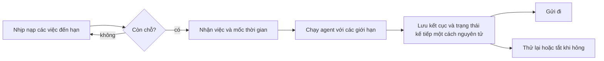

# Việc lặp lại - bên trong

Dành cho người đóng góp mã. Trang này nói các vòng lặp của dịch vụ nền (daemon), bộ lập lịch việc và heartbeat chạy
thế nào bên dưới. Phần dành cho operator ở [Việc lặp lại](../van-hanh.md).

## Cơ chế vòng lặp

Mọi vòng lặp giao dịch theo kiểu ngủ - chạy - ngủ, không dùng `setInterval`. Khoảng chờ kế tiếp được
tính sau khi phiên chạy xong, nên một lượt chậm không chồng lên chính nó, và lượt nào không có việc đủ
điều kiện thì thoát ngay. Kích thước lô cố định 50 dòng mỗi lượt; `trading.macro-extract` dùng 3 vì mỗi
mục là một lời gọi mô hình. Nhịp workflow và nhịp heartbeat là các timer 30 giây do hệ con của chúng
tự giữ.

Ghi chú từng vòng:

| Vòng | Chi tiết |
| --- | --- |
| `trading.alerts` | Gửi chạy trước khi vũ trang, nên dòng vừa vũ trang ở một lượt không được chính lượt đó gửi. |
| `trading.outcomes` | Một lượt duyệt hết mọi đề xuất đang chờ bằng con trỏ keyset chỉ tiến lên, nên đề xuất còn chờ nến không bỏ đói các mã sau. |
| `trading.briefs` | Không có con trỏ: các dòng được nhận dưới một lease, nên nhịp này là một lần kiểm và giờ gửi là `[trading.briefs] send_time`. Lease hết hạn là chốt chống bỏ đói. |
| `trading.exits` | Giữ một con trỏ trong closure qua các lệnh thoát đang treo. Lệnh thoát mà sàn phủ nhận 300 giây (một khoảng thời gian, không phải số lượt, để kết luận không đổi theo nhịp) thì bị coi là đã mất. Chỉ khởi động khi có sàn mang theo bộ nối: sàn không có thông tin đăng nhập là nơi giữ tài sản không có client. |
| `trading.intents` | Quyết toán các dòng ý định mà sổ đã nắm; phần còn lại chờ `/trade reconcile`. Cùng điều kiện khởi động với `trading.exits`. |
| `trading.refresh` | Xem [Các neo của refresh](#các-neo-của-refresh). Ghi dòng `nav_snapshots` của ngày trước khâu chụp bảng yếu tố, nên bảng lỗi không làm mất dòng đó. Có mã chưa có giá thì bỏ qua ngày đó và log `trading.nav_snapshot_skipped` kèm tên các mã; lỗi khác log `trading.nav_snapshot_failed`. |

Các vòng giao dịch khởi động sau khi khâu gửi của kênh đã gắn vào, nên cảnh báo kích hoạt ở lượt đầu
tiên vẫn có nơi gửi tới.

### Các neo của refresh

`trading.refresh` ngủ đến mốc **sớm nhất** trong ba neo:

- `tapeFinalAt` của từng thị trường: giờ đóng phiên cộng độ trễ khớp lệnh định kỳ. Đây chính là mốc
  quyết định một phiên có được tính là đã chốt hay không, nên một lượt làm mới không neo vào bảng giá mà
  sau đó chính nó từ chối lưu;
- 60 phút trước giờ mở của từng thị trường, để bản tin và bảng lọc đọc dữ liệu đã làm ấm;
- `interval_ms` đã cấu hình, là cái trần và là phương án dự phòng khi sổ đăng ký rỗng.

Thị trường chạy liên tục không có giờ mở, nên chỉ neo vào lúc sang ngày UTC. Hai neo cách nhau dưới 60
giây thì gộp thành một lượt.

Khi khởi động, lần làm mới đầu chạy trước các hệ con khác, chờ tối đa 60 giây rồi hoàn tất ở chế độ
nền kèm cảnh báo. Lỗi ranh giới (`isBoundaryFailure`) từ nó chỉ cảnh báo `daemon.boot_refresh_failed` dù ở
trong hay sau 60 giây và khởi động vẫn tiếp tục; lỗi khác là chí mạng, ném về nơi gọi trong ngân sách thời
gian và qua bộ theo dõi tác vụ dịch vụ nền sau đó. Nhịp đầu tiên của chính vòng lặp chạy ngay sau đó: nếu lượt quét khởi động vẫn đang
chạy thì nó nhập vào đó, và nếu máy khởi động không có mạng, chính nhịp này là lượt chờ có mạng rồi đi
vào chuỗi thử lại.

Lượt để bất kỳ loại dữ liệu nào ở `unavailable` (không lấy được gì) thử lại sau 2, 4, 8 và 16 phút,
không bao giờ quá neo kế tiếp; lần hỏng thứ năm trả việc về cho neo và chuỗi bắt đầu lại. Lượt `partial`
thì chờ neo kế tiếp.

### Phân loại lỗi của một lượt

`runTick` phân loại lỗi được ném ra:

| Lỗi | Kết quả |
| --- | --- |
| `StorageError`, `ChannelError`, `LLMError`, hoặc `RunHalted` với mã `budget` hay `rate` | Lỗi biên: `trading.tick_failed` ở mức warn, thử lại ở chu kỳ sau. |
| `MissingEnvError` | Lỗi biên: `trading.tick_key_missing` ở mức warn, một lần mỗi vòng cho tới khi có lỗi khác được ghi, thử lại ở chu kỳ sau. |
| Mọi lỗi khác | Thoát lên lớp cách ly bọc quanh vòng lặp. Thử lại mãi chỉ che giấu việc mã đang sai. |
| Hủy | Là lúc tắt máy khi chính tín hiệu của vòng lặp bị hủy; vòng lặp thoát bình thường. Lệnh hủy khác (bạn dừng phiên chạy của lượt đó trên trang) ghi `trading.tick_stopped` ở mức info và chờ chu kỳ sau. |

Lớp cách ly (`withQuarantine`) ghi `trading.loop_quarantined` ở mức error và gửi operator một thông báo
gọi tên vòng đó. Nó chạy lại vòng sau một giờ, tối đa ba lần. Vòng nào chạy trọn một ngày rồi mới lỗi
lại thì được cấp lại đủ số lần; nếu không, lỗi kế tiếp để nó dừng đến khi dịch vụ nền khởi động lại, và
thông báo nói rõ điều đó. Các vòng và kênh khác không bị ảnh hưởng.

Vòng cảnh báo là một nhịp ba bước: gửi (`alerts.tick`), rồi lượt dựng cảnh báo thoát, rồi lượt dựng cảnh báo
sàng lọc. Bước gửi được phân loại như trên. Mỗi lượt dựng chạy dưới một lớp bảo vệ riêng
(`trading.alert_arming_failed` ở mức warn, gọi tên bước), nên mọi lỗi ở một lượt - dù là lỗi biên hay không -
để nguyên lượt kia và lần gửi của chu kỳ sau; chỉ lệnh hủy đi xuyên qua. Trong lượt thoát, `planAndTrail` bảo vệ
từng mã một (`trading.exit_holding_failed`, kèm mã và bước): mã đó giữ kế hoạch mà bước bắt đầu từ đó, và lượt
đi tiếp sang mã kế.

Trước mỗi lượt, `waitUntilReachable` phân giải `example.com` qua bộ phân giải của hệ điều hành (đường
mà mọi lần tải ra ngoài đều đi). Nếu thất bại, lượt bị bỏ qua: `trading.tick_offline` ghi một lần cho mỗi
đợt mất mạng, rồi kiểm tra lại mỗi phút. Lần gửi không bị trừ lượt thử và lần lấy dữ liệu không làm ngắt
nguồn; lượt quá hạn chạy ngay khi có mạng lại.

## Bộ lập lịch việc

Bộ lập lịch rà mỗi `tickSeconds` (30 giây), khởi động tối đa 5 việc mỗi lần rà (`maxPerTick`) và chạy
đồng thời tối đa 50 việc (`maxGlobal`); cả ba đều không có khóa TOML. Cron chỉ chính xác tới phút và
`run-now` đi thẳng tới bộ điều khiển, nên nhịp ngắn hơn cũng không được gì thêm.



Lần nhận việc được lưu bền và duy nhất theo **cả** việc **và** mốc thời gian đã lên lịch, nhờ đó các
phiên chạy tự động không bị trùng. Một việc không chồng lên chính nó, và trần toàn cục áp cho tất cả.
Khâu kết thúc ghi kết cục rồi đẩy lịch tới, thử lại hoặc tắt việc, tất cả trong một giao dịch.

Lần nhận việc đi kèm một lease: 5 phút (`OCCURRENCE_LEASE_TTL_MS`), gia hạn mỗi 2 phút theo đồng hồ
treo tường chứ không theo đồng hồ thời lượng của engine (đồng hồ này tạm dừng khi ô phê duyệt đang
mở). Dòng `running` có lease còn hạn nghĩa là đang có bộ thực thi trông nó, nên nhịp này bỏ qua và giữ
nguyên nhịp lịch. Chỉ dòng `failed`, hoặc dòng `running` có lease đã hết hạn, mới bị coi là treo: nó được
đóng lại ở trạng thái hỏng và nhịp lịch đi tiếp, thay vì chạy lại lần đã tiêu. Việc chạy một lần không
có lần kế tiếp, nên một lần mất được tính là lỗi.

`run-now` dùng lần nhận việc riêng. Nó ghi một phiên chạy mà không đẩy lịch và không chạm bộ đếm lỗi, và
bị từ chối khi một phiên chạy theo lịch của cùng việc đang giữ lease còn hạn, dù từ CLI hay từ dịch vụ nền. Lần
nhận này bị coi là cũ sau thời gian chờ phê duyệt cộng trần thời lượng của việc cộng 60 giây. Lúc khởi
động, các dòng `running` cũ chuyển thành hỏng với lý do dịch vụ nền khởi động lại, và các lần nhận run-now bị
bỏ rơi được giải phóng sau lượt quét đó.

Việc thử lại dùng chung một chính sách với heartbeat (`scheduler/backoff.ts`), tối đa 30 phút:
`60 giây x 2^(số lần hỏng - 1)`. Việc cron bị tắt sau 3 lần hỏng liên tiếp. Các lần dừng không tính là
hỏng: tắt máy, phê duyệt bị từ chối hoặc quá hạn, agent chạm trần, agent đang tạm dừng. Việc gửi chạy sau khâu kết
thúc, nên lỗi gửi không bao giờ làm hỏng phiên chạy.

## Bộ chạy heartbeat

Mỗi nhịp 30 giây quét `HEARTBEAT.md` của từng agent và chạy các tác vụ đến hạn, tối đa ba agent cùng
lúc, các tác vụ trong một agent chạy tuần tự. Việc hoàn tất được ghi đúng một lần cho mỗi tác vụ sau
phiên chạy. Tệp quá 65.536 byte thì không chạy, và một tệp giữ tối đa 20 tác vụ; tên tối đa 128 ký tự,
`interval` tối thiểu 60 giây. Dòng `session` hay `duplicate_window` nhận ra được mà giá trị rỗng hoặc
không hợp lệ thì cả tác vụ bị bỏ.

### Giao thức phản hồi

Mọi phiên chạy phải kết thúc bằng đúng một phản hồi có cấu trúc; mọi thứ khác là không hợp lệ và không
bao giờ được gửi đi.

```text
[HEARTBEAT_RESPOND] {"notify":true,"summary":"operator-visible text","commitments":[]}
[HEARTBEAT_RESPOND] {"notify":false,"commitments":[]}
```

Phản hồi không hợp lệ không sinh thông báo và không sinh cam kết, nhưng vẫn ghi nhận hoàn tất. Chính
việc này ngăn một tác vụ có mô hình cứ trả đầu ra sai định dạng khỏi thử lại mỗi 30 giây. Lượt ghé chạm
trần số lượt của chính nó thì được chốt bằng phản hồi im lặng mà không cần phân tích.

### Cam kết

Một cam kết là phần việc hoãn lại mà tác vụ xin được xem lại ở lần đến hạn kế tiếp của chính nó. Mô hình
trả chúng trong `commitments`; chúng được lưu và trình lại cho đúng tác vụ đó.

- Chúng thuộc về tác vụ đã tạo ra chúng và chỉ tác vụ đó thấy. Chúng không bao giờ kích hoạt một phiên
  chạy.
- Mỗi cam kết có `prompt` (tối đa 500 ký tự) và `dueInMs` (từ một phút tới ba mươi ngày). Một phản hồi
  mang tối đa 5 cam kết; nhiều hơn thì sai schema và cả phản hồi thành không hợp lệ.
- Tối đa 10 cam kết đến hạn được trình mỗi lượt và 100 cam kết đang chờ mỗi agent. Phần dư bị bỏ và ghi
  log.
- Chúng được tiêu thụ nguyên tử cùng việc ghi hoàn tất, nên nếu rollback thì chúng được trình lại ít
  nhất một lần (có chủ ý) chứ không bị mất.
- Văn bản được trình là ngữ cảnh không đáng tin: không ghi đè được tác vụ, chỉ dẫn hệ thống, chính sách
  công cụ hay chính sách phê duyệt.

### Chặn trùng

`duplicate_window` khóa theo agent, tác vụ, đích và một vân tay của văn bản đã cắt khoảng trắng. Nó nằm
trong tiến trình, trong một LRU giới hạn 200 mục, nên khởi động lại hay bị đẩy mục ra đều làm nó quên.
Mốc thời gian đã cache chỉ cho biết bộ thông báo đã nhận thông báo, tức có thể mới vào hàng đợi chứ chưa
chắc đã tới nơi. Lời gọi bị từ chối không bao giờ được cache.

### Khoảng chờ tăng dần

Phiên chạy không bao giờ tới `completed` thì để nguyên mốc hoàn tất gần nhất, nên nếu không có phanh,
tác vụ sẽ đến hạn lại ở mọi nhịp, mãi mãi. Vì vậy mỗi lần hỏng tăng bộ đếm và hoãn lần nhận việc kế tiếp
thêm `60 giây x 2^(số lần hỏng - 1)`, tối đa 30 phút. Một lượt hoàn tất xóa cả hai. Khoảng chờ chỉ chặn
ở khâu nhận việc: tác vụ không bao giờ bị tắt.

Hai đường khác hoãn theo cùng cách, qua `deferFailedHeartbeatTask` (`heartbeat/lease.ts`):

- lượt hoàn tất nhưng lần ghi `completeHeartbeatTask` thất bại (`{ kind: 'failed' }`; `lease_lost` giữ
  nguyên, vì đã có bên khác nhận việc);
- `runClaimedHeartbeatTask` ném lỗi, trừ khi tắt máy đã hủy tín hiệu.

Ném lỗi sau khi đã hoàn tất là vô hại: lần ghi lỗi khóa theo token thuê mà bước hoàn tất đã xóa.

### Hành vi khi hỏng

| Điều kiện | Kết quả |
| --- | --- |
| Nhịp chồng lên nhau | Bị bỏ qua bởi chốt chặn một-nhịp-một-lúc |
| Engine hủy hoặc lỗi | Không ghi hoàn tất, không tiêu thụ cam kết, không thông báo; bộ đếm lỗi tăng |
| Phản hồi không hợp lệ | Việc hoàn tất vẫn được ghi; các cam kết đã trình được giữ lại |
| Giao dịch ghi hoàn tất hỏng | Không thông báo; mọi trạng thái vẫn thử lại được |
| Đích gửi không hợp lệ | Cảnh báo; các đích khác vẫn tiếp tục |
| Bộ thông báo từ chối | Cảnh báo; đích bị từ chối không được cache |

## Bản đồ mã nguồn

- Nhà máy vòng lặp và phân loại: [`trading/wiring/tasks.ts`](../../src/trading/wiring/tasks.ts)
- Lớp cách ly: [`trading/wiring/quarantine.ts`](../../src/trading/wiring/quarantine.ts)
- Các neo của refresh: [`trading/features/market-data/ops/refresh-schedule.ts`](../../src/trading/features/market-data/ops/refresh-schedule.ts)
- Đối chiếu lệnh thoát: [`trading/features/order/exit-tick.ts`](../../src/trading/features/order/exit-tick.ts)
- Khởi động dịch vụ nền và lưu giữ: [`app/daemon.ts`](../../src/app/daemon.ts)
- Vòng đời bộ lập lịch: [`scheduler/runner.ts`](../../src/scheduler/runner.ts); thực thi: [`scheduler/job/execution.ts`](../../src/scheduler/job/execution.ts); khoảng chờ: [`scheduler/backoff.ts`](../../src/scheduler/backoff.ts)
- Bộ phân tích cron: [`core/utils/cron.ts`](../../src/core/utils/cron.ts)
- Bộ phân tích, giao thức và bộ chạy heartbeat: [`scheduler/heartbeat/`](../../src/scheduler/heartbeat)
- Các kho bền vững: [`persistence/stores/scheduler/`](../../src/persistence/stores/scheduler)
