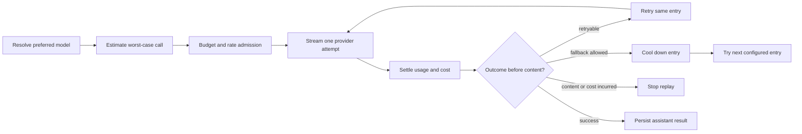

# Agents, delegation and the model chain - internals

For contributors changing the agent loader, delegation, skills or the provider chain. Writing an agent, teams and
choosing models: [agents.md](../agents.md).

---

## Agent loading and trust

The schema is `AgentTomlSchema` in [engine/agents/builder.ts](../../../src/engine/agents/builder.ts). Agents reach
the registry from three places:

| Source | Where it lives | Trust |
|---|---|---|
| Built-in | `src/engine/agents/<id>/`, trading debate roles in `src/trading/agents/<id>/` | Trusted |
| Plugin | `AgentProfileSource` in a plugin's `agents` contribution | Trusted only for bundled plugins |
| User | `<data_dir>/agents/<id>/agent.toml` | Untrusted |

Trust decides which fields the loader reads. `model_tier` and `reasoning` are rejected on an untrusted profile,
and its `system_prompt` is scanned for blocked instruction patterns. The schema is strict on purpose: an ignored
typo in a capability key would read as a granted permission. Every `[capabilities]` field is a ceiling, never a
floor; no field widens access.

User agents load fail-soft per file ([engine/agents/user.ts](../../../src/engine/agents/user.ts)), logging
`agents.user_load_failed` or `agents.user_id_reserved`. A `[focus]` the runtime rejects skips that agent with
`agents.focus_invalid` (checked in [app/providers.ts](../../../src/app/providers.ts)). Boot order: built-in, then
plugin, then user agents; existing ids are reserved. Tools register the same way - built-in, plugin, then
connected MCP tools last, never replacing an existing name.

A trusted `model_tier` must name a non-empty tier whose entries all support tool calls when the agent has tools.
One that contradicts the tier the composition prefers is rejected.

### Persona reasoning

The trading personas grade reasoning effort by role: the two researchers, the lean-mode analyst and the portfolio
manager run at `medium`; the trader, risk analyst and claim verifier at `low`. Effort pays for building a case
from evidence, not for executing or verifying. A trader deciding whether price is above a trigger does not need
two minutes of hidden thought.

The effort is hashed into a suggestion's calculation versions. Changing it starts a fresh population in the track
record instead of blending into the old one, so treat it as a strategy change. Personas prefer the `debate` tier
when `[[model_tiers.debate]]` exists and run on the primary chain otherwise.

### Runtime boundary

File tools are rooted at `<data_dir>/workspaces/<id>/` and each agent has its own memory scope. An approved shell
starts at that root, but it is a working directory, not an OS sandbox. Chat bindings live in `ChatBindingStore`
([persistence/stores/channel/chat-binding.ts](../../../src/persistence/stores/channel/chat-binding.ts)). Changing one
re-points the route, cancels the prior session's queued and active work, and opens a fresh session.

---

## Delegation

A team is derived, never stored: the orchestrator's `delegates` roster plus the delegation tools.

| Primitive | Source | Purpose |
|---|---|---|
| `delegate` | [tools/delegation/delegate.ts](../../../src/tools/delegation/delegate.ts) | One rostered sub-agent for a self-contained task. |
| `delegate_parallel` | [tools/delegation/delegate-parallel.ts](../../../src/tools/delegation/delegate-parallel.ts) | One bounded call for two or more independent tasks. |
| Child runner | [tools/delegation/child-run.ts](../../../src/tools/delegation/child-run.ts) | The `runner` seam both tools use. |
| Capability gate | [engine/hooks/capability.ts](../../../src/engine/hooks/capability.ts) | Enforces each child's own tool allowlist. |
| `loop.delegation_depth` | `config.toml [loop]` | Max child edges from the top-level run; default `3` permits depths 1, 2, 3. |
| `loop.max_delegations` | `config.toml [loop]` | Run-tree fan-out: children ever started by both tools. Not refunded. |
| `loop.max_parallel_delegations` | `config.toml [loop]` | Max items in one `delegate_parallel` call. |

The gate checks the child's allowlist, not the parent's: a rostered child may use a tool the parent cannot call
directly, and a tool absent from the child blocks before approval.

A child inherits the parent's `AbortSignal` and `Budget`, gets a fresh private ephemeral session (never written to
the durable transcript), and is discarded when the parent run ends. Cancelling the foreground run aborts every
in-flight child in order; cleanup is idempotent and never throws. Research workers follow the same rules. There
is no background task, research id, async control command or durable resume.

Both tools reserve a bounded share of the parent's remaining budget as one pool and settle each slice in `finally`
(see [budgets](budgets.md#budget-across-a-run-tree)).

Code owns the roster, tool permissions, approval isolation, quota, depth, cycles, fan-out, budget, duration and
abort propagation; the model owns none of them.

### Guards

| Condition | Error |
|---|---|
| Unknown agent id | `invalid_input` |
| Agent not in the caller's roster | `unauthorized` |
| Self-delegation, ancestor cycle, nesting limit | `depth_limit` |
| `max_delegations` used up, or more items than `max_parallel_delegations` | `delegate_full` |

`delegate` returns JSON with `agent_id`, halt `reason` and `text`. `delegate_parallel` returns a `children` array
of the same shape; budget, approval and runner failures stay visible and an unexpected rejection is isolated to its
own entry.

### Approval never inherits

Nothing carries over: not parent bypass mode, not a remembered approval, not a direct-MCP client's approval. A
routed child (the parent invocation carries `chatId`) asks a one-time deny/once decision through the parent chat;
a headless child is approval-unavailable and its dangerous calls block before prompting. Rules:
[safety](../safety.md).

`CLI_CHAT_ID` is the CLI's `SessionRouter` and slash-context identity
([cli/commands/chat/types.ts](../../../src/cli/commands/chat/types.ts)). It enters `RunOptions.chatId` only while
`openCliApprovals` is armed for that turn ([cli/commands/chat/repl.ts](../../../src/cli/commands/chat/repl.ts)):

- an interactive REPL turn always passes it;
- an interactive `chat --message` (TTY stdin) passes it once `openCliApprovals` succeeds;
- a noninteractive one-shot (piped or empty stdin) omits it, so a delegated dangerous child fails
  approval-unavailable even under `--mode bypass`.

### The `<delegates>` block

[engine/hooks/available-delegates.ts](../../../src/engine/hooks/available-delegates.ts) is wired in
`app/providers.ts` (it needs the fully extended agents map) and appends the block through an `LLMRequestModifier`:

```text
<delegates>
Delegate a sub-task with delegate(agent_id, prompt); agent_id must be one id below.
- reviewer: Critiques a draft for logical gaps, unsupported claims, and missing source support; returns APPROVE or a numbered fix list. It does not verify facts or sources.
</delegates>
```

Empty or unresolved roster: no block. Each description is cut at `DESC_MAX` (200) and the body at
`DELEGATES_BLOCK_MAX` (4,096); the first role line is always emitted so one over-cap line cannot drop the block.
It is the delegate twin of `<available_skills>`.

### Built-in registry

Engine agents are listed in `BUILT_IN_AGENT_IDS` ([engine/agents/registry.ts](../../../src/engine/agents/registry.ts)):
`chat`, `deep-researcher`, `reviewer`, `research-planner`, `research-crawler`, `research-synthesizer`,
`research-reviewer`. The suggestion pipeline schedules the debate personas directly, each with its own budget
slice; they are never rostered. `research` is read-only on the static `delegate` capability and does not trigger
dangerous-tool approval; the tool allowlist still decides who sees it.

---

## Skills

`SkillCatalog` ([engine/skills/catalog.ts](../../../src/engine/skills/catalog.ts)) is the single owner. Trading
ships embedded skills compiled into the binary and hands the list to the catalog; it has no parser, cache or
visibility rule of its own. Embedded names are reserved: a directory skill reusing one is rejected, not shadowed.

Directory order: managed skills directory, then `[paths].skills_dirs`, then plugin-contributed directories.
De-duplicated without reordering; first name wins; a missing directory contributes nothing. The index fingerprint
hashes path, mtime and size and covers directory roots only, so an embedded skill never invalidates the cache.

The index records `name`, the sanitized `description`, directory, `SKILL.md` path, size, mtime, and optional
metadata ([engine/skills/frontmatter.ts](../../../src/engine/skills/frontmatter.ts)).

Before indexing or loading, the runtime resolves paths through `PathPolicy` (rejects traversal and symlink
escape), validates the name, scans descriptions for injection and swaps a flagged one for neutral text, strips fake
chat-role boundary lines from bodies, and applies platform and tool-availability rules.

The prompt index is built in [engine/hooks/available-skills.ts](../../../src/engine/hooks/available-skills.ts) and
capped at `SKILL_INDEX_BLOCK_MAX` (8,192 bytes); the first 200 description characters show. `skill_view`
([tools/system/skill-view.ts](../../../src/tools/system/skill-view.ts)) looks the name up in the index the agent
may see, returns the embedded text or the first safe `<dir>/<name>/SKILL.md`, and charges its size to the run's
budget (`SKILL_VIEW_RUN_BUDGET_BYTES`, 262,144; a child starts its own). Unseen, missing or unsafe gives
`ToolError('file_not_found')`; an exhausted budget gives `payload_too_large`. A file over `SKILL_MAX_BYTES`
(1 MiB, [engine/skills/load.ts](../../../src/engine/skills/load.ts)) is never loaded.

Installs go through the CLI ([cli/commands/skill.ts](../../../src/cli/commands/skill.ts)) and the lockfile
([engine/skills/lockfile.ts](../../../src/engine/skills/lockfile.ts)), never an agent tool. A scan verdict weighs
by source: local always installs; `gh:` from a trusted owner unless `dangerous`; other remote only on `safe`.

---

## The model chain

Boot builds one ordered chain; the first entry is primary, the rest are infrastructure fallbacks. Every provider
attempt is streamed, bounded, classified, priced and written down before the engine decides to retry or move on.
The catalog ([ai/catalog.ts](../../../src/ai/catalog.ts)) maps provider ids to an endpoint, a transport, model
metadata and static pricing. Transports normalize their stream to one internal event contract: `openai_chat`,
`openai_responses`, `anthropic_messages`, `gemini_generate` and `openrouter_decisions`.

### Request flow



The preferred model goes first, then the other entries in declared order. Retry and fallback happen only before
visible content and before usage shows billable work; afterwards replay stops. This holds identically for global
and tier fallbacks, and a tier fallback is reported through the same attempt stream.

Every surface reports a switch: channels post a notice, deep research a progress warning, the server relays it over
the socket, and the CLI prints one line per distinct switch above the footer. The CLI reads it off the event bus,
not the turn's stream, because a debate persona and a research child each stream to their own printer and only the
bus payload still names the inherited channel. The line is held until the work ends so the transient progress row
cannot paint over it.

### Retry, fallback and cooldown

Policy lives in [ai/chain/attempt-ledger.ts](../../../src/ai/chain/attempt-ledger.ts) and
[ai/chain/provider-chain.ts](../../../src/ai/chain/provider-chain.ts).

| Failure class | Same-entry retry | Next-entry fallback | Cooldown |
| --- | --- | --- | --- |
| `transient` (5xx, 408, 409, 425, dropped connection) | Yes | Yes after retries | Entry cools 1 minute after exhaustion. |
| `rate` | No | Yes | Entry cools 1 minute, or the provider's `Retry-After` when longer. |
| `timeout` | Yes | Yes after retries | Entry cools for the transient cooldown after exhaustion. |
| `empty_response` | Yes | Yes after retries | None - output quality is not provider health. |
| `output_budget_exhausted` | No | Yes | None. |
| `auth`, `billing` | No | Yes | Provider and every model behind it pause 15 minutes, then retry. |
| `not_found` | No | Yes | Entry disabled until process restart; siblings untouched. |
| Context overflow, response too large, unhinted `fatal` | No | No | Request-wide; the next entry cannot fix it. |
| Any failure after output or incurred usage | No | No | Attempt settled and returned as the terminal failure. |

Defaults ([core/config/resolvers/runtime.ts](../../../src/core/config/resolvers/runtime.ts)): 2 retries after the
first attempt, 500 ms backoff, 60 s transient cooldown, 900 s credential cooldown. An abort cancels the wait.

- A cooldown is recorded against the **entry** (one model at one provider), not the provider. Entries often share a
  router, and one upstream refusal must not disable the fallbacks behind it. Only credentials and billing span
  every model behind a provider.
- An endpoint that refuses a reasoning field or an output contract gets one more try without it
  (`ai.reasoning_rejected`, `ai.output_contract_rejected`). Both are optimizations the run can do without; the
  refused attempt is still paid for.
- Cooling marks an entry unavailable for the next turn, so only real availability signals do it (`transient`,
  `rate`, `timeout` - `ENTRY_COOLDOWN_CODES`). `empty_response` and `output_budget_exhausted` describe this
  request's output; cooling on them would poison a working entry.
- `output_budget_exhausted` is absent from the retry set: a model that spent its cap on reasoning spends it again.
  So is `rate`: a window just refused does not reopen inside a backoff.
- When every entry is cooling, a call waits out the shortest remaining cooldown once, capped at 1 minute. Past that
  it fails as `rate`, unless the first entry's provider is cooling on a refused key or bill: waiting will not fix
  that, so the call fails with the original `auth` or `billing` refusal.
- Provider error bodies are normalized to the shared codes before any policy runs, including a failure that lands
  after the response started (reported as a stream frame, not an HTTP status). Each transport translates the
  frame to the status it would have carried, so a mid-stream overload is classified as it would have been at the gate
  instead of ending as an empty answer.

### Streaming and reasoning

Adapters ([ai/adapters/runner.ts](../../../src/ai/adapters/runner.ts)) emit normalized text, reasoning, tool calls,
usage and completion events. One malformed frame is skipped and logged; an unusable or incomplete stream fails the
attempt. The total stream is capped at 4 MiB, or 1 KiB per output token when larger, and the response reader is
cancelled in cleanup on success, failure, timeout and abort.

Reasoning accepts `default`, `off`, `low`, `medium`, `high`, translated per provider. Reasoning tokens are a subset
of output usage: reported separately, never charged twice.

Claude is the fiddly one. From 4.6 on it takes adaptive thinking with an effort level; a thinking *budget* is what
older models take, and 4.7 onward rejects it. Claude 5 thinks when the request says nothing, so `off` must be sent
as an explicit disable. Opus 5.5 and Fable 5 cannot stop thinking: `off` runs them at `low`, logs
`ai.reasoning_downgraded`, and widens the reply cap by the `low` reserve.

Both lists are fixed: models that take a budget (everything before 4.6) and models that accept a disable (Opus and
Sonnet 4.6-4.8, Opus 5, Sonnet 5). Any other Claude id, including a future one, gets adaptive thinking and treats
`off` as `low`, the one request every current Claude accepts, so a new model needs no code change. A model with no
catalog price bills at the fallback with `pricing.unknown_model` until `cost_input_per_m` and `cost_output_per_m`
are set.

A Claude safety-classifier refusal is a normal stop: the turn ends `content_filter`, the category (`cyber`, `bio`,
`reasoning_extraction`, ...) is logged as `ai.provider_refusal`, and the chain does not fall back.

### Prompt caching

Providers that cache on their own (OpenAI, DeepSeek, Gemini, Grok) reuse the shared prompt start. Claude reuses only
up to a breakpoint the request marks ([ai/adapters/cache-control.ts](../../../src/ai/adapters/cache-control.ts)),
set on the direct Anthropic transport and on OpenRouter alike: the end of the system prompt's stable part, just
before the date line, the one piece that changes daily. Debate calls carry a routing key of role and market, so
OpenRouter keeps a role on one endpoint for up to ten quiet minutes. An endpoint that is slow without failing keeps
it too; pin with `provider_only` or `provider_order` when speeds differ.

### Usage, pricing and rate limiting

Provider-reported non-negative usage is preferred; missing usage is estimated from normalized content. Cost
resolution ([ai/cost/pricing.ts](../../../src/ai/cost/pricing.ts)) tries a valid provider-reported amount, then
pricing set on the model, then catalog pricing, then a conservative fallback. Every attempt - failures, retries,
fallbacks, compaction - is written to `llm_attempts`, which is what makes the ledger exact.

A run waits up to 5 seconds for OpenRouter's price feed before its first turn
([ai/openrouter-feed.ts](../../../src/ai/openrouter-feed.ts)). The feed is fetched when something that can
call a model first builds the chain (`llmChains`, bound in `ai/services.ts`) or a run first awaits
`pricing.ready()`, not when pricing is constructed, so a command that never calls a model does not wait on
it. The unknown-model warning (`pricing.unknown_model`) therefore runs after the first fetch, not at boot.

The rate limiter ([engine/rate-limiter.ts](../../../src/engine/rate-limiter.ts)) is a one-minute global bucket plus a
bounded fairness bucket per agent/user pair. A fairness bucket gets half the global burst, rounded down, minimum one
call. Rate admission runs after the first budget check and before the final recheck and reservation. A full bucket
halts the run with `rate` before any provider call.

### Subscription credentials

`auth login` writes `<data_dir>/auth/<provider-id>.json` (owner-only, atomic replace): access and refresh tokens,
expiry, account id and plan claims. The chain refreshes five minutes before expiry (`REFRESH_SKEW_MS` in
[ai/auth/credentials.ts](../../../src/ai/auth/credentials.ts)), and concurrent turns share one refresh. The ChatGPT
callback listens on port 1455, then 1457 ([ai/auth/providers/chatgpt.ts](../../../src/ai/auth/providers/chatgpt.ts)).
`auth` commands do not boot the runtime, so they work without a config file. Subscription attempt rows carry
`pricing_subscription`, priced at `$0`.

Cloud sign-ins (`vertex`, `azure-openai`, `azure-openai-responses`) write nothing. The token is minted on demand
from the variables in `IDENTITY_ENV` ([ai/auth/cloud/identity.ts](../../../src/ai/auth/cloud/identity.ts)), kept in
memory, and renewed on the same five-minute skew. Boot reads those variables once, so an entry with neither
`api_key_env` nor its variables fails boot, and `doctor models` reports the same line.

---

## Source map

- Agent schema and loading: [engine/agents/builder.ts](../../../src/engine/agents/builder.ts), [engine/agents/user.ts](../../../src/engine/agents/user.ts), [engine/agents/registry.ts](../../../src/engine/agents/registry.ts)
- Delegation: [tools/delegation/](../../../src/tools/delegation/), [engine/hooks/capability.ts](../../../src/engine/hooks/capability.ts), [engine/hooks/available-delegates.ts](../../../src/engine/hooks/available-delegates.ts)
- Skills: [engine/skills/](../../../src/engine/skills/), [tools/system/skill-view.ts](../../../src/tools/system/skill-view.ts)
- Provider and model catalog: [ai/catalog.ts](../../../src/ai/catalog.ts)
- Model configuration: [core/config/resolvers/model.ts](../../../src/core/config/resolvers/model.ts)
- Provider chain: [ai/chain/provider-chain.ts](../../../src/ai/chain/provider-chain.ts)
- Attempt policy: [ai/chain/attempt-ledger.ts](../../../src/ai/chain/attempt-ledger.ts)
- Streaming adapters: [ai/adapters/runner.ts](../../../src/ai/adapters/runner.ts)
- Pricing: [ai/cost/pricing.ts](../../../src/ai/cost/pricing.ts)
- Rate limiting: [engine/rate-limiter.ts](../../../src/engine/rate-limiter.ts)
- Tool definitions and `AgentProfileSource` for plugin authors: the Runtime SDK in [extending.md](extending.md)
- `[loop]` and `[model_tiers]` keys: [configuration.md](../configuration.md)
