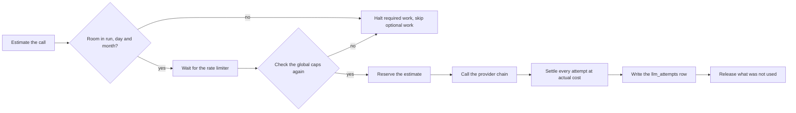

# Budgets - admission, settlement and run-tree slicing

For contributors changing the cost engine or delegation. Setting caps and finding what you spent:
[budgets.md](../budgets.md).

---

## Admission

Required work (a normal turn, compaction) halts when admission fails; optional work (preference extraction) is
skipped and logged. Channel queues stop accepting runs once the day or month is at its cap.



Two checks, two reasons. The first avoids burning a rate-limit slot on work that is already unaffordable. The
second closes the gap in which another run spent while this one waited. Reservations count toward admission, so two
concurrent runs cannot both be approved against the same remaining dollar. In-memory reservations are deliberately
not durable: they belong to the process and vanish with it.

Code: [engine/budget/reservation.ts](../../../src/engine/budget/reservation.ts) (admission and the soft warning at
`soft_warn_ratio`).

## Settlement

Every provider attempt settles exactly once, failures, retries and fallbacks included, because all three can incur
charges.

1. Provider-reported usage is normalized; invalid or negative counts become zero.
2. Cost is the provider's own figure when given, otherwise resolved model pricing.
3. Input, output, cache-read and cache-write tokens are priced separately. Reasoning tokens are a subset of output
   and never charged twice.
4. Actual cost is added to process totals and the run budget, then written to `llm_attempts`. A failed write is
   retried up to three times (`ATTEMPT_RECORD_MAX_TRIES`, 100 ms backoff). Only after that may a budget halt be
   raised.

Actual usage can overshoot an estimate. The runtime records the full amount and then halts. It never discards paid
usage to make a total fit a cap.

Code: [engine/budget/attempt-settlement.ts](../../../src/engine/budget/attempt-settlement.ts).

## The ledger

`llm_attempts` is the durable ledger
([persistence/stores/llm-attempt.ts](../../../src/persistence/stores/llm-attempt.ts)). A row carries the run and
parent run (`parent_run_id`), billing session, agent, `billing_agent_id`, provider, model, outcome, token counts,
cost source, `cost_nano_usd`, latency and settlement time. Day, month and range totals are summed from rows, so no
aggregate can drift.

At startup the runtime rebuilds the current day and month from `llm_attempts` before admitting work.

If a write still fails after retries, the spend is appended to `unrecorded-spend.jsonl` in the data directory
([engine/budget/unrecorded-spend.ts](../../../src/engine/budget/unrecorded-spend.ts)). Startup folds it back into
day and month totals until the month ends, so a restart cannot hand money back to the caps. If the append also
fails, or the file is unreadable or damaged at startup, no further paid work is admitted while a daily or monthly
cap is set (`ledger_unavailable`); with no cap it is only a reporting gap.

Retention deletes old sessions and messages but detaches attempt rows rather than deleting them.

`billing_agent_id` is the agent whose cap the spend counts against, which is not always the one that ran. A
delegated child, a research child and a debate persona started by a tool all bill the agent that asked; a headline
read inside that debate is attributed but never refused. An empty value bills the agent that ran the row.

The per-agent cap ([engine/budget/agent-cap.ts](../../../src/engine/budget/agent-cap.ts)) reads the billing agent's
spend for the calendar day once, at run start, and reserves nothing. A read failure logs `agents.cap_read_failed`
and the run goes ahead. At the cap a root run halts as `agent_daily_cap`; jobs are skipped without counting a
failure.

---

## Budget across a run tree

Three layers:

| Layer | Owner | Scope |
| --- | --- | --- |
| Global caps | `CostTracker` ([engine/budget/cost-tracker.ts](../../../src/engine/budget/cost-tracker.ts)), one per process | Day and month, every run at any depth |
| Run budget | `Budget` on run state ([engine/budget/run-budget.ts](../../../src/engine/budget/run-budget.ts)) | One top-level run |
| Slice | `BudgetSlice` handed to a child ([engine/budget/slices.ts](../../../src/engine/budget/slices.ts)) | One child run, or one research phase cohort |

A child never creates a budget. It receives a slice, and the global caps are checked on every call regardless of
depth.

### What a child gets

```ts
const allocationUsd = ctx.budget.remainingUsd() * AGENT_BUDGET_FRACTION // 0.85
const slices = createBudgetSlicesWithin(ctx.budget, allocationUsd, count)
```

(`allocateChildBudgets` in [tools/delegation/child-run.ts](../../../src/tools/delegation/child-run.ts);
`AGENT_BUDGET_FRACTION` and `MIN_PER_RUN_BUDGET_USD` in
[engine/constants.ts](../../../src/engine/constants.ts).)

The whole allocation is **reserved on the parent up front**, which keeps 15% for the parent to read results and
answer. Children then draw from **one shared pool**, first come first served. The reservation settles once every
slice has settled, so an underspending child leaves its remainder to a sibling. A runaway child can drain the pool
before a sibling's first call; that sibling reports `budget`, as it would on exhausting a private slice. Stranded
budget is certain waste and a runaway child only occasional, so the pool was chosen on purpose (per-slice ceilings
are the upgrade path if it shows up).

A cohort is refused outright when `allocationUsd / count` is under `MIN_PER_RUN_BUDGET_USD` ($0.001). On an
uncapped run the remainder is `Infinity` and none of this bites.

Parent at $1.00 remaining, three parallel children: 0.850 reserved and shared, 0.150 kept by the parent, refused
below 0.003 total.

### Research pool

`research` runs its own worker tree, so it takes a pool, not a slice
([engine/research/budget.ts](../../../src/engine/research/budget.ts)). It reserves the same 85% once and splits it
by phase (`PHASE_WEIGHTS`):

| Depth | plan | crawl | synthesize | review |
| --- | ---: | ---: | ---: | ---: |
| `light` | 0 | 0.70 | 0.30 | 0 |
| `medium` | 0.10 | 0.45 | 0.25 | 0.20 |
| `deep` | 0.10 | 0.50 | 0.20 | 0.20 |

`pool.take(phase, count, knownFutureCalls)` carves a cohort in proportion to `count / (count + knownFutureCalls)`,
so an early cohort cannot starve work the plan already knows is coming. Crawl keeps `CRAWL_EXTERNAL_COST_RESERVE`
(25%) of its phase unsliceable: search fees land on the same crawl budget, and a cohort that reserved the whole
phase would make the first fee halt the crawl. Exa's reported charge is used as-is; Brave, Serper and Tavily charge
the configured `cost_per_search_usd` (unset means uncharged); DuckDuckGo and self-hosted SearXNG are free; a cache
hit and a failed call are never charged.

### When a slice runs out

Spend is recorded, then the halt is thrown. In a child it surfaces as:

| Surface | Value |
| --- | --- |
| Child `RunResult.reason` | `budget` |
| Tool result | `{ agent_id, reason, text, budget_exhausted: true, ... }`, `isError: true` |
| Parent | Continues with the partial text and a notice; must not retry the same call |

A parent halted by its own budget stops on its next charge. Settling a child's reservation swallows the halt, so
results already paid for are never thrown away.

### Bounds that are not money

`[loop]` counters bound the tree independently of budget:

| Bound | Shape | Refunded? |
| --- | --- | --- |
| `delegation_depth` | Max child edges from the top-level run, plus self-delegation and ancestor-cycle rejection | n/a |
| `max_delegations` | One quota shared by the whole tree, reserved before children start ([engine/budget/delegation-quota.ts](../../../src/engine/budget/delegation-quota.ts)) | No |
| `max_parallel_delegations` | Max items in one `delegate_parallel` call | n/a |

### Invariants

- A child's limit always comes from the parent's reserved allocation, never a freshly read config cap.
- Reserve before spawning, settle in `finally`, settle once.
- Spend is recorded before the halt is thrown, at every layer.
- The parent always keeps 15% of its own remainder.
- Global caps apply to children exactly as to the top-level run.

---

## Source map

- Admission and warnings: [engine/budget/reservation.ts](../../../src/engine/budget/reservation.ts)
- Per-agent cap: [engine/budget/agent-cap.ts](../../../src/engine/budget/agent-cap.ts)
- Global tracker: [engine/budget/cost-tracker.ts](../../../src/engine/budget/cost-tracker.ts)
- Attempt settlement: [engine/budget/attempt-settlement.ts](../../../src/engine/budget/attempt-settlement.ts), [engine/budget/unrecorded-spend.ts](../../../src/engine/budget/unrecorded-spend.ts)
- Per-run budgets: [engine/budget/run-budget.ts](../../../src/engine/budget/run-budget.ts)
- Slices and child allocation: [engine/budget/slices.ts](../../../src/engine/budget/slices.ts), [tools/delegation/child-run.ts](../../../src/tools/delegation/child-run.ts)
- Research pool: [engine/research/budget.ts](../../../src/engine/research/budget.ts)
- Durable cost data: [persistence/stores/llm-attempt.ts](../../../src/persistence/stores/llm-attempt.ts)
