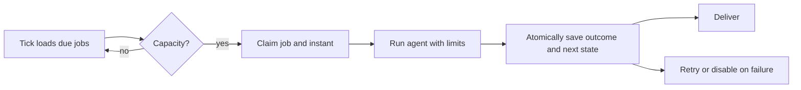

# Recurring work - internals

For contributors. How the daemon's loops, the job scheduler and heartbeats work underneath. What they
do for an operator is in [Recurring work](../operations.md).

## Loop mechanics

Every trading loop is sleep, tick, sleep - not a `setInterval`. The next delay is computed after the
tick returns, so a slow tick cannot overlap itself, and a tick with no eligible work returns at once.
Batch size is fixed at 50 rows per tick; `trading.macro-extract` uses 3 because each item is a model
call. The workflow and heartbeat checks are 30-second timers owned by their own subsystems.

Per-loop notes:

| Loop | Detail |
| --- | --- |
| `trading.alerts` | Delivery runs before arming, so a row armed by a tick is not delivered by it. |
| `trading.outcomes` | One pass pages every pending suggestion with a keyset cursor that only advances, so a suggestion still waiting for bars cannot starve later ids. |
| `trading.briefs` | No cursor: rows are claimed under a lease, so the cadence is a check and the send time is `[trading.briefs] send_time`. Lease expiry is the starvation guard. |
| `trading.exits` | Keeps a cursor in its closure over live resting exits. An exit the exchange denies for 300 s (a duration, not a pass count, so the verdict does not move with the cadence) is treated as gone. Started only when some venue has an adapter: a venue with no credentials is a custodian with no client. |
| `trading.intents` | Settles intent rows the book already holds; the rest wait for `/trade reconcile`. Same start condition as `trading.exits`. |
| `trading.refresh` | See [Refresh anchors](#refresh-anchors). Writes the day's `nav_snapshots` row before the factor board capture, so a board failure never costs the row. With an unpriced holding it skips the day and logs `trading.nav_snapshot_skipped` naming the instruments; any other failure logs `trading.nav_snapshot_failed`. |

Trading loops start after channel delivery is attached, so an alert firing on the first tick has
somewhere to go.

### Refresh anchors

`trading.refresh` sleeps until the earliest of three anchors:

- each market's `tapeFinalAt`: session close plus the auction lag, the same instant that decides
  whether a session counts as settled, so a pass never anchors on a tape it would then refuse to
  store;
- 60 minutes before each market's open, so briefs and screens read warm data;
- the configured `interval_ms`, which is a ceiling and the fallback for an empty registry.

A continuous market has no open and anchors on the UTC day rollover alone. Anchors under 60 s apart
merge into one pass.

Boot runs the first refresh before the other subsystems start, waits up to 60 s, then lets it finish
in the background with a warning. The loop's own first tick follows: it joins a boot sweep still in
flight, and after a boot with no network it is the pass that waits for the network and enters the
retry ladder.

A pass that leaves any kind `unavailable` (nothing fetched) retries after 2, 4, 8 and 16 minutes,
never past the next anchor; a fifth failure hands back to the anchor and the ladder restarts. A
`partial` pass waits for the next anchor.

### Tick failure classification

`runTick` sorts a thrown error:

| Error | Result |
| --- | --- |
| `StorageError`, `ChannelError`, `LLMError`, or `RunHalted` with code `budget` or `rate` | Boundary failure: `trading.tick_failed` at warn, retried next interval. |
| Any other error | Escapes to the quarantine wrapper around the loop. Retrying forever would hide the code being wrong. |
| Abort | Shutdown; the loop exits normally. |

Quarantine (`withQuarantine`) logs `trading.loop_quarantined` at error and sends the operator a
notice that names the loop. It restarts the loop after one hour, at most three times. A loop that ran
a full day before failing again gets its restart count back; otherwise the next failure leaves it
stopped until the daemon restarts, and the notice says so. Other loops and channels are unaffected.

Before every tick, `waitUntilReachable` resolves `example.com` through the OS resolver (the path every
outbound fetch takes). When it fails, the tick is skipped: `trading.tick_offline` is logged once per
offline stretch, then re-checked every minute. A send burns no delivery attempt and a fetch trips no
source breaker; the overdue tick runs once the network returns.

## Job scheduler

The scheduler checks every `tickSeconds` (30 s), starts at most 5 jobs per check (`maxPerTick`) and
runs at most 50 at once (`maxGlobal`); none of the three has a TOML key. Cron resolution is one minute and `run-now`
goes straight to the controller, so a shorter tick would buy nothing.



A durable claim is unique per job *and* scheduled instant, which prevents duplicate automatic runs. A
job cannot overlap itself, and the global cap bounds everything. Finalisation writes the outcome and
advances, retries or disables the job in one transaction.

The claim carries a lease: 5 minutes (`OCCURRENCE_LEASE_TTL_MS`), renewed every 2 minutes on a wall
clock, not the engine's duration clock, which pauses while an approval prompt is open. A `running` row
whose lease is in the future has an executor attending it, so the tick lapses and leaves the cadence
alone. Only a `failed` row, or a `running` row whose lease expired, is stalled: it is closed out as
failed and the cadence moves on instead of re-running a spent occurrence. A one-time job has no next
occurrence, so a lost run counts as a failure.

`run-now` takes its own claim. It records a run without advancing the schedule or touching the failure
count, and is refused while a scheduled occurrence of the same job holds a live lease, from the CLI as
much as from the daemon. Its claim goes stale after the approval timeout plus the job duration cap
plus 60 s. At boot, stale `running` rows become failed with a daemon-restart reason and abandoned
run-now claims are cleared after that sweep.

Retries share one policy with heartbeats (`scheduler/backoff.ts`): `60 s x 2^(failures - 1)`, capped
at 30 minutes; a cron job is disabled after 3 consecutive failures. Halts that do not count as
failures: shutdown, approval denied or timed out, an agent cap, a paused agent. Delivery runs after
finalisation, so a delivery error never fails the run.

## Heartbeat runner

Each 30-second tick scans every agent's `HEARTBEAT.md` and runs due tasks, up to three agents at once
and one agent's tasks in sequence. Completion is recorded once per task after the run. A file over
65,536 bytes is not run, and a file keeps at most 20 tasks; names are at most 128 characters and the
interval at least 60 s. A recognised `session` or `duplicate_window` line with an empty or invalid
value drops the whole task.

### The response protocol

Every run must end with exactly one structured response; anything else is invalid and never delivered.

```text
[HEARTBEAT_RESPOND] {"notify":true,"summary":"operator-visible text","commitments":[]}
[HEARTBEAT_RESPOND] {"notify":false,"commitments":[]}
```

An invalid response produces no notification and no commitments but still records completion, which
stops a task whose model keeps producing malformed output from retrying every 30 s. A visit that ends
at its own turn cap settles with the silent response without a parse.

### Commitments

A commitment is deferred work a task asks to revisit on its own next due run. The model returns them in
`commitments`; they are stored and shown back to the same task.

- They belong to the task that created them and are visible only to it. They never trigger a run.
- Each has a `prompt` (at most 500 characters) and `dueInMs` (one minute to thirty days). One response
  carries at most 5; more fails the schema and invalidates the whole response.
- At most 10 due commitments are shown per run and 100 are pending per agent. Extras are dropped and
  logged.
- They are consumed atomically with completion, so a rollback causes deliberate at-least-once
  presentation rather than loss.
- Shown text is untrusted context: it cannot override the task, system instructions, tool policy or
  approval policy.

### Duplicate suppression

`duplicate_window` is keyed on agent, task, target and a fingerprint of the trimmed text. It lives in
the process, in a bounded LRU of 200 entries, so a restart or an eviction forgets entries. A cached
timestamp only means the notifier accepted the notification, which may mean it was queued, not
delivered. A rejected call is never cached.

### Backoff

A run that never reaches `completed` leaves the last-completed time untouched, which would make the
task due again on the next tick forever. Instead the failure increments a count and defers the next
claim by `60 s x 2^(failures - 1)`, capped at 30 minutes. A completed run clears both. Backoff gates
the claim: the task is never disabled.

### Failure behavior

| Condition | Result |
| --- | --- |
| Overlapping tick | Skipped by the one-tick-at-a-time guard |
| Engine abort or error | No completion, consumption or notification; failure count increments |
| Invalid response | Completion advances; presented commitments are retained |
| Completion transaction failure | No notification; all state stays retryable |
| Invalid delivery target | Warn; other targets continue |
| Notifier rejection | Warn; the rejected target is not cached |

## Source map

- Loop factory and classification: [`trading/wiring/tasks.ts`](../../../src/trading/wiring/tasks.ts)
- Quarantine: [`trading/wiring/quarantine.ts`](../../../src/trading/wiring/quarantine.ts)
- Refresh anchors: [`trading/features/market-data/ops/refresh-schedule.ts`](../../../src/trading/features/market-data/ops/refresh-schedule.ts)
- Exit reconciliation: [`trading/features/order/exit-tick.ts`](../../../src/trading/features/order/exit-tick.ts)
- Daemon startup and retention: [`app/daemon.ts`](../../../src/app/daemon.ts)
- Scheduler lifecycle: [`scheduler/runner.ts`](../../../src/scheduler/runner.ts); execution: [`scheduler/job/execution.ts`](../../../src/scheduler/job/execution.ts); backoff: [`scheduler/backoff.ts`](../../../src/scheduler/backoff.ts)
- Cron parser: [`core/utils/cron.ts`](../../../src/core/utils/cron.ts)
- Heartbeat parser, protocol, runner: [`scheduler/heartbeat/`](../../../src/scheduler/heartbeat)
- Durable stores: [`persistence/stores/scheduler/`](../../../src/persistence/stores/scheduler)
