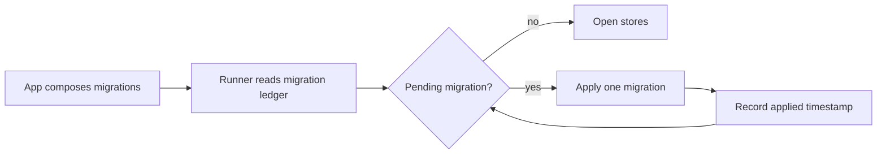

# Storage internals: dialects, migrations, registry, sessions

For contributors. What operators do with the database and sessions is in
[Storage and sessions](../storage.md).

## Persistence layers

Everything goes through one asynchronous SQL interface. Stores own the SQL, transactions guard any
rule spanning more than one row, and an agent never touches storage directly. `openPersistence`
(`persistence/connection.ts`) returns `{ storage, dialect }` for the configured engine;
`resetPersistence` is its destructive twin.

```ts
interface Storage {
  query<T>(sql: string, params?: readonly unknown[]): Promise<readonly T[]>
  execute(sql: string, params?: readonly unknown[]): Promise<{ readonly changes: number }>
  transaction<T>(fn: (tx: Transaction) => Promise<T>): Promise<T>
  close(): Promise<void>
}
```

`Transaction` is the `query` and `execute` half. Both are in `core/types/storage.ts`.

### Dialect contract

Store code asks the `Dialect` for engine differences instead of branching in domain logic. Never
write dialect-specific SQL in a store or branch on the dialect in domain logic.

```ts
interface Dialect {
  readonly name: 'sqlite' | 'postgres'
  readonly autoIncrementPk: string
  param(index: number): string                       // sqlite ?N, postgres $N
  paramList(count: number, startAt?: number): string
  upsert(table: string, target: UpsertTarget): string // keys, cols, rowCount, keepWhenNull?
  insert(table: string, target: InsertTarget): string // an insert that follows its own delete
}
```

`UpsertTarget.keepWhenNull` names columns a NULL must not overwrite, for rows several providers
each fill part of.

### Engines

- **SQLite** (`persistence/engines/sqlite.ts`, `bun:sqlite`). Pragmas in order: `busy_timeout`
  5000 ms first (switching to WAL takes a lock, so the wait must already be set), `journal_mode =
  WAL`, `synchronous = NORMAL`, `temp_store = MEMORY`, `cache_size` 4000 KiB, `mmap_size` 8 MiB,
  `foreign_keys = ON`. The retention sweep also runs `PRAGMA optimize` every 6 hours on SQLite
  (`optimizeSqlite` in `persistence/upkeep.ts`, failures log `retention.optimize_failed`); there is no
  engine timer. Backup uses `VACUUM INTO` (`persistence/backup.ts`): written into a
  `mkdtemp` staging folder (`.staging-*`, `0700`) beside the target, `chmod 0600`, then renamed into place,
  because `VACUUM INTO` honours the umask and the copy must never be readable by others while it is
  written. `backupAndPrune` writes a copy then clears orphaned staging folders and drops the oldest past `keep`
  (`KEEP_BACKUPS`, 7, unless the caller passes a count). The retention sweep calls it for `backups/daily/`
  when `newestBackupAt` is missing, in the future or at least a day less one sweep interval old, with
  `[retention] daily_backups` as the count; SQLite only, failures log `retention.backup_failed`.
- **PostgreSQL** (`persistence/engines/postgres.ts`). `ensureSchema` runs `CREATE SCHEMA IF NOT
  EXISTS` first: `search_path` names a schema but never creates it, and a missing entry is skipped
  silently, which would land every migration in `public`.

## Migrations



A migration is `{ id, reversibility, up, down? }` (`persistence/types.ts`). The file name is the id:
`YYYY_MM_DD_HHMMSS_description.ts`, so lexicographic order is application order. A file exports
`up` and may export `down`; generation pairs them with the id from the filename.

- **Registry.** `persistence/migrations/registry.generated.ts` is generated by `bun run gen`
  (`scripts/gen-migrations.ts`). Never edit it. Add a file with `bun run migration:new`, then
  regenerate. Its static imports are what a compiled binary needs.
- **Runner** (`persistence/migrations/runner.ts`). `migrate(db, dialect, options)` is idempotent: it
  applies only ids absent from the `_migrations` ledger. `resolveMigrations` merges core with the
  extras trading and plugins append, sorts by id and rejects duplicates (`StorageError`).
- **One locked transaction.** Read-decide-apply-record runs inside one transaction, so two booting
  processes cannot both compute the same pending list. SQLite serialises through `BEGIN IMMEDIATE`;
  PostgreSQL takes `pg_advisory_xact_lock(hashtext('persistence_migrations'))` and sets
  `statement_timeout` and `idle_in_transaction_session_timeout` to 0 for the transaction. The batch
  is all-or-nothing: a failure rolls back migrations applied earlier in the same call.
- **Ledger.** `_migrations (id TEXT PRIMARY KEY, applied_at BIGINT NOT NULL)`. Its name and the
  statements that read it are exported from the runner because `doctor` reads it through a raw
  read-only `bun:sqlite` handle, so the SQL must stay shared.
- **Status.** `migrationStatus` returns `applied | pending | orphan` per id. An orphan is in the
  ledger but not declared (a downgrade or deleted migration). `migrate` refuses a
  database with any, before backing it up or applying anything, with `errors.dbSchemaAhead`: an
  older release reading a newer schema misreads rows.
- **Pre-migration backup.** SQLite only, when `backupDir` is set and anything may be pending:
  `backupSqlite` into `pre-migration/`. A stale precheck can only cost an unneeded or skipped
  backup, never a missed migration, because the lock re-reads first. A failed backup logs
  `migration.backup_failed` and does not block.
- **Rollback.** `resolveMigrationRollback` says what `db migrate down` would do:
  `ready | none | irreversible | orphan | gap`. Only the newest applied migration is reversible, and
  only against an unbroken history. `rollbackMigration` re-resolves under the same lock and returns
  `history_changed` if another process moved the ledger since the operator was told the target.
  Logs: `migration.applied`, `migration.failed`, `migration.rolled_back`,
  `migration.rollback_failed`.

### Migration rules

- Migrations are immutable from 1.0.0: an applied file and id never change. Every schema change is
  a new file, with `down` written at birth.
- `check-migration-rollback` enforces `down` (static table coverage plus a SQLite round trip).
- Adding a table is three edits: `CREATE TABLE` in the migration, its name in that migration's
  `TABLES_TO_DROP`, and one registry line (next section).

## Table registry

`persistence/tables.ts` lists every table because neither engine exposes a portable catalog query.
It drives `db stats`, `db export` paging, `db import` order and retention delete keys, and is the
only place a primary key is written outside the DDL.

```ts
interface DbTable {
  readonly name: string
  readonly pk: readonly string[]   // declaration order; export pages on it
  readonly durable?: true          // survives only if exported; no catalog derives it
}
```

Entries sit in `CORE_TABLES` then `TRADING_TABLES`. Exports: `ALL_TABLES`, `DURABLE_TABLES`,
`ALL_TABLE_NAMES`, `TABLE_NAME_WIDTH`, `findTable(name)` (operator-supplied, returns `null`) and
`dbTable(name)` (typed name, throws `StorageError` on a miss). `durable` is for rows an operator
wrote or that cannot be fetched again; each exception among market data carries a comment saying
why.

### The gate

`scripts/check-table-registry.ts` holds the registry against the schema, so a table added to a
migration and forgotten here fails at lint speed instead of going invisible to `db stats` and
`db export`.

1. It migrates a throwaway SQLite database, compares table names with the registry, and checks each
   primary key against `PRAGMA table_info`, naming any missing entry and any key that moved. It also
   asserts each table is pageable.
2. PostgreSQL cannot be migrated from a gate. Its schema is read by running every migration's `up`
   against a recording `Transaction` that captures DDL instead of executing it, then parsing
   `CREATE TABLE`.
3. The same reader runs over the SQLite dialect and is checked against `PRAGMA table_info`.
   Otherwise the parser could drift and quietly excuse PostgreSQL, the one engine it is the only
   check for.

So a domain table missing after a reset means its migration was not registered at boot, not that
`db stats` hid a failure.

### Data notes

- `daily_bars` is keyed by source and day. The writer's window `DELETE` normally leaves one provider
  per window, but that is the writer's doing. `listBars` orders by `fetched_at` and keeps the newest
  row per session, because a series with one session twice changes every median, ATR and lookback.
- `resting_exits.first_missed_at` is a timestamp, not a counter, on purpose: counting denials would
  measure reconcile passes rather than time, and its meaning would shift with the tick cadence.
- `llm_attempts` is the source of truth for cost. Session totals are folded from it
  (`loadTotals`), never stored.

## Retention

`persistence/retention.ts`. Constants: `SCHEDULER_RUNS_KEEP_PER_JOB` 200,
`BRIEF_SNAPSHOTS_KEEP_PER_LOCALE` 1, `LLM_ATTEMPTS_RETENTION_MS` 400 days. `RetentionConfig` carries
`retentionDays` and `inboxRetentionDays`. The daemon sweeps once at start, then on a schedule; the
manual `db cleanup` runs the same policy. `runRetention` runs each scope's delete (`toScopes`) in its own
transaction, so one slow or failing scope neither holds the SQLite connection for the whole sweep nor
rolls the others back on PostgreSQL's statement timeout; a failed scope logs `retention.scope_failed`
and returns 0 in the unchanged `RetentionCounts`. The `SELECT changes()` read stays inside the scope's
transaction, on the same connection as its delete.

## Session store

`SessionStore` (`persistence/types.ts`), implemented by `createSessionStore(db, dialect)` in
`persistence/stores/session/store.ts`; SQL strings come from `buildSessionSql(dialect)`.

- **Claim.** `claimRun({ session, runId, now, leaseExpiresBefore })` inserts the row if absent, then
  claims it with one `UPDATE`: two racing claimants both run it and the loser matches zero rows
  (returns `false`, surfaced as `session_busy`). A holder whose last activity is older than
  `leaseExpiresBefore` has lost its lease. The bound is
  `now - (loop.maxDurationMs + RUN_LEASE_SLACK_MS)`, with `RUN_LEASE_SLACK_MS` = 300,000.
- **Write path.** `appendMessages` is the engine's session sink: append-only, flushed per completed
  turn by `engine/hooks/persistence.ts`. `appendCommandExchange` writes the two rows a slash command
  contributes (no run owns them). `finalizeRun(id, runId, outcome)` closes the session out and throws
  `ConflictError` unless that run holds it.
- **Stale.** `markStaleRuns(leaseExpiresBefore)` runs once at daemon boot (`app/startup-state.ts`),
  before any subsystem can open a run, and marks every `active` session nobody holds a live lease on
  as `stale`.
- **Remove.** `remove(id)` reads the status inside the transaction and refuses an `active` session
  (`'active'`; its next flush would fail on the cascaded delete). Otherwise it deletes route rows
  first, then messages, nulls `llm_attempts.session_id`, then the session. `clear(agentId?)` does
  the same for many and refuses if any is active. Route keys use `SESSION_ROUTE_KEY_PREFIX`.
- **Prefix lookup.** `resolveIdPrefix` returns `found | not_found | ambiguous`; an exact id wins over
  a longer match.
- **Reads.** `loadHistory(id, limit?)` returns the newest `limit` rows in order; `loadDetails`
  returns a `SessionSnapshot` (details, stored messages, attempts, folded totals).
  `SessionStatus` is `'active' | 'done' | 'stale'`.

### Queue and route fencing

`core/session-queue.ts` serialises work per session on a promise tail with `MAX_QUEUE_DEPTH` = 10;
past it the caller gets `RunHalted('queue_full')`. A route switch (`/new`) goes through a route
fence with a per-route generation: it waits for held leases, invalidates queued work, updates the
stored route, then admits work for the new generation, so a message accepted for the old session
cannot run under the new route.

### Compaction and todo restoration

- `engine/compact/compactor.ts` decides and orchestrates; `summarizer.ts` calls the model;
  `message-repair.ts` keeps each tool call with its result, drops orphans, de-duplicates by call
  id, and checks integrity before the next provider request. `engine/loop/run-compaction.ts` wires
  it into the run.
- Summary calls are budgeted, priced and recorded as `compaction` attempts. A provider error inserts
  a truncation marker. A pass that leaves the transcript no smaller halts with `length_limit`.
- `engine/loop/todo.ts` keeps the run's copy of the `todo_write` list outside the transcript and
  re-appends it before the next provider call when no `todo_write` result or earlier restoration
  notice is visible. Only a `todo_write` result refreshes the copy. The notice lives only in the
  prompt, never in the stored transcript.

## Source map

- Storage and transactions: [`persistence/connection.ts`](../../../src/persistence/connection.ts)
- Engines: [`persistence/engines/sqlite.ts`](../../../src/persistence/engines/sqlite.ts) - [`persistence/engines/postgres.ts`](../../../src/persistence/engines/postgres.ts)
- Dialect contract: [`core/types/storage.ts`](../../../src/core/types/storage.ts)
- Migration runner: [`persistence/migrations/runner.ts`](../../../src/persistence/migrations/runner.ts) - generated registry: [`registry.generated.ts`](../../../src/persistence/migrations/registry.generated.ts)
- Core schema: [`persistence/migrations/2026_07_10_000001_initial_schema.ts`](../../../src/persistence/migrations/2026_07_10_000001_initial_schema.ts)
- Trading schema: [`persistence/migrations/2026_07_10_000002_trading_tables.ts`](../../../src/persistence/migrations/2026_07_10_000002_trading_tables.ts)
- Retention: [`persistence/retention.ts`](../../../src/persistence/retention.ts)
- Table registry: [`persistence/tables.ts`](../../../src/persistence/tables.ts), gated by [`scripts/check-table-registry.ts`](../../../scripts/check-table-registry.ts); rollback gate: [`scripts/check-migration-rollback.ts`](../../../scripts/check-migration-rollback.ts)
- SQLite backup and restore: [`persistence/backup.ts`](../../../src/persistence/backup.ts)
- Database CLI: [`cli/commands/db/db.ts`](../../../src/cli/commands/db/db.ts), [`export.ts`](../../../src/cli/commands/db/export.ts), [`import.ts`](../../../src/cli/commands/db/import.ts), [`migrate.ts`](../../../src/cli/commands/db/migrate.ts)
- Session store contract: [`persistence/types.ts`](../../../src/persistence/types.ts) - store: [`persistence/stores/session/store.ts`](../../../src/persistence/stores/session/store.ts)
- Transcript writes: [`engine/hooks/persistence.ts`](../../../src/engine/hooks/persistence.ts)
- Session queue and route fencing: [`core/session-queue.ts`](../../../src/core/session-queue.ts)
- Context compaction: [`engine/compact/compactor.ts`](../../../src/engine/compact/compactor.ts) - [`message-repair.ts`](../../../src/engine/compact/message-repair.ts)
- Todo list restoration: [`engine/loop/todo.ts`](../../../src/engine/loop/todo.ts)
- History CLI: [`cli/commands/history.ts`](../../../src/cli/commands/history.ts)
