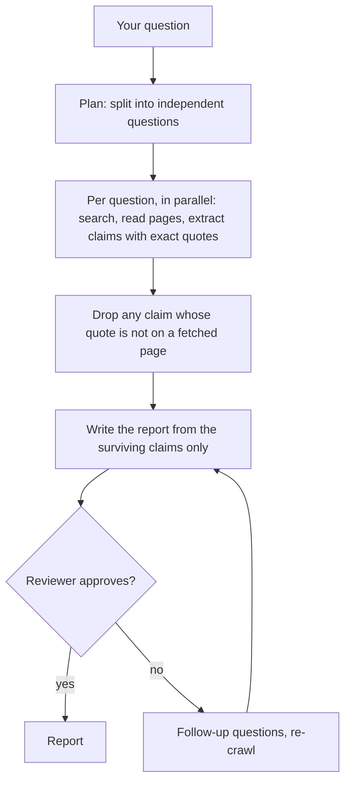

# Deep research

Research answers a question from current outside sources and hands back a report. Every important
claim in it is tied to a quote from a page OpenAlpha actually fetched. It is read-only and advisory: it
suggests, cites and flags gaps, and cannot place or simulate an order.

It runs in the foreground only. A run lives inside the chat turn that started it, shares that turn's
cancel signal and budget, and is gone when the turn ends. There is no background job, no research id
and no resume. Cancel the turn and everything stops.

One idea holds the design together: **the model never touches the network.** Ordinary code searches
and fetches first, and the model only sees what that code collected. A made-up citation is not just
unlikely; it cannot happen.

For `/research` syntax see [Commands](commands.md); for which model each stage uses see
[Configuration](configuration.md). How it works inside: [dev/research.md](dev/research.md).

## Start a run

The `chat` agent calls research on its own when a question needs current, outside, multi-source
evidence. To ask for it yourself:

```text
/research <query>
/research quick <query>
/research standard <query>
/research thorough <query>
```

`/research` runs through the built-in `deep-researcher` agent and leaves your `/agent` binding alone.
To chat with that agent directly, use `openalpha chat --agent deep-researcher`. A query can be up to
20,000 characters.

| Profile | Questions | Review rounds | Plan approval |
| --- | --- | --- | --- |
| `quick` | 1, no planner | 0 | none |
| `standard` (default) | up to 7 | at most 1 | plan shown, not editable |
| `thorough` | up to 7 | up to 2 for a complex question, otherwise at most 1 | interactive |

A top-level `thorough` run needs someone to review the plan interactively. With nobody attached, it
is cancelled before spending anything rather than running the most expensive depth unreviewed.

### A real run

A real `quick` run, trimmed and translated from Vietnamese. With no eight-month figure found, the report says so and gives the latest one, flagging with ⚠️ the claims it could not source well enough:

```
You:  /research quick What did FPT earn in the first eight months of 2026,
      and what do brokers forecast for the year?

2 searches · 3 pages read
2 sources used · 4 supported claims
⚠️ 2 evidence issues
  • Not enough source support was found for a claim. ×2
✓ Complete with gaps · Evidence level: mixed

⏺ No eight-month 2026 profit figure for FPT was found, and no broker full-year
forecast either. The latest figures found:
- Five months: net profit to parent VND 4,199 bn, +16% (Vietcap).
- Six months: pre-tax profit VND 5,714 bn, +18.1% (Bao Dau tu).
- FPT's own full-year plan (not a forecast): pre-tax profit VND 11,629 bn.

$0.0111 · done in 34.4 seconds
```

## How a run works



- **Search and read come first, in plain code.** The model only extracts claims and exact quotes from
  the pages that code fetched. Search snippets and provider summaries are for finding pages, never
  evidence.
- **The code decides what counts.** A claim stays only if its quote appears word for word on a page
  that was really fetched. The model never invents source ids.
- **The report has no prose of its own.** Each sentence traces back to a claim that survived.
- **A reviewer scores it.** A weak report triggers follow-up questions and a re-crawl of only those,
  up to the profile's round limit.

Each question is crawled at most twice; the second try is told what failed the checks. If every
planned question fails in a retryable way, the run falls back to one exact-query search on your
original wording, preferring official sources. A fallback result is always `completed_with_gaps`, has
evidence level `limited`, and skips review.

## What counts as evidence

A **source** is a page, an **excerpt** is a verbatim quote from it, and a **claim** is a statement that
cites excerpts. A claim with no surviving excerpt never reaches the report.

Each claim is one of three kinds:

- `factual` and `numeric` claims are sourced and must cite excerpts. A `numeric` claim also carries
  its value, unit and date exactly as written in the quote.
- `inference` claims are the model's own reasoning, labelled as such so you can tell them from sourced
  statements.

A sourced claim marked `forecast: true` states an expectation, estimate, price target or company
guidance rather than something that already happened. An analyst's 2027 earnings estimate is a sourced
fact about what that analyst expects, not about 2027 earnings, and the report presents it that way.
Two forecasts that disagree are two views, not a contradiction.

**Conflicts are reported, not resolved.** Choosing between two sourced numbers is your job. A
`numeric_mismatch` means a number could not be tied to its quote. A `factual_contradiction` means two
admitted claims state the same measure (same unit, scope and effective day) with values that differ
by more than rounding. Units are compared, never converted.

Each claim also carries `independentSources`: how many distinct publishing hosts stand behind it, with
syndicated copies counted once.

### Gaps

When something is dropped or missing, the report names a gap instead of hiding it:

| Gap | Meaning |
| --- | --- |
| `low_recall` | A question found fewer than two pages |
| `content_limit` | A size or count limit cut material (over 42 searches, over 3 pages read, over 8 excerpts on a source) |
| `missing_support` | A claim lost its supporting excerpt |
| `unsafe_content` | A source or quote tripped the prompt-injection scan |
| `freshness_out_of_window` / `freshness_uncertain` | The date is outside the window you asked for, or missing or low-confidence |
| `truncation` | An excerpt was cut to 4,000 characters |
| `artifact_limit` | Evidence had to be trimmed to fit 128 KiB |
| `provider_unavailable` | The search provider failed and no fallback is configured |

Freshness never silently deletes a source on a weak signal. A date is rejected only when it is
high-confidence; otherwise the source stays and is flagged.

## Read the report

The report has ordered sections, each a list of claims:

| Section | Contents |
| --- | --- |
| `answer` | The direct answer. Mandatory: a run with no answer claim fails. |
| `keyEvidence` | The strongest supporting claims. |
| `risks` | What could invalidate the answer. |
| `conflicts` | Sources that disagree. |
| `practicalConsiderations` | Caveats for acting on it. |

Every completed result also carries an outcome and an evidence level:

| Field | Values |
| --- | --- |
| `outcome` | `completed`, or `completed_with_gaps` whenever any gap or conflict survives |
| `evidenceLevel` | `sufficient` when completed and reviewed; `mixed` when it came from the planned path or finished without a review round (the quick profile); `limited` when it came from the fallback |

The reviewer approves only when every score dimension is at least 0.4, the composite is at least 0.7,
no claim is unsupported and no issue is outstanding.

## When research fails

A run fails with `insufficient_evidence` when no excerpt was admitted, when nothing survives the
checks, when nothing lands in `answer`, or when the answer cannot fit in 128 KiB. That is a deliberate
refusal to answer, not a degraded answer.

Other failures say which part broke:

| Code | Meaning |
| --- | --- |
| `aborted` | You cancelled the run |
| `budget_exhausted` | The run's cost budget ran out |
| `capacity_exhausted` | Not enough delegated-call slots left for the work required |
| `planner_failed` | No usable research plan |
| `crawler_failed` | Evidence collection failed |
| `source_unavailable` | Crawlers ran but produced no claims |
| `provider_unavailable` | No search provider returned usable evidence |
| `llm_provider_failed` | The model request failed |
| `synthesizer_failed` | Evidence collected, report could not be written |
| `reviewer_incomplete` | The review did not finish |
| `invalid_output` | A worker returned output that failed validation |
| `invalid_tool_arguments` | A worker kept calling web tools incorrectly |
| `model_incompatible` | The selected model cannot use the required web tools |
| `timeout`, `turn_limit`, `loop_detected` | The run hit a duration, turn or repetition limit |
| `unexpected` | An internal error |

Research reserves its delegated calls up front. If the depth you asked for needs more calls than the
turn has left, it fails at once with `capacity_exhausted` rather than start work it cannot finish. It
also reserves 85% of the turn's remaining budget and leaves the rest for the parent turn to read the
result. Optional work (extra questions, review rounds, retries, follow-ups) draws on what is left
beyond that; when a call cannot be funded, research skips it and notes the gap instead of failing
after the work is spent.

## Limits

These are fixed; there is no `[research]` section in the configuration.

| Limit | Value |
| --- | --- |
| Questions | 7 |
| Search terms per question | 3 |
| Search subqueries per run | 42 |
| Review rounds | 2 |
| Review threshold (composite score) | 0.7 |
| Excerpt size | 4,000 characters, cut at a sentence boundary |
| Excerpts per source | 8 |
| Evidence per report | 128 KiB |
| Pages a question reads itself | 3 (when the search provider returns no page text; every provider but Exa) |
| Page text kept per source | 64 KiB |

A profile may narrow a limit but never raise it.

Search providers are set under `[web_search]`. Research uses two explicit roles - the configured
default and an optional distinct fallback - and never silently falls back to keyless DuckDuckGo the
way the general `web_search` tool does. With no fallback configured, a failed default shows up as a
`provider_unavailable` gap. If the default's `api_key_env` names an empty variable, `/research`
refuses up front and names the variable to set.

A paid provider's charge comes out of the crawl budget. Exa reports its own cost; Brave, Serper and
Tavily bill per query without reporting it, so set `[web_search] cost_per_search_usd` to your plan's
rate or their spend stays invisible.

## Safety

Fetching is guarded:

- HTTPS only (a plain-http result is upgraded to its https address, and fails as a gap if the host has
  none), and credentials in URLs are rejected;
- loopback, link-local and cloud-metadata addresses are blocked, DNS is resolved once and the
  connection is pinned to that address to defeat rebinding;
- at most five redirects, with the address checks repeated on each hop, and sensitive headers stripped
  when a redirect crosses hosts;
- non-text responses are rejected, and outbound requests are scanned for credential-shaped values.

**OpenAlpha does not read or honour `robots.txt`.** Exclude sites you would rather not fetch by other
means.

Hard ceilings apply to any single run whatever the configuration: 8 sources gathered per question, 8
claims per question, 3 sources per claim, 8 entries per report section, 12 gaps, 6 review issues, 64
retrieval attempts. A page read stops at 1 MiB before extraction (a longer page is cut, not rejected),
search snippets are 400 characters, and failure messages 500.

## See also

- [Budgets](budgets.md) - cost caps and how a run tree splits one budget
- [Safety](safety.md) - the injection-scanning model
