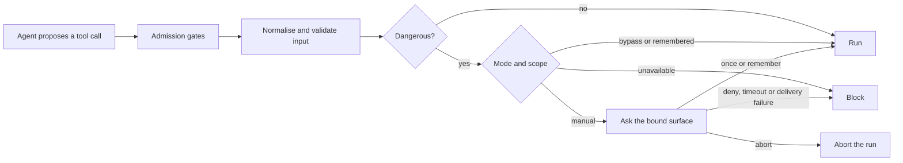
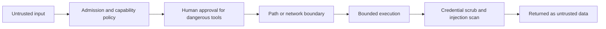

# Safety: approvals and security

Two jobs, defended side by side. **Approval** decides whether a dangerous action may run at all.
**Security** decides what that action can reach once it does. Neither replaces the other, and code
enforces both - not a prompt.

One caveat up front: an approved shell command runs with the permissions of the daemon process. The
workspace is a starting directory, not an operating-system sandbox. To contain genuinely hostile
code, use a container or a restricted service account.

## Operator checklist

1. Keep API keys in environment variables named by config. Never put a secret in `config.toml`, a
   prompt, a skill or memory.
2. Leave approval in `manual` unless both the caller and the workload are trusted.
3. Keep channel admission allow-listed or paired, and set operator user ids for shared chats.
4. Load plugin tools that run code only from trusted bundled plugins. Leave `[plugins].allow_code`
   off unless you have read that plugin's `sources.ts`.
5. Give each agent only the tools, capabilities and outbound hosts it needs.

Run `openalpha doctor` after any change, or `openalpha doctor safety` to see which risky switches are on. Configuration is merged and frozen at boot, so restart the
process for a security change to take effect.

---

## Part one: approvals

Approval gates side effects an agent asks for. It also keeps the product rule that OpenAlpha only
suggests: the one surface that places an order asks you every single time.

### Your three answers

| Decision | Effect |
| --- | --- |
| **Deny** | Blocks this call. In the CLI, free text goes back to the agent as feedback on what to change. |
| **Allow once** | Runs this exact call, once. |
| **Remember** | Allows it for the chat session or MCP connection. Not offered for a tool that declines it, or for a call whose arguments were too long to show whole. |

Anything unrecognised, malformed, expired or undeliverable blocks the call. Cancelling ends the wait
and the run.

Remember is never offered to scheduled jobs or delegated children. It is also never offered for
`order_place`: **two identical orders are two real fills**, so your answer about one order never
covers the next.

### What needs approval

A call needs approval when any of these is true:

1. The tool writes files or runs shell commands.
2. The tool comes from an external MCP server.
3. The tool judges this particular input dangerous.

The third rule lets read-only work through. Listing scheduled jobs needs no approval; removing one
does. Recalling memory needs none; storing or removing it does.

Reading a web page works the same way. The agent opens a link you sent or one a search or news read
brought back without asking. It asks first when it built or changed the link itself, adds its own
headers, or has already read `[loop] max_unasked_fetches` pages in one run (10 by default). A page
can hide instructions, and a link the agent puts together is how it would carry your holdings,
profile or notes out to someone else, so that one is yours to approve. Text you forward into the
chat counts as someone else's, not as a link you sent, and so does a task one agent hands another.
These prompts offer no "remember".

Approval does not replace permissions. The agent must already be allowed the tool, and the call must
pass input checks, before you are asked anything.

### Modes

| Mode | Behaviour |
| --- | --- |
| `manual` | Ask a human. The normal interactive mode. |
| `bypass` | Allow without asking. Must be chosen explicitly. |
| `unavailable` | Block, because the run has no trusted way to ask a human. |

`bypass` allows before the gate is consulted, so no tool can make itself un-bypassable. Instead, a
tool whose effect cannot be undone outside this process checks the mode itself and refuses. Placing
an order under `bypass` also needs `[trading.orders] allow_unattended`. Two deliberate decisions, not
one.

These always use `unavailable`: heartbeats, scheduled jobs with no target, delegated children with
no chat route, and non-interactive one-shot runs (unless you chose bypass). A scheduled job with a
target asks through that target, and `schedule run-now` follows the job's own target.

### Scope and lifetime

| Scope | Offered | Remember lasts |
| --- | --- | --- |
| Interactive chat session | deny, once, remember | In process memory, per session and call. Never saved to disk. |
| MCP client | deny, once, remember | The active MCP connection. |
| Scheduled job with a target | deny, once | Not offered. |
| Delegated child with a route | deny, once | Not offered. |

A remembered approval covers only what its key names, and disappears on restart:

- shell command: the exact command and arguments;
- tool from an external MCP server: its whole argument set (key order aside);
- any other tool: the tool name.

A call with a different key asks again. Chat-session denials are not remembered. MCP denials are, so
an agent cannot keep asking for the same denied tool on one connection.

**A child never inherits its parent's bypass or remembered approvals.** With a routed chat it can ask
for one-time approval through that route; without one, its dangerous calls are blocked.

### While you decide

The run's time limit is **paused** while it waits, so your thinking time does not eat the run's
allowance. The wait has its own timeout: `[loop].approval_timeout_ms` (120 s) normally,
`[schedule].approval_timeout_ms` (900 s) for scheduled jobs with a target. Identical pending calls
in one run get one prompt, not three.

### Per surface

**CLI.** Prints the tool name and the call's detail (for `shell_exec`, the whole command and its
arguments). With `--verbose` it also prints a credential-scrubbed argument preview. `o`/`once` or
`y`/`yes` allows once, `r`/`remember` remembers where the scope allows it, anything else denies.
Prompts from parallel child runs take turns. An MCP tool's nested arguments print as compact JSON.
A call too long to show whole opens with `[Arguments cut short - you can only approve this once]`
and offers no remember.

**Channels.** An inline-button prompt goes only to the channel that owns the run. A tap counts only
when the request is still pending, it came from the prompted chat, that decision was actually
offered, *and* the person tapping is an authorised operator. A channel without inline buttons (Zalo) asks
with short codes such as `/4821` to type back, each good only in that chat and only while the prompt
lives; it denies immediately and says so only when no code can be drawn. Shutdown denies every outstanding request.

**MCP.** Approval uses form elicitation when the client supports it. A client without elicitation
cannot approve, so dangerous calls fail closed.

**Scheduler and delegation.** Only with a target channel and chat, and only deny or allow once. A
child's prompt names both the child and the parent run.

### Why it holds

- A request ID alone is not authority: the answer must also match the run's channel.
- Channel taps are bound to the prompted chat and the operator list.
- Argument previews are credential-scrubbed and capped at 2,000 characters.
- `shell_exec` refuses a call whose command and arguments would not fit the 400-character prompt
  detail, and quotes any argument holding whitespace or a quote, so the prompt always shows the
  whole command with its argument boundaries.
- Approval runs after input preparation and right before execution, so a blocked call never runs.
- Missing UI, delivery failure, timeout, abort, malformed answer and shutdown all **fail closed**.

---

## Part two: security layers

No layer replaces another. Approval decides whether an action may run; path and network policy
still check its target; the output pipeline still treats the result as data, not instructions.

### Credentials and logs

Model credentials come from the environment variable named by `api_key_env`; storage and search
credentials work the same way. A missing storage value fails at boot rather than starting a
half-configured service; a missing model key only makes model calls wait, and `start` warns about it;
an empty search key only turns web search off and says so.

A few credentials are their own files under the data directory, mode `0600`: a model provider's
subscription login, the generated API token, social network keys and the Zalo personal session. They
do not travel with `db export` or `db backup`; see
[Storage](storage.md#files-outside-the-database).

Keys typed on the office page (Settings > Providers, Exchanges and Tools) go to the same key file
`openalpha key set` writes, `<data dir>/env`, mode `0600`, replaced atomically. The daemon never sends
a saved value back: the page learns only whether a name is saved, and a refused value is not echoed
in the error, the log or the field's sentence. The page may set only the variables your models,
exchanges, web search and data sources read: the API token, a channel's bot token, an MCP server's
variables, the product's own control variables (such as `OPENALPHA_DATA_DIR`) and the names that steer how programs start
are refused, and so is a value with a line break, an edge space or more than 4,096 characters. Which
variable a key lives in (`api_key_env`, `[trading.sources]`, a venue's `credentials`) is set only from
the CLI or the file, so the page cannot point a key somewhere new. While `[api] public_url` is set,
saved on disk or running, the page changes no key and starts no ChatGPT sign-in.

Credential detection covers authorization headers, provider tokens, JWTs, private keys,
certificates and URLs that carry credentials. It is used three ways:

- outbound requests reject secret-looking URL parts, headers and bodies;
- memory rejects values that look like secrets;
- tool output, errors and stack traces are scrubbed before display or logging.

Details of the scrub:

- A `token: ...` or `password=...` assignment is redacted only when its value is 8 or more
  characters, so `pass: 12` and `token: ETH` pass through.
- A quoted key (`"password": "..."`, also inside an escaped JSON string) is read the same way.
- A `Cookie:` or `Set-Cookie:` header is redacted to the end of its line.
- Text streamed to the app is scrubbed across chunk boundaries, so a secret split between two
  chunks is still caught. The stream holds back an unfinished word, header line or private-key block
  until it can judge it; past 512 characters it releases what it has.

Scrubbing is the last line of defence, not permission to put credentials where a model can see them.

### Files and shell

File tools resolve through the agent's workspace and recheck its identity, so symlinks and
directory swaps cannot escape it. Reads and writes both reject device paths and sensitive host files:
SSH keys, cloud and kube credentials, GnuPG keys, `.env` files, password files, container sockets.
Writes also reject protected project instructions (`AGENTS.md`, `CLAUDE.md`, `CONTEXT.md`).

Shell policy rejects launchers and wrappers that would dodge inspection, interpreters (python, node,
awk and the like), filesystem formatters, forced removal of root, and raw-device writes. Execution
can be aborted and is bounded by duration and output. Child processes get a filtered environment and
a per-run `HOME` and temp directory.

Everything written under the data directory is private to you: directories `0700`, files `0600`.
That covers provider tokens, agent and skill files, plugin installs, logs, scratch directories,
`db export` output and database backups. A backup holds every session, memory and ledger row, so it
never inherits a umask that leaves it readable by others. Files appear by atomic rename with the
mode set *before* the rename, so nobody sees a partial or permissive file. A backup is the one file
written by the database itself, so it is written inside a private `0700` staging folder and moved
out only when complete. Windows has no mode bits:
there the data directory sits in your user profile (`%USERPROFILE%\.openalpha`), whose access list
already keeps other accounts out.

### Outbound requests

- **HTTPS only.** The one exception is a loopback address (`localhost`, `127.0.0.1`, `[::1]`), for a
  model server on this machine such as Ollama.
- **Allowlist.** Where one exists, the hostname must match it.
- **Blocked names.** Cloud-metadata, `.local` and `.internal` hostnames are refused before DNS is
  asked.
- **Public addresses only.** Every resolved endpoint is checked for public routability, and the
  request is pinned to the validated address. That is what stops DNS rebinding.
- **Redirects.** At most five hops, each destination rechecked. A cross-host redirect loses sensitive
  headers (this path is GET or HEAD only, so no body can leak).
- **Abort.** Cancelling propagates through DNS resolution and the request.

An external MCP server's HTTP endpoint is rechecked on every request and follows no redirect, but it
is not address-pinned, so the rebind window between check and call stays open.

The office page makes one outside call of its own, from your browser rather than the daemon: the
current weather for the region's city from `api.open-meteo.com`, every 30 minutes, sending only the
city's latitude and longitude, with no cookie and no referrer. It never runs in a preview hour or under
reduced motion, and a failed call falls back to a made-up sky. The compiled page's security policy
lets it reach the daemon and that one host, nothing else; Settings > Data and connections names it beside the hosts the
daemon calls.

An agent's `hosts` list is a capability boundary for `web_fetch` and for the pages `research` reads
directly: adding a host deliberately widens what that agent can reach. A research page on a host outside
the list is skipped like any other failed read, and the run carries on.

### Tool and skill content

Tool output is normalised before it re-enters the model's context:

1. ANSI sequences removed, credentials scrubbed. The whole result is scrubbed before any cut, so a
   key block cannot be split and left half exposed. A result over 4 MiB (only a remote MCP server can
   send one) is dropped unread and replaced with a one-line note.
2. Prompt-injection patterns detected **before** arrays are compacted or the size cap applies.
3. Arrays normalised and output capped - 32 KB in a chat run, 64 KB for a served MCP call whose
   client budgets its own context - keeping the head and tail of anything longer. The cap counts the
   text as the model receives it, escaped and inside its wrapper, not the raw text.
4. Suspicious content gets an in-band security notice.
5. The result is wrapped as a tool result, so the model treats it as data.

`web_fetch` reads at most 2 MiB of a page. A longer text page returns its start with
`"truncated": true` rather than failing; a non-text response is still refused.

Skill installation uses a stricter scan: prompt injection, shell payloads and invisible Unicode can
block a skill outright.

### Plugins and channels

Only trusted bundled plugins may contribute tools that run code, slash and CLI command handlers, or
channel definitions. Installed untrusted plugins contribute declarative content only, and only with
`[plugins].allow_untrusted`.

The one exception that runs installed code is a market-data `sources.ts`. It needs its own switch,
`[plugins].allow_code`, on top of `allow_untrusted`, and runs with the daemon's full permissions - the
declared endpoint constrains an honest plugin and nothing more.

Channel admission is allowlist or pairing. There is no open mode. In a shared chat, set explicit
operator user ids so an admitted reader is not automatically an operator: until you do, every
admitted user in the chat counts as one.

### The book and orders

A model sees weights and percentages for your positions - never money, quantities or cost basis. The
absolute fields are stripped from every payload handed to a model. The single order path asks a human
every time and never remembers that answer. Spend caps bound what a run can cost; see
[budgets](budgets.md).

### Social networks

An agent on a [social network](social.md) reads strangers' text while holding tools, so the
boundaries are code, not instructions. How the approved skill is pinned, the tool rules, the pinned
host, the key and the drafts are covered on that page. At the request boundary the runtime also
enforces:

- **Paths and labels.** A request must match a pinned template. `..`, encoded slashes, backslashes,
  `?` and `#` are refused before any call. The label decides the policy, and account, registration
  and admin requests are never sent.
- **Secret check.** A body that looks like a secret or contains the agent's own key is refused.
- **MCP.** `social_request` and `social_skill` are withheld from the MCP server surface.

## Failure behaviour

| Condition | Result |
| --- | --- |
| Required secret environment variable absent | Boot fails with a configuration error |
| File path escapes the workspace or targets a protected path | Operation rejected |
| URL non-HTTPS, disallowed, private, or unsafe after redirect | Rejected before connecting |
| Dangerous tool denied, or approval expires | The tool does not run |
| Tool output resembles prompt injection | Marked untrusted, returned with a notice |
| Untrusted plugin contributes executable code | Ignored or rejected |
| Channel identity not admitted | Fails closed |

---

## Errors you can see

Errors reach you as a plain sentence, plus a hint where one helps. In the CLI a few also set the exit
code. Add `--verbose` for the technical detail.

### Run halt codes

When a run stops early, the CLI exits with the code below and prints the sentence and hint.

| Code | Exit | What it means | What to do |
|---|---:|---|---|
| `shutdown` | 0 | Runtime stopped normally. | Nothing. |
| `budget` | 3 | A spend cap was reached, or the cost ledger could not be read. | Run `openalpha cost`. See the cap list below. |
| `rate` | 4 | Rate limit hit: the provider's, or the app's own. | Wait a few seconds and retry, or add a fallback in `[[models]]`. |
| `llm_error` | 5 | The model provider failed for good. | Check `openalpha logs`, or try a fallback model. See the LLM list below. |
| `turn_limit` | 6 | The agent used its turn cap before finishing. | Send another message to continue, or raise `[loop] max_turns`. |
| `length_limit` | 7 | Context still full after compaction. | Start a new session with `/new`, or shorten the prompt and tool output. |
| `content_filter` | 8 | The provider's safety policy blocked the content. | Rephrase, or try a different model. |
| `queue_full` | 9 | The chat session's queue is full (10 waiting tasks). | Wait a moment and retry. |
| `no_agents` | 10 | No eligible agent is available. | Check your agents with `openalpha agent list`. |
| `hook_failed` | 11 | A required step failed, so the run stopped to avoid losing data. | Check the logs. |
| `session_busy` | 12 | This session already has a run in progress. | Wait, stop it with `/stop`, or start fresh with `/new`. A run that died without cleaning up frees the session after `[loop] max_duration_ms` plus five minutes. |
| `loop` | 15 | The agent kept repeating the same tool calls. | Rephrase, or steer it with another message. If it is fanning out over many distinct calls, raise `[loop] max_tool_calls`. |
| `agent_paused` | 16 | The agent is paused. | `openalpha agent resume <id>`. |
| `abort` | 130 | You cancelled. | Send a new message to start again. |

A run that runs out of time (no exit code of its own) says "Timed out before the agent finished".
Send another message to continue, or raise `[loop] max_duration_ms`.

Which spend cap a `budget` stop names:

| Cap | Fix |
|---|---|
| Per-run | Raise `--max-cost-usd`, or lower `max_tokens` if one call's estimate already exceeds the cap. |
| Daily | Resets at midnight in your `[locale]` timezone. Raise `[budget] max_daily_usd`. |
| Monthly | Raise `[budget] max_monthly_usd`. |
| This agent's daily share | It resumes tomorrow. Raise `max_daily_usd` in its `agent.toml`. |
| Ledger unreadable | "Unable to record spending. No further paid work can run." Check the log for storage errors, then restart. |

### Model errors

Behind a `llm_error` stop, the codes you have to act on (`auth`, `billing`, `not_found`, `rate`) get their own
sentence and fix; the rest read as a general provider error, with the detail in the log:

| Code | What it means | What to do |
|---|---|---|
| `transient` | Temporary provider error. | Retry. The chain already retried and tried fallbacks. |
| `rate` | The provider answered 429. | Wait, or add a fallback model. That entry cools for the provider's `Retry-After`, or 1 minute. |
| `auth` | Authentication failed. | Fix the key. The provider is skipped for 15 minutes. |
| `billing` | Billing error. | Top up the account. The provider is skipped for 15 minutes. |
| `timeout` | Request timed out. | Retry. |
| `not_found` | Model or endpoint not found. | Fix the model id. The entry stays off until restart. |
| `context_overflow` | Context limit exceeded. | `/new`, or shorten the prompt. |
| `empty_response` | The model answered nothing. | Retry. |
| `output_budget_exhausted` | The output cap was spent before an answer. | Raise `max_tokens` on the model entry. |
| `response_too_large` | The reply was too large. | Narrow the request. |
| `fatal` | Other provider error. | Check the logs. |

### Tool errors

When a tool fails, chat shows a short label:

| Code | What it means |
|---|---|
| `unknown_tool` | The agent asked for a tool that does not exist. |
| `unauthorized` | The agent is not allowed that tool or sub-agent. |
| `invalid_input` | The input failed validation. |
| `depth_limit` | Delegation depth limit reached (`[loop] delegation_depth`). |
| `delegate_full` | No delegation slots left (`[loop] max_delegations`, `max_parallel_delegations`). |
| `budget_exhausted` | Not enough budget left for delegated work. |
| `approval_timeout` | You did not answer in time, so the tool did not run. |
| `approval_denied` | You denied the action. |
| `approval_unavailable` | No way to ask you, so the dangerous call was blocked. |
| `path_escape` | The path leaves the agent's workspace. |
| `binary_content` | Binary content is not supported. |
| `host_blocked` | The host is not allowed (see [Outbound requests](#outbound-requests)). |
| `dns_failure` | The host could not be resolved. |
| `payload_too_large` | The response was too large. |
| `schedule_blocked` | The schedule operation was blocked, for example the agent is at its job limit. |
| `file_not_found` | The file or skill was not found, or you may not see it. |
| `credential_leak` | An outbound request held a secret pattern, so it was blocked. |
| `timeout` | The operation timed out. |
| `repeated_call` | The agent repeated an unchanged call, so it was blocked. |
| `server_unavailable` | The tool's MCP server is not responding right now. |
| `superseded` | Skipped because a newer message arrived. |
| `unexpected` | Unexpected error. Check the logs. |

### Order errors

Order failures come from `/trade` and `order_place`. They split by whether your book was touched.

**Act on these.** The order or its protection is out of step with your book:

| Code | What happened | What to do |
|---|---|---|
| `order.unmirrorable` | Filled, but the ledger rejected the entry. | Record the trade by hand with `/record`. |
| `order.unmirrorable_fee` | Filled, but the fee currency cannot be booked automatically. | Record the trade by hand. |
| `order.unpriced_fill` | The venue reported a fill with no price. | Record the trade by hand. |
| `order.fill_timeout` | The order is still live at the exchange and could not be cancelled. | Settle it at the exchange; `/trade reconcile` lists it so you can close it out. |
| `order.exit_failed` | Filled, but the take-profit/stop-loss could not be placed. | The position has no stop. Set one with `/trade exit`. |

**The book is untouched.** Nothing moved; fix the cause and try again:

| Code | What happened | What to do |
|---|---|---|
| `order.auth` | The exchange rejected your API credentials. | Check the keys. |
| `order.network` | The exchange could not be reached. | Retry. |
| `order.rate_limited` | The exchange is rate limiting you. | Wait. |
| `order.insufficient` | Not enough balance. | Fund the account or shrink the order. |
| `order.rejected` | The exchange rejected the order. | Read the detail. |
| `order.clock_skew` | Your clock is too far from the exchange's. | Fix the system clock. |
| `order.below_minimum` | Quantity below the exchange minimum. | Raise the size. |
| `order.exit_below_minimum` | At the stop price the position would be below the exchange's minimum order, so its stop could not be placed. | Raise the size a little. |
| `order.unfilled` | Did not fill in time and was cancelled. | Place again if you still want it. |
| `order.book_moved` | Another order went out while this one waited, so the caps no longer allow it. | Check the book and place again. |
| `order.book_unpriced` | A holding in your book has no price right now, so the caps cannot be checked against it. | `/portfolio` names the holding; `/refresh` its market, then place again. |
| `order.approval_bypassed` | Orders need an approval prompt, and this session bypassed it. | Run it in a `manual` session, or also set `[trading.orders] allow_unattended`. |
| `order.buying_halted` | Buying is switched off (`/trade halt`). Sells and exits still go out. | Only you can switch buying back on. |
| `order.sell_unsettled` | Only the settled part of the position can be sold today. | The message gives the quantity sellable now; wait for the rest. |
| `order.sell_guarded` | A resting exit has frozen part of the position at the exchange. | `/trade cancel`, or sell at most the quantity shown. |
| `order.no_position` | Your book holds nothing here to guard. | Record the trade first, then set the exit. |
| `order.exit_inverted` | Take-profit and stop-loss are on the wrong sides of the price. | Swap or fix the levels. |
| `order.exit_oversized` | The exit is larger than the venue holds. | Name a size at or below the position, or leave it out. |
| `order.exit_conflict` | An exit already rests here that cannot be changed into the new one. | `/trade cancel` first, then set the new pair. |
| `order.exit_not_amendable` | This exchange cannot move an exit once it rests. | `/trade cancel`, then `/trade exit`, back to back: nothing protects the position between the two. |
| `order.venue_ambiguous` | More than one venue can fill the order. | Write `venue:ticker` naming one of the listed venues. |
| `order.venue_unavailable` | No venue that can place orders serves this instrument. | The message lists the venues that hold it. |
| `order.venue_unreachable` | That venue is traded by hand here, or has no credentials loaded. | Add credentials, or trade there yourself. |

`order.exit_unsupported` sits in both groups. From `/trade exit` nothing has moved. While attaching
an exit to an entry that has already filled, it means a position is open with no stop. Either way it
says the venue rests no take-profit/stop-loss orders, so the position is guarded by alerts alone.

Internals: [dev/safety.md](dev/safety.md).

See also [plugins](dev/extending.md#plugins), [channels](channels.md) and the
[`config.toml` reference](configuration.md).
