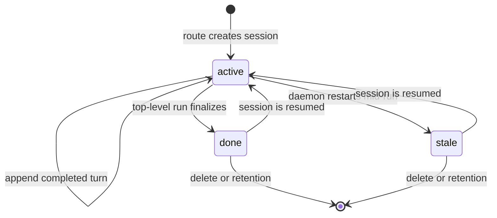

# Storage and sessions

Everything OpenAlpha remembers lives in one SQLite file by default, or in PostgreSQL if you point it
there. Conversations, the ledger, suggestions, cost history and scheduler state are all rows in the
same database. That is why one `db export` carries everything that cannot be rebuilt.

This page covers the database first, then the chat sessions stored in it.

---

## Persistence

### Choose an engine

SQLite needs no configuration. PostgreSQL takes `engine = "postgres"`, the name of the environment
variable holding the connection URL, and a schema. The keys are in
[`[storage]` in the configuration reference](configuration.md#storage).

SQLite runs with foreign keys on, in WAL mode, with a bounded wait when busy and a capped cache.

### Operate the database

```bash
openalpha db migrate --status
openalpha db migrate
openalpha db integrity
openalpha db stats
openalpha db cleanup --older-than 90d --dry-run
openalpha db export --out ./export
openalpha db import --in ./export
```

Commands that write need the daemon stopped. `db integrity`, `db stats`, `db export` and `db backup`
are read-only and run while the daemon is live. They start only the storage layer, so they work
even before you configure any model credentials. On PostgreSQL, `db integrity` only checks that the
connection works.

`db stats` lists the core tables and the trading tables. If your database is several megabytes, most
of it is trading rows: core data is bounded by process lifetime, while market data grows with the
market.

If a trading table is missing after a reset, its migration was not registered at boot. It does not
mean `db stats` is hiding a failed migration.

### What is stored

| Tables | Holds |
| --- | --- |
| `sessions`, `session_messages` | Session lifecycle and transcript. No usage total is stored: per-session totals are added up from `llm_attempts` each time they are read, so they cannot drift. |
| `llm_attempts` | Append-only record of every model attempt, and of global cost. |
| `runs` | One row per finished long-running command and per agent run whose answer reaches a surface (and the child runs they started): what the activity page lists. A run's cost is read from `llm_attempts`, never copied here. |
| `notices` | The bell: every notice of weight sneak, nudge or interrupt the daemon raised (alerts, stops, the brief, fills, approvals, spent budgets, its own sentences), with the channels it also went to and whether you read it. |
| `bindings`, `pairings` | Chat routing aliases and channel pairing state. |
| `channel_state` | Channel checkpoints: poll offsets and session routes. |
| `channel_inbox` | Inbound queue and retries; payloads of completed or failed entries; a finished run's answer when its final send failed. |
| `jobs`, `scheduler_runs`, `heartbeat_task_completions`, `heartbeat_commitments` | Schedules, occurrence history, heartbeat progress and deferred commitments. |
| `memory_kv` | Agent memory. SQLite adds FTS5 search; PostgreSQL uses its text-search facilities. |

Trading adds its own tables: `instruments`, `daily_bars`, `fundamental_snapshots`,
`foreign_flow_snapshots`, `daily_trade_sides`, `annual_accounts`, `quarterly_accounts`,
`funding_snapshots`, `fx_rates`, `macro_snapshots`, `series_points`, `series_provenance`,
`macro_documents`, `news_items`, `market_refresh_attempts`, `ledger_entries`, `nav_snapshots`,
`trading_profiles`, `suggestions`, `factor_log`, `alerts`, `brief_snapshots`, `brief_delivery`,
`intraday_settings`, `order_intents`, `order_settings`, `resting_exits`, `themes`, `theme_runs`,
`theme_reads`, `theme_outcomes` and `agent_focuses`.

**Durable tables.** A table is `durable` when you or the runtime wrote its rows and nothing
OpenAlpha can fetch would rebuild them. Only durable tables go into the default `db export`. Most
market data is not durable, because `refresh` rebuilds it. The exceptions are tables whose provider
answers only for the present:

- `daily_trade_sides`, `series_points`, `series_provenance`, `news_items`, `macro_documents`;
- `fundamental_snapshots` (the ratios endpoint serves the latest period only);
- `macro_snapshots` (a refresh stamps only the current session's market state).

**Ledger.** `ledger_entries` has a `close_reason` column: which leg of a resting exit filled (`stop`
or `target`), empty on every sale you made by hand. `from_venue` is a `transfer` row's source,
empty on every other kind. `venue` is always set: a cash row names where the money is held, without
naming an instrument.

**NAV.** `nav_snapshots` keeps one row a day of the book's value (NAV, cash, net deposits), written by
`trading.refresh`. It is durable: `db export` and `db import` carry it and no sweep removes it. It
grows by one row a day.

**Bars.** `daily_bars` holds one row per market, ticker and day, and records which provider wrote it.
A series carrying one session twice would skew every median, ATR and lookback, so the key makes that
impossible.

**Orders.** `order_intents` and `resting_exits` belong to the order feature, and both are durable:

- a staged intent holds the terms you were shown and the token that confirms them;
- an outcome row records an order that placed but could not be mirrored into the ledger;
- a resting row is a take-profit or stop-loss live at the venue it names. An instrument can hold one
  per venue.

`first_missed_at` is when the exchange started denying the order exists. It clears the moment the
exchange answers again.

**Themes.** These tables back `/themes`, and all are durable: a read is a model's answer on a bundle
that cannot be rebuilt.

- `themes` holds a theme's identity and lifecycle: `proposed`, `active`, `weakening`, `invalidated`,
  `rejected`, `retired`.
- Each run writes one `theme_runs` row (prompt and score versions, cost, the evidence bundle, and
  `theme_id` when `/themes run <id>` read one theme) and a set of `theme_reads` at three levels -
  theme, sector, stock. A read is never rewritten.
- `theme_outcomes` holds three horizon rows per stock read. They are written with the run, and the
  daemon loop resolves them once due, against bars a reset may no longer hold.

**Series.** `series_points` holds day-keyed scalar series. The domestic gold premium is derived from
fetched history: each pass backfills the percentile window's missing days from dated gold board
history, world closes and FX history. The FX series is written from a fetched one. An ordinary
refresh does not overwrite a day already recorded, because a board does not change once its session
has closed. A forced refresh replaces it, and that is the one way to correct a day.

#### Agents and focus

All durable:

| Table | Holds |
|---|---|
| `agent_focuses` | Each focus an agent has made calls under (`agent_id`, `focus_key`, the focus as JSON, first and last seen), so a record survives an edit to `[focus]` |
| `agent_pauses` | One row per paused agent: a row means paused |
| `suggestions.focus_key` | The focus a call was made under (`default` for yours); part of the identity index |
| `llm_attempts.billing_agent_id` | Which agent's `max_daily_usd` the spend counts against; empty when the row bills to the agent that ran it |

`db import` fills a missing column with its default (`default` focus, an empty billing agent).

#### Social networks

Four tables back [social networks](social.md):

| Table | Holds |
|---|---|
| `social_networks` | Each network you added: state (`active`, `paused`) and why it is paused (durable) |
| `social_memberships` | Which agent is on which network: public name, state, review flag, visit interval, 403 streak, cooldown (durable) |
| `social_writes` | Every public write an agent sent: label, body hash, the first 200 characters, the network's id. It feeds the daily caps and the duplicate guard, and is pruned after thirty days (not durable) |
| `social_drafts` | Requests waiting for your OK, never the key; they expire after three days (durable) |

#### Files outside the database

Some things live on disk under the data directory, so `db export`, `db import` and `db backup` do
not carry them:

- the pinned skill files in `<data_dir>/social/<network>/` and each agent's key in
  `<data_dir>/credentials/social/<network>/<agent>.json`; without them `social list` reports the
  files as missing;
- the Zalo personal session in `<data_dir>/credentials/zalo_personal/<profile>.json`;
- a model provider's subscription login in `<data_dir>/auth/<provider>.json`.

All are owner-only. When moving to another machine, copy them with the data directory. The social
part has its own steps in [Social networks](social.md#moving-to-another-machine).

### Migrations

Migrations apply at boot, in filename order, as one all-or-nothing batch: if one fails, none of that
batch is applied and the later ones do not run. `db migrate --status` shows each as applied,
pending or orphaned. An orphan is an applied migration this version of the code does not know, which
means a newer release updated the database. This version then refuses to start, and `doctor` fails
the database check, rather than misreading it. Run `upgrade` to go back to the newer release, or
restore the copy in `backups/pre-migration/` with `db restore`.

`db migrate` snapshots into `backups/pre-migration/` before applying a pending migration, and
`db migrate down` into `backups/pre-rollback/` before rolling one back. Neither writes anything when
there is nothing to do. Both are ordinary backups, so either can go to `db restore`. PostgreSQL gets
no snapshot on either path, and `db migrate down` says so before it asks.

`db migrate down` undoes the newest migration. `db migrate down --to <id>` undoes every one after
`<id>`, newest first, behind one question and one snapshot, and stops at the first it cannot undo.
`upgrade --rollback` uses it to bring the schema back to the previous release.

### Retention

The windows are set by [`[retention]`](configuration.md#retention): `days` is the general window
and `inbox_days` is the inbox's own. An inbox entry may be claimed 3 times before it is dead-lettered.

| Data | Retention behaviour |
| --- | --- |
| Non-active sessions and their messages | Removed after `days`, from end or last-activity time. |
| Session routes | Follow the session's general window. |
| `llm_attempts` | Kept when a session is removed; only the link to the session is dropped. Rows settled more than 400 days ago are pruned, so the year `cost` can report stays complete. |
| `runs` (the log behind the activity page) | Removed after `days`, from the time the run ended. The cost ledger above is not part of it. |
| `notices` (the bell) | Removed after `days`, from the time the notice was raised, read or not. |
| Completed or failed inbox entries | Removed after `inbox_days`, payload included. |
| Pending or processing inbox entries | Not removed by `inbox_days`. Interrupted processing is requeued, up to 3 times. An entry nobody has claimed for more than `days` (usually because its channel was removed) is removed on the general window. |
| Poll offsets in `channel_state` | Kept indefinitely, like other delivery checkpoints. |
| Scheduler history | Rows older than `days` are pruned only beyond a job's newest 200 such rows. |
| Memory | Removed once expired, or once marked deleted for more than `days`. |
| Pending pairings | Removed after `days`, from creation. |
| Fired or disabled alerts | Removed after `days`, from the time they fired or were disabled. Live alerts are never pruned. |
| `brief_snapshots` | Removed after `days`, except the newest snapshot per locale, which always survives. |
| Market data | Not touched by `db cleanup`. Each market's refresh trims its own old rows by fetch time after a pass that wrote. News ages out the same way, on its own window. |

The daemon applies retention once at startup and then on a schedule. `db cleanup --older-than
<duration>` runs the same policy by hand, needs the daemon stopped, and with `--dry-run` only
counts. `--older-than` is required, overrides the general window for that command only and must be
at least `1d`. Inbox entries still use `inbox_days`, and `llm_attempts` keeps its own 400 days.

Each kind of data is pruned in its own transaction. A kind that fails or runs slow is logged as
`retention.scope_failed` and counted as zero, the other kinds are still pruned, and its rows wait for
the next sweep.

### Export and import

```bash
openalpha db export --out ./export
openalpha db export --out ./export --table ledger_entries --format csv
openalpha db import --in ./export
```

**Export** writes one file per table. Without `--table` it writes the durable set: the ledger, past
suggestions, the profile, alerts, memory, sessions and their transcripts, jobs, bindings, spend
history, brief delivery state, intraday settings and every other durable table above. Market data is
skipped because `refresh` re-derives every row. `--table` still reaches any registered table by
name. A table the registry names but the database has not created yet (after a schema change, before
`db reset`) is skipped with a note: it holds nothing to keep.

- Two exports of unchanged rows diff clean. Values go out as stored: nano-USD stays nano-USD, an
  epoch-ms column stays a number.
- Files are written to a staging directory and moved into place only once every table is written, so
  a failure part-way leaves the target exactly as it was. To write into a directory that already has
  files, pass `--force`.
- JSON is the default, one JSON object per line, one table row each. It is what `db import` reads.
  CSV is for a spreadsheet and does **not** round-trip: a null and an empty string look identical
  and nothing carries types.

**Import** reads a directory `db export` wrote, taking every file that names a registered table, or
just one with `--table`. It applies any pending migration first, so it also imports straight into an
empty data directory.

- The whole import is **one transaction**. A table that already has rows is refused before anything
  is written, and a malformed line rolls back every table that already landed. There is no partial
  state, no `--force`, and re-running after fixing the file is always safe.
- Tables are written in a fixed order so foreign keys hold: `sessions` before `session_messages`
  and `llm_attempts`, `jobs` before `scheduler_runs`.
- Column names come from the file and must match an identifier pattern. A well-formed name that
  matches no column is rejected by the engine, which names it.

**Keeping data through a schema change.** A backup cannot do this: it restores the file, and the
file carries the schema that was reset away. Export and import move rows, not a schema:

```bash
openalpha db backup                    # the undo button, if the rest goes wrong
openalpha db export --out ./keep
openalpha db reset --yes
openalpha db import --in ./keep
openalpha ... /refresh                 # market data was skipped, so refetch it
```

### SQLite backup and restore

```bash
openalpha db backup
openalpha db backup --path /safe/place/runtime.sqlite
openalpha db restore /safe/place/runtime.sqlite --yes
```

**Backup** writes a consistent snapshot while the database is live and sets it to `0600`, wherever
`--path` points. It holds every session, memory and ledger row, so it is never readable by the group
or everyone, not even while it is being written: the copy is made in a private `0700` staging folder
next to the target and moved into place when it is complete. A crash can leave a `.staging-` folder
behind; the automatic backups folder clears it on the next backup, anywhere else delete it by hand. Automatic backup destinations keep the seven newest files.

The daemon also takes one backup a day by itself, into `backups/daily/`, and keeps the newest three
(`[retention] daily_backups`, `0` turns it off). The first lands when the daemon starts, and a later
one follows whenever the newest is about a day old. They are ordinary backups, so any of them can go
to `db restore`. PostgreSQL is skipped: use `pg_dump`. `--path` refuses a file that
already exists unless you pass `--force`.

**Restore** needs the daemon stopped. It first checks that the source opens as a SQLite database and
passes `PRAGMA quick_check`, then keeps the database it replaces in `backups/` under a timestamped
name, so restoring twice never loses the original. A previous database that cannot be opened does
not block the restore: it is moved into `backups/` the same way.

**Moving servers.** You need only the one file; renaming it is fine, and the target needs no
prepared data directory. Migration state travels inside the file, so the new host reports its
migrations as already applied. The target must run code that recognises those migrations; if not,
`db migrate --status` reports an orphan. Both hosts must use SQLite: a SQLite backup cannot be
loaded into PostgreSQL. To move between engines, use `db export` and `db import`.

These commands deliberately do not back up or restore PostgreSQL. Use the database service's own
backup, point-in-time recovery and access controls.

### Reset

```bash
openalpha db reset --yes
```

Reset deletes every row and needs the daemon stopped. SQLite replaces the database and its sidecar
files; PostgreSQL rebuilds the configured schema, and refuses `public`, since other apps may share it.
Every registered migration then applies. To keep
your data, run `db export` first and `db import` afterwards (see
[Export and import](#export-and-import)).

### Failure behaviour

| Condition | Result |
| --- | --- |
| Storage config is incomplete or invalid | Startup fails before opening the database. |
| One migration fails | The batch rolls back and later migrations do not run. |
| SQLite stays busy past its configured wait | A storage error is returned. |
| Restore source is not a readable SQLite database or fails `quick_check` | Restore is rejected before replacing the database. |
| Inbox worker is interrupted | Processing entries are requeued until the attempt cap, then failed. |
| Session is deleted | Its messages are removed; cost facts remain, detached. |

---

## Sessions and history

A session is one lasting conversation for one agent, one user and one surface. It holds the
transcript, status, usage, route, and a queue that runs work one task at a time.

A *run* is one bounded execution inside that session. Delegated agents get private ephemeral
sessions instead, so a child's chatter never lands in your history.

### Start or resume a CLI session

```bash
openalpha chat
openalpha chat --message "Review today's watchlist"
openalpha chat --continue
openalpha chat --continue --message "Expand the risk section"
```

Without `--continue`, CLI chat starts a fresh session. With `--continue`, it picks up the last CLI
session and loads the stored transcript and usage totals, including after a restart.

Channels route by channel, chat and user. The first accepted message creates a route; later messages
reuse it.

- `/new` switches the route to a fresh session in one step, so queued work from the old conversation
  cannot leak into the new one.
- `/continue` keeps the current session and sends one short nudge as the next turn, so a run that
  stopped early picks up where it left off without you retyping the request.

### Inspect and remove history

```bash
openalpha history list
openalpha history list --limit 50
openalpha history show <session-id>
openalpha history delete <session-id>
openalpha history clear --agent analyst --yes
```

`history show` accepts a full session id or any prefix that matches only one session. It shows
status, the messages in order, cumulative token and cost totals, and the model attempts behind each
assistant message. Attempts not tied to a message, such as compaction, are shown separately.

`history delete` removes one session without asking. `history clear` needs the daemon stopped and
asks for confirmation unless you pass `--yes`. Both refuse a session with a turn still running; one that
is merely open with nothing running can be deleted.

### Lifecycle



Each completed turn is saved immediately, so if the process dies abruptly you lose at most the turn
in flight. When a run ends, any remaining messages are saved first, then the outcome. Session usage
is read back from the stored attempts, not kept as a separate total.

On daemon start, sessions left `active` by a run that died are marked `stale`, with a restart
reason. Their transcript can still be resumed: a later run reactivates the same session.

### What a transcript keeps

Messages are append-only and ordered within the session. Each records the run that produced it, role,
content, tool-call link, an error marker and creation time. An assistant message links to the model
attempts behind it, so retries and fallbacks are kept without counting as separate answers.

`llm_attempts` is the durable ledger and the source of truth for both session and global cost.
Deleting a session deletes its messages, but the attempt records are only detached, not deleted.

### One run at a time

Only one run changes a session at a time. Later messages wait in a queue of at most ten pending
tasks; excess work fails with `queue_full` instead of letting memory grow. A failed task does not
affect the next one.

`/new` and other route changes wait for in-flight work to settle, cancel the queued work, update the
route, and then accept work for the new session. A message accepted for the old session cannot run
under the new route.

### Context limits and compaction

Compaction starts when the history approaches the model's context window or exceeds the soft message
cap. The threshold, the message cap and the maximum number of passes are under
[`[loop]`](configuration.md#loop). It keeps the system head, summarises the older middle, and keeps
the ten most recent message groups (a user message, or an assistant message with its tool results),
so a run driven by one long request still has older content to shrink. A configured fast model is
preferred for summarising; otherwise the primary model is used. Summary calls are budgeted, priced
and saved as `compaction` attempts.

- Each tool call stays together with its result. Orphaned calls and results are dropped, repeated
  results are folded, and integrity is checked before the next provider request.
- Thinking blocks are left out of the summary input: they are large and cannot be safely sent and
  received back.
- The summary keeps: the active todo list and unfinished steps, decisions and their reasons,
  constraints still in force, unresolved errors, and facts established by tool calls. It drops
  exploratory back-and-forth, redundant tool output and superseded content.
- If summarising hits a provider error, a truncation marker is inserted and a repaired recent
  history is kept. Budget, timeout, abort and other run halts still stop the run as usual.
- A run compacts at most 3 times. A pass that leaves the transcript no smaller halts the run with
  `length_limit` instead of resending the same overflow.

### Todo list restoration

A `todo_write` result is an ordinary tool message, so compaction or the message cap can remove it
while the agent is still working through the list. The run keeps its own copy outside the transcript
and re-appends the list before the next model call once no `todo_write` result or earlier
restoration notice is still visible. A visible list is never duplicated, so a long session pays one
message per compaction, not one per turn.

Only a `todo_write` result refreshes the copy: a summary that paraphrases the list cannot overwrite
what the agent wrote. The restoration notice exists only in the prompt. It is never saved to the
transcript, so it does not appear in `history show` or the chat history API.

The copy does not outlive the run. A resumed session recovers its list from the stored `todo_write`
result while that message is still inside the 500-message session cap.

### Model and approval state

`/model` stores a bounded override in the process, per session. It survives later runs in that
process but not a restart; the stored agent profile remains the default. Approval grants are also per
session and live only in the process. `/new` starts a fresh scope for both.

Neither changes the stored transcript. The model and approval outcomes stay visible through the
stored attempt and tool records.

### Delegated sessions

Delegated agents get private ephemeral sessions. They inherit the parent's abort signal and share
its budget tree, but never load or append to the parent's transcript. Their model attempts keep the
child and parent run ids and bill to the top-level session, so spend stays auditable without mixing
scratch conversation into your history.

### Retention and failure behaviour

| Condition | Result |
| --- | --- |
| Process stops during a turn | Completed prior turns remain; the session becomes `stale` at daemon start. |
| Two messages target one session | They run one after the other, in arrival order. |
| Per-session queue reaches ten pending tasks | New work fails with `queue_full`. |
| Route changes while old work is queued | Old work is cancelled before it can run. |
| Compaction summary provider fails | Repaired recent context continues with a truncation marker. |
| Compaction removes an active todo list | The run re-appends it before the next model call. |
| Non-active session exceeds `[retention].days` | Session, route and messages are removed. |
| Session is manually deleted | Model attempts remain, with the session link removed. |

Active sessions are not removed by age. Session routes follow the general `[retention].days`
window; poll offsets are separate channel checkpoints and are kept indefinitely.

Internals: [dev/storage.md](dev/storage.md).
