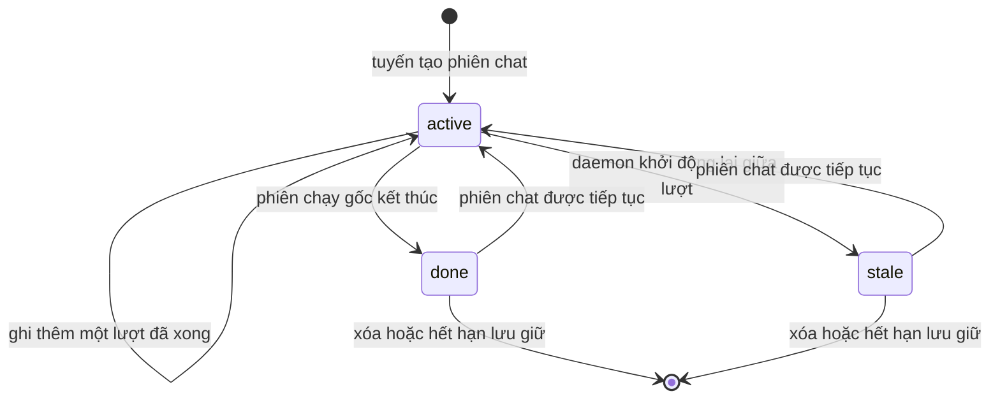

# Lưu trữ và phiên chat

Mọi thứ OpenAlpha nhớ được nằm trong một tệp SQLite duy nhất theo mặc định, hoặc trong PostgreSQL nếu
bạn trỏ nó sang đó. Hội thoại, sổ lệnh, các đề xuất, lịch sử chi phí và trạng thái bộ lập lịch đều là
các dòng trong cùng một cơ sở dữ liệu. Vì vậy một lần `db export` mang theo trọn phần không dựng lại
được.

Trang này nói về cơ sở dữ liệu trước, rồi đến các phiên chat lưu trong đó.

---

## Lưu trữ

### Chọn engine

SQLite không cần cấu hình gì. PostgreSQL thì khai `engine = "postgres"`, tên biến môi trường chứa URL
kết nối, và một schema. Các khóa nằm ở [`[storage]` trong tham chiếu cấu hình](cau-hinh.md#storage).

SQLite chạy với khóa ngoại bật, chế độ WAL, có thời gian chờ giới hạn khi bận và cache bị chặn trần.

### Vận hành cơ sở dữ liệu

```bash
openalpha db migrate --status
openalpha db migrate
openalpha db integrity
openalpha db stats
openalpha db cleanup --older-than 90d --dry-run
openalpha db export --out ./export
openalpha db import --in ./export
```

Lệnh nào ghi dữ liệu thì cần dừng daemon trước. `db integrity`, `db stats`, `db export` và `db backup`
chỉ đọc, nên chạy được khi daemon đang chạy. Chúng chỉ khởi động tầng lưu trữ, nên dùng được cả khi bạn
chưa cấu hình khóa mô hình nào. Trên PostgreSQL, `db integrity` chỉ kiểm tra kết nối được hay không.

`db stats` liệt kê các bảng cốt lõi và các bảng giao dịch. Nếu cơ sở dữ liệu nặng vài megabyte, phần
lớn là dòng giao dịch: dữ liệu cốt lõi bị giới hạn theo vòng đời tiến trình, còn dữ liệu thị trường lớn
dần cùng thị trường.

Nếu một bảng giao dịch biến mất sau khi reset, nghĩa là migration của nó chưa được đăng ký lúc khởi
động. Nó **không** có nghĩa là `db stats` đang che một migration hỏng.

### Dữ liệu được lưu những gì

| Bảng | Giữ gì |
| --- | --- |
| `sessions`, `session_messages` | Vòng đời phiên chat và bản ghi hội thoại. Không lưu tổng lượng dùng riêng: tổng theo phiên chat được cộng lại từ `llm_attempts` mỗi khi đọc, nên không thể lệch. |
| `llm_attempts` | Sổ chỉ ghi thêm: từng lần gọi mô hình và chi phí toàn cục. |
| `bindings`, `pairings` | Bí danh định tuyến chat và trạng thái ghép nối kênh. |
| `channel_state` | Mốc tiến độ của kênh: offset polling và tuyến phiên chat. |
| `channel_inbox` | Hàng đợi tin đến và số lần thử lại; nội dung của các mục đã xong hoặc đã hỏng; câu trả lời của phiên chạy đã xong nhưng lần gửi cuối bị lỗi. |
| `jobs`, `scheduler_runs`, `heartbeat_task_completions`, `heartbeat_commitments` | Lịch, lịch sử các lần chạy, tiến độ heartbeat và các cam kết hoãn lại. |
| `memory_kv` | Bộ nhớ agent. SQLite thêm tìm kiếm FTS5; PostgreSQL dùng các tiện ích text-search. |

Phần giao dịch có các bảng riêng: `instruments`, `daily_bars`, `fundamental_snapshots`,
`foreign_flow_snapshots`, `daily_trade_sides`, `annual_accounts`, `quarterly_accounts`,
`funding_snapshots`, `fx_rates`, `macro_snapshots`, `series_points`, `series_provenance`,
`macro_documents`, `news_items`, `market_refresh_attempts`, `ledger_entries`, `nav_snapshots`,
`trading_profiles`, `suggestions`, `factor_log`, `alerts`, `brief_snapshots`, `brief_delivery`,
`intraday_settings`, `order_intents`, `order_settings`, `resting_exits`, `themes`, `theme_runs`,
`theme_reads`, `theme_outcomes` và `agent_focuses`.

**Bảng bền (`durable`).** Một bảng là `durable` khi các dòng của nó do bạn hoặc runtime ghi và không gì
OpenAlpha tải về được có thể dựng lại. Chỉ bảng bền vào `db export` mặc định. Phần lớn dữ liệu thị
trường không bền, vì `refresh` dựng lại được. Ngoại lệ là các bảng mà nhà cung cấp chỉ trả lời cho hiện
tại:

- `daily_trade_sides`, `series_points`, `series_provenance`, `news_items`, `macro_documents`;
- `fundamental_snapshots` (endpoint tỷ số chỉ trả kỳ mới nhất);
- `macro_snapshots` (mỗi lần refresh chỉ ghi trạng thái thị trường của phiên hiện tại).

**Sổ lệnh.** `ledger_entries` có cột `close_reason`: vế nào (`stop` hay `target`) của lệnh thoát đang
treo đã khớp; để trống ở mọi lần bán do bạn tự làm. Cột `from_venue` là nguồn của một dòng `transfer`,
để trống ở các loại khác. Cột `venue` luôn có giá trị: dòng tiền mặt cho biết nơi giữ tiền, không gắn
với công cụ nào.

**NAV.** `nav_snapshots` giữ mỗi ngày một dòng giá trị danh mục (NAV, tiền mặt, tiền nạp ròng) do
`trading.refresh` ghi. Đây là bảng bền: `db export` và `db import` mang nó theo, và không lần dọn dẹp
nào xóa nó. Nó chỉ lớn thêm một dòng mỗi ngày.

**Nến ngày.** `daily_bars` khóa theo cả nguồn lẫn ngày, nên hai nhà cung cấp cùng trả lời một cửa sổ thì
cả hai đều được lưu. Một chuỗi có cùng một phiên hai lần sẽ làm lệch mọi trung vị, ATR và khoảng nhìn
lại, nên phía đọc giữ dòng mới nhất cho mỗi phiên.

**Lệnh.** `order_intents` và `resting_exits` thuộc về tính năng đặt lệnh, và cả hai đều bền:

- ý định đã dựng giữ các điều khoản bạn đã xem và token để xác nhận chúng;
- dòng kết cục ghi lại một lệnh đã đặt được nhưng không ghi được vào sổ;
- dòng đang treo là lệnh chốt lời hoặc cắt lỗ đang chạy ở đúng sàn nó nêu tên. Một công cụ có thể có
  một lệnh mỗi sàn.

`first_missed_at` là lúc sàn bắt đầu báo không có lệnh đó, và được xóa ngay khi sàn trả lời lại.

**Chủ đề.** Các bảng này phục vụ `/themes`, và đều bền: một nhận định là câu trả lời của mô hình trên
một gói bằng chứng không thể dựng lại.

- `themes` giữ tên và vòng đời của một chủ đề: `proposed`, `active`, `weakening`, `invalidated`,
  `rejected`, `retired`.
- Mỗi phiên chạy ghi một dòng `theme_runs` (phiên bản prompt và phiên bản điểm, chi phí, gói bằng
  chứng, và `theme_id` khi chỉ soát một chủ đề bằng `/themes run <id>`) cùng một tập `theme_reads` ở ba
  tầng: chủ đề, ngành, cổ phiếu. Dòng đã ghi không bao giờ bị ghi đè.
- `theme_outcomes` giữ ba dòng theo kỳ hạn cho mỗi nhận định cổ phiếu. Chúng được ghi cùng phiên chạy,
  và vòng lặp daemon chốt kết quả khi tới hạn, dựa trên các cây nến mà sau một lần reset có thể đã mất.

**Chuỗi theo ngày.** `series_points` giữ các chuỗi số đơn theo ngày. Mức chênh giá vàng trong nước được
suy ra từ lịch sử đã tải: mỗi lượt bù các ngày còn thiếu của cửa sổ phân vị từ lịch sử bảng giá vàng có
ngày, giá đóng cửa thế giới và lịch sử tỷ giá. Chuỗi tỷ giá ghi thẳng từ một chuỗi đã tải. Refresh
thường **không** ghi đè ngày đã có, vì bảng giá không đổi nữa sau khi phiên chốt. Refresh cưỡng bức
thì thay được, và đó là cách duy nhất để sửa một ngày.

#### Agent và phạm vi

Đều bền:

| Bảng | Giữ gì |
|---|---|
| `agent_focuses` | Mỗi phạm vi agent từng dùng để đưa ra nhận định (`agent_id`, `focus_key`, phạm vi dạng JSON, lần đầu và lần cuối thấy), để hồ sơ không mất khi bạn sửa `[focus]` |
| `agent_pauses` | Một dòng cho mỗi agent đang tạm dừng: có dòng nghĩa là tạm dừng |
| `suggestions.focus_key` | Phạm vi mà đề xuất được tạo ra (`default` cho của bạn); là một phần của chỉ mục định danh |
| `llm_attempts.billing_agent_id` | Khoản chi tính vào `max_daily_usd` của agent nào; để trống khi dòng tính cho chính agent đã chạy |

`db import` điền giá trị mặc định cho cột bị thiếu (phạm vi `default`, agent chịu chi phí để trống).

#### Mạng xã hội

Bốn bảng đứng sau [mạng xã hội](mang-xa-hoi.md):

| Bảng | Giữ gì |
|---|---|
| `social_networks` | Mỗi mạng bạn đã thêm: trạng thái (`active`, `paused`) và lý do tạm dừng (bền) |
| `social_memberships` | Agent nào ở mạng nào: tên công khai, trạng thái, cờ duyệt, khoảng cách giữa các lượt ghé, chuỗi 403, thời gian nghỉ (bền) |
| `social_writes` | Mọi bài agent đã gửi công khai: nhãn, mã băm nội dung, 200 ký tự đầu, mã do mạng gán. Bảng này dùng cho hạn mức theo ngày và chặn đăng trùng, và bị dọn sau ba mươi ngày (không bền) |
| `social_drafts` | Các yêu cầu đang chờ bạn duyệt, không bao giờ chứa khóa; hết hạn sau ba ngày (bền) |

#### Tệp nằm ngoài cơ sở dữ liệu

Một số thứ nằm trên đĩa dưới thư mục dữ liệu, nên `db export`, `db import` và `db backup` đều không
mang theo:

- các tệp skill đã ghim ở `<data_dir>/social/<mạng>/` và khóa của mỗi agent ở
  `<data_dir>/credentials/social/<mạng>/<agent>.json`; thiếu chúng thì `social list` báo thiếu tệp;
- phiên Zalo cá nhân ở `<data_dir>/credentials/zalo_personal/<profile>.json`;
- lần đăng nhập thuê bao của nhà cung cấp mô hình ở `<data_dir>/auth/<nhà-cung-cấp>.json`.

Tất cả đều chỉ chủ sở hữu đọc được. Khi chuyển sang máy khác, hãy chép chúng cùng thư mục dữ liệu. Phần
mạng xã hội có hướng dẫn riêng ở [Mạng xã hội](mang-xa-hoi.md#chuyển-sang-máy-khác).

### Migration

Migration được áp lúc khởi động, theo thứ tự tên tệp, thành một lô được ăn cả ngã về không: nếu một cái
hỏng thì cả lô không được áp và các cái sau không chạy. `db migrate --status` cho biết mỗi migration là
đã áp, đang chờ hay mồ côi. Migration mồ côi là cái đã áp mà phiên bản mã này không còn biết (thường do
hạ cấp): hãy xem lại nó.

`db migrate` chụp một bản sao vào `backups/pre-migration/` trước khi áp migration đang chờ, và
`db migrate down` chụp vào `backups/pre-rollback/` trước khi rollback một migration. Không có việc gì
để làm thì cả hai không ghi gì. Cả hai đều là bản sao lưu thường, nên đưa cái nào cho `db restore` cũng
được. PostgreSQL không được chụp ở cả hai đường, và `db migrate down` nói rõ điều này trước khi hỏi
bạn.

### Lưu giữ

Cửa sổ lưu giữ do [`[retention]`](cau-hinh.md#retention) đặt: `days` là cửa sổ chung và `inbox_days`
là cửa sổ riêng của inbox. Một mục inbox được nhận việc tối đa 3 lần trước khi bị đưa vào hàng chết.

| Dữ liệu | Hành vi lưu giữ |
| --- | --- |
| Phiên chat không hoạt động và tin nhắn của chúng | Bị xóa sau `days`, tính từ lúc kết thúc hoặc hoạt động cuối. |
| Tuyến phiên chat | Theo cửa sổ chung của phiên chat. |
| `llm_attempts` | Được giữ khi phiên chat bị xóa, chỉ bị gỡ liên kết tới phiên chat. Dòng đã chốt quá 400 ngày thì bị xóa, nên khoảng một năm mà `cost` báo vẫn đầy đủ. |
| Mục inbox đã xong hoặc đã hỏng | Bị xóa sau `inbox_days`, gồm cả nội dung tin nhắn. |
| Mục inbox đang chờ hoặc đang xử lý | Không bị xóa theo `inbox_days`. Mục xử lý dở bị ngắt được đưa lại hàng đợi, tối đa 3 lần. Mục nào quá `days` mà không ai nhận (thường do kênh đã bị gỡ) thì bị xóa theo cửa sổ chung. |
| Offset polling trong `channel_state` | Giữ vô thời hạn, như các mốc theo dõi việc gửi. |
| Lịch sử bộ lập lịch | Dòng cũ hơn `days` chỉ bị cắt khi một việc có quá 200 dòng như vậy; 200 dòng mới nhất được giữ. |
| Bộ nhớ | Bị xóa khi đã hết hạn, hoặc đã bị đánh dấu xóa quá `days`. |
| Ghép nối đang chờ | Bị xóa sau `days`, tính từ lúc tạo. |
| Cảnh báo đã nổ hoặc đã tắt | Bị xóa sau `days`, tính từ lúc nổ hoặc lúc bị tắt. Cảnh báo còn sống không bao giờ bị cắt. |
| `brief_snapshots` | Bị xóa sau `days`, trừ ảnh chụp mới nhất của mỗi ngôn ngữ, cái đó luôn sống sót. |
| Dữ liệu thị trường | `db cleanup` không đụng tới. Mỗi lần refresh của một thị trường tự cắt các dòng cũ của nó theo thời điểm tải, sau một lượt đã ghi dữ liệu. Tin tức cũng vậy, theo cửa sổ riêng. |

Daemon tự dọn một lần lúc khởi động rồi theo chu kỳ. `db cleanup --older-than <khoảng>` chạy đúng chính
sách đó bằng tay, cần daemon đã dừng, và thêm `--dry-run` thì chỉ đếm chứ không xóa. `--older-than` bắt
buộc, ghi đè cửa sổ chung chỉ cho lệnh đó và phải ít nhất `1d`. Các mục inbox vẫn dùng `inbox_days`,
còn `llm_attempts` giữ cửa sổ 400 ngày riêng.

Mỗi loại dữ liệu được dọn trong một giao dịch riêng. Loại nào hỏng hoặc chạy chậm thì được log
`retention.scope_failed` và tính là không dọn được gì, các loại khác vẫn được dọn, còn các dòng của
loại đó chờ lượt dọn kế tiếp.

### Xuất và nhập

```bash
openalpha db export --out ./export
openalpha db export --out ./export --table ledger_entries --format csv
openalpha db import --in ./export
```

**Xuất** ghi mỗi bảng thành một tệp. Không có `--table` thì xuất tập bền: sổ lệnh, các đề xuất cũ, hồ
sơ, cảnh báo, bộ nhớ, phiên chat cùng bản ghi hội thoại, các việc theo lịch, các ràng buộc, lịch sử chi
tiêu, trạng thái gửi bản tin, thiết lập trong ngày và mọi bảng bền khác nêu ở trên. Dữ liệu thị trường
bị bỏ qua vì `refresh` dựng lại được từng dòng. `--table` vẫn chọn được bất kỳ bảng đã đăng ký nào theo
tên. Bảng có trong sổ đăng ký mà cơ sở dữ liệu chưa tạo (như sau khi đổi schema và trước `db reset`) sẽ
được bỏ qua kèm một ghi chú, vì không có gì để giữ.

- Hai lần xuất trên dữ liệu không đổi sẽ diff sạch. Giá trị được xuất đúng như đã lưu: nano-USD vẫn là
  nano-USD, cột epoch-ms vẫn là một con số.
- Tệp được ghi vào một thư mục tạm và chỉ chuyển vào chỗ khi mọi bảng đã ghi xong, nên nếu hỏng giữa
  chừng thì đích vẫn y như cũ. Muốn ghi vào thư mục đã có tệp, thêm `--force`.
- JSON là mặc định, mỗi dòng là một đối tượng JSON ứng với một dòng của bảng. Đó là định dạng `db import`
  đọc. CSV dành cho bảng tính và **không** nhập lại được: null và chuỗi rỗng trông y hệt nhau, và không
  có thông tin kiểu.

**Nhập** đọc thư mục mà `db export` đã ghi: lấy mọi tệp mang tên một bảng đã đăng ký, hoặc chỉ một tệp
nếu có `--table`. Nó áp các migration còn thiếu trước, nên nhập thẳng vào một thư mục dữ liệu trống
cũng được.

- Cả lần nhập là **một** giao dịch. Bảng nào đã có dòng thì bị từ chối trước khi ghi bất cứ gì, và một
  dòng sai định dạng sẽ rollback mọi bảng đã nhập. Vì vậy không có trạng thái dở dang, không có
  `--force`, và chạy lại sau khi sửa tệp luôn an toàn.
- Các bảng được ghi theo thứ tự cố định để khóa ngoại không từ chối: `sessions` trước `session_messages`
  và `llm_attempts`, `jobs` trước `scheduler_runs`.
- Tên cột lấy từ tệp và phải khớp một mẫu tên hợp lệ. Tên đúng mẫu mà không khớp cột nào thì bị engine
  từ chối, và engine nêu rõ tên đó.

**Giữ dữ liệu qua một lần đổi schema.** Bản sao lưu không làm được việc này: nó khôi phục cả tệp, mà
tệp đó mang đúng cái schema vừa bị reset. Xuất và nhập thì chuyển các dòng chứ không chuyển schema:

```bash
openalpha db backup                    # cái nút undo, nếu phần còn lại có sai
openalpha db export --out ./keep
openalpha db reset --yes
openalpha db import --in ./keep
openalpha ... /refresh                 # dữ liệu thị trường bị bỏ qua, nên hãy tải lại
```

### Sao lưu và khôi phục SQLite

```bash
openalpha db backup
openalpha db backup --path /safe/place/runtime.sqlite
openalpha db restore /safe/place/runtime.sqlite --yes
```

**Sao lưu** ghi một bản chụp nhất quán ngay khi cơ sở dữ liệu đang chạy và đặt quyền `0600`, dù
`--path` trỏ tới đâu. Nó chứa mọi phiên chat, mọi bộ nhớ và mọi dòng sổ, nên không bao giờ để nhóm hay
người khác đọc được, kể cả lúc đang ghi: bản sao được tạo trong một thư mục tạm riêng tư `0700` đặt cạnh
đích rồi mới chuyển vào chỗ khi đã đủ. Nếu tiến trình chết giữa chừng, thư mục tạm `.staging-` còn sót
lại: thư mục sao lưu tự động sẽ xóa nó ở lần sao lưu kế tiếp, còn chỗ khác thì bạn xóa tay. Đích sao lưu tự động giữ bảy tệp mới nhất. `--path` từ chối tệp đã tồn tại trừ khi
bạn thêm `--force`.

**Khôi phục** cần daemon đã dừng. Trước hết nó kiểm tra nguồn có mở được như một cơ sở dữ liệu SQLite
và qua `PRAGMA quick_check` không, rồi giữ cơ sở dữ liệu cũ với hậu tố `.bak`. Nếu cơ sở dữ liệu cũ
không mở được thì việc khôi phục vẫn chạy: nó được dời sang bên thành tệp `.bak`.

**Chuyển sang máy chủ khác.** Bạn chỉ cần một tệp; đổi tên cũng được, và máy đích không cần có sẵn thư
mục dữ liệu. Trạng thái migration nằm trong chính tệp, nên máy mới báo các migration là đã áp. Máy đích
phải chạy phiên bản mã nhận ra các migration này, nếu không `db migrate --status` sẽ báo migration mồ
côi. Cả hai máy đều phải dùng SQLite: bản sao lưu SQLite không nạp được vào PostgreSQL. Muốn chuyển
giữa hai engine, dùng `db export` và `db import`.

Các lệnh này cố tình **không** sao lưu hay khôi phục PostgreSQL. Hãy dùng sao lưu, khôi phục theo thời
điểm và kiểm soát truy cập có sẵn của chính dịch vụ cơ sở dữ liệu đó.

### Reset

```bash
openalpha db reset --yes
```

Reset xóa mọi dòng và cần daemon đã dừng. SQLite thay cơ sở dữ liệu cùng các tệp đi kèm; PostgreSQL dựng
lại schema đã cấu hình. Sau đó mọi migration đã đăng ký được áp lại. Muốn giữ dữ liệu, chạy `db export`
trước rồi `db import` sau (xem [Xuất và nhập](#xuất-và-nhập)).

### Hành vi khi hỏng

| Điều kiện | Kết quả |
| --- | --- |
| Cấu hình lưu trữ thiếu hoặc không hợp lệ | Khởi động báo lỗi trước khi mở cơ sở dữ liệu. |
| Một migration hỏng | Cả lô rollback và các migration sau không chạy. |
| SQLite bận quá mốc chờ đã cấu hình | Trả về một lỗi lưu trữ. |
| Nguồn khôi phục không phải cơ sở dữ liệu SQLite đọc được, hoặc không qua `quick_check` | Lệnh khôi phục bị từ chối trước khi thay cơ sở dữ liệu. |
| Worker inbox bị cắt giữa chừng | Các mục đang xử lý được đưa lại hàng đợi đến số lần thử tối đa, rồi đánh dấu hỏng. |
| Một phiên chat bị xóa | Tin nhắn của phiên chat bị xóa; dữ liệu chi phí vẫn còn, chỉ bị gỡ liên kết. |

---

## Phiên chat và lịch sử

Một phiên chat là một cuộc hội thoại lưu lâu dài giữa một agent, một người dùng và một bề mặt. Phiên
chat giữ bản ghi hội thoại, trạng thái, lượng dùng, tuyến và hàng đợi chạy lần lượt từng việc.

Một **phiên chạy** là một lần thực thi có giới hạn bên trong phiên chat đó. Agent được ủy quyền dùng
phiên chat tạm thời riêng, nên phần trò chuyện của agent con không bao giờ lọt vào lịch sử của bạn.

### Bắt đầu hoặc tiếp tục một phiên chat CLI

```bash
openalpha chat
openalpha chat --message "Review today's watchlist"
openalpha chat --continue
openalpha chat --continue --message "Expand the risk section"
```

Không có `--continue`, chat CLI tạo phiên chat mới. Có `--continue`, nó tiếp tục phiên chat CLI gần nhất
và nạp bản ghi hội thoại cùng tổng lượng dùng đã lưu, kể cả khi tiến trình đã khởi động lại.

Kênh định tuyến theo kênh, chat và người dùng. Tin đầu tiên được nhận sẽ tạo một tuyến; các tin sau
dùng lại tuyến đó.

- `/new` chuyển tuyến sang phiên chat mới trong một bước, để việc đang chờ của cuộc trò chuyện cũ không
  lọt sang cuộc mới.
- `/continue` giữ nguyên phiên chat hiện tại và gửi một lời nhắc ngắn làm lượt kế tiếp, nên phiên chạy
  dừng giữa chừng sẽ làm tiếp từ chỗ đang dở, bạn không phải gõ lại yêu cầu.

### Xem và xóa lịch sử

```bash
openalpha history list
openalpha history list --limit 50
openalpha history show <session-id>
openalpha history delete <session-id>
openalpha history clear --agent analyst --yes
```

`history show` nhận mã phiên chat đầy đủ hoặc một tiền tố chỉ khớp một phiên chat. Nó hiện trạng thái,
các tin nhắn theo thứ tự, tổng token và chi phí lũy kế, cùng các lần gọi mô hình đứng sau từng tin nhắn
của trợ lý. Những lần gọi không gắn với tin nhắn nào, như khi nén hội thoại, được hiện riêng.

`history delete` xóa một phiên chat mà không hỏi lại. `history clear` cần daemon đã dừng và hỏi xác
nhận trừ khi bạn thêm `--yes`. Cả hai từ chối phiên chat đang chạy.

### Vòng đời



Mỗi lượt xong được ghi ngay, nên nếu tiến trình chết đột ngột thì chỉ mất đúng lượt đang dở. Khi một
phiên chạy kết thúc, các tin nhắn còn lại được ghi trước, rồi mới ghi kết cục. Lượng dùng của phiên chat
được tính lại từ các lần gọi mô hình đã lưu chứ không giữ thành một tổng riêng.

Khi daemon khởi động, các phiên chat còn đánh dấu `active` do một phiên chạy đã chết để lại sẽ chuyển
thành `stale`, kèm lý do là khởi động lại. Bản ghi hội thoại của chúng vẫn dùng tiếp được: một phiên
chạy sau sẽ kích hoạt lại đúng phiên chat đó.

### Bản ghi hội thoại lưu gì

Tin nhắn chỉ được ghi thêm và xếp theo thứ tự trong phiên chat. Mỗi tin ghi phiên chạy tạo ra nó, vai,
nội dung, liên kết với lời gọi công cụ, dấu lỗi và thời điểm tạo. Tin nhắn của trợ lý liên kết tới các
lần gọi mô hình đứng sau nó, nên các lần thử lại và dự phòng được giữ mà không bị tính là những câu trả
lời riêng.

`llm_attempts` là sổ gốc, lưu lâu dài, cho cả chi phí theo phiên chat lẫn chi phí toàn cục. Xóa một
phiên chat thì xóa luôn tin nhắn của nó, nhưng các dòng lần gọi chỉ bị **gỡ liên kết**, không bị xóa.

### Mỗi lúc một phiên chạy

Mỗi lúc chỉ một phiên chạy được sửa một phiên chat. Các tin nhắn sau chờ trong hàng đợi, tối đa mười tác
vụ đang chờ; phần vượt quá bị từ chối với `queue_full` thay vì để bộ nhớ phình mãi. Một tác vụ lỗi
không ảnh hưởng tác vụ kế tiếp.

`/new` và các lần đổi tuyến khác chờ việc đang chạy xong, hủy phần việc đã xếp hàng, cập nhật tuyến, rồi
mới nhận việc cho phiên chat mới. Nhờ vậy tin nhắn nhận cho phiên chat cũ không chạy nhầm dưới tuyến
mới.

### Giới hạn ngữ cảnh và khâu nén

Khâu nén bắt đầu khi lịch sử gần chạm cửa sổ ngữ cảnh của mô hình, hoặc vượt trần mềm về số tin nhắn.
Ngưỡng, trần tin nhắn và số lần nén tối đa nằm ở [`[loop]`](cau-hinh.md#loop). Khâu nén giữ nguyên phần
đầu hệ thống, tóm tắt phần giữa cũ hơn, và giữ lại mười nhóm tin nhắn gần nhất (một tin nhắn người
dùng, hoặc một tin nhắn trợ lý cùng các kết quả công cụ của nó), nên một phiên chạy xuất phát từ một
yêu cầu dài vẫn còn phần cũ để thu nhỏ. Việc tóm tắt ưu tiên mô hình nhanh nếu bạn đã cấu hình, nếu
không thì dùng mô hình chính. Các lời gọi tóm tắt vẫn có ngân sách, được tính giá và được lưu như các
lần thử `compaction`.

- Mỗi lời gọi công cụ được giữ cùng kết quả của nó. Lời gọi và kết quả mồ côi bị bỏ, kết quả lặp được
  gộp, và tính toàn vẹn được kiểm trước lần gọi nhà cung cấp kế tiếp.
- Các khối suy nghĩ không đưa vào đầu vào của bước tóm tắt, vì chúng lớn và không thể gửi đi rồi nhận
  về an toàn.
- Bản tóm tắt giữ lại: danh sách việc đang làm và các bước chưa xong, các quyết định cùng lý do, các
  ràng buộc còn hiệu lực, các lỗi chưa giải quyết, và các dữ kiện do lời gọi công cụ xác lập. Phần trao
  đổi thăm dò, đầu ra công cụ thừa và nội dung đã bị thay thế thì bỏ.
- Nếu bước tóm tắt gặp lỗi nhà cung cấp, một dấu cắt ngắn được chèn vào và lịch sử gần đây đã sửa được
  giữ lại. Các trường hợp dừng vì ngân sách, hết giờ, bị hủy và các lý do khác thì vẫn dừng như bình
  thường.
- Một phiên chạy nén tối đa 3 lần. Nếu một lần nén không làm bản ghi nhỏ đi thì phiên chạy dừng với
  `length_limit`, thay vì gửi lại đúng phần tràn đó.

### Khôi phục danh sách việc

Kết quả `todo_write` chỉ là một tin nhắn công cụ bình thường, nên khâu nén hay trần số tin nhắn có thể
xóa nó khi agent vẫn đang làm theo danh sách. Vì vậy phiên chạy giữ một bản sao riêng ngoài bản ghi hội
thoại, và ghi lại danh sách trước lần gọi mô hình kế tiếp, khi không còn kết quả `todo_write` hay thông
báo khôi phục nào trước đó còn thấy được. Danh sách đang hiển thị không bao giờ bị nhân đôi, nên phiên
chat dài chỉ tốn một tin nhắn cho mỗi lần nén, không phải một tin nhắn mỗi lượt.

Chỉ kết quả `todo_write` mới làm mới bản sao: bản tóm tắt diễn giải lại danh sách không ghi đè được thứ
agent đã viết. Thông báo khôi phục chỉ nằm trong prompt. Nó không bao giờ được ghi vào bản ghi hội
thoại, nên không hiện trong `history show` hay API lịch sử chat.

Bản sao không sống lâu hơn phiên chạy. Phiên chat được tiếp tục lấy lại danh sách từ kết quả
`todo_write` đã lưu, miễn là tin nhắn đó còn nằm trong 500 tin nhắn gần nhất của phiên.

### Trạng thái mô hình và phê duyệt

`/model` lưu một lựa chọn ghi đè có giới hạn trong tiến trình, theo từng phiên chat. Nó còn hiệu lực qua
các phiên chạy sau trong tiến trình đó nhưng mất khi khởi động lại; hồ sơ agent đã lưu vẫn là mặc định.
Các phê duyệt đã cấp cũng chỉ áp dụng trong phiên chat và trong tiến trình. `/new` tạo phạm vi mới cho
cả hai.

Hai thứ này không làm đổi bản ghi hội thoại đã lưu. Mô hình và kết cục phê duyệt vẫn xem được qua các
dòng lần gọi và dòng công cụ đã lưu.

### Phiên chat được ủy quyền

Agent được ủy quyền dùng phiên chat tạm thời riêng. Chúng thừa hưởng tín hiệu hủy và dùng chung cây
ngân sách của agent cha, nhưng không nạp và không ghi thêm vào bản ghi hội thoại của agent cha. Các lần
gọi mô hình của chúng giữ mã phiên chạy con và cha, và được tính tiền vào phiên chat gốc, nên chi tiêu
vẫn kiểm toán được mà không trộn phần hội thoại nháp riêng vào lịch sử của bạn.

### Lưu giữ và hành vi khi hỏng

| Điều kiện | Kết quả |
| --- | --- |
| Tiến trình dừng giữa một lượt | Các lượt đã xong trước đó vẫn còn; phiên chat thành `stale` lúc daemon khởi động. |
| Hai tin nhắn cùng nhắm một phiên chat | Chúng chạy lần lượt theo thứ tự đến. |
| Hàng đợi của một phiên chat chạm mười tác vụ đang chờ | Việc mới bị từ chối với `queue_full`. |
| Tuyến đổi trong lúc việc cũ còn trong hàng đợi | Việc cũ bị hủy trước khi nó kịp chạy. |
| Nhà cung cấp cho khâu tóm tắt hỏng | Ngữ cảnh gần đây đã sửa vẫn tiếp tục, kèm một dấu cắt ngắn. |
| Khâu nén xóa một danh sách việc đang hoạt động | Phiên chạy ghi lại nó trước lần gọi mô hình kế tiếp. |
| Phiên chat không hoạt động vượt `[retention].days` | Phiên chat, tuyến và tin nhắn bị xóa. |
| Phiên chat bị xóa thủ công | Các lần gọi mô hình vẫn còn, chỉ bị bỏ liên kết tới phiên chat. |

Phiên chat đang hoạt động không bị cắt theo tuổi. Tuyến phiên chat theo cửa sổ chung `[retention].days`;
offset polling là mốc theo dõi riêng của kênh và được giữ vô thời hạn.

Bên trong: [dev/luu-tru.md](dev/luu-tru.md).
