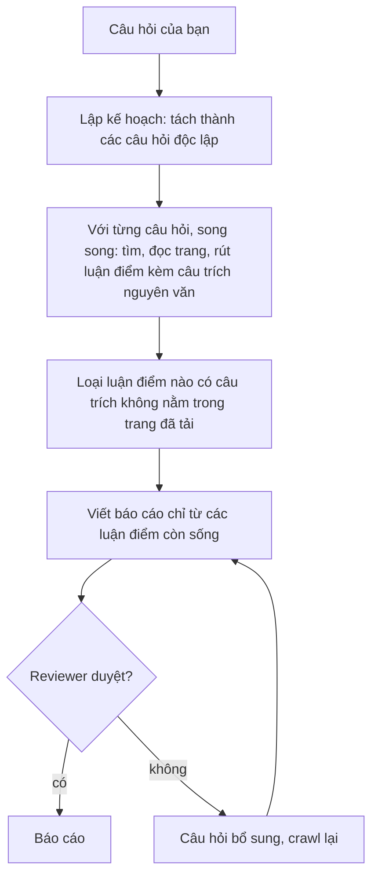

# Nghiên cứu sâu

Nghiên cứu sâu trả lời một câu hỏi bằng các nguồn bên ngoài còn mới, rồi trả về một báo cáo. Mỗi
khẳng định quan trọng trong báo cáo đều kèm một câu trích từ trang mà OpenAlpha **thật sự** đã tải
về. Nó chỉ đọc và chỉ tư vấn: gợi ý, trích nguồn, nêu chỗ còn thiếu. Nó không có đường nào để đặt lệnh
hay mô phỏng lệnh.

Nghiên cứu chỉ chạy ở tiền cảnh. Một lần nghiên cứu nằm gọn trong lượt chat đã khởi động nó: dùng
chung tín hiệu hủy và ngân sách của lượt chat, và mất khi lượt chat kết thúc. Không có việc chạy nền,
không có mã nghiên cứu để tra lại, không khôi phục được. Hủy lượt chat là hủy tất cả.

Cả thiết kế dựa trên một ý: **mô hình không bao giờ chạm tới mạng.** Mã thường tìm và tải tài liệu
trước; mô hình chỉ được xem đúng phần tài liệu mã đó thu về. Nhờ vậy một trích nguồn bịa ra là **không
thể** xảy ra, chứ không chỉ là khó xảy ra.

Cú pháp `/research` xem [Lệnh](lenh.md); mô hình nào chạy cho từng giai đoạn xem
[Cấu hình](cau-hinh.md). Cách nó chạy bên trong: [dev/nghien-cuu.md](dev/nghien-cuu.md).

## Khởi động một lần nghiên cứu

Agent `chat` tự gọi nghiên cứu khi một câu hỏi cần bằng chứng mới, từ bên ngoài, từ nhiều nguồn. Muốn
tự yêu cầu:

```text
/research <câu hỏi>
/research quick <câu hỏi>
/research standard <câu hỏi>
/research thorough <câu hỏi>
```

`/research` chạy qua agent `deep-researcher` có sẵn và không đổi `/agent` bạn đang gắn. Muốn trò chuyện
trực tiếp với agent đó, dùng `openalpha chat --agent deep-researcher`. Một câu hỏi dài tối đa 20.000 ký
tự.

| Hồ sơ | Số câu hỏi | Vòng soát | Duyệt kế hoạch |
| --- | --- | --- | --- |
| `quick` | 1, không có bước lập kế hoạch | 0 | không |
| `standard` (mặc định) | tới 7 | tối đa 1 | hiện kế hoạch, không sửa được |
| `thorough` | tới 7 | tới 2 với câu hỏi phức tạp, còn lại tối đa 1 | tương tác |

Chạy `thorough` ở tầng gốc **cần** một người duyệt kế hoạch tương tác. Không có người duyệt thì nó bị
hủy trước khi tốn đồng nào, thay vì chạy mức đắt nhất mà không ai soát.

### Một lần chạy thật

Một lần `quick` thật, đã rút gọn. Không tìm được số 8 tháng thì báo cáo nói chưa có và đưa số gần nhất, kèm cờ ⚠️ cho những nhận định chưa đủ nguồn:

```
Bạn:  /research quick Lợi nhuận 8 tháng 2026 của FPT là bao nhiêu,
      và các công ty chứng khoán dự báo cả năm thế nào?

2 lượt tìm kiếm · 3 trang đã đọc
2 nguồn được dùng · 4 nhận định có bằng chứng
⚠️ 2 vấn đề về bằng chứng
  • Chưa tìm thấy đủ nguồn ủng hộ cho một nhận định. ×2
✓ Hoàn tất nhưng còn thiếu sót · Mức độ bằng chứng: một phần

⏺ Chưa tìm thấy số liệu lợi nhuận 8 tháng 2026 của FPT, cũng chưa có dự báo cả năm
từ công ty chứng khoán nào. Số liệu gần nhất tìm được:
- 5 tháng: lợi nhuận sau thuế cổ đông công ty mẹ 4.199 tỷ đồng, +16% (Vietcap).
- 6 tháng: lợi nhuận trước thuế 5.714 tỷ đồng, +18,1% (Báo Đầu tư).
- Kế hoạch cả năm do FPT đặt (không phải dự báo): lợi nhuận trước thuế 11.629 tỷ đồng.

0,0111 USD · xong trong 34,4 giây
```

## Một lần nghiên cứu làm việc thế nào



- **Tìm và đọc chạy trước, bằng mã thường.** Mô hình chỉ rút luận điểm và câu trích nguyên văn từ các
  trang mã đó đã tải. Đoạn trích tìm kiếm và bản tóm tắt của nhà cung cấp chỉ để tìm trang, không bao
  giờ là bằng chứng.
- **Mã quyết định cái gì được tính.** Một luận điểm chỉ ở lại khi câu trích của nó xuất hiện đúng từng
  chữ trên một trang đã thật sự tải. Mô hình không tự đặt mã nguồn.
- **Báo cáo không có văn xuôi riêng.** Mỗi câu bạn đọc đều truy được về một luận điểm còn sống.
- **Reviewer chấm điểm.** Báo cáo yếu thì sinh câu hỏi bổ sung và chỉ crawl lại những câu đó, tới giới
  hạn số vòng của hồ sơ.

Mỗi câu hỏi được crawl tối đa hai lần; lần hai được báo lại điều gì đã trượt phép kiểm. Nếu mọi câu hỏi
trong kế hoạch đều hỏng theo kiểu thử lại được, phiên lùi về một lần tìm kiếm đúng nguyên câu hỏi của
bạn, ưu tiên nguồn chính thức. Kết quả dự phòng luôn là `completed_with_gaps`, mang mức bằng chứng
`limited` và bỏ qua vòng soát.

## Bằng chứng được nhận thế nào

Một **nguồn** là một trang, một **trích đoạn** là một câu trích nguyên văn từ trang đó, một **luận
điểm** là một phát biểu dẫn một hoặc nhiều trích đoạn. Luận điểm không còn trích đoạn nào sống sót thì
không vào được báo cáo.

Mỗi luận điểm thuộc một trong ba loại:

- `factual` và `numeric` có nguồn và **bắt buộc** dẫn trích đoạn. Luận điểm `numeric` còn mang giá trị,
  đơn vị và ngày đúng như viết trong câu trích.
- `inference` là lập luận của chính mô hình, được gắn nhãn như vậy để bạn phân biệt với phát biểu có
  nguồn.

Luận điểm có nguồn mà mang `forecast: true` là nói về một kỳ vọng, ước tính, giá mục tiêu hay kế hoạch
công ty đưa ra, chứ không phải điều đã xảy ra. Ước tính lợi nhuận 2027 của một công ty chứng khoán là sự
thật có nguồn về điều họ *kỳ vọng*, không phải lợi nhuận 2027, và báo cáo trình bày đúng như vậy. Hai
dự báo lệch nhau là hai quan điểm, không phải mâu thuẫn.

**Xung đột được báo lại, không được giải quyết.** Chọn giữa hai con số đều có nguồn là việc của bạn.
`numeric_mismatch` nghĩa là một con số không neo được vào câu trích của nó. `factual_contradiction`
nghĩa là hai luận điểm đã nhận cùng nói về một đại lượng (cùng đơn vị, phạm vi, ngày hiệu lực) mà giá trị
lệch nhau quá mức làm tròn. Đơn vị chỉ được so sánh, không bao giờ quy đổi.

Mỗi luận điểm cũng mang `independentSources`: số host xuất bản khác nhau đứng sau nó, bản đăng lại chỉ
tính một.

### Khoảng trống

Khi có gì bị loại hoặc còn thiếu, báo cáo nêu thành khoảng trống chứ không giấu:

| Khoảng trống | Nghĩa là |
| --- | --- |
| `low_recall` | Một câu hỏi tìm được dưới hai trang |
| `content_limit` | Một giới hạn cỡ hay số lượng đã cắt tài liệu (quá 42 lần tìm, quá 3 trang tự đọc, quá 8 trích đoạn trên một nguồn) |
| `missing_support` | Một luận điểm mất trích đoạn hậu thuẫn |
| `unsafe_content` | Một nguồn hay câu trích trượt phép quét tiêm prompt |
| `freshness_out_of_window` / `freshness_uncertain` | Ngày nằm ngoài cửa sổ bạn yêu cầu, hoặc thiếu hay độ tin cậy thấp |
| `truncation` | Một trích đoạn bị cắt cho vừa 4.000 ký tự |
| `artifact_limit` | Bằng chứng phải cắt cho vừa 128 KiB |
| `provider_unavailable` | Nhà cung cấp tìm kiếm hỏng và chưa cấu hình dự phòng |

Độ mới không bao giờ lặng lẽ loại một nguồn chỉ vì tín hiệu yếu. Ngày chỉ bị từ chối khi chính nó có độ
tin cậy cao; nếu không, nguồn vẫn ở lại và bị gắn cờ.

## Đọc báo cáo

Báo cáo có các mục theo thứ tự, mỗi mục là một danh sách luận điểm:

| Mục | Nội dung |
| --- | --- |
| `answer` | Câu trả lời trực tiếp. **Bắt buộc**: không có luận điểm trả lời là phiên hỏng. |
| `keyEvidence` | Các luận điểm hậu thuẫn mạnh nhất. |
| `risks` | Điều gì có thể làm câu trả lời sai. |
| `conflicts` | Các nguồn không đồng ý với nhau. |
| `practicalConsiderations` | Các lưu ý khi hành động theo nó. |

Mọi kết quả hoàn tất cũng mang một kết cục và một mức bằng chứng:

| Trường | Giá trị |
| --- | --- |
| `outcome` | `completed`, hoặc `completed_with_gaps` khi còn bất kỳ khoảng trống hay xung đột nào sống sót |
| `evidenceLevel` | `sufficient` khi hoàn tất và đã qua vòng soát; `mixed` khi đến từ đường có kế hoạch hoặc hoàn tất mà không có vòng soát (hồ sơ quick); `limited` khi đến từ đường dự phòng |

Reviewer chỉ duyệt khi mọi chiều điểm đạt từ 0,4 trở lên, điểm tổng hợp từ 0,7 trở lên, không luận
điểm nào thiếu hậu thuẫn và không còn vấn đề tồn đọng.

### Trên trang văn phòng

Gửi `/research <câu hỏi>` từ ô câu lệnh của [trang văn phòng](van-hanh.md#trang-văn-phòng) thì khung chat liệt kê các bước của lần chạy ngay khi chúng diễn ra. Nút Dừng hỏi lại trước, nhắc rằng phần AI đã dùng vẫn tính vào hạn mức hôm nay, và dừng luôn các agent con của nó. Câu trả lời cuối cùng chính là báo cáo: mỗi số chú thích nhảy tới nguồn được đánh số ngay dưới câu trả lời đó, và hai câu trả lời nghiên cứu trong cùng một cuộc trò chuyện giữ số của riêng mình. Khi lần chạy đã có trong danh sách, "Mở dạng báo cáo" mở đúng câu trả lời của lần chạy đó trong trình đọc, dù sau đó trong chat có nói gì thêm, và thẻ Đề xuất giữ nó cùng các kết quả nghiên cứu khác. Lần chạy bị dừng hoặc thất bại thì hiện câu của dịch vụ nền (daemon) ở chỗ các bước.

## Khi nghiên cứu thất bại

Một lần chạy hỏng với `insufficient_evidence` khi không trích đoạn nào được nhận, khi không gì sống sót
qua các phép kiểm, khi không gì rơi vào mục `answer`, hoặc khi câu trả lời không vừa trong 128 KiB. Đây là
một lần **cố ý từ chối trả lời**, không phải câu trả lời kém chất lượng.

Các lỗi khác cho biết khâu nào đã hỏng:

| Mã | Ý nghĩa |
| --- | --- |
| `aborted` | Bạn đã hủy |
| `budget_exhausted` | Ngân sách chi phí của lần chạy đã cạn |
| `capacity_exhausted` | Không còn suất gọi ủy quyền nào cho phần việc cần làm |
| `planner_failed` | Không có kế hoạch nghiên cứu dùng được |
| `crawler_failed` | Khâu thu bằng chứng hỏng |
| `source_unavailable` | Các crawler đã chạy nhưng không sinh ra luận điểm nào |
| `provider_unavailable` | Không nhà cung cấp tìm kiếm nào trả về bằng chứng dùng được |
| `llm_provider_failed` | Lời gọi mô hình hỏng |
| `synthesizer_failed` | Đã thu được bằng chứng, nhưng không viết nổi báo cáo |
| `reviewer_incomplete` | Khâu soát không hoàn tất |
| `invalid_output` | Một worker trả về đầu ra không qua được kiểm tra |
| `invalid_tool_arguments` | Một worker liên tục gọi công cụ web sai cách |
| `model_incompatible` | Mô hình đã chọn không dùng được các công cụ web cần thiết |
| `timeout`, `turn_limit`, `loop_detected` | Chạm giới hạn thời lượng, số lượt, hoặc lặp lại |
| `unexpected` | Một lỗi nội bộ |

Nghiên cứu giữ chỗ trước các lời gọi ủy quyền. Độ sâu bạn chọn cần nhiều lời gọi hơn lượt chat còn có
thể cấp thì nó hỏng ngay với `capacity_exhausted`, không bắt đầu việc không thể làm xong. Nó cũng giữ
chỗ 85% ngân sách còn lại của lượt chat, phần còn lại để lượt cha đọc kết quả. Việc tùy chọn (thêm câu
hỏi, vòng soát, thử lại, câu hỏi bổ sung) dùng phần còn lại ngoài khoản đó; lời gọi nào không đủ suất thì
nghiên cứu bỏ qua và ghi chú chỗ thiếu, không hỏng sau khi đã tốn công.

## Giới hạn

Các giới hạn dưới đây cố định; không có mục `[research]` trong cấu hình.

| Giới hạn | Giá trị |
| --- | --- |
| Số câu hỏi | 7 |
| Từ khóa tìm kiếm mỗi câu hỏi | 3 |
| Truy vấn tìm kiếm mỗi lần chạy | 42 |
| Số vòng soát | 2 |
| Điểm duyệt (điểm tổng hợp) | 0,7 |
| Cỡ mỗi trích đoạn | 4.000 ký tự, cắt ở ranh giới câu |
| Trích đoạn mỗi nguồn | 8 |
| Bằng chứng mỗi báo cáo | 128 KiB |
| Trang mỗi câu hỏi tự đọc | 3 (khi nhà cung cấp tìm kiếm không trả văn bản trang; mọi nhà cung cấp trừ Exa) |
| Văn bản trang giữ cho mỗi nguồn | 64 KiB |

Hồ sơ có thể thu hẹp một giới hạn nhưng không bao giờ nâng nó lên.

Nhà cung cấp tìm kiếm cấu hình dưới `[web_search]`. Nghiên cứu dùng hai vai rõ ràng - nhà cung cấp mặc
định và một nhà cung cấp dự phòng riêng (tùy chọn) - và không bao giờ ngầm rơi về DuckDuckGo không cần
khóa như công cụ `web_search` chung. Chưa cấu hình dự phòng thì nhà cung cấp mặc định hỏng sẽ hiện
thành khoảng trống `provider_unavailable`. Nếu `api_key_env` của nhà cung cấp mặc định trỏ tới một biến
rỗng thì `/research` từ chối ngay và nêu biến cần đặt.

Phí của nhà cung cấp trả tiền được trừ vào ngân sách giai đoạn crawl. Exa tự báo chi phí; Brave, DeepSeek, Serper
và Tavily tính tiền theo truy vấn nhưng không báo lại, nên hãy đặt `[web_search] cost_per_search_usd`
theo đơn giá gói của bạn, nếu không khoản chi đó sẽ không hiện ra.

## An toàn

Khâu tải trang có nhiều lớp bảo vệ:

- chỉ HTTPS (kết quả dạng http được nâng lên địa chỉ https, và thành khoảng trống nếu máy chủ không có
  https), từ chối thông tin đăng nhập nhúng trong URL;
- chặn địa chỉ loopback, link-local và metadata của nhà cung cấp cloud; DNS phân giải đúng một lần và
  kết nối được ghim vào địa chỉ đó để chặn tấn công rebinding;
- tối đa năm lần chuyển hướng, kiểm lại địa chỉ ở từng chặng, và cắt các header nhạy cảm khi chuyển
  sang host khác;
- phản hồi không phải văn bản bị từ chối, và các yêu cầu đi ra được quét tìm giá trị giống thông tin
  đăng nhập.

**OpenAlpha không đọc và không tuân theo `robots.txt`.** Trang nào bạn không muốn tải thì phải loại bằng
cách khác.

Một số trần cứng áp cho mỗi lần chạy, dù cấu hình thế nào: 8 nguồn thu được mỗi câu hỏi, 8 luận điểm mỗi
câu hỏi, 3 nguồn mỗi luận điểm, 8 mục trong mỗi mục báo cáo, 12 khoảng trống, 6 vấn đề soát, 64 lần
truy hồi. Một lần đọc trang dừng ở 1 MiB trước khi rút trích (trang dài hơn bị cắt, không bị từ chối),
đoạn trích tìm kiếm 400 ký tự, thông báo lỗi 500 ký tự.

## Xem thêm

- [Ngân sách](ngan-sach.md) - trần chi phí và cách một cây phiên chạy chia một ngân sách
- [An toàn](an-toan.md) - cơ chế quét tiêm prompt
